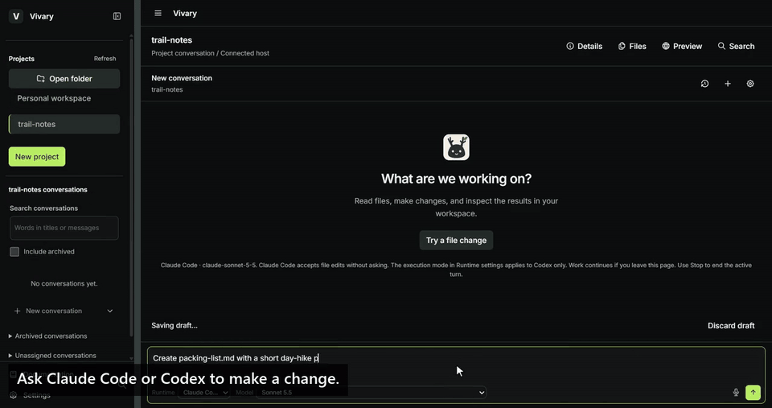
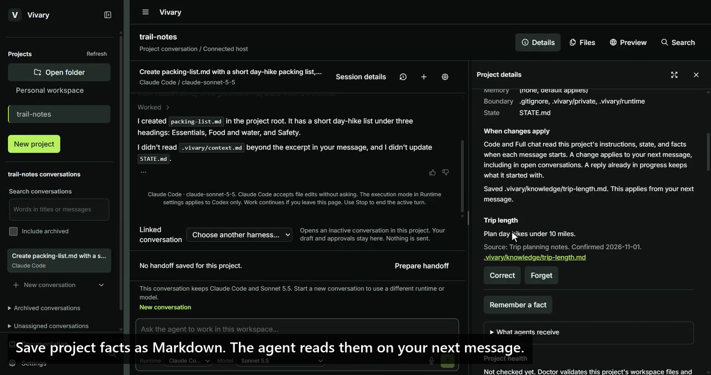
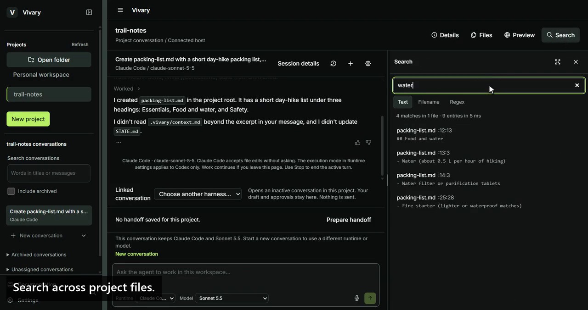
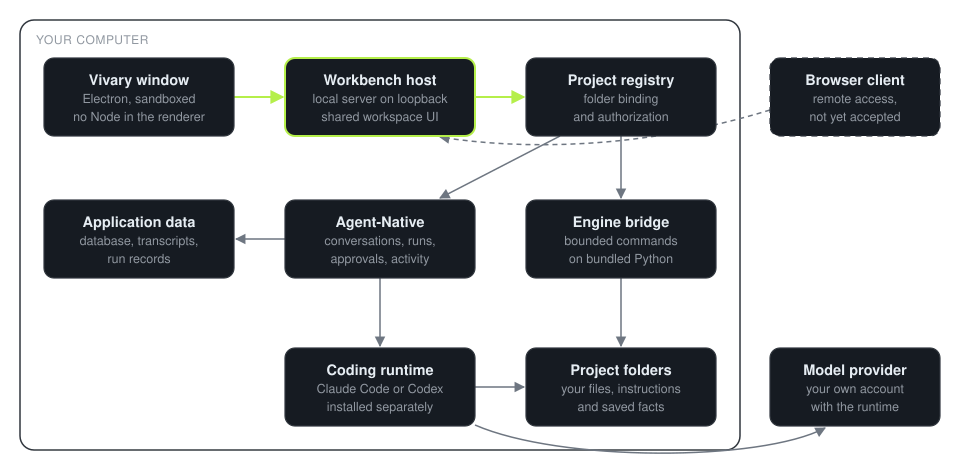

<p align="center">
  
</p>

<h1 align="center">Vivary</h1>

<p align="center">
  A desktop workspace for AI agents on your own projects.
</p>

<p align="center">
  <a href="https://github.com/vivary-dev/vivary/releases/tag/v0.1.0-beta.1"></a>
  <a href="https://github.com/vivary-dev/vivary/actions/workflows/ci.yml?query=branch%3Adev"></a>
  <a href="LICENSE"></a>
</p>

<p align="center">
  <a href="https://github.com/vivary-dev/vivary/releases/tag/v0.1.0-beta.1"><strong>Download for Windows</strong></a> &nbsp;·&nbsp;
  <a href="https://www.vivaryagent.xyz/">Website and full demo</a> &nbsp;·&nbsp;
  <a href="docs/desktop-preview.md">Installation guide</a>
</p>

<p align="center">
  
</p>

<p align="center"><sub>Published build 0.1.0-beta.1, recorded 2026-11-01 with a disposable profile. Cut for length. The <a href="https://www.vivaryagent.xyz/">56-second version</a> is on the website.</sub></p>

Vivary puts agent chat, project files, project memory and search in one window.
It runs on your computer and needs no Vivary account. Your agents, credentials,
files and history stay on that computer. The model provider you use receives
what your agent reads and writes.

## Download

| Platform | Download | Requires |
| --- | --- | --- |
| Windows, 64-bit. Tested on Windows 11. | [Vivary 0.1.0-beta.1](https://github.com/vivary-dev/vivary/releases/tag/v0.1.0-beta.1) | No administrator rights |

Beta, published 2026-10-31. The installer is `Vivary-Setup-0.1.0-beta.1.exe`. A
portable ZIP is on the same page. Both are unsigned, so Windows shows
**Windows protected your PC**. Select **More info**, then **Run anyway**.

Verify the download first. Download the installer and its `.sha256` file. Then,
in PowerShell, in the download folder:

```powershell
$file = '.\Vivary-Setup-0.1.0-beta.1.exe'
$expected = (Get-Content "$file.sha256").Split(' ')[0].Trim()
if ((Get-FileHash $file -Algorithm SHA256).Hash -ne $expected) { throw 'Checksum mismatch. Do not run this file.' }
```

<!-- tested: 2026-11-06, PowerShell 5.1 on Windows 11, against the release files -->

No output means the checksum matches. The command comes from the
[installation guide](docs/desktop-preview.md), which also covers the portable
ZIP, upgrades and removal.

There is no macOS or Linux build.

## What you can do

Each line is in the 0.1.0-beta.1 [release notes](https://github.com/vivary-dev/vivary/releases/tag/v0.1.0-beta.1).

- Open an existing folder as a project, or create a new project.
- Chat with Claude Code or Codex in a project. The agent can read files, change files and run tools.
- Save project facts as readable files in the project, and search project files.
- Check project health with the bundled Python.
- Set up automations that run on a schedule, on an event or from a webhook while Vivary is open.

<table>
  <tr>
    <td width="50%"></td>
    <td width="50%"></td>
  </tr>
  <tr>
    <td>A saved fact is a Markdown file in the project, with its source.</td>
    <td>Project search reports each match with its line and column.</td>
  </tr>
</table>

## Requirements

- For coding conversations: Claude Code or Codex, installed and signed in on the same computer.
- For automations: your own provider key. Automations run from a Native chat.
- Vivary includes no model access and no credentials. Provider accounts are separate.

The download bundles Node, Python and Electron. You do not need to install them.

## Release status

Beta. The first Windows beta is public. Full desktop acceptance is still open.

On 2026-10-31 the installed app passed the checks in the left column, in a
separate application profile. That pass ran on a build of `dev` commit `32c2a26`.
The release came from a later documentation-only commit. The right column is not yet accepted on the installed
app. The [acceptance register](docs/product/multi-project/desktop-acceptance-status.md)
lists each check.

| Passed on the installed app | Not yet accepted |
| --- | --- |
| Silent install and first launch | A coding-runtime turn |
| Settings, project creation and project health | Provider-backed automations |
| A saved fact and project search | Remote access from another device |
| Second-instance handoff, close and relaunch | An upgrade over an earlier install |
| Uninstall with user data kept | Code signing |

The pass also did not cover native dialogs or a File Explorer launch.

The recording at the top shows one Claude Code turn on the published portable
ZIP. That is a demo. It is not an acceptance pass.

Known limits of this build:

- It runs one coding conversation at a time on a computer.
- Rollback after an upgrade is not supported. Back up `%USERPROFILE%\.vivary\workbench` and `%APPDATA%\Vivary` before you upgrade.

Settings has a Remote access option. It opens Vivary on another device over a protected HTTPS connection that you set up, such as Tailscale. It is not yet accepted on the installed app, and phone use is still open.

## Your data

- Vivary opens without a Vivary account and without a sign-up.
- Application data is in `%USERPROFILE%\.vivary\workbench` and `%APPDATA%\Vivary`.
- Project memory is saved as files inside the project folder.
- Claude Code and Codex keep their own sessions and credentials.

Report a security problem through [SECURITY.md](SECURITY.md).

## How it works

<picture>
  <source media="(prefers-color-scheme: dark)" srcset="assets/vivary-architecture-dark.svg">
  <source media="(prefers-color-scheme: light)" srcset="assets/vivary-architecture-light.svg">
  
</picture>

Simplified from the [system architecture diagram](docs/product/multi-project/diagrams/01-system-architecture.jpg). It leaves out the direct path from Native chat to the model provider.

- **The window has little access.** The renderer has no Node access, uses Electron's sandbox, and can navigate only to its own loopback server ([desktop package](packages/desktop/README.md)).
- **The host owns the work.** Workbench is a local server on a numeric loopback address. Agent-Native owns conversations, runs and actions.
- **The runtime stays yours.** Vivary drives the Claude Code or Codex that you installed. The download includes no model access or credentials.
- **A release proves its contents.** Each download has a `.sha256` file. `BUILD-INFO.json` names the source commit, and a licenses ZIP holds the notices of each bundled component.

The 2026-10-31 pass recorded these results on the installed app: the silent
install exited 0 in 31 seconds, and 3,163 application files matched the portable
ZIP byte for byte. Closing the window ended each app process and freed the port.
<!-- source: docs/product/multi-project/desktop-acceptance-status.md, section "Installed Windows beta, October 31" -->

## Build from source

Most people need only the download. To run the app from source, start with the
Workbench package:

```console
pnpm --dir packages/workbench install --frozen-lockfile
pnpm --dir packages/workbench build
pnpm --dir packages/workbench start
```

Untested on a clean machine. Read
[Workbench setup](packages/workbench/README.md#run-from-source) for the sign-in
step and [Desktop setup](packages/desktop/README.md#development) for the
Electron shell and its Node version rule.

| Path | What it holds |
| --- | --- |
| `packages/workbench/` | The local server and the workspace interface |
| `packages/desktop/` | The Electron shell and the Windows packaging |
| `docs/` | Product design, the acceptance register and guides |
| `site/` | The original project website source |

The other packages hold the original Vivary command-line tools. See the
[original CLI reference](docs/ORIGINAL-CLI.md). Those published packages are not
a release of the desktop app.

## Contributing

GitHub issues hold task scope and status. The
[release milestone](https://github.com/vivary-dev/vivary/milestone/1) holds the
remaining work for the desktop release. Start a topic branch from `dev` and open
the pull request into `dev`. See [CONTRIBUTING.md](CONTRIBUTING.md) and the
[engineering policy](ENGINEERING.md).

## License

MIT. See [LICENSE](LICENSE).
