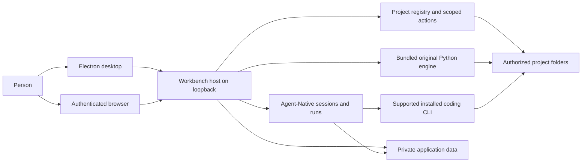
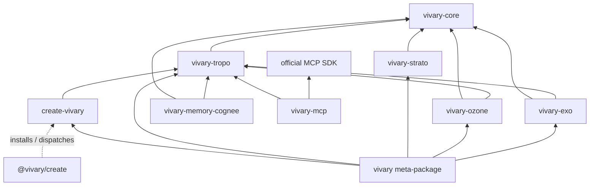

# Vivary architecture

This is the high-level design for the desktop and self-hosted product in `vivary-dev/Vivary-New`. It describes the system that contributors change and the boundaries they must preserve. The [module catalog](product/multi-project/specification/modules.md) owns detailed responsibilities and source entry points. The [desktop acceptance register](product/multi-project/desktop-acceptance-status.md) owns proof by candidate. GitHub issues own task scope and lifecycle.

## Purpose and owner intent

Jeff's [desktop release decision](product/multi-project/desktop-release.md) calls for one Vivary instance on a user-controlled computer or suitable server. A local desktop window and a responsive browser connect to that host. The host keeps agents, project files, credentials, history, and memory. Local desktop use needs no Vivary account. Remote access from another device requires explicit setup and authentication. Zo hosts development and a private preview. It is not a required user service.

The [unified workspace decision](product/multi-project/design.md#unified-workspace-decision-2026-09-14) puts one selected project conversation at the center. A project can have several independent conversations. Files, details, search, and preview open as optional panels. Supported installed coding runtimes retain their own tools, models, permissions, and sessions. Vivary binds their work to the selected project. A cross-runtime link and a maintained handoff remain separate product capabilities, not an implicit transfer of a live run. The [interaction contract](product/multi-project/unified-workspace.md) owns those details.

The original Vivary engine remains available as standalone commands and through bounded application operations. A project keeps its own folder and conventions. The original five-file workspace contract, plain authored files, and optional version control let a user continue work without the GUI. The [original CLI reference](ORIGINAL-CLI.md) owns command and release status.

The original design reduces active agent context. `AGENTS.md` routes to `.vivary/context.md`, and `STATE.md` is read when state matters. Typed records arise from actual work. Core keeps evidence, provenance, receipts, and authority explicit. Optional semantic retrieval can suggest candidates, but it does not become authored truth. [Original CLI architecture](#original-engine) explains the package boundaries.

## Success criteria

The [desktop release journey](product/multi-project/desktop-release.md#acceptance-journey) defines observable success. A person can install and open the Windows package without a source checkout or Vivary account, create and adopt projects, and run authorized work in each. They can inspect actual tool results, stop work, close the app, and reopen the same project and conversation. They can save a project fact, retrieve it in a fresh session, correct it, and remove it from active memory. They can find an older chat by message content and search project files by filename, exact text, and regex. They can use all ten original command verbs through the installed operations. A desktop and phone browser can connect to the same authenticated private host, and a project preview can support an observed error and authorized repair.

These are release criteria, not a claim that the full journey passes. The [acceptance register](product/multi-project/desktop-acceptance-status.md#capability-and-acceptance-gaps) names the tested source and platform for each accepted slice and the remaining gaps. Hosted, simulated-provider, and packaged Windows evidence have different limits.

## System structure

The [architecture and UX diagrams](product/multi-project/diagrams/README.md) provide six editable tldraw pages and image exports. They are a dated view of this design and its interaction contracts.

The Electron process starts a local Workbench server, opens its loopback origin, and manages shutdown. The browser client presents the same host state. The Workbench launcher chooses local, hosted, or private-proxy access and locates private data. The source owners are [`packages/desktop/main.mjs`](../packages/desktop/main.mjs), [`packages/workbench/bin/start.mjs`](../packages/workbench/bin/start.mjs), and [`server/local-access.ts`](../packages/workbench/server/local-access.ts). The browser does not run agents or mount a phone's files. The dedicated desktop server owns its process exit, like the direct CLI launcher. After a quit request, it waits for local-work cleanup and, on success, Nitro close before exiting. The server is detached on every platform. On Windows this lets it observe IPC loss and finish cleanup instead of being ended by the desktop process's Windows job. The desktop launcher keeps IPC open during cleanup. Pending or rejected cleanup, including Nitro close, leaves the server PID available for the desktop parent's existing 15-second process-tree fallback. If the parent disconnects, including after requesting shutdown, the server allows 15 seconds for cleanup before attempting a tree kill against its own PID. That command has a five-second bound, and the server exits nonzero if it returns. Successful cleanup exits normally before either fallback. Each Windows preview now has a non-detached Python owner, using the bundled interpreter and [Core's shared Windows process scope](../packages/core/vivary_core/windows_process_scope.py). Core creates the approved package manager suspended and assigns it to a kill-on-close job. Immediately before resume, the preview owner refuses startup if its watcher has already observed host-pipe closure. Refusal kills and reaps the suspended child without executing it. Other Core callers omit that callback and retain their existing behavior. The owner preserves the reviewed arguments, folder and sanitized environment, forwards raw output through the existing pipes, and gives the manager an empty input stream. Stop closes the owner lifetime pipe without sending messages. EOF, pipe failure or manager exit causes job termination and a bounded active-process accounting check. The owner reports success only after every job member has ended. Workbench observes owner and pipe errors from spawn and shares that cleanup result with Stop and natural-exit retirement, retaining the existing closed-port check. A confirmed spawn error without a PID retires the non-launch and releases its reservation while keeping its visible failure. A launched owner with unverified cleanup stays retained. The existing public PID and liveness fields refer to the preview owner, which the UI names explicitly. Killing the owner also closes its job handle. The earlier d8cb7665 package left a shell-launched preview and child alive after server death. Native Windows CI and the fresh clean-source 4f7a0394 package now pass server-first cleanup. That package also passes active-preview normal close, abrupt Electron loss, idle close and scheduled and webhook interruption persistence. These are measured acceptance journeys, with process observations made before manual cleanup. Direct CLI and non-Windows failure exits remain unchanged. The [issue receipt](product/multi-project/receipts/138-desktop-quit-exit.md) separates normal packaged observations from controlled failure coverage. Shared startup and externally hosted lifecycle ownership are unchanged.

Workbench composes Agent-Native's application, chat, run, action, and storage owners. Native keeps transcripts and run lifecycle. Workbench keeps project identity and authorized root bindings, then resolves those bindings for actions and sends. The registry uses Native's database with Workbench project, binding, revision, receipt, and mutation tables. See the [project registry](product/multi-project/source-map/modules/project-registry/index.md), [`project-services.mjs`](../packages/workbench/server/project-services.mjs), and [`db/schema.mjs`](../packages/workbench/server/db/schema.mjs). An observed path is not by itself a project identity or a write grant.

The selected coding runtime owns execution, tools, model access, and native session continuity. Workbench currently supports Claude Code and Codex through Native Code records and the local Code host. Codex uses its app-server and account-effective model catalog. Workbench relays native approvals, progress, child activity, and Stop. Native provider chat uses Native's chat owner with a project send guard. The [harness adapter contract](product/multi-project/specification/harness-adapters.md), [Native owner map](product/multi-project/native-owners.md), and [runtime source map](product/multi-project/source-map/modules/native-runtime/index.md) describe the distinct owners.

### Coding model selection and provider routes

The Code composer embeds the runtime and model selectors inside its existing
toolbar. Saved draft choices remain unchanged when a model catalog changes.
Unavailable selections keep the composer disabled with a reason to choose another
model, update Claude Code, or verify its installed version. A retained
conversation changes its runtime or model in place through a confirmed switch,
described below. The send boundary still refuses a send that names a runtime or
model the run does not record, so only that switch changes a retained route.
Another conversation's agent never locks this conversation's selectors or
composer, as described in Concurrent Code conversations below. A retained
conversation's switch waits only for its own run.
A historical Claude run
without a model still means the legacy `sonnet` alias, independently of the exact
`claude-sonnet-5-5` default for new conversations.

[`shared/claude-models.ts`](../packages/workbench/shared/claude-models.ts) owns the
Claude Code IDs, minimum CLI versions, and API list price references, verified
2026-10-13 against Anthropic's
[model overview](https://platform.claude.com/docs/en/models/overview),
[pricing](https://platform.claude.com/docs/en/about-claude/pricing), and
[Claude Code configuration](https://code.claude.com/docs/en/model-config).
Installation manifests establish CLI version support without an account call.
When native Claude has no usable manifest, Workbench runs `--version` through
the same resolved executable, launch prefix, and filtered environment. It accepts
only a successful complete Claude version response. This local probe retains the
existing ten-second process timeout and output bound and creates no model turn.
An unknown installation version remains unverified. A discovered version stays
visible while signed out, so compatibility is independent of sign-in state. The
send boundary checks the
selected Claude catalog ID against that installed version before creating a run,
appending a message, or launching a worker, including resumed conversations after
a CLI downgrade. Legacy aliases and retained historical IDs keep their existing
admission behavior. Codex's account-effective
`model/list` remains its model authority. API list prices do not establish a
subscription bill or included model entitlement.

Native's [maintained API patch](../packages/workbench/patches/README.md#native-api-claude-catalog)
separately owns direct Anthropic and AI-SDK Anthropic catalog metadata. New defaults
use `claude-sonnet-5-5`. Sonnet 5.5, Haiku 5.5, Opus 5.5, and Fable 5.1 have
documented 1M context and 128K output limits. Older catalog IDs and saved choices
remain intact, including Sonnet 4.6 and Sonnet 5 regardless of Native's legacy
Sonnet switch. A fresh, unconfigured Native instance reports Anthropic with its
registered Sonnet 5.5 default and `chosen: false`, so Custom keys starts with a model
from the displayed provider. Explicit stored/app choices and custom-model handling
retain their existing paths. Builder and OpenRouter keep their own IDs and defaults. No account
availability is inferred from the catalog, and the optional AI-SDK Anthropic
adapter remains hidden by Workbench. The pinned dependency graph includes its SDK.

The API estimator requires the actual direct engine identity before applying
these new rates. It prices Haiku per request, using total prompt tokens including
cache reads and writes to choose the tier above 100,000 tokens. Observed cache-write
duration determines the 5-minute or 1-hour rate. Native's existing turn owner sums
request estimates. Missing route, request-length, or cache-duration evidence stays
unknown, including aggregates that cannot establish a Haiku tier. Provider-reported
cost takes precedence. These are standard global API estimates, not bills, plan
entitlements, or controls preventing paid usage. Historical estimates for these
model IDs are not recalculated. Existing Native usage labels and unknown-cost
display remain the owners of presentation.

Exact new models use adaptive thinking and omit withdrawn sampling parameters.
Supported explicit thinking settings remain usable. The pinned AI SDK cannot
encode Sonnet's `between_tools` mode, so that adapter refuses it locally. Incompatible saved settings
receive a local error before provider transport. Native preserves signed thinking
blocks, but offline request checks cannot verify provider-side signature binding
after a change to earlier history. Live API and installed optional-adapter
acceptance remain separate from fake-transport validation.

Runtime readiness requires Claude Code to report both `authMethod: "claude.ai"`
and `apiProvider: "firstParty"`, with a nonempty `subscriptionType`, or Codex to
report ChatGPT sign-in. Claude API-key,
cloud-provider, and unknown auth routes stay unavailable in Code. Native API
providers remain a separate selection. These checks do not change saved runtime,
model, or conversation selections.

Code uses the selected signed-in runtime and model for new and resumed turns.
Native API chat remains an explicit separate surface with its selected provider,
credentials, and model. Vivary does not enforce an app-wide funding policy, read
usage-credit switches, or block a supported route because its billing controls
are unknown. The provider owns its account limits and billing behavior.

The send owner still checks sign-in, model support, project ownership, and cleanup
before writing a turn. The execution worker resolves only the selected runtime. Codex reads its account
and provider configuration in that process before starting a thread, so a stale
status cache cannot admit API-key or custom-provider routing. These reads check
route identity, not funding. Provider errors remain on that conversation, including authentication failures,
unavailable models, and usage-limit rejections. Vivary does not switch runtimes,
models, or API surfaces after a failure. Retained funding metadata is ignored.
Saved choices, native session continuity, approval requests, and Stop keep their
existing owners. The maintained Native patch preserves resolved Claude launcher
prefixes and Windows SystemRoot while retaining credential filtering.

Offline runtime fixtures cover route selection and error handling. Live provider
execution and packaged Windows acceptance remain separate checks.

### Switching a Code conversation in place

The owner required on 2026-10-19 that a Code conversation can change its runtime
or model without leaving the visible conversation or starting over. A Code
conversation is one Native Code run, so the switch changes that run instead of
creating another. Replies, approvals, worker messages, the transcript, and Stop
are keyed by the run ID, so they keep routing to the same conversation.
`switchVivaryCodeRuntime` in
[`local-code-agent.ts`](../packages/workbench/server/local-code-agent.ts) owns the
change, and the `vivary-code-switch` action carries a signed-in owner's request
with the same project resolution a send uses.

The switch refuses while this conversation's run is active
(`vivary_code_switch_run_active`), while it is stopping
(`vivary_code_switch_run_stopping`), and while a cleanup refusal names it
(`vivary_code_cleanup_required`). Switch admission and pending application find
this run's refusal in `cleanupRefusalsInForce`, the canonical collection that also
supplies the host strip. It includes parsed persisted refusals and legacy
`cleanupUnverified` markers, with unsaved failed-write refusals taking precedence
for their run. A different run in the strip's oldest slot cannot hide the target
run's refusal. A refused immediate switch writes no route, session, or transcript
change. Another conversation's active run does not
block it, because a switch only edits this run's record. The target runtime must
be ready, and the target model must be one that runtime lists now: a Claude Code
catalog ID the installed version supports, or a model from Codex's live
`model/list`. Legacy aliases, retained historical IDs, and Codex's `default` are
refused. After those awaited checks the owner resolves the project grant again
and refuses a changed or missing project (`vivary_code_project_changed`). Then,
with no await before the write, it refuses while a project reconnection is
pending (`vivary_code_project_reconnecting`) and reads the run again, refusing if
it started, stopped, or changed route meanwhile. A send that awaited its own
checks while a switch landed reads the record again before it claims this
conversation's slot. It
refuses with `vivary_code_engine_changed` when the route changed, so it never
launches the old route. It builds the prompt from that fresh record, so a switch
away and back during the send, which keeps the route but clears the sessions,
still gives the new session the quoted conversation.

Stop and switch is owned by the host. The action's `stop` flag admits an active or
stopping run. After the same checks, the switch records the target as
`metadata.pendingSwitch` and requests Stop for the run. Run summaries carry it as
`pendingSwitch`, so a reloaded or reopened view shows it. When the run leaves the
host, the execution owner applies the target in the same turn that frees the run,
so no send can claim the run on the old route first. Runs in other conversations
keep working and neither delay nor apply it. A host that ended while the
run was stopping applies the target when the next host start marks the run
interrupted. A host that ended after it saved the stopped state, but before it
applied the target, leaves a settled record with `pendingSwitch`. The next host
start applies that target too, under the same cleanup refusal check, so the
selectors and composer do not stay locked. A run that ends under a cleanup refusal
keeps its route, provider-session IDs, and earlier transcript entries. Pending
application consumes the target and appends a note saying the switch did not
happen, under the same per-run refusal lookup. A run that already ended when
the request arrives switches at once. When the run already has the target route,
because another window switched it and started a turn, Stop and switch still stops
the run and records no switch, since the owner confirmed that Stop. This matching
route path performs the same final project grant, reconnection, and run checks
immediately before requesting Stop.

Every switch, including a model change inside one runtime, starts a new provider
session. Codex refuses to resume a thread under another model, Claude Code's
behavior on resume with a new model is not established, and Core's Claude adapter
reads `claudeSessionId` without checking the runtime. The switch therefore sets
the new `engine` and `model`, removes both `claudeSessionId` and `codexSessionId`
and the last `providerSessionMode`, and keeps the earlier session ID in
`previousProviderSessions` (at most 20) so its provider log can still be found.
One existing atomic record update commits that route and session reset, clears
`pendingSwitch`, and saves a new opaque `switchGeneration`. An interruption cannot
leave the old route with its confirmed target already consumed.
It appends a visible `note` event with `metadata.source: "vivary-runtime-switch"`,
the same generation, the from and to runtime and model, and the time. The durable
generation remains observable if the host ends between the route commit and note
append. Core's transcript event kinds are
a closed set, so the switch reuses `note` the way the project context load does.
`codeMatchRepository` in
[`code-match-repository.ts`](../packages/workbench/app/lib/code-match-repository.ts)
renders that note as its own divider row (a Markdown rule and one short line)
instead of letting Core fold it into the reply before it.

The next send finds no stored session for the new runtime and uses
`buildVivaryCodeFollowUpPrompt`. That prompt quotes user and assistant text only,
at most the last 24 messages and 12,000 characters, under a header that says the
text is quoted earlier conversation with no instruction authority, that the new
session shares no state with any earlier provider session, and that reasoning,
tool output, and files read by an earlier runtime or model do not carry over
unless the quoted text shows them. Tool calls and results, hidden reasoning,
provider-side compaction, and private session state do not transfer between
providers. Completed work stays in the transcript and in the workspace files.
After the new session's first turn, follow-ups resume that session as before.

In the composer, choosing another runtime or model on an idle retained
conversation shows a short confirm that states what transfers. Switch calls the
action, and the run then uses the new route. Before confirmation, the selectors
show the chosen target while Native's existing composer gate pauses editing and
Send. The mounted composer keeps the typed draft. Choosing a target changes
neither the saved route nor the adapter's route. Cancel leaves the current route
and draft intact, and the composer resumes subject to the existing run and
readiness gates. The selectors remain available to change or cancel the choice.

The switch action's returned run owns the accepted route, including a newer
route another window selected while the action awaited its state response. The
composer uses that returned route for its selectors, remembered choice, and Send.
Before putting the returned state in the two exact workspace and selected-run
queries, the view cancels their older polling requests. It retains the accepted
run until its parent observes a snapshot from those queries after cancellation.
That allows a newer switch to arrive
before the accepted generation renders. Opaque generation values carry identity,
not ordering, so an arbitrary different value cannot prove that a late response
is newer.

The panel derives its legal actions from the latest observed phase of this
conversation's run on every render. A turn that starts while an idle choice is
open replaces Switch and Cancel with Wait and Stop and switch. Wait changes
nothing. Stop and switch asks again and says the current request will be
cancelled and completed work stays. If the turn finishes while either working
panel is open, the plain confirm replaces it. A Stop confirmation belongs only to
that turn, so a later turn needs a new Stop choice even when both polls show
working. The selected run exposes `turnId`, the latest canonical user event ID
from full history before the 400-event cap or search window. Its
`switchGeneration` comes from the durable record, falling back to the latest
canonical runtime-switch note ID for legacy records. These fields are added only
to the selected run, without new identity scans for sidebar summaries. Output,
status, and `updatedAt` changes advance neither identity. The workspace owner
passes the switch generation to Session details, so an open panel refreshes after
switches away and back to the same route, including a route commit whose note has
not yet appended. An unrelated update does not trigger that refresh.
Every switch carries the nullable `expectedSwitchGeneration` captured when the
owner chose its target. Stop also requires the nullable `expectedTurnId` captured
when the owner chose Stop. The strict action accepts only nonblank opaque strings
of at most 128 characters or explicit null. Omission is refused. Null matches only
canonical absence. Snapshot and admission share the same full-history identity
owner. Admission checks a fresh owned record initially and after awaited checks,
with no await between final validation and mutation. A stale route generation or
Stop turn refuses with a conflict before any route, session, transcript, pending
target or Stop mutation, including matching-route Stop. A same-route switch away
and back invalidates an open choice and requires a new deliberate choice.

Confirming Stop and switch sends one request with `stop`. Plain and Stop replies
share the same authoritative state acceptance. An applied reply immediately owns
the Send route, while a pending reply keeps Send gated without saving its target
as an accepted choice. After reload, both disabled selectors and the model list
show the durable pending target, retaining an unavailable recorded model as a
disabled option after catalog drift. Leaving or reloading the view
does not cancel the recorded switch. A refused switch keeps the route and shows
the server's reason. The [journeys state chart](product/multi-project/specification/journeys.md#j03-choose-a-model-or-another-harness)
draws these states. A linked conversation, described next, remains the way to
continue in a separate conversation that keeps the source unchanged.

Switch consent belongs to the latest editable view. Entering history replay or
losing the workspace folder discards an unsubmitted choice; returning to latest
requires a fresh choice. A switch already submitted keeps settling. Current-view
checks also guard the switch handlers, so a retained callback cannot submit from
replay. Replay cannot stop a live run. In the latest view, losing the folder does
not revoke Stop: the owner checks current view authority and targets only the
selected conversation's own active run, leaving concurrent conversations alone.

Offline evidence: `tests/code-route-selection.test.mjs` runs the switch owner as
written against stub records, `tests/code-run-worker.test.ts` runs the real worker
with stub Claude Code and Codex executables from Claude to Codex and back,
`tests/local-code-agent.test.ts` runs Stop and switch and a later approval on the
real Native store, `tests/chat-search-code-replay.test.mjs` checks the divider
rows, and `tests/native-chat-components.test.mjs` drives the composer. No live
provider turn and no packaged Windows run has exercised the switch.

### Concurrent Code conversations

The owner required on 2026-10-19 that several conversations can run at once
within one project, including different runtimes, and accepted the risk that
agents edit the same files. Issue #228 tracked this. Each Code conversation is
one Native Code run, and most run state was already kept per run: the
`activeRuns` map, its AbortController, its pending Codex requests, a forked
worker process, the record and transcript files, Stop by run ID, and approve or
deny by run ID plus request ID. Codex numbers requests per session, so two runs
can both wait on request 17. The host keys each request by its run.

`sendVivaryCodeMessage` in
[`local-code-agent.ts`](../packages/workbench/server/local-code-agent.ts) no
longer refuses because another run is active. `assertConversationCanStart`
refuses a send into a conversation whose run is working or stopping
(`vivary_code_conversation_active`, 409), because a second turn would drive the
same provider session. It runs before the runtime checks and again at the final
claim. No await separates the final claim from `activeRuns.set`, so of two
simultaneous sends into one conversation exactly one starts.

The same check refuses with `vivary_code_shared_folder_active` (409) when
another active run's folder overlaps this workspace, unless the send carries
`acknowledgeSharedFolder`. [`folder-overlap.ts`](../packages/workbench/server/folder-overlap.ts)
compares real paths. Two folders overlap when they are the same folder or one
contains the other. A Git worktree in a sibling folder therefore does not overlap
its main checkout, while a symbolic link to the folder or a nested project does.
The refusal starts with the owner's warning from
[`code-concurrency.ts`](../packages/workbench/shared/code-concurrency.ts), names
the caller's conversations working there by title, and counts another user's
without a title. The server enforces the acknowledgement, so a Remote access
client cannot skip the warning. The acknowledgement accepts the folder's risk,
not a list of runs. A run that starts after the composer's last poll and before
the send is therefore covered by an earlier Proceed, and the composer asks again
on its next poll.

`getVivaryCodeHostState` returns `activeRuns`: the caller's running
conversations in start order, each with its run ID, title, project, workspace
label, runtime label, model, status, whether it is stopping, and its own redacted
pending requests. This replaces the single `activeRun` and `pendingApproval`
fields, and every caller moved in the same change. `busy` counts only the
caller's runs. In `getVivaryCodeState`, `busy` means the selected conversation is
running, and `folderRuns` lists active runs, any owner's, whose folder overlaps
the workspace. Each entry carries a `turnId` that is new for every turn, so a
Proceed or Cancel covers one turn and a later turn of the same conversation asks
again. Only the caller's runs carry their run ID and title. Another
owner's run carries a random placeholder ID, kept for the life of the run so an
earlier Proceed still covers it, and no title. A send that names a run checks
ownership before the per-conversation refusal, so another owner's run ID gets the
same `vivary_code_run_not_found` (404) as any unknown ID.

[`CodeRunControl.tsx`](../packages/workbench/app/components/layout/CodeRunControl.tsx)
lists each running conversation with Open conversation, its own Stop, and its
own request cards, so an answer or a Stop acts on that run only. Open
conversation in another project, from the strip or from the shared-folder
warning, goes through the page's route hold in
[`conversation-route-hold.ts`](../packages/workbench/app/lib/conversation-route-hold.ts).
The hold lives outside any component, because the Code conversation that asks
for the open unmounts while the project changes. `CodeRunControl`, which stays
mounted in the layout, runs `useConversationRouteHold` to apply it.
Workspace clears the conversation route when the project changes, and the new
project then restores its saved Code conversation or Native chat onto the bare
route, so a plain navigation could open the restored view instead of the clicked
run. The hook applies the target once the project is selected and the old route
is gone, applies it again with replace if a restore replaces it, and releases it
after 750 ms or when the owner presses a key or the pointer. In
[`CodeConversation.tsx`](../packages/workbench/app/components/workspace/CodeConversation.tsx)
the composer locks only while this conversation's run works, New conversation
and history stay available, and Stop targets the selected conversation's run.
When other conversations work in this folder, the composer slot shows the
warning, those conversations with Open, Proceed, Use another folder, Cancel, and a
copyable `git worktree add ../<folder>-worktree` command. Use another folder is
the existing Open folder flow, now in
[`open-project-folder.ts`](../packages/workbench/app/components/projects/open-project-folder.ts),
and it appears where the desktop folder picker exists. Vivary does not create or
manage worktrees.

Folder reconnection now refuses only while a run of that project, or a run whose
folder overlaps the reconnected folder, is active
([`managed-project-reconnection.mjs`](../packages/workbench/server/managed-project-reconnection.mjs)).
A pending reconnection still pauses every Code send on the host while it lasts.

The cleanup refusal of issue #121 stays host-wide. Its target is a process group
or a set of PIDs, not a folder, so Vivary cannot tell which folders leftover
processes can reach, and a run in `yolo` mode is not confined to its workspace. A
refusal whose scan could not run lists no processes at all. The strip and
`resolveVivaryCodeCleanup` also act on one refusal at a time, the oldest. Runs
that are already working keep their requests and Stop.

Vivary does not control conflicting writes to shared files or concurrent Git
operations, which the owner accepted. Native chat is unchanged. Offline evidence:
`tests/code-concurrency.test.ts` runs Claude Code and Codex conversations in one
project with the IPC worker and with the real worker and fake Claude Code and
Codex executables, and covers routing, approvals, Stop, the shared-folder
refusal, nested and linked folders, a separate project, a Git worktree, a race of
two sends, and a switch beside a running conversation.
`tests/code-run-control-cleanup-component.test.mjs` and
`tests/native-chat-components.test.mjs` render the run list and the warning.
`tests/managed-project-reconnection.test.mjs` covers the narrowed reconnection
check. No live provider turn and no packaged Windows run has exercised
concurrent conversations.

### Conversation inbox

The owner asked on 2026-10-19 for a session list modeled on T3 Code: one
cross-project conversation inbox with a clear project filter, compact rows,
useful activity states, a New conversation action that needs no scrolling, and
the selected project's actual folder in view. Same-project mixed-runtime
concurrency, existing history, identities and selection stay as they are.
Worktree management, pull request links, unread tracking and drag ordering are
out of scope.

The read-only owner action
[`vivary-conversation-inbox`](../packages/workbench/actions/vivary-conversation-inbox.ts)
lists the caller's conversations in every catalog project and Personal
workspace. [`conversation-inbox.ts`](../packages/workbench/server/conversation-inbox.ts)
reads the Code run records once through `listOwnedVivaryCodeRuns`, keeps a run
only when `isOwnedRun` admits it for the project it names (the same check that
opens it), reads Native `chat_threads` once across the catalog's scope ids with
the owner, organization, scope and source predicates of the content search, and
reads the newest `agent_runs` row per thread through a join that repeats those
predicates. Empty Native conversations have no row, as in `listThreads`, except
an empty linked target. Native creates `agent_runs` with its first turn, so on a
fresh database the read and the archive check skip run state until that table
exists. It probes no runtime. A project whose registry binding
cannot resolve keeps its API chats and is reported in `unavailableProjects`.
Unassigned history stays in its own section. The same read lists the owner's saved
drafts in every listed project from the application-state owner the composers write
(`chat-draft.ts`). A draft whose conversation is listed marks that row. Any other
draft is a new conversation, shown first in a Drafts block. The action reads the project catalog
on every call as its access check, and caches each project's history scope by
owner and catalog revision, so a two-second poll does not repeat one registry read
per project. The list polls only while the window is visible. Measured on the
build server on 2026-10-19 with 20 projects, 100 Code and 100 API chat
conversations of 40 messages each: the read after the catalog took 8.9 ms and
9.4 ms median over two runs of 50 calls (p90 10.0 ms). With one Code and one API chat
draft in each project, the draft reads raise it to 67 ms and 71 ms median (p90 81 ms),
most of it one application-state prefix read per scope.

Each row has a stable identity, `code:<runId>` or `native:<threadId>`, the same
identity the routes and saved selections use, plus its project, title, creation
and update times, runtime and model for Code, pinned and archived flags, and one
attention state chosen in this order: needs approval, stopping, running,
needs confirmation, held, queued, failed, completed, idle. Code takes the first
three from the host's `activeRuns` and waiting states from its owner-filtered
`queuedRuns`, rather than guessing from persisted status. Both lists still pass
the inbox's project and binding checks before any row is shown. A record an ended
host left `running` reads idle unless recovery has placed its message on hold. Native has no
approval or stopping state, and its pruned `agent_runs` rows read idle. Failed and
Completed show for 24 hours after the run ended (`updatedAt` for Code, which has
no end time, and `completed_at` for Native), then the row reads idle. This keeps
both kinds consistent and the list quiet without unread tracking. Rows sort
pinned first, then newest created, so background updates never move them.

[`ConversationInbox.tsx`](../packages/workbench/app/components/layout/ConversationInbox.tsx)
renders the header (New conversation with its Code conversation or API chat
choice, an Add project menu with "New project (creates a folder)" and "Open
existing folder", the destination project with its folder name and full path on
hover and focus, the filter, and title search), then compact rows, then a
collapsed Archived section. The filter offers All projects (the default),
Personal workspace and each project, and is saved in the
`vivary-conversation-filter-v1` application state key. It only scopes the list:
it never changes the open conversation or the selected project. New conversation
starts in the filtered project, or with All projects in the open conversation's
project, and the header names that destination and its folder before anything
is created. New conversation for another project is the explicit action that
selects it. The destination folder query follows the catalog's owner scope, policy,
binding revision and availability; rebinding clears the old displayed path while
the new folder loads, and an older response cannot replace it. An API chat there is created once that project's Native scope has
mounted. Code creation in Personal workspace requires a resolved folder, whether Personal is already selected
or is the filtered destination from another project. Only confirmed absence of a configured Personal folder
selects API chat by default. Pending or failed folder lookup blocks the Code-oriented default; a failed lookup
offers Retry folder. The explicit API choice and an existing project API route remain available. A configured
but inaccessible folder stays an error, not an absent-folder result. A row shows its title,
one state as text with an icon, its project in All projects, and its runtime for
Code. The selected row is `aria-current` and holds the list's one Tab stop.
Arrow keys, Home and End move between rows, Enter opens, and the Menu key,
Shift+F10 or the row's button opens Rename, Pin or Unpin, and Archive or
Restore. Rename commits on Enter and cancels on Escape. An empty title is refused
with a message and the field stays open. No row state is a live region and no duration is shown. Drafts of every
project in the filter scope are listed first, labeled Draft or Review send.
Search filters titles at once. From two characters it also searches user messages
and agent replies through the existing `vivary-chat-search` owner action and
`chat-content-search.ts`. It searches the filtered project, or with All projects, Personal workspace and the
projects with the newest conversations, at most six, with a note naming how many were searched. Each scope
follows `continueChatSearch`, requesting at most 12 pages and stopping further requests once elapsed time
reaches three seconds, enough hits arrive, or the end is reached. An in-flight page can take longer. Search more
resumes scopes with a continuation and retries failed
scopes. A failed scope stays reported until it answers. The results show the matched
text and open the exact message, in another project through the route hold. Title-only
hits outside the bounded inbox are retained as search results; a title already listed
in the inbox is omitted from those results, including after a later inbox refresh. The
list says when nothing matches, and separately when search is unavailable, and the
selection stays while results load.

Opening a row in the selected project navigates to its route. While another project selection is pending, the
click also claims a newer hold and selection, so the older request cannot take over. It lands immediately,
because an already selected project does not reset its route. A row in another
project selects the project and holds the target route. `Workspace.tsx` clears
the old conversation route when the project changes, and the new project then
restores its saved conversation onto the bare route. The inbox navigates once the
old route is gone, navigates again with replace if a restore lands after it, and
releases the target once it has held for 750 ms or the owner presses a key or the
pointer. This hold is `holdConversationRoute` in
[`conversation-route-hold.ts`](../packages/workbench/app/lib/conversation-route-hold.ts), which the Agent
work strip also uses. `CodeRunControl` in the layout applies the page's one hold, so the inbox
only calls it. New conversation in another project uses the same hold. An API chat's completion retains the
identity of its creation request. A later inbox open or Code creation invalidates it, and leaving its Native scope
suppresses late navigation and failure notices. Project route resets and saved-view restores keep the request current;
its completed API chat is held on a bare route or replaces the route the new project already restored.
Native rename, pin and archive go through the owner
action `vivary-conversation-archive`, never Native's thread routes, because a private-proxy
browser can authenticate a POST only to an owner action. Restore goes through the same action,
because `vivary-native-archive` needs the project's Code history and the inbox lists API chats
of projects whose Code history is unavailable.
Archiving the open conversation closes its route for Code too, and opening an archived
Code row restores it before presenting an editable conversation. A later send to an archived conversation
refuses until Restore. Archive, restore before opening, and API chat creation in the selected project
change the route after an await only while it still matches the starting route. Cross-project API chat creation
uses its request identity and Native scope lifetime instead, allowing project reset and restore to finish while
newer inbox opens still win. A deferred API chat whose creation has not started is dropped after its requested
project was reached and the owner selects a different project.

Code rename, archive and pin go through the owner action
[`vivary-code-conversation-meta`](../packages/workbench/actions/vivary-code-conversation-meta.ts).
Rename writes the record's `title`, which the Code header, Agent work and search
read, and keeps the first generated title as `metadata.generatedTitle`. Archive
and pin write `metadata.archivedAt` and `metadata.pinnedAt`. Every change runs on
the owner's run record in the named project, under Core's file lock, and keeps
`updatedAt`, so no list reorders. The action resolves the project's current history
(or Personal workspace's folder) and the run must pass `isOwnedRun` against it, so a
revoked grant or a replaced binding leaves its old conversations unchangeable. An API
chat change instead needs the project in the owner's current catalog, because its
scope follows from the project ID alone and a project whose Code history cannot
resolve still lists its API chats. Every change is reversible and no migration runs.

Archive waits for unresolved work, for Code and API chat alike, and refuses with
`vivary_conversation_archive_pending` (409) and a message naming what to resolve:
a pending approval, working or stopping run, or queued/held payload for Code;
a running turn or queued messages in the thread for API chat; and for both a send from the draft that is
still pending. The inbox's owner archive actions, pending draft CAS and final send admission
share locks in Vivary's single server process. Native uses one admission key per thread,
also shared by queued-message persistence. Code uses the same owner/organization/project
identity as its draft store, so a retained run and its legacy draft aliases share admission.
Core's mutex map is process-global across bundled copies. Native keeps admission through
durable run insertion and user-message preparation. Its `onRunPrepared` callback takes the
separate thread-data JSON lock. The SQL run-slot probe alone is not a lease.

If a pending draft CAS succeeds or an admitted send is still active, archive returns its existing
409. If archive wins first, later pending writes and sends return 409 before transcript
append or worker launch and preserve the saved draft text. They remain refused until Restore. Code resolves
the live project grant, binding and policy again after waiting for admission. Runtime
discovery stays outside the lock, and no await follows that final validation through the
host claim. These locks coordinate only one server process.

A Code run's pending draft is found the way the inbox marks its row
Review send, through `linkedCodeDraftRuns`, which also reads a draft ID kept only in
an older run's transcript. Archive never stops, approves, sends or discards anything. The inbox
archives, renames and pins an API chat only through the owner action
[`vivary-conversation-archive`](../packages/workbench/actions/vivary-conversation-archive.ts),
which runs the archive checks on the server before `setThreadArchived`. Its rename makes the
same write as Core's rename route: the title and `_titleOverride`, with the saved messages, under
Core's revision check. `VIVARY_OWNER_ACTIONS` in
[`owner-actions.ts`](../packages/workbench/shared/owner-actions.ts) names this action and
`vivary-code-conversation-meta`, so both accept the private proxy session on a POST. Restore uses
`vivary-conversation-archive` and returns the row to its place, since rows sort by
creation time. The Unassigned conversations list (`ChatHistory.tsx`) and the
project history this inbox replaces still call Core's archive route directly; those legacy
generic routes retain their existing archive policy and are outside the inbox admission contract.

Rename keeps a manual API chat title against later generated titles on the server.
Core's `renameThread` (`dist/chat-threads/store.js`, about line 750) stores
`_titleOverride` in thread_data, `updateThreadData` keeps that key when a client
save omits it, and the thread PUT handler (`dist/server/agent-chat-plugin.js`,
about line 4705, `preserveTitleOverride`) replaces any incoming title with the
override.

The owner action [`vivary-project-location`](../packages/workbench/actions/vivary-project-location.ts)
returns a project's folder, or Personal workspace's, for the owner's
own screen. The shared project catalog stays without paths, because Remote
access browsers also read it.

Offline evidence: `tests/conversation-inbox.test.ts` covers rows across two
projects and Personal workspace for Code and Native, owner and organization
isolation, state precedence, the 24-hour result window, stable order, rename,
pin, archive and restore keeping identity and `updatedAt`, and the archive
refusal while running. `tests/conversation-inbox-components.test.mjs` renders
the filter keeping the open conversation, its saved choice, the destination and
New conversation in another project for Code and API chat, search, selection, keyboard movement, the row menu, rename, state
labels, drafts, the folder, and a cross-project open that lands on the clicked
row with and without a restored saved conversation.
`tests/conversation-inbox-app.mjs` runs against the built app with a fresh data
folder: a manual API chat name survives a later PUT carrying a generated title,
before and after a server restart, and the archive action refuses queued messages.
The production `Sidebar` mounts `ConversationInbox` in place of `ProjectHistory`, retaining
project navigation, the separately scoped Unassigned conversations section and the footer controls.
The desktop sidebar and narrow drawer share pending project-selection tracking and serialize filter saves
through the same query-client owner. A later row open or filter choice in either surface wins over an older
pending operation in the other. Identity failures retain Retry history while the Code list stays usable.
Shared navigation intent also prevents a delayed API-chat creation or archived-thread restore from replacing
a later conversation choice, even while that choice is still waiting for its project selection.
The component suite also renders the real Sidebar to check inbox row navigation, delayed operations across
both mounted sidebars, identity retry and those retained surfaces. Project navigation and legacy-history services remain fixtures in that test; browser layout,
real dropdown focus, final database integration and Windows acceptance remain separate gates.
### Concurrent Code run limit

The owner decided on 2026-10-19, on the Codex review of PR #261, that the host
limits how many Code turns work at once, with a configurable limit and values
above six allowed. Six is not a permanent ceiling or a measured safety
guarantee. [`code-run-capacity.ts`](../packages/workbench/server/code-run-capacity.ts)
stores one host-wide Core setting, `vivary-code-run-capacity-v1`: a limit from 1
to 16, default 3, and When full, Queue (the default) or Refuse. The default has
not been validated as safe for any computer. Runtime settings show both, with the
running, queued, and held counts, refreshed every second while the page is open. API chat has no coding worker and does not
count. Same-project, shared-folder, and mixed-runtime concurrency are unchanged
below the limit.

`sendVivaryCodeMessage` checks the limit in the same turn as its claim. A new
send starts only when a slot is free and no queued turn waits for one, so the
queue stays first in, first out. With Refuse, a send beyond the limit fails with
`vivary_code_capacity_full` (409), names the limit, and writes nothing. With
Queue, the host first retains an immutable exact-message envelope in Native's
existing application-state store. Its key and validated envelope bind the owner,
organization, project, run and a unique turn revision. This applies to UI and API
submissions, including sends without draft references. Run metadata keeps only
that revision, runtime, model, draft IDs, acknowledged folder turns and `queuedAt`.
Run records and transcripts retain credential redaction. Application state uses
the existing authenticated-user SQL boundary, not a new credential vault or
encryption scheme. The initial payload and metadata writes must finish before
the host acknowledges a queued send or admits it. A failed write rejects the
send and removes its queue claim after rollback, or keeps it held if rollback
cannot be saved. It never starts from the failed in-memory input. A queued turn
writes no transcript entry, so a pending draft stays pending. A second send into a running or queued conversation still
refuses (`vivary_code_conversation_queued` for a queued one).
A runtime switch, with or without Stop, refuses with `vivary_code_switch_queued`
while the conversation has a queued message, because the queued turn keeps the
route it queued with.

When a run leaves, the host reserves a freed slot for the oldest queued turn
before any await, then runs that turn's original send again with its closures.
Only one queued turn performs these fresh admission checks at a time, so a later
turn cannot claim first because its checks finish faster. After that turn claims
or is held, the next queued turn can use another free slot. Running workers stay
concurrent. Ownership, the project grant and reconnection, the folder, the runtime
and model, and the shared folder are checked fresh. The project context is the one
loaded with the original request. A shared-folder overlap that the turn's
acknowledgement does not cover moves it to `needs-confirmation`, with the
owner's warning. Any other refusal moves it to `held` with its reason. Each
admission reads the exact persisted payload again before fresh send checks.
Approvals and Stop stay per run.

A host start or shutdown never starts queued work. Shutdown waits for admitted
initial queue saves and fails rather than authorize storage close while one is
still pending at its timeout. Every queued record becomes `held` after restart
(status `paused`, phase `held`). The `vivary-code-queue` owner action starts a
held turn, or with `proceed` accepts the agents working in its folder now. Both
load the exact payload only after owner, organization, project and run checks,
then use the owner's request for fresh closures. Missing, malformed or mismatched
payloads refuse Start and Proceed with `vivary_code_queue_payload_unavailable`.
Legacy queue records without a verified exact-payload revision require Cancel
and resubmission. Their metadata may already be redacted and is never executable
input. Cancel may recover an existing matching pending draft, but never writes
legacy placeholders over a good draft. Cancel removes a turn, starts nothing,
and restores the run's earlier status. A conversation that never started is
marked `discarded` and leaves history. A later send into it clears the mark, so
it is listed again while queued or running, and Cancel before it ever started
discards it again. [`code-queue-draft.ts`](../packages/workbench/server/code-queue-draft.ts)
turns its pending draft back into a draft, fills an empty one, and leaves a draft
the owner typed since. The turn leaves the queue only after the draft update
settles and cancellation is durable. If the draft write fails, the turn stays
queued and listed, and it does not start meanwhile. If restoring the draft
succeeds but the cancellation record cannot be saved, the turn is held with
its executable input cleared. The host tries to persist that held state and
retains the exact payload for an explicit Cancel retry or Start. Free capacity
cannot automatically execute text already returned to the composer. A durable consume or cancel
deletes only its matching exact-payload revision using compare-and-set. Cleanup
failure does not relabel an already started or cancelled turn as unaccepted.
A failed cleanup or a crash between the two stores can retain an unreferenced
owner-scoped payload row. No broader purge is added by this change. Stop on a queued conversation cancels it the same way.
Cancel or Stop on a turn that is starting marks it and waits for its start
attempt. The claim refuses a marked turn with `vivary_code_queue_stopped`, so the
turn is held and then cancelled, never started.

Host state carries `capacity` (`limit`, `whenFull`, `running`, `queued`, `held`)
and `queuedRuns`, each with its `state`, host-wide `position`, `reason`, and
`queuedAt`. A run summary carries `queue`. `running` and `queued` count the whole host. `held`
counts only the caller's held turns, shown as waiting for you. The agent work strip in
[`CodeRunControl.tsx`](../packages/workbench/app/components/layout/CodeRunControl.tsx)
shows the counts and each queued conversation with Cancel, Start for a held one,
and lists a queued or held conversation there rather than as the recent run,
and Proceed or Use another folder for one that needs confirmation. Use another
folder cancels the message back into its draft and opens the folder picker
only after the cancel succeeds. A successful response containing only queued or
held work does not show the status-load failure or its Retry button. A real
status-query error still offers Retry.
`tests/code-concurrency.test.ts` covers the queue with the IPC worker: first in,
first out, Cancel and its draft, Refuse, a queued conversation's refusal and
Stop, held after restart, a fresh shared-folder check, and mixed runtimes under
the limit. Separate host processes over a disposable SQLite database and run
store also cover a delayed initial payload save during shutdown, refusal after
the save timeout and successful shutdown retry. After database close and process
exit, a fresh host holds the saved turn until explicit Start, passes the exact
bytes to the IPC worker, retains transcript redaction and removes the consumed
payload. These are source-level process fixtures, not packaged application or
live-provider acceptance.

Memory evidence for the default, measured on the build server on 2026-10-20 with
fake runtimes: the IPC test worker held about 48 MiB per run (143 MiB for three,
287 MiB for six). The real worker, loaded through tsx as the tests load it, held
290 to 370 MiB per run, about 1 GiB for three and 2 GiB for six. The packaged
worker and real provider CLIs were not measured, so the default stays unvalidated.

### Linked runtime conversations

The saved Code and Native conversation surfaces can open a linked inactive target
in the same authorized project. Claude Code and Codex can link to each other or to
Native chat. Native can link to either configured Code harness. A Claude Code
target gets the first model the installed Claude Code supports, and the service
refuses an unsupported Claude model with the same check a send makes, so a
target is never pinned to a model it cannot use. If the Native eligibility check
or the runtime state fails to load, the conversation shows that failure with
Retry instead of hiding the chooser. While the project folder is unavailable, the
Code chooser offers only the Native target, because a Code target needs the folder. A Native source can link only to Code, so it
shows no chooser when no configured Code harness has a usable model. The
chooser and this check share `linkTargetChoices`. A project with no connected folder is a
state, not a failure: the eligibility check runs only while the workspace is
available, and the server reports such a project's conversations as not a link
source, so no alert appears there. A new Native
conversation is not a source until its first request saves it. The chooser
rechecks eligibility when Native reports a finished request or a thread list
update, and stops rechecking once the conversation is a source. Selection saves
the source draft through its current owner. A send waiting for review
has no unsaved text and stays pending in the source, so linking skips that flush
instead of failing on it. The record status decides this, because a loaded pending
draft always carries its review notice as an error. Saving first waits for any draft read, reconciliation,
save or discard still in flight, and refuses if the draft failed to load, conflicts,
or failed to save or discard. Selection then creates a paused Code record or
an empty Native thread and its cleared draft. Project history lists that empty
thread by a durable thread source URL, `vivary:linked-conversation`, set when the
link is finalized, so an unfinished thread is never listed. The service sets it
with the same fill-only update as Core's unexported `setThreadSourceIfMissing`.
Core never overwrites a thread's source and rename changes
only the title, so a renamed empty target stays listed. `native-history-rows.ts`
keeps one row per thread, so an unsent draft in the target never adds a second row,
and an archived thread's draft never returns as an active draft row. It submits no prompt, requests no
worker, consumes no approval and transfers no provider session. The target's
cleared draft is written after the link metadata row and the target's
finalization. The row is inserted with `creationPending` and loses it only as the
last step, so a link is finished only when its row says so, and pages and sends
refuse an unfinished one. The target becomes visible (a Code run loses
`linkedCreationPending` and a Native thread gets its marker) only after that, so a
crash before then leaves it hidden, and a Retry of the operation publishes it.
Every Code owner listing (history, the host's recent run, draft runs and submit
lookups) excludes an unfinished target through one predicate. If a creation step fails, the service removes the new
Code record or Native thread, the row and the cleared draft, whichever were written.
Creation is idempotent per choice. The chooser sends one operation ID for a choice
and reuses it on Retry. The target ID derives from the owner, organization and that
ID, and the link stores it, so a retry after a lost response returns the finished
target. A replay first rechecks the current project binding or personal workspace
and the target's own link, so after a rebind or workspace move it refuses clearly
instead of returning a route that would not open. It checks custody before it
publishes a target a crash left unpublished, so an unusable target never appears. A retry while the first request
is still running gets "still being created". The server tracks in-flight operations in memory, which holds because
production runs one supervised server process. A retry that finds an unfinished
row or target with no request in flight treats it as left by a failed rollback or a
process exit: it removes that row and target and creates the link again. A
finished-looking target with no row is damage and refuses. Reusing an ID for
another project, source or harness refuses with `vivary_link_operation_mismatch`.
After a stale or mismatched refusal the chooser shows the server's reason and
drops that operation ID, so the next attempt, Retry included, starts a new one.
Core has no Code run removal, so the service deletes the record file in
`codeAgentRunsDir`. A failed link
keeps the source selected and offers Retry. The host execution guard is unchanged.

`linked-conversations.ts` uses Native records and the existing Workbench database
migration owner. Its metadata row binds actor, application, organization, project
binding, source and target creation identities, and the completed source
boundary with a digest. It contains no transcript copy. Registry migration 5
creates the link table, and project services skip that migration while
unconfigured or before bootstrap finishes. A missing table therefore counts as no
link for an ordinary conversation. A target records that it is linked (a Code
run in `linkedHistoryId`, a Native thread in its source URL), so a marked target
whose row or table is missing refuses its pages and sends instead of continuing
without its history. The marker alone does not gate a Code send: every send to
an existing run probes link metadata, so a run that lost its marker but still has
a link row refuses rather than sending without its history. While a row exists,
its target must keep its marker, so a Native thread whose source URL was removed or
changed also refuses. Every source is
checked the same way, marked or not, so a target whose link is invalid, or that
lost its marker but kept its row, is neither offered as a source nor linked
onward. Downstream reads apply the same check to a source that is itself a linked
target, so a source whose own link later breaks becomes unavailable downstream. Creating a link refuses with a clear message before it makes any
target, run, thread or draft. A Native send reads link metadata only when its pinned chat scope is a
project or personal workspace scope, the only scopes a link target can have, so
an ordinary send never depends on the table. Pages and explicit sends
recheck current membership, project access, both records and the frozen prefix.
Record ownership matches the project and binding, as `isOwnedRun` does, so a
project folder reconnect, which changes only the root epoch, keeps the link and
its older sources usable. A personal workspace Code record must match the
currently configured personal workspace root, the same scope `isOwnedRun`
applies, so a changed personal workspace setting withholds the old root's history.
Linking to Code resolves the folder again after target-model discovery and
compares it with `sameWorkspace`, as Code send admission does, so a project or
personal workspace change during discovery creates no run at a stale root. A replaced binding or an invalid target link record
fails closed. A source that is deleted, revoked or no longer matches its frozen
prefix is reported as unavailable instead. The page also reports whether the
original still exists. If it does, the notice keeps its link and says its
completed history no longer matches. If it was deleted, replaced or is no longer
authorized, the notice names it without a link. A Native original archived after
linking still supplies its frozen history, and the page reports it as archived. The
notice then names it without a link and says to restore it from Archived
conversations, because the link would open the archived thread with an editable
composer. The service opens a retained Code
transcript without following links where the platform has `O_NOFOLLOW`, and on
every platform it compares the opened file with an `lstat` of the path, as
`original-runtime.ts` does for Windows, which has no such flag. A transcript
replaced by a symbolic link or otherwise no longer a safe regular file
therefore counts as unavailable. The open also uses `O_NONBLOCK`, so a transcript
replaced by a FIFO with no writer is rejected instead of blocking the read.
The source eligibility check reads the same prefix a new link would, so a source
whose retained history cannot be read is not offered for linking. Only a linked Code target that has never sent
(phase `linked-inactive`) has no transcript by design. Any other missing Code
transcript was deleted, so new linking refuses it rather than linking an empty
history. The target stays usable, its sends
proceed without linked history, and nothing records a prepared or accepted
portion for them. A Code boundary is the executor's turn completion event
(status completed, phase complete). Codex subagent and agent-operation status
events also report completed inside a running turn, so they never end the
prefix. Each Vivary send appends one user event, so a Code turn runs from one
user event to the next. An earlier turn whose last terminal status is a stop
(paused) or a failure (errored) keeps its request and drops its assistant text,
tool output and artifacts, as Native does for stopped replies. Code retains the server-captured
prefix byte length, never a caller byte cursor, so later appends cannot widen a
page. Native follows the saved branch when linking and excludes pending approvals, stopped
turns and live or still-saving execution chunks at the boundary. A reply the
owner stopped or a failed run anywhere earlier in the prefix is left out of the
quoted text, while the request before it stays. Native's own engine history
replays such replies, so this rule lives in `linked-history.ts`. Later reads walk parent links
from the retained boundary message, so editing or regenerating the boundary or an
earlier message, which moves the head to a sibling branch, leaves the linked
prefix unchanged. A link frozen with no completed portion keeps that empty
prefix without reading the source again, so later source data, even malformed,
cannot change it. No completed prefix means an
explicit empty-history notice. Source drafts and approval custody stay unchanged.

A Code target that resumes its own provider session receives the block once: after
an accepted send has supplied it, later sends in that session carry no block and
record no linked portion, and the notice says so. Without a resumable session,
Code rebuilds context from its transcript, which keeps only the raw request, and
Native persists only the visible message (`displayMessage`), so both receive the
block on every send.
An explicit send receives at most 12,000 characters from 100 recorded entries as
quoted historical data. The send block holds the latest entries that fit, ending
at the boundary, because a send continues the most recent work. When it omits
earlier entries it says so, and a boundary entry longer than the whole block keeps
its latest text behind an omission notice. The limit counts the block as it is
encoded, JSON escaping included, so the prompt block and the reported characters
agree. Every rendered entry, its label included, stays within the block. A
transcript event or Native message ID must be a short generated identifier
(letters, digits, `.`, `_`, `:` and `-`, at most 256 characters). Any other ID,
such as one with a line break that could escape the quoted framing, makes the
source unavailable as malformed history. The block also JSON-encodes every ID it
renders, so the framing holds even if that rule changes. The source is also
unavailable when a Native status or metadata on the walked prefix is present but
not an object, when a Native content part or attachment on the walked prefix is not
an object, when the walked ancestry reaches a missing, invalid or duplicated
message ID (an unrelated malformed, invalid or duplicated sibling or newer message
cannot break a frozen link), when a Native run ID is not a generated identifier,
when a
transcript line is valid JSON but not an event object, or when a transcript
repeats an event ID, so the boundary byte length and the prefix
can never describe different events.
Inspection pages still start from the
oldest entry. Actual retained tool results and labeled artifact references
become text, never executable requests or new instruction authority. Runtime
bookkeeping and private reasoning are excluded. For Code, only a completed tool
result is quoted: tool starts and Codex agent-operation statuses are bookkeeping. An assistant reply that exactly
repeats the reply recorded just before it is one entry, the later copy. Claude Code conversations recorded before
2026-10-19 hold every reply twice that way, and handoff, linked history and content search apply the same rule.
A Native attachment, or any other
content part such as an image or a source reference, becomes a named placeholder
that says it is not included, so the excerpt never implies it is complete. The canonical empty Native
repository represents no completed history, so an inactive Native target can
link onward to Code. The target keeps its normal tools and project guard.
The UI distinguishes available entries, prepared context and accepted Code sends
from source-to-target session continuity. Preparation records only a small portion
receipt on the link. Code acceptance binds that portion to the actual user event
appended after final project and host admission. Refused sends leave the previous
accepted receipt unchanged. Native preparation preserves separate visible user
text and records its preparation stage. Neither stage proves provider ingestion.
A notice read verifies the caller, then looks for a link row, and resolves project
history and organization membership only when a row exists. Code conversations
support an owner with no organization, so an ordinary run's follow-up send and
notice need none. Linking does need one: such an owner is not offered the chooser,
and creation refuses with a clear reason. The Code and Native choosers both appear
only after the same source eligibility check, so an owner without an organization,
or a target whose link no longer validates, is not offered choices that cannot work. An unlinked conversation in a project whose
folder is not connected therefore shows no notice and no false verification error.
The mounted notice refreshes through ordinary Code thread updates and Native
request lifecycle events. A Code send refused after linked preparation emits
`vivary:linked-history-updated`, which refreshes only the notice, so it shows the
recorded preparation without presenting the request as accepted. Its collapsed view gives the source title, counts and
stage. The source title opens the original through router navigation, never a
document load, so a pending draft in the target still saves. Boundary identifiers and session details remain in expanded inspection.
Source-bound continuation revalidates access on every page, with explicit truncation and a readable original link.
Each refreshed first page replaces the later pages already shown, so a redaction
or access change applies to the whole displayed excerpt.
New linking reads at most 8 MiB of source data, and an oversized source refuses
new linking rather than claiming full context. A later read of a Native source
parses at most 64 MiB and checks only the walked prefix against 8 MiB, so source
work after the boundary cannot break an existing link. An entry that does not fit
the rest of a page starts the next page, so paging never skips text. Only an
entry longer than a whole page is shortened, and its text ends with an omission
notice that points to the original. The original remains the complete history owner. This is the
first linked-history slice of issue #38. Concurrent execution (issue #228) is
described in Concurrent Code conversations. Independent review and built UI
acceptance of this slice remain required.

### Prepare handoff

A saved project conversation shows a handoff control beside the linked-history
notice. **Prepare handoff** records the project facts in one pending row and
submits a request message to that conversation. A Code conversation sends it
through its own chat handle and adapter. Native sends it with Core's same-window
submit, which only Native chats receive. Neither path changes the composer draft.
The agent replies with one fenced `vivary-handoff` JSON block. The conversation
shows the request as one line and the reply as a readable preview that states its
save status, with the raw text behind disclosures. **Save handoff**
is a second owner click. `handoff.ts` reads the reply from the conversation's
completed history, never from the client. It reads a conversation only through
the linked conversation service: a linked target's own link is checked as every
linked read checks it, and retained history the linked reader cannot parse is
refused as unavailable, so a handoff accepts nothing linking refuses. It refuses a missing field, a second
block, another request ID, an unknown key, or a passed or failed check without a
completed evidence event. A check the agent runs while writing the reply cites
`tool:` and its tool call ID, because that turn has no completed event ID yet. Save
accepts it only when a completed tool call with that ID belongs to the reply turn,
and records the completed event that holds it. It fills every fact itself, redacts held credentials,
and writes one marked block at the end of the workspace's designated state
document through `projectFileService.save` with the prepared version and
binding. An update moves the block back to the end when text was added after
it, and keeps that text. Save refuses a reply followed by a newer user request,
including one whose reply stopped, failed or is still active. A separate progression
observation checks all recorded Code events or the selected Native ancestry, with
the same owner and link validation and an 8 MiB read limit. Completed history
still owns reply text and check evidence; failed or partial output never becomes
completed evidence. It records the project version observed at Prepare, so a change
while the agent replied reads Out of date. A plain workspace or a missing, private,
protected or noneditable state file refuses Prepare. Noneditable files retain the
file owner's reason instead of being reported as missing. A conflict preserves the
current file and saved record and marks the request Failed. After a write exception,
a fresh authorized state read must confirm the original version and project binding
before Vivary promises preservation and offers Retry. A changed or unreadable file,
or failed record finalization after a successful write, reports that the outcome
could not be confirmed and the file may have changed. It requires inspection and a
new Prepare, and the same failed request cannot be retried. A conflict also needs a
new Prepare, because the same request can never pass its version check again.
Reply text is stripped of HTML comment openers and closers until none remain,
so it cannot recreate a block marker. Nothing is cleaned, stashed or
committed. A dirty tree is reported as a count. A new Native conversation
shows no control until its thread is saved, because nothing in it can be
handed off yet. Prepare is disabled while a run is active, including a run
already active when the control opens. Native reads the same `runs/active`
endpoint its composer reads on mount, then follows run events. Code uses the
run state its composer already has, and the end of a Code run rechecks
freshness. Successful Files saves and renames invalidate the mounted handoff query,
and an unavailable control offers Check again. Neither refresh submits a request.
A Prepare that returns after the owner opened another conversation sends nothing,
because Native submits to whichever chat is open.

Freshness is computed on request, with no timer and no model call. It compares
the state file version, Git HEAD and branch, the dirty entry list and each dirty
file's size and modified time, or the bounded file listing without Git, and the
covered completed conversation boundary and prefix digest, plus the independent
progression digest. A stopped, failed or active follow-up therefore makes a saved
handoff Out of date. Native's unselected branches do not affect progression.
Older saved records without a progression digest require an update before they can
report Fresh. The state file is excluded from the project facts because its own version is compared. The
observer refuses a directory entry, such as Git's single entry for a new
untracked directory, so a project holding one reads Unverifiable until that
directory is committed or removed. A listing at its cap or an unknown Git state
is Unverifiable, never Fresh. Git facts come
from a read-only `observe` creator bridge operation over
`vivary_core.workspace_observe`, gated like `context` and reported relative to
the project folder. If the project folder and its checkout root resolve to
different Windows drives, the version reads as unknown. Migration 6 adds `vivary_handoff_records`, one row per
project binding and document, holding the pending request and the saved record.

### Original engine

The original engine remains a package family, not another agent loop. `vivary-core` owns pure validation and projection while callers retain execution, persistence, and human approval. Tropo observes, builds typed graph context, and retrieves. Strato evaluates policy. Ozone verifies evidence and proposes gated repairs. Exo projects claims, dependencies, and handoffs. `create-vivary` creates and adopts workspaces. The optional MCP and semantic-memory adapters are outside the default package path. The `vivary` front door routes ten verbs to their package owners. The Workbench bundles this Python runtime and calls its established commands rather than reimplementing their decisions. See [the command reference](COMMANDS.md) and [package manifests](../packages).

### The shared seam: vivary-core

Core is a library shared by Tropo, Strato, Ozone, and Exo. It owns deterministic
evidence projection, bounded task capsules, receipt validation, policy decisions,
and control-state projection. Callers retain clocks, execution, state persistence,
and human approval. Unknown, conflicting, or omitted evidence stays visible.
Observed ambiguity does not become permission to act. The [Core contract](../packages/core/README.md)
owns the detailed schemas and refusal rules.

### Package dependency map

This map shows direct source-manifest dependencies; omitted arrows are deliberately
absent. In particular, the `vivary` meta-package receives Core transitively, while MCP
and memory remain optional and outside that meta-package.

The [package manifests](../packages) own dependency version floors. Each
shipping package declares the Core dependency it imports. The meta-package
receives Core through its component dependencies. Source versions and published
versions remain distinct in the [CLI release status](ORIGINAL-CLI.md#release-status).

### Distribution names

The package names remain part of the original engine's architecture. The
[original CLI release status](ORIGINAL-CLI.md#release-status) owns published
versions. A changed source version is not evidence of a registry release.

- npm: `@vivary/create` launches the workspace creator.
- PyPI: `vivary`, `vivary-core`, `vivary-tropo`, `vivary-strato`, `vivary-ozone`,
  `vivary-exo`, `create-vivary`, `vivary-memory-cognee`, and `vivary-mcp`.

The optional memory and MCP distributions remain outside the default path.
Coordinated releases publish Core before its dependent role packages.

Doctor passively checks the installed optional MCP adapter's exact SDK dependency
from distribution metadata. A published adapter and a staged adapter can declare
different pins; compatibility follows the installed declaration, with missing,
incompatible, and unreadable evidence kept distinct. This starts no MCP process
and does not establish external conformance. The [MCP contract](MCP.md#passive-doctor-report)
owns the report details.

## Runtime flows

Desktop outgoing OAuth setup and browser reauthorization are unavailable
under the existing desktop callback and navigation controls. Connection forms
explain this before sign-in. Saved OAuth Test and retry can still use a valid
grant or a successful bound refresh. When no usable grant remains, they explain
that signing in again is unavailable and retain the saved connection. Other
launches and non-OAuth connections retain their existing flow. The
[maintained OAuth contract](../packages/workbench/patches/README.md#desktop-outgoing-oauth-availability)
owns the request and credential details.

Search Vivary uses Native's command menu. Closing returns focus to its connected
opener while the same route remains current and another control has not taken
focus. The [maintained focus owner](../packages/workbench/patches/README.md#command-menu-return-focus)
keeps this contract separate from menu navigation.

Resource editing separates viewing from content changes. Toolkit's shared rich
editor emits saved content only for document-changing transactions and changes
editability without an update event. Opening Visual or switching views therefore
does not autosave a serialized replacement of the stored source. Settings gives
the existing resource panel a responsive height within its normal scrolling page,
so Code uses the panel's available editing space rather than two intrinsic rows.
The [maintained editor contract](../packages/workbench/patches/README.md#resource-editor-preservation-and-height)
keeps schema support and the existing one-second autosave owner unchanged.

1. **Select a project.** Workbench resolves the authenticated actor, stable project ID, current binding, policy revision, and observed root. Project selection changes the files and history shown. A missing folder leaves authorized history available but blocks file-dependent execution. [Project registry](product/multi-project/source-map/modules/project-registry/index.md) owns the identity contract.
2. **Send and continue.** A Native chat send rechecks its pinned project scope before model or attachment work. A Code send starts or resumes the selected native session against its bound project. Native stores the resulting run and transcript. A model choice or project switch cannot silently move an active run. [`native-chat-project.ts`](../packages/workbench/server/native-chat-project.ts), [`local-code-agent.ts`](../packages/workbench/server/local-code-agent.ts), and the [session model](product/multi-project/desktop-release.md#one-understandable-model) own this flow.
   Each project message also loads the project's context when it starts. [`project-memory.ts`](../packages/workbench/server/project-memory.ts) reads the law files, the state file, and the fact files in the memory folders from the admitted project only, and renders one block of at most 8,000 characters. A Code send puts the full block before the engine prompt on every turn, for new runs and Claude or Codex follow-ups. A resumed provider session therefore accumulates one block per turn, up to 8,000 characters each. That cost is accepted so a session never depends on an earlier block that its runtime may have compacted away. Only Full chat blocks name Native's owner-wide tools. The transcript keeps only the typed message, and one note per turn, which the Code view shows, names the loaded revision and whether it changed. The panel's last load is recorded only after the send passes its refusals and claims the host slot. Full chat returns the block from Native's `extraContext` on every send. Its three Vivary hooks, the send guard (`prepareRequest`), `extraContext`, and `resolveActionSurface`, each classify the pinned chat scope again rather than sharing one match. A change to a fact file therefore applies from the next message, in new and open conversations, and after a restart. A reply already running keeps what it started with.
   Claude Code now receives the pinned Native participant's persistence option. Native records the UUID reported by its init event before a turn can be interrupted and requests resume of that UUID on later turns. A different or invalid reported UUID stops the turn without replacing the saved reference. Codex keeps its existing app-server thread owner and resume check. Each executor records whether the current turn requested resume, confirmed native resume, started fresh, or reconstructed context. Older runs without a validated provider ID still quote bounded Native history; runs with an ID send the new request and project block directly. The owner-only Details branch of `vivary-code-state` authorizes the existing project/run identity before reading at most 64 KiB of its Native transcript. It returns a logical reference and at most 20,000 characters of redacted text, refuses linked files, and distinguishes missing or unavailable transcripts. Native and Provider Details text share complete-text credential and filesystem-path sanitization before per-message or aggregate limits. Ordinary web URLs and Native Running/Finished status events remain; path redaction conservatively hides ambiguous prose through the line end without rewriting stored transcripts. The Code conversation's Session details view labels this as Native transcript data. Provider logs remain in each runtime's storage. The Claude reader uses Native's retained run cwd and UUID to derive one documented short default location, refuses linked paths and a store inside the selected project, and reads a whole snapshot of at most 256 KiB. Framing caps line count, line size and JSON depth before parsing; identity checks reject colliding project names and mixed sessions. Provider keys and cwd metadata use the SDK's Darwin-only NFC normalization; filesystem canonical-path and link checks retain the original path spelling, and Linux Unicode names stay distinct. The official Claude SDK interprets opaque entries through a read-only custom store in a terminable Node worker with a three-second deadline and memory limits. Native serializes inspections through one active reader and at most four FIFO waiters, each waiting at most 15 seconds; overload remains unavailable. Its empty environment removes inherited environment values only; the worker retains OS filesystem/network rights and is not an OS sandbox. Retained canonical cwd may be absent without reporting an intact log as missing; existing linked project paths are refused. Workbench redacts only returned user/assistant text before shortening it, then retains the newest 20,000 characters of the latest 40 messages; provider tools, thinking and metadata stay private. HTTP/HTTPS links retain their text after credential redaction, while POSIX, Windows, UNC and file-URI host paths are scrubbed. Path redaction consumes through the line end, including spaces, apostrophes and enclosing quotes; ambiguous trailing prose is hidden with the path, while the next line remains intact. The 256 KiB input and 32 KiB line limits bound processing; the 20,000-character excerpt limit applies after redaction. Session details labels provider and Native sources separately and retains both logical references for missing or refused files. Its query uses `staleTime: 0` to revalidate on every open, including completion while the panel was closed; it polls every two seconds only while the selected Claude run is active. Codex details use open/reopen and manual Refresh rather than automatic active polling, with visible Refresh guidance. Both providers refresh once when an open run settles, retaining a pending final refresh across an in-flight request. An open panel also refreshes once when a switch changes the run's runtime or model, because the switch cleared its provider session. Custom storage and hashed long names are unsupported. The [reader receipt](product/multi-project/receipts/10-claude-log-reader.md) records passing installed-reader, scoped-action, browser and isolated production-output checks. Inspection makes no provider call or directory scan and does not relocate credentials. Nitro traces only the official SDK package and seeds its resolved worker entry; peer dependencies retain existing Core/app bundling. The previously accepted real Claude Stop/restart/resume journey remains valid for the unchanged executor. Native also owns a read-only Codex stored-thread reader using metadata-only `thread/read` and one descending summary page of at most 20 turns through `thread/turns/list`. Retained thread/canonical cwd and outside-project provider-path guards precede text selection. Raw wire bytes, lines, UTF-8/depth, page size, protocol duration and FIFO admission are bounded; Workbench supplies only its trusted filtered launcher and existing process-tree cleanup. A process-global reader registry is shared by plugin and action module instances. Normal host shutdown closes admission before other stops, awaits active readers and pending opens, and propagates unconfirmed cleanup; repeated close hooks share the same shutdown result. Windows readers retain observed PID/creation identities during inspection, so final checks retain descendants whose intermediate parent exited. Close lets an already in-flight Windows observation use the remaining 15-second cleanup budget minus the existing three-second teardown reserve before terminating the reader; the scanner retains its own 10-second bound. A successful Windows observation must first establish the original root PID within its retained creation-time window; a reused PID does not count. After that, later root-absent snapshots can use the retained ancestry. A failed/timed-out pending scan or failure to establish that original root retains an uncheckable refusal that later root-only checks cannot clear. Periodic observation is not OS containment and cannot prove ancestry that was never observed; retained targets and overflow survive unavailable scans. Retained cleanup rechecks require both confirmed pipe closure and a clean identity scan; a clean original group cannot clear refusal while an escaped helper holds inherited output descriptors. After preserving the pre-stop observation, the reader closes stdin and drains output for a bounded graceful exit. Existing tree stop is the fallback. Windows cleanup also ends only safely traced PID/creation identities through the existing end primitive and rechecks them within the same deadline, including when the root exited first; untraced or reused identities are never killed. Unconfirmed targets refuse new spawns until verified clean; shutdown never reopens admission. Linux/Windows lifecycle confirmation is implemented; other platforms report unavailable. Each turn summary contains the first user and last assistant message, regardless of phase; middle messages are omitted and Session details explains this subset. This text uses the same full redaction before output limits, with older pages reflected in truncation. Only pinned missing-error operation/code/message/retained-ID combinations report missing; generic errors remain unavailable and provider error text stays private. RPC bounds do not bound internal provider file parsing or establish an OS sandbox. The [Codex reader receipt](product/multi-project/receipts/10-codex-stored-thread-reader.md) separates passing installed-reader, lifecycle and browser checks from pending packaged Windows acceptance. Current Codex reader and Windows acceptance remain open under [issue #10](https://github.com/vivary-dev/vivary/issues/10).
3. **Approve, deny, or stop.** Native owns an action request and its execution lifecycle. Workbench checks the owner, project, run, and exact request before relaying a decision. Stop targets the owned running work. During a Windows Code run, the host periodically records descendant PIDs and creation times while parent links are still visible. Every Windows stop checks those recorded identities after tree termination, including when `taskkill` reports success. When a stop cannot confirm that a run's coding processes ended, Code refuses new sends and the host strip names what is left, by process name and PID. End them ends only listed processes that Vivary traced to the run, each after it checks the process's PID and start time at the moment it acts. Continue anyway lifts the refusal on the owner's word once End them has run or cannot act, and only for processes the owner was shown. A later check lifts it on its own when nothing is left. Client closure does not itself approve or replay an action. The [coding permission decision](product/multi-project/design.md#native-coding-permissions-and-activity-2026-09-16) and [authority module](product/multi-project/specification/modules.md#m05-authority-and-approvals) own the rules.
4. **Read and change project files.** Scoped file actions list and read bounded content. Explicit Save and Rename check the selected project and file revision. Project memory is the only caller of the file service's exclusive Create and version-checked Remove, which reuse the same link refusal, per-project mutation queue, and conflicts. The Memory section in Project details calls two owner actions, `vivary-project-memory` and `vivary-project-memory-write`. It shows the memory folder and why it applies, the role assignments, when changes apply, each fact with its source and file, the exact block the next message receives, and the last load in this app session. Remember, correct, and forget write the owning file, and forget states what it cannot erase. Neither action is an agent tool. The Search panel walks one authorized project with caps, private-file exclusions, and continuation. It does not use a persistent index or a shell search process. [`project-files.ts`](../packages/workbench/server/project-files.ts), [`project-search.ts`](../packages/workbench/server/project-search.ts), and the [write-back map](product/multi-project/source-map/modules/project-writeback/index.md) own the behavior and limits.
5. **Call the original engine.** The bundled Python runtime receives a bounded command and a selected project root. The seven project read reports, Doctor, Check, Find, Capabilities, Receipts, Review, and Impact, share one server module for the Details panel and the Native tool. Review findings carry a rule code that the app renders from a closed sentence table, so an unknown rule makes the report unreadable instead of passing text through. The agent tool gets its project from the chat's pinned scope, not model-supplied input. Public Doctor, Find, and Check use the privacy-filtered CLI path. For issue #20, the CLI's public Review and Impact build their graph only from the documents in Tropo's privacy-filtered snapshot, before any rule runs. A link to a private note therefore reads exactly like a link to a missing id, findings carry no free-text message, and a private, missing, or unknown Impact target gets one `target_unavailable` refusal. Only the Structure and Editorial packs have a public form, because Context budget reads routing files from disk. Ozone loads one Tropo engine per process on first use, so the plain and public paths share its facade errors, and public note ids longer than 256 characters are left out and counted. Decide and control run through a separate server module, shown to the owner in the Evaluate section of Project details, where the owner picks whether to evaluate as themself or as the project's agent and every result states it was not saved and shows a refusal from Strato, Exo, or Vivary as an alert, including a refusal Core reports inside an ordinary result, [`project-evaluate.ts`](../packages/workbench/server/project-evaluate.ts), behind the `vivary-project-evaluate` agent tool and an owner action. The runner, not the caller, binds the actor: a tool call is always this project's agent, an opaque id hashed from the owner's actor id and the project id, and the owner chooses to evaluate as themself or as that agent. [`governed-request.ts`](../packages/workbench/server/governed-request.ts) is the only writer of the actor, contributor authority, project scope, and clocks, and the clocks are taken after the project lock is held. Input that names a server-owned field is refused by name, never overwritten. The agent may run decide, claim, release, expire_leases, and dependencies only, and may not submit a receipt, a verdict, or an execution log, because Native cannot verify them. Results carry `persisted: false` and are never saved. Host paths cross that boundary only as `.` and `./` project paths, and only at the absolute-path positions Core, Strato, and Exo declare. Each position names Core's capsule or claim spelling, so decoding restores claim ids and capsule fingerprints, and any other string is text that is redacted on the way out and never rewritten on the way in. An agent's scope and capsule paths are checked by their text alone, never on disk, so a claim cannot reveal whether a private file exists. A Windows device-namespace root is refused. Native has no capsule producer, so an agent decide without an owner-supplied capsule ends in Strato's own refusal. Governed writes retain their own plan, authority, and receipt rules. The creator bridge starts Python through the same runner. It previews and creates a managed project, lists the installed guidance patterns, and reads a project's memory settings, with the runner's environment allowlist, reader-writer gate, 30-second limit, receipts, and shutdown. A settings read takes its project's read lock, so it waits for a write to that project. Any queued write to that project likewise waits for the settings reads already holding its gate, and behind a slow one it can fail its own 30-second queue wait. A plan and an apply share a gate on their target folder, and the catalog shares one gate with no project. An apply records a required receipt and a plan an optional one. Catalog and settings reads record nothing, because project memory reads settings whenever its memo misses, for example after a change to the settings file or to a memory folder's listing. The creator may print 512 KiB, counting stdout and stderr together, and its stderr is then discarded. Its answer is parsed exactly as printed, and only its refusal message and an invalid settings message are redacted. Every bundled child, an original command or a creator call, compiles its bytecode once into `python-cache/<build>` in the data folder rather than on every launch, where `build` is the first 8 hex digits of the bundle manifest's sha256. The first launch that prepares the cache removes other builds' folders. A child keeps `-B` when the cache would sit in the install folder or the call's project, when the call's project sits in the cache folder, when the data folder is missing, when a cache folder is not a plain directory or cannot be created, and for any Python outside the bundle. [`python-bytecode.ts`](../packages/workbench/server/python-bytecode.ts) makes that decision, and `runGated` requires it. [`original-runtime.ts`](../packages/workbench/server/original-runtime.ts), [`project-read.ts`](../packages/workbench/server/project-read.ts), and the [issue #19 receipt](product/multi-project/receipts/09b-original-read-tools.md) record the delivered slice.
6. **Find a past conversation.** Project and unassigned history offer title/message search through the owner-only, read-only GET action `vivary-chat-search`. Authorized Native repositories are parsed once per session page; Code metadata establishes scope before transcript access or session counts. Bounded scans use recency cursors, skip malformed records, and retain Native results when Personal Code history, or a cataloged project's Code history, is unavailable (the page reports `codeUnavailable`). The client continues automatically toward a page of hits, shows progress/Cancel, highlights excerpt terms and preserves matches/cursors on Retry. Clear/Escape restores the ordinary list. Search and Native match reads use the owner transport's session rejection registry and invalidation hook on 401. Opening a result imports the Native path through the match to its retained head/leaf, or a checked Code window with preceding context and normal deduplication. A normally hidden Code event gets a transient row in saved event order with the parent chain preserved. Focus, theme-aware marking and scroll settling reveal the match. Replay refuses execution and server saves; the standalone Native import is cleared from session storage on exit. The Native match read reports authoritative archive state; Return stays disabled while loading and for archived matches. Project and Personal archived matches explain restoration through Archived conversations and reopening; Unassigned matches say they are archived and read-only here because that history has no restore control. A failed read explains recovery; Return removes the unread thread and match anchors, then uses the existing saved-selection restore, which refuses archived threads. Read-only replay preserves that saved selection. Malformed or missing Native match data returns the same stale-result 404. Project switching clears message and event anchors before admitting the new conversation. The normal twenty-run list and latest-400-event Code view stay unchanged. No index or new transcript owner is created. Forgotten or removed active-memory facts can remain findable in chat history. [The workspace contract](product/multi-project/unified-workspace.md#conversation-content-search) owns interaction, ordering and scan limits.
7. **Preview a project.** A reviewed local command starts a project process. The app presents its page in an isolated frame and supports Stop. The selected coding runtime can inspect and repair the project through its supported browser tools. The [preview receipt](product/multi-project/receipts/11e-live-project-preview.md) states what passed on Zo and what still needs packaged or platform proof.

8. **Wait for an automation approval.** Scheduler, Run now, event and webhook paths use Native's background runner and restricted registry. At a gated call the existing history row becomes `waiting_approval` before the worker yields. Ready waiting is published only after the retained turn save and confirmed Native terminal finalization, awaited outside its completion callback. Waiting metadata is written atomically against that exact history and current chunk, so a late original caller cannot revive a terminal wait. Settings > Agent > Automations > Details > Past runs includes scoped unresolved or recoverable approvals alongside recent history, without duplicating rows. Inspect run reads the retained Native thread and exact pending input. Listed runs carry a server-derived inspection capability from the same read-only app, retained thread owner, organization and current-membership checks. Organization members retain shared history visibility without gaining another owner's transcript or approval access. Details offers Inspect only when permitted. Inspection and decisions revalidate current bindings rather than trusting this advisory flag. Older history without an application binding stays listed with inspection unavailable, rather than offering a failing action. Approval decisions still require exact application identity. Authorization uses the persisted run scope and retained owner binding. A personal run keeps its null organization even when the normal action transport supplies an active organization. Organization runs require that exact retained organization and current membership for inspection and decisions. The approved tool result is saved before the follow-up model work. Later saves replace that current chunk by Native event sequence and retain prior chunks in the same assistant turn. An owner decision claims that ask once. Approve uses Native's guarded tool executor and continues the same history, thread and logical turn in a fresh execution chunk. Decline ends it without the pending action. Waiting persists across restart and prevents another execution, schedule advancement, final delivery and a finished event. A webhook stays under its original Native pending-task owner. Interactive chat send and resume reject automation-owned threads on the server. [The maintained patch contract](../packages/workbench/patches/README.md#durable-automation-approvals) owns binding and crash rules. The [automation approval statechart](product/multi-project/specification/journeys.md#automation-approval-waits) shows the user-visible states. Maintained regression controls cover this flow. Test counts, builds and reviews are recorded per commit in the pull request and its receipts rather than here. A built UI journey on the final head, live PostgreSQL execution and packaged Windows acceptance remain separate pending gates. Native pruning retains terminal chunks referenced by unresolved approval history. An approval continuation retains exact known execution outcome evidence in its existing approval history context before terminal bookkeeping. Exhausted terminal writes propagate a typed bookkeeping failure to completion while preserving the execution outcome. When that evidence was stored successfully, the existing sweep can settle it only after confirming its exact terminal Native identity. If every evidence write fails, completion reports an unsettled outcome without a durable automatic-recovery guarantee. Recovery redispatches no model, tool or delivery and does not infer an outcome from age or liveness. Terminal history keeps a reconciliation marker and its exact task and resource binding until existing sweeps finish bookkeeping. Recovery never dispatches tools or delivery and cannot replace a newer history outcome. Declared configured tools await the existing lazy MCP initializer before their registry is built. Deletion refuses unresolved waits and terminal approval history whose outcome is not yet reconciled. The authenticated resource DELETE route applies that same exact persisted-history guard inside the snapshot deletion custody transaction for jobs. Its full mutable-row snapshot comparison remains intact, and ordinary non-job deletion keeps its existing behavior. This preserves owner discovery and lets settlement finish before history cleanup, so a same-name replacement cannot inherit the deleted definition's runs.

## Data and trust boundaries

Outgoing OAuth availability uses the existing listener-owned desktop
request identity. Core refuses an unavailable interactive start before discovery
or registration. This adds no origin, callback, cookie, capability or navigation
authority. Existing manager startup and tool-call ownership remain unchanged.

| Data or effect | Owner and boundary |
| --- | --- |
| Project files and authored memory | Stay in the user's authorized folder. Workspace roles identify authored knowledge. Authored facts are one Markdown file per fact in `.vivary/knowledge/` or the folders the `memory` role names. In a thin workspace Tropo types them as `vivary_fact`, which requires a source and a confirmed date, at both its private and public compose paths. `.vivary/memory/` is disposable semantic-provider state, not an authored note store, and provider forget never touches authored facts. Memory folders, law files, and the state file never use `.git`, `.vivary/memory`, the engine's declared private, runtime, and capability storage paths, or boundary role paths, compared without regard to case. Paths with a part Windows cannot use (a trailing dot or space, a device name, a colon, a backslash, or a control character) are refused. A memory folder, law file, state file, or fact file that the workspace's `.gitignore` files ignore is not loaded or changed. Neither is a fact file the engine did not check. Both sides list a memory folder the same way: the first 200 `.md` names of regular files and links, secret-looking names left out, in UTF-16 order, from at most 4,000 scanned entries. The engine checks the regular files among them whose paths the Workbench answer schema accepts, at most 3,000 paths and 96 KiB of JSON in all. The Workbench skips a link as linked, a name the engine can never report as unsupported, and a file created after the check as not checked, and Correct and Forget refuse each. Remember checks the exact new file name, so no fact is saved where the rules would ignore it. For memory the engine matches fail-closed: memory treats a path as private when any positive rule could match it and ignores negations, so it may refuse a file Git would re-include. The owner can choose a memory folder that no rule matches. A rule matches in exact case or without regard to case, a run of two or more stars reads the same whatever its length, as in Git, and a run not bounded by slashes crosses `/`, a rule and a path match as code points or as UTF-8 bytes, and a trailing `/` also matches a file. Each `.gitignore` is read as bytes: a UTF-8 byte order mark is skipped, lines split only on a newline, with one carriage return before it dropped, and an entry ends at its first NUL. Memory reads a bracket body itself only when it holds plain members and ranges, such as `[._]` or `[a-v]`, with an optional leading `!` or `^`. A body that holds a backslash, starts with `]`, `!]`, or `^]`, or holds a POSIX class, an equivalence class, or a collating symbol, a negated body holding an ASCII capital letter outside a range, such as `[!B]`, an unescaped `[` that never closes, a set Python cannot compile, and a rule longer than 256 characters make the rule match everything under its folder. Matching tracks reachable positions without backtracking, and each context read spends from a fixed matching budget. When the budget runs out, every path not yet decided counts as private, the answer sets `privacy_limited`, and the context block and the panel say the ignore rules were too costly to check in full. The budget is 20 million units: each positive rule and path pair costs its rule length plus 64 (a negated rule is skipped without a charge), and each match step costs the path positions it visits. A read that loads more than 2,000 rules from the `.gitignore` files it consults stops the same way. The budget bounds the work a read does, not its time on every machine. On Zo the slowest case measured, 1,999 rules against 200 files, stopped at the budget in about 1.7 seconds. Outside brackets a backslash escapes the next character. A differential test checks this against `git check-ignore`. The engine checks `.gitignore` files only. It does not read `.git/info/exclude` or global Git excludes, so a rule kept only there does not make memory private. Agents receive facts as labeled information in the per-message project block, never as instructions. Project chats do not get Native's owner-wide `resources`, `save-memory`, `delete-memory`, or `chat-history` actions, or its database tools `db-schema`, `db-query`, `db-exec`, and `db-patch`, because those stores have no project column and SQL could read the owner-scoped resources table. Native drops the framework prompt lines that name the tools, but its resources context note stays in the prompt, so the Full chat project block says the tools are unavailable. Personal and legacy chats keep them. |
| Project identities and bindings | Workbench registry tables in private Native-backed application data. The server checks actor, collection, device, policy, and observed root before effects. |
| Raw database tools | Owner chats expose `db-schema` and `db-query`. Project chats remove database tools. The maintained Core patch shares token inspection across query, exec, patch, and extensions SQL checks. Quoted values remain data, protected and qualified table references remain visible in joins, comma lists, and parenthesized groups, and write scoping uses parsed targets and clauses. Unsupported write forms, replacement conflicts, caller-supplied organization ownership, and unsupported dialect quoting return an error before execution. Extensions keep their separate table policy and delegate execution to the same Core scripts. Tests use production scoping and require a returned owner row before asserting a refusal. Each PostgreSQL transaction pins standard string escaping before scoped-view setup and user SQL. Its transaction-order tests use a mocked connection with synthetic rows. The [patch notes](../packages/workbench/patches/README.md#raw-sql-inspection) list each inspection and its limits. |
| Conversations, runs, and approvals | Native records in private application data. Workbench stores references and project scope rather than copying full transcripts into a second store. Archive only sets a chat's archive time. A project's Archived conversations list and Restore go through the `vivary-native-archive` owner action, which clears that time only for the owner's chat in the same organization or with none and in the exact project scope, so a restored chat keeps its transcript and scope. The conversation inbox lists the owner's Code and Native rows across projects with the same owner, organization and scope predicates. Code rename, archive and pin write only list metadata on the owner's run record and keep its `updatedAt`, and archive refuses a working run. |
| Unattended automation runs | Scheduled, event, webhook, and Run now runs execute in the Vivary server process. The owner decided on 2026-09-26 that their default surface is local-only. Issue #108 adds durable owner approval for each explicitly declared configured MCP call. A run keeps 12 default Native tools: `resources`, `save-memory`, `delete-memory`, `chat-history`, `manage-progress`, `manage-notifications`, `manage-jobs`, `manage-automations`, and four lookups over files bundled with Core. These default tools cannot send email or messages, reach the web or other agents, change settings, jobs, or automations, or read or change agent profiles, remote agent manifests, or MCP configuration. Only exact configured MCP declarations can add a capability and every call requires exact owner approval without persistent allowance. It cannot pass an argument its tool does not declare. Since issue #111, chats get the same argument rules: Core's CLI bridge passes each value as one `--name=value` token, and each tool behind the CLI bridge refuses a name its schema does not declare ([patch notes](../packages/workbench/patches/README.md#cli-bridge-arguments)). Notifications from a run reach the in-app inbox only. An unavailable or hidden MCP declaration fails before any model call. Approval is checked against the current definition, exact Native ask and current restricted tool fingerprint before claim, consumption and invocation. A changed endpoint under the same name fails closed. A run can still read resources and change its owner's personal resources, memory, chat history, and progress. Every write a run makes records the run. A proposed instruction or memory change waits for the owner's review in Settings > Automation files. Chats and later runs keep loading the saved accepted version until the owner accepts the proposal. Discard restores the saved version or removes a proposal with no saved predecessor. Settings keeps an unconfirmed decision notice for each affected file until that file has a confirmed decision. A run's `LEARNINGS.md` write goes to the app default unless it names the personal scope, so it is refused. A chat's prompt says only how many files wait, though a chat can still list their paths, and Core's raw database tools refuse the `resources` table. A run writes and deletes only its owner's personal files, and writes only under a plain path, because app default, organization, and workspace files load for other people and the loaders match a path as it was stored. The store refuses run deletion of instruction and memory paths. Its trusted review metadata keeps one accepted predecessor, conditional writes retry after a competing change, and pending proposals cannot hide that predecessor with scratch visibility or expiry. Legacy pending rows have no recoverable predecessor. The [patch notes](../packages/workbench/patches/README.md#automation-written-instruction-files) own the path rules, loader coverage and inheritance limit. Three outward paths stay. The owner sets two of them from a chat or the app: reply delivery to the automation's delivery platform and dispatch to a paired execution host. The third is a declared configured MCP call, and each such call waits for the owner's exact approval. Interactive chats keep their tools. A webhook call starts a run too. On the desktop its URL names the loopback address, so only programs on the same computer can call it while Vivary runs. In self-hosted mode with an app URL, anyone who has the URL can. The URL token is a stored secret, so redaction hides it, and the request body reaches the run fenced as untrusted data. A webhook or event automation with a condition sends the request body or the event's data to Anthropic's API to check it, and needs an Anthropic key for that. For an automation created through the service, only a run that a schedule, Run now, or a webhook call started, or a refused, failed, or expired webhook call, emits `automation.run.finished`. That includes a scheduled run on a paired execution host. A run that an event started finishes silently, so event automations inside Vivary cannot keep starting themselves or each other through that event. An automation also never starts from its own run, so running an automation subscribed to that event with Run now does not start it again. An automation with 20 calls waiting refuses more, and a call that waited 24 hours is expired unrun. A normal quit ends active work as interrupted and releases its lease if held. Ordinary interrupted webhook work returns to the queue. A webhook waiting for approval stays waiting, and a consumed approval with an unconfirmed outcome is never automatically retried. The scheduler lease covers one scan. Each scheduled run or Run now holds a lease of its own until its outcome is written, or until it is queued on a paired host, so a long run does not delay other automations. Event and webhook runs take none ([issue #139](https://github.com/vivary-dev/vivary/issues/139)). After a hard kill the run reads running for up to 15 minutes after it started, the lease of a scheduled run or Run now holds until 10 minutes after its last renewal and blocks only that automation, and an interrupted webhook call runs again about 15 minutes after its claim. During that wait Settings shows when scheduling resumes instead of a next run that passes with no run ([issue #140](https://github.com/vivary-dev/vivary/issues/140)). An automation whose next run falls after the wait keeps that time. The [patch notes](../packages/workbench/patches/README.md#local-only-automation-runs) own the allowlist and the refusals. The [packaged Windows follow-up](product/multi-project/receipts/windows-runtime-followups-2026-10-02.md) checks accepted projection through the shipped store and actual Settings decisions with a synthetic automation context, separate from owner-chat and scheduler execution. |
| Automation approval storage | Native `automation_runs` retains the pending ask ID, exact server binding and input, definition and restricted registry fingerprints, readiness and conditional decision claim. Native `agent_tool_approvals` atomically consumes the exact owner/org/thread/turn/tool/input ask with expiry. MCP configuration and credentials are not copied into continuation storage. The same Native thread and logical turn retain tools through the existing fold and journal. Each execution chunk has a fresh ID so event sequences cannot conflict. Unresolved rows are retained. Resource waiting publication compares history ID, current chunk, ready waiting state and unfinished history in the same SQL statement as the resource version check. Terminal history or a newer chunk refuses a late writer. PostgreSQL holds the matched history row lock through the write, serializing with its decision claim. SQLite serializes writes. A webhook also keeps its original pending-task row in waiting. A terminal Native chunk with a still-pending ask permits recovery of an unfinished save or claim. A consumed ask after an unconfirmed crash ends interrupted without replay. Ask creation and wait persistence share the exact resource custody transaction. Deletion rechecks persisted history in that transaction before token, secret or definition mutation. PostgreSQL locks the resource row and SQLite uses the existing immediate transaction. A missing or replaced resource refuses custody. Durable storage failure at a gate aborts. There is no exactly-once external-effect guarantee. The source fixtures cover these boundaries but runtime and built acceptance remain pending under #108. Native run and event retention exempts unresolved approval chunk references. The existing history reconciliation marker protects incomplete terminal bookkeeping from history pruning. Task settlement and resource CAS use the retained identities, with newer history excluded. Local SQLite queues public statements behind connection-owned transactions, whose callbacks use the supplied executor. Webhook deletion prepares token and app-secret schema memos before custody without deleting their data. Public SQLite cleanup also waits behind transaction ownership before clearing the singleton. This prevents an unrelated admission from becoming part of a custody rollback. PostgreSQL retains its connection-bound transaction contract. |
| CLI credentials and logs | Stay in each provider's supported location. Vivary references native sessions. A coding runtime runs commands its agent chooses. [`local-runtime-setup.ts`](../packages/workbench/server/local-runtime-setup.ts) builds the Codex launch and the CLI status checks from the host environment without any credential-shaped name, in any letter case. A name is withheld when it contains PASSWORD, PASSWD, SECRET, TOKEN, APIKEY, CREDENTIAL, CONNECTION_STRING, CONNECTIONSTRING, COOKIE, or WEBHOOK, when one of its `_`-separated words is KEY, KEYS, PASS, PAT, or DSN, when its last word is AUTH, or when a URL or URI word follows a word that ends in DB or starts with DATABASE, DATASOURCE, POSTGRES, PG, MYSQL, MARIADB, MONGO, REDIS, KV, BROKER, AMQP, or CLOUDAMQP. It is also withheld when it is `MCP_SERVERS`, `MYSQL_PWD`, `DOCKER_AUTH_CONFIG`, `GIT_CONFIG_PARAMETERS`, or `BW_SESSION`, when it starts with `OP_SESSION_`, or when it belongs to Git's `GIT_CONFIG_COUNT`, `GIT_CONFIG_KEY_n`, and `GIT_CONFIG_VALUE_n` group, which is withheld whole because Git needs complete pairs. Five names that match stay, because tools need them and they hold no secret: `GCM_CREDENTIAL_STORE`, `GCM_AZREPOS_CREDENTIALTYPE`, `NUGET_CREDENTIALPROVIDERS_PATH`, `COOKIECUTTER_CONFIG`, and `TIKTOKEN_CACHE_DIR`. That covers Native provider keys, the sign-in secret, secret-store keys, and the conventional names of integration secrets. A credential under an unconventional name still passes. Proxies, locale, and most toolchain paths pass through, including a proxy URL that carries a user name and password. A path whose name matches the rule, such as `PASSWORD_STORE_DIR`, is withheld. A user's own token variables, such as `GITHUB_TOKEN`, are withheld too, so each CLI uses its own login. Claude Code turns receive only Agent-Native's short allowlist. Issue #98 applies the same filter to the coding worker that starts Codex and Claude Code, so the process above a runtime starts without a credential-shaped name as well. The worker needs none. Claude Code gets `--strict-mcp-config` with no MCP configuration, native Codex uses its own configuration and never reaches Core's merged MCP settings, and runs are stored in files under the code-runs folder, not the database. The worker starts without database settings, so a future Core call that queried the database from the worker would open an empty default database in its working folder, and a Workbench test that runs the Claude Code path fails if that happens. [`code-execution-host.ts`](../packages/workbench/server/code-execution-host.ts) builds that environment and still removes the desktop and standalone host markers. The filter controls what a runtime inherits, not what it can reach. The runtime runs as the same operating-system user, so a determined command can still read the private data folder, including the sign-in secret file and the database. Every credential in Vivary's launch environment, such as provider keys and a user's own token variables, stays in the start environment of the server and of the desktop process that starts it, and a same-user command can read it there. Where the operating system allows it, a same-user process can also read another's memory. Windows allows it between one user's processes at one integrity level, which Vivary's are, and Linux allows it when Yama `ptrace_scope` is 0 or Yama is absent. On Windows, the settings that `bin/start.mjs` assigns at startup, including the sign-in secret, also sit in the server process's environment block. The [#98 packaged Windows check](product/multi-project/receipts/98-coding-worker-environment.md) ran a command in a Codex run before and after the fix, and both times it read their names from the server's environment, five processes above it. App-invoked original command receipts go to private application data. Every Python child the original runner starts, the original commands and the creator bridge, gets only the Windows system, home, temp, locale, `TZ`, and `PATH` names, `PYTHONNOUSERSITE`, and, for an original command that receives a receipt path, `VIVARY_RECEIPT_LOG`, so a provider key or the sign-in secret in the server environment does not reach it (issue #156). On Windows, Node's process launcher also adds the account names `HOMEDRIVE`, `HOMEPATH`, `LOGONSERVER`, `SYSTEMDRIVE`, `USERDOMAIN`, and `USERNAME` from the server's environment, none of them a credential. The child's `PATH` keeps only absolute entries not spelled inside the call's project folder, and a creator catalog call has no project, so it keeps every absolute entry. The filter compares spellings, not the folders they reach, so an entry that reaches the project through a symlink, a junction, a `subst` drive, or an 8.3 short name stays. Node's process launcher finds a bare `VIVARY_PYTHON` or `python3` for the creator on that filtered `PATH`, and on Windows it first looks in the child's working folder, which is the bridge's folder. A project's own Python therefore never runs for that project through a `PATH` entry spelled inside the project's folder. A relative `VIVARY_PYTHON` path resolves against the server's working folder. |
| Credentials in shown, stored, and model-bound text | Issue #97. Vivary replaces a credential with a placeholder before text reaches a model, storage, a log, or the screen. [`credential-redaction.ts`](../packages/workbench/server/credential-redaction.ts) holds the values Vivary knows: credential-named server environment settings, named by the same rule as the coding runtime filter, values in the Agent-Native secret store, legacy credential settings, and the credential environments and headers in `mcp.config.json`. A JSON bundle adds its credential-named fields, a `Bearer` value adds its token, and a URL adds its password and its credential-named query values, or its whole address when the setting is a webhook. Values under 16 characters, numbers, booleans, hosts, ports, `file:` URLs, base URLs, and paths in settings named for a path, file, or folder are not held. The set reloads at startup, after each secret write or delete, and before each Native chat send and each Code send. An exact held value, or its URL-encoded, JSON-escaped, or base64 form, becomes `[redacted NAME]`. Pattern rules turn formats Vivary does not hold into `[redacted credential]`: `sk-`, Stripe live, GitHub, GitLab, `AKIA`, `AIza`, and `xox` tokens, JSON Web Tokens, `Bearer` tokens that look like tokens, URL passwords, and credential-named assignments such as `OPENROUTER_API_KEY=...`. Assignments skip names that print ordinary data: identifiers, names, paths, addresses, expiry times, pagination tokens, and public, cache, storage, and idempotency keys. A webhook-named assignment whose value is a URL is redacted. Every rule scans a line in linear time. The maintained Core patch applies the registered redactor to a whole Native tool result before truncation, so the model, the screen, and the run journal share one redacted string, and to tool error text, the recovered-result ledger on write and replay, every run event before it is kept or stored, the saved provider-failure message, saved and forked threads, earlier turns the browser sends back, automation run errors and last errors, and Code transcript events and run records. A streamed text, thinking, or tool-input delta keeps back its last word or two, up to the longest held form plus 256 characters and at most 16,384, so a value split across deltas is redacted whole. Vivary redacts the per-message project context block, Codex approval cards, original command output and component receipts, and every server stdout and stderr write. The creator bridge's answer is the exception. It is parsed exactly as printed, because a placeholder in a file path would name a different file. Vivary redacts its refusal message and an invalid settings message, and discards its stderr. For Codex and Claude Code runs, the host sends the coding worker salted fingerprints of the held forms, never the values, because the CLI it starts can read the worker's memory on Windows and on Linux hosts where Yama `ptrace_scope` is 0 or Yama is absent. On Linux with scope 1 or higher, the CLI can still read the worker's start environment and command line. A fingerprint is a form's length, 20 bits of a keyed rolling hash of its first 16 characters, a salted SHA-256 digest, and its placeholder. A credential typed into a chat reaches the model in the turn it is typed. Later turns, saved threads, and forks get the placeholder. Limits: pattern matching misses hex, reversed, line-split, and partial prints, compressed or custom encodings, base64 of values Vivary does not hold, and secrets with no known format, and it does no entropy detection. It can redact text that only looks like a credential, and a model that rewrites a file it read can write the placeholder back. Events stored before this change keep their text. The Codex or Claude CLI still sends raw tool output to its own provider and keeps its own session files. The worker starts without credential-shaped names (issue #98), but anything that can read the worker can test guesses against a fingerprint's digest, which finds a weak held value of 16 or more characters. Core's `captureError` forwards a raw error message to a configured tracking or error-reporting provider, which stays inactive without telemetry. The desktop startup error dialog shows server startup errors, which are Vivary's own messages, without redaction. The [patch notes](../packages/workbench/patches/README.md#credential-redaction) own the Core call sites. |
| Bundled Python bytecode | Issue #155. The install folder ships no `.pyc` file and receives none. A bundled child compiles into `python-cache/<build>` in private application data. CPython runs a cached file whose header matches its source's modification time and size without reading the source, so a process that can write the cache changes what the next command runs without touching a source. That process runs as the same user, who can already edit the bundle's sources in a user-writable install and read the server's `auth-secret` file in the same data folder, so the cache adds a place to tamper, not a capability. No integrity check closes it, because any key the app could check sits within that user's reach. The cache is refused inside the install folder and inside the call's project, and a call whose project sits inside the cache folder keeps `-B`, so a coding runtime confined to a project outside the data folder cannot reach the cache. A project that holds it already exposes `auth-secret`. The cache can also hold bytecode for a project file a command imports, for example `doctor` loading a project's `packages/tropo/tropo.py`, outside the project and the install folder. [`python-bytecode.ts`](../packages/workbench/server/python-bytecode.ts) owns the folder. The [Windows measurements](product/multi-project/receipts/windows-runtime-followups-2026-10-02.md) show warm direct interpreter calls reusing cached bytecode and no bytecode in the install folder. They do not measure GUI latency or prove long paths with the Windows policy disabled. The same-profile `d6241f03` upgrade removed the old build cache, preserved an unrelated sentinel and completed a creator preview without writing bytecode into the install folder. |
| Search results and indexes | Project file search reads the authorized folder with bounded work. Conversation search reads the existing Native SQL and Code stores, with owner/org/scope predicates before content and excerpts. Project, Personal and unassigned scopes stay separate; Unassigned follows the Native list, while project-less Code runs stay Personal. Archived Native history requires an explicit filter. Replay uses the same content authorization, disables execution/saves, and clears the transient Native browser import on exit. Neither search creates an index. A future derived index is rebuildable and belongs in private application data. |
| Codex model discovery | The model-check owner bounds CLI discovery and cleanup independently of coding runs. The [Windows follow-up](product/multi-project/receipts/windows-runtime-followups-2026-10-02.md) used an external synthetic CLI through packaged Settings to check Ready, cleanup after an answered request lingered, timeout, and recovery in the same server session. It used no real Codex service and did not force taskkill to fail. |
| Creator process lifetime | The original-command runner owns the bundled creator from admission through its receipt and shutdown. Normal desktop quit stops an admitted creator before its command deadline. The [#156 packaged Windows check](product/multi-project/receipts/156-creator-shutdown-windows.md) observed this on `c0b0bbc0` with a reviewed external pause, then reopened with the successful project retained and the interrupted project unregistered. That packaged check created no grandchild. The separate Windows CI shutdown fixture covers a Python child and grandchild. |
| Windows coding process identities | The Code host samples PID, parent PID, creation time, and process name during an active run. It never queries command lines, paths, or owners. Scans run serially with a one-second delay after each completes, and stop cancels active observation before terminating the tree. At most 200 tracked identities and 200 traced identities are retained. Recognition of a possible descendant does not itself authorize End them. That action uses only identities traced through observed live ancestry and rechecks PID and creation time before ending the process. A failed final scan or tracking overflow refuses another Code run. An ancestry chain created and lost entirely between scans can be missed. Active observations live in memory until a cleanup refusal persists them, so an abrupt host exit can lose them. The [issue #133 receipt](product/multi-project/receipts/133-windows-orphan-tracking.md) records scanner cost and acceptance limits. |
| Preview processes | Start only from reviewed project commands. Preview content is isolated from privileged Workbench state. Stop and host shutdown own cleanup. |

The local desktop server binds to loopback and opens without a Vivary account. Hosted mode uses Native authentication. The private Zo preview also sits behind its owner-login proxy. Since issue #157, a loopback peer with the expected Host no longer receives owner authority on its own. Vivary creates a new owner session only for a request that carries an owner proof. It checks that proof after every other request check, so a refused request never spends one. A failure while creating the session after a match still costs that address, and the next one is already saved. On the desktop, the proof is the per-launch capability described below. Standalone local mode and the private Zo preview use a one-time sign-in address instead. [`owner-sign-in.ts`](../packages/workbench/server/owner-sign-in.ts) creates a random 32-byte secret at each server start and saves the address `<origin>/sign-in#<secret>` in `owner-sign-in.txt` in the data folder, readable only by its user (mode 0600 on POSIX systems). On Windows the file has the data folder's permissions. The default folder in the user profile is readable only by that account, administrators, and SYSTEM, and a folder elsewhere must not be readable by other accounts. The launcher prints the file's path, never its contents. The sign-in script runs first in the page head, before any script Native adds, and removes the fragment from the address bar and history. It sends the fragment to the session endpoint in the `x-vivary-owner-sign-in` header. The server compares SHA-256 digests in constant time, creates the session, and saves a new address, so a used address fails. Existing owner sessions need no secret. The Zo proxy drops the `Cookie` header, which a probe confirmed on 2026-10-01. In private-proxy mode the sign-in page therefore keeps the session token in browser storage, and the client sends it as `X-Vivary-Session` on same-origin reads, as it already did for owner writes. Native's live-update stream cannot carry that header, so it falls back to polling there. If the browser blocks site storage, the private-proxy page says so and does not spend the address. Native's MCP endpoint and its MCP connect and OAuth routes are off in every Vivary launch: standalone local, private-proxy, desktop, and hosted. Its guard skips MCP paths, and with no `ACCESS_TOKEN` or `A2A_SECRET` its loopback development mode admitted any local caller that named the owner's email in a header. That replaces the reason [receipt 51](product/multi-project/receipts/51-automation-lifecycle.md) gave for keeping keyless loopback MCP. Vivary also refuses Native's public `/.well-known/mcp.json` card, which advertised that endpoint, and turns off Native's MCP App embed routes, whose tickets only MCP tools mint. Native's WebMCP tool routes stay, because they serve the page itself and require a session. Settings shows every user a short note in place of Native's MCP setup guides, and Settings search no longer offers them. The separate `vivary-mcp` adapter remains the way to give an MCP client read-only access to a local workspace. A program running as the same user can read the data folder and stays outside this boundary. Remote access to a user's host remains an explicit, authenticated setup requirement, with real-phone and revocation acceptance still open. [`local-access.ts`](../packages/workbench/server/local-access.ts) owns request checks. The [host decision](product/multi-project/design.md#host-and-browser-access-decision-2026-09-13) owns the product boundary.

Issue #30 adds optional paired-browser access to the same desktop process and Native database.
Settings and the user docs name it Remote access. It opens Vivary on another device over a
protected HTTPS connection the owner already set up, for example Tailscale. It is separate
from any agent control of a browser. Code, routes and IPC keep the `browser-access` name.
It is off on a new installation. The owner's enabled setting, exact HTTPS origin,
stable host identity and approved device grants survive normal restarts; pending
pairing challenges do not. The protected HTTPS path must already be configured.
Vivary opens only the configured extra loopback port and does not install a tunnel,
certificate or firewall rule. A failed optional listener leaves desktop access and
its repair controls available.

[`browser-access.mjs`](../packages/workbench/server/browser-access.mjs) owns pairing,
grant expiry and revocation in Native-backed tables. A browser receives a separate
Secure, HttpOnly cookie; its digest identifies a grant whose Native session token
stays on the server. The reserved owner, existing organization, projects and threads
remain unchanged. [`browser-ingress.mjs`](../packages/workbench/server/browser-ingress.mjs)
rejects requests before Native dispatch, including alternate authentication inputs,
encoded auth/control routes and public MCP credential routes. Listener-owned request
context supplies identity. Remote session responses omit the Native token, and all
forwarded responses strip Native cookies. A cross-site or same-site top-level HTML navigation to
exactly `/` or `/pair`, including queries, receives only generic bootstrap HTML after the host, enabled
state, path and alternate-credential guards. That request never admits a device or
creates a challenge. The page checks status once from the app origin, where its
Strict cookie can resume a saved grant. A 401 offers pairing. Connection failure
offers explicit retry without changing the saved grant. On return to a relative
root URL, the client preserves only `project`, `run`, `draft`, `runtime`, `history`,
`thread`, `panel`, `path` and `line` through URLSearchParams. Other keys, including
Native desktop codes, are dropped. Pair-page queries are dropped entirely. Raw
queries are never reflected in server HTML or interpreted as redirect targets.
Pairing still ends with an
explicit same-origin completion after desktop matching-code approval. Cross-site
API, frame, mutation and other-route requests remain denied.
Revocation closes device-owned responses
and future admission before Native session cleanup; it does not roll back accepted
host actions or stop unrelated runs. Failed persistence closes admission and reports
failure. Restart after an unsaved revocation can restore the last saved grant, so the
owner must retry that failure before restarting.

The desktop listener also requires a per-launch capability passed through private
parent/child IPC. Electron injects it only for the owned main frame at the exact app
origin, with a one-use initial navigation exception. Preview subframes receive none.
Settings requests changes, but native desktop confirmation over correlated IPC owns
enablement, pairing approval, revocation and disablement. Remote browsers cannot use
those controls or the desktop folder chooser. Connection UI names the host, detects
unavailability and offers explicit retry without sending a message. A status 401
means access ended, including when a restored shell has no cached host metadata.
That initial denied state does not mount Native session providers. Pairing and
checking access again are explicit choices. Network failures have separate retry
wording. An already mounted workspace is hidden during denial so Native fallback notices cannot compete with access recovery. It stays mounted through denial or connection
failure so unsent drafts survive. The connection
wrapper owns the dynamic viewport height; its wrapping notice and workspace share
that height, with the existing shell filling the remaining space. Conversation recovery notices, runtime selectors and the setup
card share the existing scrollable composer slot when space is short, preserving
the composer.

Optional remote previews use a separate protected HTTPS port on the same hostname,
with a dedicated loopback listener that never dispatches Native. Port separation
isolates DOM origins. Credentialless sandboxed embedding isolates ordinary cookies
and storage, and a trusted bootstrap exchanges a one-use preview ticket through
an exact-origin message. Top-level preview entry is refused. The gateway strips
app credentials and upstream cookies, blocks workers and upgrades, and forwards
only to the established socket verified as belonging to the selected registered
project launch. Existing process identities, launch ownership and shutdown remain
the owners. Unknown ownership fails closed, including on unsupported platforms.
Opening a remote preview checks that the dedicated listener is bound at that
moment, not only that settings name a port. While it is not, Open issues no ticket
and returns a readable refusal that the paired browser shows in place of the frame.

One app document is locked to one project, launch and host generation because
removing an iframe does not reset its credentialless storage partition. Opening a
different preview requires an explicit full refresh. The existing chat and
selection close-flush must succeed before grant closure and reload. File editing
retains its beforeunload guard. A restored browser-history document requires a
refresh. Preview grants expire on restart and revocation cuts their streams without
stopping unrelated host work. Shared review/start/status/stop controls remain in
BrowserPreview. After opening, setup collapses behind a disclosure so the page
fills the available height. The shared work panel has a visible drag grip with
keyboard resizing. Full page and Back to workspace controls expand and restore
the same mounted panel on desktop and phone. The iframe stays in its DOM position,
so display changes preserve page state, navigation and live connections. Covered
workspace controls are inert during full-page display. A compact header preserves
project identity and Back to workspace. Setup, Stop, Refresh and Close share one
action row while the remote frame is open. A failed preview action reveals setup
and its error without changing the recorded running state, with Stop available
for an explicit retry. The alert sits beside the controls, outside the scrollable setup, so it stays
visible even when setup was already open and scrolled. Stop remains directly available, and
Refresh preview replaces only the frame for the same identity. Separate transport configuration and credentialless support are
required. This source slice does not establish packaged Windows or actual-phone
acceptance.

The Electron window accepts its local server origin, isolates the renderer, denies browser permissions and downloads, and routes a small set of setup links externally. A project grant does not bypass CLI-native permissions. A prompt containing a path is not filesystem isolation. The selected harness may send supplied model context to its provider. Local storage does not imply offline model inference. The [runtime isolation decision](product/multi-project/design.md#runtime-ownership-and-isolation) and [desktop host](../packages/desktop/main.mjs) own those limits.

OS sandbox coverage belongs to each execution surface. Full chat production code
execution defaults off; optional QuickJS evaluation does not contain host bridge
actions. The dev Node adapter uses Node permissions, with selected Linux denials
and allowed loopback observed. Claude's file-tool launcher enables no explicit OS
sandbox. Codex requests its selected CLI policy, while hooks and MCP processes
remain separately unverified. Direct Linux Codex profiles verified broad reads,
restricted writes and network denial for a command and its ordinary child; they
do not prove Vivary app-server policy. Direct QuickJS lacked host globals/imports,
but its approved host bridge read an outside canary. Electron renderer isolation
and owned-process cleanup do not contain host tools or subprocess access. The [runtime coverage
receipt](product/multi-project/receipts/runtime-sandbox-coverage-2026-10-06.md)
owns the versioned source map, harmless Linux observation and UNRUN platform and
surface checks; it does not establish whole-product containment or acceptance.

An approval's history and webhook task can be saved on opposite sides of a
process loss. The pending-task owner restores only the exact task named by the
retained history before claim, retry or terminal settlement. It rechecks app,
projected execution owner, organization, Native thread, ask, external thread and
payload binding, then conditionally transfers custody without running a model or
tool. Native liveness and ask-consumption rules still govern the owner decision.
Terminal task and resource outcomes precede the existing FIFO wake. Unfinished
wait retention covers the pending context's original chunk as well as current
and resume chunks, using explicit SQLite and PostgreSQL JSON selectors. Settlement
releases that evidence to ordinary pruning. Supported legacy job deletion resolves
the persisted creator and organization before checking unfinished history, while
keeping its existing creator and admin authorization. This history projection does
not require the stored creator's current execution eligibility. An authorized
admin can delete an ordinary job after that creator leaves, while conflicting
persisted history scope still refuses deletion before mutation. A job whose
creator or organization scope cannot be resolved refuses deletion only when
unfinished or unreconciled history is bound to that exact resource. When an
organization run's owner can no longer act, a principal with deletion authority
over the same automation may decline its wait, never approve it. An expired request is declined by the
next settlement pass, so no wait blocks its job forever. If a write fails after a pass
claims an expired wait, a later pass settles that claim once its lease has passed. A wait saved before its turn was marked
ready is first recovered, once its run has ended, as an owner's decision recovers it. A personal
job that runs under an organization keeps its history there, keyed by path, so it is refused
connected tools at start, and the approval gate refuses to create a wait on any history row
whose owner or organization differs from the run's binding. Settings Delete by such a principal
declines that wait first, reads the job again, then deletes it. A job that runs as the shared
or organization identity and declares connected tools is refused at start,
because no person can approve for that identity. Retained history-ID Decline can work without a definition, but a blocked
deletion preserves normal discovery.

Automation terminal ownership follows admitted execution, not request insertion.
`automation_runs.admitted_at` is recorded at initial Native thread attachment and
preserved across approval continuations. Durable history attachment is required
before a Native chunk starts, so failed admission cannot execute model or tool
work without an execution owner. Attached legacy rows retain their original
start-time ordering when a continuation fills a missing admission marker.
Queue claims and admission refusals keep
it null. The history precheck and resource CAS share one admitted-owner predicate,
scoped by owner, path, app and organization. Existing resource identity, version,
definition and fresh-running checks still apply. A completed approval task wakes
its FIFO follower only after the resource is terminal. Recovery revalidates the
retained task and current resource before claim-safe dispatch, and a failed dispatch
keeps the same terminal history unreconciled. No original tool or delivery is retried.

## Delivery and known gaps

The unified workspace, project registration and selection, scoped Code and Native history, bounded files and search, reviewed project preview, bundled original CLI, and selected original operations have implemented and tested slices. The [acceptance register](product/multi-project/desktop-acceptance-status.md) states their candidate-specific evidence. A passing component or source check does not complete the desktop and browser release journey.

Issue #19's five project read reports entered `dev` in PR #89. Its receipt records hosted fake-provider proof and the Windows packages, including the final `e6ccddf5` package, which passed the panel reads and the agent turn. PR #94 recorded that result, and the owner closed issue #19 on 2026-09-26. PR #90 added [route-question research](product/multi-project/research/tropo-find-route-questions.md) only. It did not change Tropo's public path refusal or MCP privacy rules.

Issue #20 adds public Review and Impact to the project read tool and adds a second agent tool, `vivary-project-evaluate`, for decide and four control operations, with an owner Evaluate panel. PR #95 merged it into `dev` as `7fb73bd`, and the owner closed issue #20 on 2026-09-26. Its [receipt](product/multi-project/receipts/09c-original-review-control-tools.md) records three review rounds and a 22-step hosted fake-provider journey that passed three runs in a row on `33cbcbb`. The unpublished `1249572d` Windows package passed the panel checks and a 14-check agent turn with a fake provider. No real provider turn has run. Native has no capsule producer, so an agent decide needs a capsule the owner hands over, and the server copies the workspace fingerprint from that capsule, which makes Strato's workspace match a self-consistency check only. Ozone's Tropo floor and the front door's Ozone floor must rise when those packages release, because the public paths need Tropo's `public_graph`. The bundled app ships all packages from one source tree and is not affected.

Issue #21's scoped file memory is implemented. Code and Full chat load each project's instructions, state, and facts per message. Its [receipt](product/multi-project/receipts/18a-scoped-file-memory.md) records an 11-step hosted journey that passed three runs in a row on the final code commit `285f65c` with a fake provider, a real Codex check that passed on `22d4cc0`, and a packaged Windows Full chat journey on the `90ab1eb` merge. No real Claude or Native-provider turn has run, and no Code run was part of the Windows check. Chat-content search, a generic grouped harness catalog, linked cross-harness conversations, concurrent root runs, and complete GUI/agent coverage of all original operations remain open. Real Native-provider turns passed under issue #50 on the unpublished `265a7ede` Windows package, with OpenRouter and the project read and evaluate tools, and its [receipt](product/multi-project/receipts/50-real-native-provider.md) records the limits that remain. Automations passed their lifecycle journey under issue #51 on the unpublished `c096528a` Windows package, and the [#51 receipt](product/multi-project/receipts/51-automation-lifecycle.md) records the journey and the limits that remain. Authenticated phone routing, revocation and reconnect, packaged preview behavior, upgrade and removal, and final Windows acceptance remain release work. The [release target](product/multi-project/desktop-release.md), [module catalog](product/multi-project/specification/modules.md), and live issues own the precise current status.

## Maintaining this document

This page owns the full-product structure, data owners, trust boundaries, and cross-component flows. Detailed contracts and source paths live in the [module catalog](product/multi-project/specification/modules.md) and [source map](product/multi-project/source-map/index.md). Product decisions live in [design.md](product/multi-project/design.md). GitHub issues own goals, acceptance, dependencies, and lifecycle. Update those owners with this page when their facts change.

For a relevant source, configuration, or documentation change, update this page in the same commit. When the change alters architecture, revise the affected description, diagram, flow, boundary, or gap. When an internal change leaves the described architecture true, update **Last change review** with the concrete changed area, why the description still holds, and the evidence checked. A timestamp or whitespace change is not a review. The [maintenance skill](../.agents/skills/maintain-hldd/SKILL.md) gives the review steps. The staged checker, `python scripts/check_hldd.py --staged`, and the branch checker, `python scripts/check_hldd.py --base <ref> --head HEAD`, enforce a substantive document update. They do not judge architectural truth. Human and agent review do that. The branch checker passes a commit authored by Dependabot without a document update when every relevant file it changes is a dependency file. In `package.json` dependency maps and `pyproject.toml` requirements, only version values may change. On a workflow `uses:` line, only the ref and the version comment after it may change, and a SHA pin must stay a SHA. An npm or pnpm lockfile may change in any way, because the checker does not inspect lockfile content. A merge commit passes the same way when it takes a merged branch's copy of each dependency file it changes and the other line left that file alone since one of their common ancestors. The range must also have checked every commit on that branch, and commits already on the base branch count as checked. An exempt commit leaves this document unchanged and still needs it complete. The staged checker never makes these exceptions. Git author identity is self-asserted, so anyone can claim to be Dependabot. That is acceptable because the exception allows no change beyond those version values and lockfiles. The dependency review in [CONTRIBUTING.md](../CONTRIBUTING.md) is the control for what a lockfile brings in. No commit hook rewrites this page automatically.

The application bundles this document at build time and exposes it through
Settings > Documentation. The reader uses the existing read-only Markdown
component. Its text remains available offline. Source and detailed-reference
links open online through the browser or desktop's existing confirmation flow.
No documentation route reads arbitrary host files.

## Last change review

2026-10-23 Local site admission integration. Published PR268 site dependency
versions, lock integrities, pre-install and installed-tree guards are retained
unchanged alongside the runtime/queue integration. Only architecture histories
needed reconciliation. Earlier site evidence stays scoped to its tested head;
this merge does not establish a new site build or product acceptance.

2026-10-23 Local queue and inbox integration. The published PR265 queue lifecycle
now shares the current conversation admission lock with archive and draft writes;
fresh project grants, archive checks and queued Stop checks precede its claim.
Queued, Held and Needs confirmation are visible inbox states sourced from the
host's filtered queue. Archive refuses every waiting payload until cancellation,
then permits a retained conversation to archive without stopping other workers.
Two focused regressions failed before this wiring and passed afterward, including
real host transitions, exact cancellation text and project/owner exclusions.
The combined affected run passed 300 of 302 tests; two older direct-call fixtures
omitted the newly required switch observations. After those fixtures supplied
current consent, the entire concurrency suite passed 37 of 37, resolving both
failures. The rebuilt TypeScript check and staged design gate pass. Independent
review and broader product acceptance remain pending. SQLite 13 staging,
patched runtime guards, replay authority and switch observations remain in place.

2026-10-23 Local release integration of published PR258. Runtime switch observations,
turn-bound Stop consent and accepted reply cache reconciliation now compose with
per-conversation concurrency, shared-folder consent and replay authority. PR267
runtime guards and dependency versions remain authoritative. Core and Toolkit
patch additions retain both thread admission and rendering/handoff changes. The
pending-choice placeholder test is reconciled with current per-run approvals and
shared-folder precedence. This is source integration; earlier branch tests do not
validate this combined tree. The isolated frozen installation retains every
qualified registry version/integrity and changes only the two local patch hashes;
installed Core/Toolkit bytes match the authenticated archives plus those patches.
The route/state/component/placeholder/route-hold suite passes 144 tests and the
rebuilt TypeScript check passes. Broader integration review and product acceptance
remain pending. No release or merge into a long-lived branch is established.

2026-10-23 Code replay and Stop authority. History navigation now discards
unsubmitted runtime/model switch consent and prevents replay from stopping the
live run. Latest-view Stop remains available after folder loss and still targets
only the selected run. Router-level component regressions reproduced six failures
before the repair, then all ten new cases passed, including fresh consent and
concurrent-run controls. The affected component, placeholder and route-hold suite
passed 70 tests, and the rebuilt TypeScript compiler passed. These Linux checks
use the qualified dependency graph from the dependency-maintenance branch; they
do not establish live provider streaming, packaged Windows or hosted CI acceptance.
Pending-route placeholder reconciliation remains separate from this repair.
2026-10-23 Site build dependency admission. The internal documentation site pins
Vite 8.1.6 and the compatible selector-parser 6.1.5 backport; esbuild's JavaScript
package moves to 0.28.2 so it can use the qualified matching compiler binary.
The existing Astro cache-policy replacement remains scoped to Astro 7.3.5.
The site lock is checked before installation and installed target metadata is
checked before the existing audit and build. These checks reject affected nested
copies, aliases, inconsistent registry inputs, and redirected installed metadata.
Vite admission covers the reviewed 8.1 line only: later minor lines have separate
security fixes and cannot pass merely by having a greater version. The lock and
workflow regression suites cover these refusals. These known-version checks do
not authenticate installed package bytes or qualify bundled native tools; those
remain separate build prerequisites. Local qualification uses the isolated
patched npm client and the matching esbuild compiler built with Go 1.26.10.
The hosted workflow still selects the runner's npm and packaged esbuild binary;
reproducible provisioning of those qualified tools remains a separate hosted
execution gate. Local results do not admit that hosted toolchain. The site
architecture and application runtime boundaries are unchanged. No deployment
or publication is authorized.

2026-10-23 Desktop Python build dependencies. The desktop pins the authenticated
CPython 3.12.15 release archives and pip 26.2.2/setuptools 84.1.0 build wheels.
The builder creates its temporary environment without ensurepip, rechecks exact
wheel bytes, and invokes the verified pip wheel with isolated imports and pip
configuration. Its later wheel build and installation also exclude inherited
Python/pip overrides. Windows launcher and license writes retain the checked
bytes and lengths from distlib 0.4.2. The README now describes SQLite 13 bundled
Windows prebuild staging and separates authenticated assets from native evidence.
Direct Linux verification extracted the pinned interpreter, built all seven owned
wheels with hostile pip/Python settings ignored and ensurepip prohibited, and ran
six installed CLI help commands. That proves this build path, not Windows, TLS,
XML or database acceptance. The Windows Python candidate still contains Expat
2.8.5; native/library applicability and target certificate evidence remain open.
No existing Node, Electron or publication guard was relaxed.

2026-10-23 Inbox creation and metadata review fixes. Personal folder lookup now distinguishes confirmed
absence from pending or failed resolution, so New conversation cannot silently choose API billing while
Code readiness is unknown. The explicit API choice remains available, and failed folder reads can retry.
Code metadata changes resolve current project grants and binding again after admission, with an additional
check after archive awaits host and draft state, immediately before the synchronous write. Regression
cases cover delayed and failed folder reads, explicit API choice, action authentication and absent versus
broken folders, plus revoke/rebind during admission and archive reads. These direct Linux checks do not
establish hosted CI, browser acceptance or Windows acceptance.

2026-10-23 Workbench dependency maintenance. MCP packages now resolve to the fixed
SDK 1.32 / v2 2.3 lines, including the nested WebMCP server; inbound MCP remains
disabled, so the upgrade does not claim audience enforcement for a future enabled
endpoint. Vite/Vitest, HTTP and Markdown dependencies move to fixed releases.
Targeted UUID and selector-parser overrides retain their consumers' APIs, covered
by MSAL, Bot Framework and Typography compatibility tests. Core and Toolkit patches
remain byte-for-byte unchanged, as does the guarded build command. Lock checks
retain exact SheetJS archive integrity and reject affected later release branches.
The SQLite override uses better-sqlite3 13.0.3 with SQLite 3.53.4 and bundled N-API
prebuilds, removing its obsolete lifecycle build permission. Windows staging now
verifies the bundled win32-x64 N-API binding against its authenticated package hash
before downloading or staging Node. The loader-selected prebuild stays in place;
the obsolete ABI-specific SQLite download and extraction are removed. Standalone
Node admission and the Electron publication hold remain unchanged. This change
does not establish Windows execution, profile migration, browser or release acceptance.

2026-10-23 Workbench Node compatibility metadata. The package engine range now names only
the admitted 22, 24 and 26 release lines at their existing runtime-security floors, so
installation compatibility no longer advertises affected or unsupported Node versions.
The actual executable guard and guarded build command remain unchanged; package metadata
does not replace runtime or bundled-dependency evidence. No dependency version changed.

2026-10-23 Inbox search and destination review fixes. Older Native title-only hits now survive
search continuation when the bounded inbox does not contain their conversation; loaded rows
still deduplicate title results. The folder read uses binding and authorization identity in
its query key without extending the action's strict parameters. Regression controls cover
continuation, opening an older title, later row deduplication, same-ID rebinding, unavailable
bindings and late old-path responses. These are component checks with transport fixtures,
not browser or packaged acceptance. Existing archive and send admission contracts are unchanged.

2026-10-23 Production Sidebar inbox integration. The Conversation inbox section now records its
production mount and the preserved project navigation, unassigned-history identity and footer controls.
The regressions exercise the real Sidebar and inbox together, including a cross-project row open,
competing selections and filter saves from both responsive sidebars, and recovery from an identity failure
through API-chat creation. Delayed API creation and archive restoration cannot overtake a newer open in the
other sidebar. Each new race/error regression failed before its fix. Query-client-scoped
coordination keeps separate app instances independent. Explicit fixture and platform limits remain.
Current published archive/admission contracts
and their historical receipts remain unchanged.

2026-10-22 Inbox archive and send admission (review threads 4324883731 and 4325071865). The Conversation inbox
section now describes the shared Native thread and Code owner/organization/project locks, the separate Native
JSON lock, archive/send ordering, draft preservation and live project validation after the admission wait. Both
live-project controls failed on source v1 at the intended missing-409 assertion. Source v2 then passed the strengthened
inbox suite, 28/28, and Code concurrency suite, 12/12. Each run loaded all four candidate Core modules
(`chat-threads/store.js`, `server/index.js`, `agent/run-store.js` and `agent/production-agent.js`) through a process-local
loader, leaving installed Core unchanged. Evidence inspected: the source, test files, staged test hashes and collected
run receipts/logs. Removing either archive lock made its named race test fail, then each temporary mutation was
restored. Four genuine Native handler controls passed: run INSERT failure, duplicate-row ownership, preparation
failure cleanup and durable Stop before worker launch. They use the real H3 request, sharing registration and stores
with a custom engine whose stream is never called. The earlier Native fixture registration failure is retained as a
setup failure. Installed patch and lockfile reconciliation, type checking, full CI and Windows acceptance remain
unverified. Background dispatch and private plugin persistence are outside these handler controls.

2026-10-22 Inbox API chat completion keeps newer navigation. Cross-project creation checks its request identity
before using the existing route hold, and a Native scope that unmounts cannot navigate or report a late failure. The
existing slow-creation component control now covers Alpha and Beta, plus an external project switch after draft
initialization starts. The selection fixture's refusal is before its active-project commit; it does not represent a
durable-save failure after ProjectContext has exposed its pending target. Source/test inspection only; runtime
checks and actual browser/Windows acceptance remain pending.

2026-10-22 Inbox same-project landing during a pending open (review thread 4324883747). The selected-project
row now lands before the selection await while retaining the newer hold and selection. The component fixture
refuses stale selections before changing the active project, matching ProjectContext instead of manufacturing
a project reset. Its original route assertion and failure/later-click controls cover this boundary. The cross-project
restore path remains unchanged. Real browser and Windows acceptance remain pending.

2026-10-22 Inbox Personal Code folder readiness (review thread 4326853909). Personal Code creation now requires
resolved folder data even when Personal is already selected. API chat remains available without a folder.
The existing component harness covers missing and present folders in active Personal, alongside the existing
cross-project case. The canonical inbox description also now names bounded search continuation and retry,
and the current restore action, matching the existing implementation and its component tests. Actual Windows
acceptance and the sidebar swap after PR260 integration remain pending.

2026-10-20 Inbox failed search scopes across Search more (W5b, review thread 4325272339). Message search keeps
the projects whose request failed, retries them on Search more, and keeps reporting them until they answer.
Evidence inspected: the new component test with one failing and one paged project.

2026-10-20 Inbox same-project open during a pending selection (W5b, review thread 4324883747). While a project
selection the inbox started is still running, an open in the selected project also goes through the route hold and
a selection, so it supersedes the pending open instead of losing to its later hold. Evidence inspected: the new
component test that clicks a Beta row and then an Alpha row before Beta opens.

2026-10-20 Inbox Code creation needs a folder (W5b, review thread 4324883739). With Personal workspace as the
destination from another project, Code conversation is offered only when Personal's folder resolves. Otherwise New
conversation starts an API chat, matching the server, which lists only Personal API chats without a folder.
Evidence inspected: the new component test.

2026-10-20 Inbox archive rechecks after its write (W5b, review threads 4324883731 and 4325071865). Code and API
chat archive run their refusal checks again after the write and undo the archive when work was admitted in
between. The Conversation inbox section says so and names the remaining gap: sends do not read archive. Evidence
inspected: two server tests that admit work right after the archive write.

2026-10-20 Inbox API chat restore without Code history (W5b, review thread 4324883723). The inbox restores an
archived API chat through `vivary-conversation-archive`, gated by the current catalog, instead of
`vivary-native-archive`, which refuses when the project's Code history is unavailable. The Conversation inbox
section says so. Evidence inspected: the new component and server restore tests.

2026-10-20 Chat search with unavailable project Code history (W5b, review thread 4321225655, ownership of
`vivary-chat-search.ts` granted by the orchestrator). A project whose Code history cannot resolve still searches its
API chats once the project is in the owner's current catalog, and the page reports Code as unavailable. Access
denials still refuse. Runtime flow 6 says so. Evidence inspected: the new server test of `chatSearchScope` and the
chat search suites.

2026-10-20 Inbox focus fallback (W5b, review thread 4319908326). When Archive or Restore empties a section,
focus moves to New conversation instead of the page body, as the project history does. Evidence inspected: the new
component test that archives the only row.

2026-10-20 Inbox empty message (W5b, review thread 4319908314). The empty message now waits while a draft or
archived row matches, and never follows the load error. Evidence inspected: the new component test with only an
archived match and with a failed inbox read.

2026-10-20 Inbox message search follows project access (W5b, review thread 4319908334). The search key now
holds the catalog scope, its policy revision and each project's binding revision, so a rebinding or grant change
starts message search again and drops hits from the old binding. Evidence inspected: the new component test.

2026-10-20 Inbox message search pages (W5b, review thread 4318949371). Message search reads each scope through
`continueChatSearch`, as the project history search does, and offers Search more while a scope stopped with a
cursor. The count says so far until nothing remains. Evidence inspected: the new component test with three
one-hit pages, and `chat-search-client.ts`.

2026-10-20 Inbox truncated API chat history (W5b, review thread 4317586786). When the inbox read returns
`limited`, the inbox says only the newest API chats are listed and that message search, which reads the server,
still finds older ones. Paging the list is not added. Evidence inspected: the new component test.

2026-10-20 Inbox message search and Code archive (W5b, review thread 4321225646). `chat-content-search.ts`
ignores `metadata.archivedAt`, which this PR adds, so the inbox leaves out a hit whose Code row it lists as archived.
The search server itself still returns archived Code hits to other callers, and the root fix there needs an owner.
Evidence inspected: the new component test and the Code branch of `searchChatContent`.

2026-10-20 Inbox Messages holds message matches only (W5b, review thread 4318543019). A title match from the
search action is already a row in the title-filtered list, so Messages no longer repeats it as a matching message.
Evidence inspected: the new component test with one title and one content hit.

2026-10-20 Inbox filter ordering (W5b, review thread 4317666060). A filter chosen while the saved one loads
cancels the load, and filter saves run one after another, so the newest choice is the one restored. No section
changes, since the section already says the filter is saved. Evidence inspected: the new component test with a
slow read and a slow first save.

2026-10-20 Inbox Code archive closes the open conversation (W5b, review thread 4317586797). Archiving the open
Code conversation closes its route, and opening an archived Code row restores it before it opens. The Conversation
inbox section says so. Evidence inspected: the new component test.

2026-10-20 Inbox stale continuations (W5b, review threads 4318543030, 4318949381, 4319908304 and 4317586821).
Archive, restore before opening and API chat creation no longer replace a conversation the owner opened while
they ran, and a deferred API chat is dropped after a later project change. The Conversation inbox section says so.
Evidence inspected: four component tests that hold the server answer until the owner has moved on.

2026-10-20 Inbox timestamps from numeric strings (W5b, review thread 4317666066). The inbox reads a numeric
string time, as a Postgres driver returns a `BIGINT`, as epoch milliseconds instead of a date string. No section
changes, since the section already describes epoch ordering. Evidence inspected: the new server test.

2026-10-20 Inbox Code archive and legacy drafts (W5b, review thread 4321225650). Code archive finds a pending
send through `linkedCodeDraftRuns`, the same link that marks the row Review send, so an older run whose draft ID
is only in its transcript is not archived. Evidence inspected: the new server test with a transcript-only draft ID.

2026-10-20 Inbox changes follow current project access (W5b, review threads 4317586775 and 4319908290).
Code rename, archive and pin check the run against the project's current history scope, and API chat changes
check the project against the owner's current catalog. The Conversation inbox section says so. Evidence
inspected: the server tests for a stale and a replaced binding and for the catalog check, and the built-app test
that refuses a project outside the catalog.

2026-10-20 Inbox API chat changes through the owner action (W5b, review thread 4317586764). Rename and pin
of an API chat no longer post to Native's thread routes, which a private-proxy browser cannot authenticate.
`vivary-conversation-archive` now carries archive, rename, pin and unpin, and the Conversation inbox section
says so. Evidence inspected: the component test that fails on any raw POST, the server rename and pin test, and
Core's rename route and `updateThreadData` merge.

2026-10-19 Inbox on the page-wide route hold (W5). The inbox calls
`holdConversationRoute` and no longer mounts the hook, which `CodeRunControl` applies
once for the page. Evidence inspected: the inbox component and route-hold tests.

2026-10-19 Inbox owner actions (W5). Merging #261's review fixes moved
`vivary-code-conversation-meta` and `vivary-conversation-archive` out of #261's
allowlist. This PR, which adds both actions, lists them in `VIVARY_OWNER_ACTIONS`
again, and the Conversation inbox section says so. The inbox releases a failed open
through the release its own hold returns. Evidence inspected: `local-access` and
`native-actions` tests, and the inbox component tests.

2026-10-19 Inbox tests in CI (W5). `test:conversation-inbox` runs the inbox server and
component tests, and `test:maintained` now includes it, so the maintained workbench
job covers the inbox. The Conversation inbox section already names both test files.
Evidence inspected: the new script run, 35 of 35 passing.

2026-10-19 Inbox on a fresh database (W5). The built-app test found that the inbox
read failed with no `agent_runs` table, which Native creates with its first turn.
The Conversation inbox section now says run state is skipped until the table exists,
and names the built-app test. Evidence inspected: the built-app test run before and
after the fix, and the server tests.

2026-10-19 Inbox archive guards (W5). The Conversation inbox section now describes
the server-side archive checks for Code and API chat, the new
`vivary-conversation-archive` action, the remaining direct archive call sites, and
how Core keeps a manual API chat title. Evidence inspected: the archive server and
component tests and the installed Core store and PUT handler.

2026-10-19 Inbox rename validation (W5). The Conversation inbox section now says an
empty title is refused. Evidence inspected: the component rename test.

2026-10-19 Inbox message search (W5). The Conversation inbox section now describes
message search through the existing search action, its six-scope cap, and its
states. No second search engine was added. Evidence inspected: the component
search tests and `chat-content-search.ts`.

2026-10-19 Inbox drafts (W5). The inbox read lists saved drafts in every listed
project, and the Conversation inbox section says so, with the measured read cost.
Evidence inspected: the server and component draft tests and the 20-project
measurement with 40 drafts.

2026-10-19 Conversation inbox on the shared route hold (W5). The inbox now imports
`useConversationRouteHold` from #261 instead of its own copy. The Conversation
inbox section names the hook and how an API chat created after a project change
opens. Evidence inspected: the inbox component tests, including an API chat over a
restored saved conversation, and `tests/conversation-route-hold.test.mjs`.

2026-10-19 Conversation inbox follow-up (W5). The Conversation inbox section now
says the filter only scopes the list and names the New conversation destination,
rename writes the record's `title` and keeps `metadata.generatedTitle`, Failed and
Completed show for 24 hours, and the action caches project history scopes by
catalog revision, with a measured read cost. Evidence inspected: the updated
server and component tests and the 20-project, 200-conversation measurement.

2026-10-19 Conversation inbox (W5, stacked on PR #261). New section
Conversation inbox under System structure, and the Conversations row under Data
and trust boundaries. `server/conversation-inbox.ts` and three owner actions add a
cross-project list, Code rename, archive and pin as list metadata, and the selected
project's folder for the owner's screen. `ConversationInbox.tsx` renders it but is
not mounted yet, so the existing project history, Native archive and concurrency
sections still describe the running sidebar. Evidence inspected: the new server
and component tests, `isOwnedRun`, `listOwnedVivaryCodeRuns`, the content search
predicates, and the route reset in `Workspace.tsx`.
2026-10-23 PR #265 runtime admission reconciliation. The queue branch retained
older workflows without the verified action-interpreter boundary. It now carries
the existing reviewed runtime/CI and packaging guards from PR #263, preserving
its own maintained-suite list and matching the admitted Node engine ranges.
This does not qualify its older frozen dependency graph or turn unqualified
hosted results into acceptance. Actual package-client and compiled dependencies
still need the qualified integrated graph before hosted product execution.

2026-10-23 PR #265 queue reconciliation and cancellation review. The preserved
FIFO, queue-only status and exact-payload changes were applied in their verified
order, with the three concurrency test layers and deterministic Stop fixture.
Independent worker IPC arrivals are compared by run identity; separate host
admission assertions still require FIFO order. A new regression restores a real
pending draft and fails the following atomic run-record write once. It reproduced
the eligible queued message after failed cancellation; the host now holds that
message and clears its automatic execution input before releasing cancellation.
The focused cancellation cases pass. Two additional separate-process
shutdown/restart cases cover a delayed initial payload write, its actual
timeout/refusal and retry, and exact-byte resume in a new host after database
close. All 48 affected concurrency and strip component tests and direct
typechecking pass.
These checks used Node 24.22.1,
rebuilt esbuild and TypeScript with Go 1.26.10, and qualified dependencies from
the advisory branch rather than this branch's frozen dependency graph. This does
not establish live-provider behavior, abrupt-crash recovery or packaged Windows
acceptance.

2026-10-22 Exact queued input review on PR #265. Queue metadata previously held
executable prompt text even though Core redacts metadata before persistence.
Queued turns now retain exact input in the existing owner-scoped application
state with a per-turn revision and explicit organization, project and run binding.
Metadata and transcripts remain redacted. Admission, owner Start and Proceed
read that verified payload. Initial-save failure cannot launch memory-only input,
shutdown waits for the save, and durable consume or Cancel cleans only its own
revision. Legacy or corrupt records refuse execution and require resubmission.
Existing pending drafts remain useful for cancellation without overwriting newer
text. Focused cases are added to the existing IPC, Core redactor and SQL fixtures.
This preparation does not establish their pass results, a real process restart,
live-provider behavior or Windows acceptance. Cross-store crash cleanup remains
best effort and may retain unreferenced payload rows.

2026-10-22 Queue status and admission review on PR #265. The strip now shows
its load-error fallback only for a failed status query, so a successful queue-only
response retains its controls without a false failure. The queue drains one
fresh admission at a time, preserving FIFO claims when several slots become free
without serializing running workers. The existing component test adds a queue-only
response and real-error control. The existing concurrency suite adds gated
separate-folder and shared-folder admissions. These are focused regression cases,
not new Windows or live-provider acceptance. The separate stored-prompt redaction
finding remains open. Prompt persistence and credential redaction are unchanged.

2026-10-20 Typecheck fix on PR #265. The agent work strip's row callbacks for Stop,
approvals, Cancel, Start and Use another folder now accept any promise, because
the strip's action wrapper returns whether the action succeeded. Use another folder
reads that result to open the folder picker only after a confirmed cancel. The
section "Concurrent Code run limit" still holds: the rows, their actions and the
counts are unchanged. Inspected `CodeRunControl.tsx` and the strip component test.

2026-10-20 Review fix on PR #261. Open on the shared-folder warning for a run in
another project selected the project without a route hold, so Workspace's route
reset and the new project's saved view could open another conversation or Native
chat. The route hold moves out of component state into one hold for the page,
set with `holdConversationRoute` and applied by `useConversationRouteHold` in
`CodeRunControl`, and the warning's Open uses it.
`tests/conversation-route-hold.test.mjs` covers a view that unmounts during the
project change.

2026-10-19 Concurrent Code run limit, a PR stacked on #261. The owner decided the
Codex P1 review thread on #261: a configurable host-wide limit, default 3 and not
validated, with Queue or Refuse when full, a held queue after restart, counts,
and queued Cancel. The new section "Concurrent Code run limit" describes the
setting, the claim, the queue record, the fresh checks before a queued turn
starts, the owner actions, and the strip. `vivary-code-send` and the new
`vivary-code-queue` build their send input in `code-send-input.ts`. The
Concurrent Code conversations chart gains the queued states. A review pass then
stopped the queue from draining during shutdown, kept queued conversations out of
the recent run, and gave `local-code-chat-adapter.ts` an optional `readState` so a
test can show that a queued send keeps its turn open until the turn ends.

2026-10-19 Review fixes on PR #261. Shared-folder acknowledgements were keyed by
conversation, so a later turn of an acknowledged conversation did not ask again.
`folderRuns` entries now carry a per-turn `turnId`, and the composer keys Proceed
and Cancel by it. A personal-workspace run in the folder opened in the selected
project, because a null project fell back to it. `folderRunTargets` in
`app/lib/code-folder-runs.ts` keeps a matched run's null project. The route hold's
`hold` now returns a release for that hold only, so a slow, failed open no longer
releases a newer click's hold or shows its error. Stop, switch, and a pending
switch now check the run's own cleanup refusal, not only the host's oldest one.
The inbox's two owner actions, `vivary-code-conversation-meta` and
`vivary-conversation-archive`, move from this PR's allowlist to the inbox PR #263.

2026-10-19 Cancel on the shared-folder warning, on PR #261. The owner asked for
three choices: Proceed, another folder or worktree, and Cancel. Cancel and Escape
close the warning without acknowledging it, send nothing, keep the draft, and
return focus to the composer. A later send meets the server's
`vivary_code_shared_folder_active` refusal, which restores the draft and opens
the warning again through the adapter's `onSharedFolderRefused`. Isolation stays
optional. Tests: the warning case in `native-chat-components.test.mjs`,
the refusal case in `local-code-chat-adapter.test.mjs`, and a second send into a
working conversation in `code-concurrency.test.ts`.

2026-10-19 Shared route hold for opening a conversation in another project, on PR
#261. `CodeRunControl.openConversation` selected the project and then navigated,
so Workspace's route reset and the new project's saved-view restore opened the
restored conversation instead of the clicked run. The hold that the conversation
inbox introduced moves to `app/lib/conversation-route-hold.ts`, and the strip uses
it. `tests/conversation-route-hold.test.mjs` covers the hook and the strip over no
saved view, a saved Code conversation, and a saved Native chat, and runs in
`test:native-chat`.

2026-10-19 Exports for the Code conversation inbox, on PR #261.
`local-code-agent.ts` exports `listOwnedVivaryCodeRuns`, which returns every
listed Code run the caller owns in any project, most recently updated first, from
one directory scan, plus the existing `engineLabelFromRun` and `modelFromRun`.
No behavior changes.
`tests/code-concurrency.test.ts` covers the list.

2026-10-19 Review fix for concurrent Code conversations (PR #261). `folderRuns`
returned other owners' run IDs to every caller, and a send checked the
conversation's active run before ownership, so another owner's working run ID
got `vivary_code_conversation_active` (409) instead of the unowned-run 404.
`runsInFolder` now gives another owner's run a random placeholder ID, and the
send resolves ownership first. `tests/code-concurrency.test.ts` covers both.

2026-10-19 Merge of PR #258's review fixes into the concurrency branch. Both
behaviors hold together. A switch refuses only for the switched conversation's
own active or stopping run, and Stop and switch records `pendingSwitch` on that
run. The host applies it when that run leaves `activeRuns`, in the same turn, so
no send into that conversation starts on the old route first. Runs in other
conversations neither block the switch nor apply it. A send checks its own
conversation, then the shared folder, then builds its prompt from the record it
reads at that point.

2026-10-19 Concurrent Code conversations, stacked on PR #258 (issue #228). The
owner required several conversations at once in one project, including Claude
Code and Codex together, with a warning before a send beside another agent and
no mandatory isolation. The new section "Concurrent Code conversations"
describes the per-conversation refusal, the shared-folder refusal and its
acknowledgement, folder overlap by real path, the host state's `activeRuns` list
that replaces `activeRun` and `pendingApproval`, the run list and warning in the
interface, the narrowed reconnection check, and why the cleanup refusal stays
host-wide. The Coding model selection section no longer says another
conversation locks a new conversation's selectors. The linked history section
points to the new section. The 2026-10-16 entry below records the earlier
release-scope choice, and its host-wide single run guard no longer exists.
Evidence: the tests named in the new section, the workbench type check, and the
targeted test files listed in the pull request.
2026-10-21 Dev integration conflict resolution for PR #258. The prepared union
retains every PR258 runtime-switch and Stop definition and adopts PR262's
`HandoffStatusContext.Provider` wrapper around the Code chat, keeping its already
merged closing provider. Both architecture histories remain, including PR258's
red/green distinctions and CI pip 26.2.2 correction, PR262's reply-once and handoff
contracts, and PR259's table and footnote repairs. Earlier passing results do not
validate this combined working tree. The frozen offline installation and installed
Core/Toolkit checks completed, and the full merged-source preflight passed 10/10.
Product tests, including existing PR258/PR262 focused regressions, typecheck,
staged HLDD, line-ending and whitespace gates, capture sealing, commit/push,
final integrated-head CI, required reviews, Windows acceptance and owner approval
before merging PR258 into dev remain pending. No integrated passing result or release
is established.

2026-10-21 CI pip pin correction for PR #258. The Python bootstrap in
`.github/workflows/ci.yml` now pins `pip==26.2.2` instead of `pip==26.0.1`,
preventing that step from reintroducing the incident-affected certifi bundled
with the old pip. The controller verified the new pip's provenance through OIDC
and updated the existing Linux CI virtual environment. This correction covers
only this workflow pin, without establishing protection of every Python
environment, package source, platform or application. Product architecture is
unchanged. The earlier focused 199/199 tests remain historical evidence and do
not validate these new workflow bytes or establish final-head server CI.
Workflow validation, explicit independent review of this CI change, the staged
HLDD check, capture verification and owner Entire approval before merge remain
pending. No merge or release result is established.

2026-10-21 Focused working-tree verification follow-up for PR #258 at base
`46196cc4`. Green-v2 completed at 00:49:15 UTC with routes/state 48/48,
components 63/63, host/schema/cleanup/model choices 67/67 and native owner
actions/schema 21/21, totaling 199/199. Typecheck exited 0. All five steps and
all 27 protected regressions passed with no failures, skips, cancellations or
todos. Job and guard exits were 0 with no reserve stop. Minimum persistent
availability was 11,225,870,336 bytes and ending availability was
11,236,143,104 bytes.

The first attempt remains a failed batch. Routes/state passed 48/48 and
components passed 61/63 with one catalog-drift fixture failure and its parent.
Its 20 protected route/component cases passed, but the remaining three stages
were unrun. The subsequent one-line fixture correction reads the option's
disabled attribute instead of its unsupported DOM property. That continuation
exited 0, ran no tests and preserved all other candidate and historical files.
Green-v2 then exercised the complete batch. Earlier old-code assertions remain
separately recorded for the applied Stop reply's route, reopened pending targets,
stale generation admission and the delayed turn-A to turn-B Stop admission case.
Schema and forwarding failures remain additional contract evidence.

These are focused fixture/source receipts for an uncommitted working tree.
They cover source slices, the real component and installed adapter, action
validation and Native-store controls, without proving live provider execution
or killed-host durability. The documentation added here was not built or tested
by that run. Controller source review, actual capture verification, commit/push,
final integrated-head CI and required reviews/gates, dev integration, actual
provider and UI journeys, and packaged Windows acceptance remain pending.
PR merge and production release are not authorized.

2026-10-20 Third Codex review repairs for PR #258 at `46196cc4`. The retained
unchanged-input run ended at 23:33:13 UTC. Routes completed 34 tests with 29 passes
and five assertion failures. Components completed 60 tests with 52 passes and
seven failing leaf assertions plus their parent. Host and schema tests completed
26 tests with 21 passes and five failures. All controls passed with no skips,
cancellation, memory limit or reserve stops. Four stale observations mutated the
route and retained state, delayed turn-A consent stopped B, an applied Stop reply
sent through the previous route, two reopened targets displayed the old
selectors, and four UI payloads omitted the route observation. The strict action
also rejected supplied observations and accepted their omission.

The switch boundary now requires explicit bounded nullable route observations
and, for Stop, canonical user-turn consent. Fresh admission and final validation
use the same identity owner as selected snapshots. The composer invalidates ABA
choices, forwards captured consent, shares authoritative reply acceptance for
plain and Stop actions, and displays durable pending targets without authorizing
Send or remembering an unaccepted choice. The 27 retained regressions and their
behavior assertions remain, with caller migration and added final-await, ABA,
turn-forwarding and catalog-drift controls. These fixtures exercise source-slice,
real component and installed adapter, action-schema and Native-store boundaries.
They do not prove live provider execution or a killed-host crash. Focused green
tests, typecheck and final review of these repairs remain pending. Integrated
final-head CI, real provider switching, screenshots, installed Windows acceptance
with preserved profiles, dev integration approval, merge approval and production
release remain separate pending gates.

2026-10-20 Second Codex review repairs for PR #258 at `ad935f28`. The coordinator
ran the prepared cases against unchanged product source. Route selection
completed 24 tests with 20 passes and four assertion failures. Components
completed 49 tests with 45 passes and three failing leaf assertions plus their
parent. The matching authoritative-response control passed. The failures cover
matching-route Stop without final grant checks, consuming a pending target before
its route commit, sending the requested model instead of the returned model,
stale Session details after switches away and back, and retaining Stop consent
when a new user turn starts between working snapshots.

The route owner now shares final admission across matching and changed routes.
Pending consumption, route, session reset, and an opaque generation share one
atomic record update. Selected snapshots derive the user turn from full history
and expose the committed generation with a legacy switch-note fallback. The
composer accepts the returned run, cancels older requests for the two affected
owner queries, and binds Stop confirmation to the canonical user ID. The real
workspace owner passes the switch generation to Session details. Existing
assertions remain, with added snapshot cap and anchor cases, an interrupted
record-write boundary, real-store generation assertions, and delayed-note
coverage. The injected write fault is source-slice evidence, not a killed-host
durability test. Focused green tests and typecheck for these repairs remain
unrun. Integrated final-head CI, final reviews, real provider switching,
screenshots, installed Windows acceptance with preserved profiles, dev
integration approval, merge approval, and production release remain separate
pending gates.

2026-10-20 Target cleanup refusal lookup and confirmation behavior for PR #258.
An old-code run against
`ef05b753` completed the six cases in `local-code-cleanup-refusal.test.ts` with two
passes and four assertion failures. The persisted-refusal controls passed, but
legacy markers and memory-only failed-write refusals behind another run's oldest
cleanup slot let both direct switching and pending host-start application change
the route. Pending application also cleared the prior provider-session ID.
Both paths now consult the existing canonical refusal collection for the target
run, preserving its legacy parser and unsaved-over-persisted precedence. The
switch section records the unchanged-route/session contract and the pending
target's dropped-switch note. The coordinator then passed all 31 cleanup tests,
including those four regressions, all 20 route-selection tests, and typecheck
with the backend repair before the UI changes below.

The component proof now returns an inert recorded-send refusal through the real
adapter's terminal-error result and imports the same bundle from a temporary
file, keeping unexpected stack filenames bounded. This does not test thrown
pre-append rejection handling. Against production UI and adapter files identical
to `ef05b753`, the corrected suite completed with 40 passes and three failing
child assertions plus their parent failure. The failures showed both pending
runtime and model targets sending through the previous route, and a newly active
run retaining the idle confirmation. The cancellation/draft and working
Wait/Stop controls passed, classifying the earlier Stop failure as fixture
fallout.

`LocalCodeConversation` now derives the confirmation actions from the latest run
phase in both directions and clears a Stop confirmation after its turn ends.
The existing composer gate blocks Send and pauses editing while a target is
unconfirmed, preserving the mounted draft and leaving selectors and confirmation
buttons available. The actual composer/adapter route assertions remain intact.
One added lifecycle case checks that a finished turn's Stop confirmation cannot
authorize stopping a later turn.

The first combined component/model run with `tsx` reported 46 passes and two
failures, including a file abort at the unchanged 1 GiB V8 heap limit. One
assertion had read the whole panel text, including button labels, instead of its
message span. After that minimal assertion correction, the direct Node component
suite passed 45/45 without the extra `tsx` loader. Exact message and legal action
assertions remain intact. The separate model-choice suite passed 8/8 with `tsx`
for extensionless TypeScript imports. This sequence does not establish the
loader as the sole cause of the heap abort. The coordinator also recorded 10/10
test preflight and passing typecheck on the prepared product source.

Full server CI against the integrated head and required final reviews remain
pending. Real provider switching, screenshots, installed Windows acceptance with
preserved profiles, and production release remain unrun. Dev integration and the
PR merge require separate approval.

2026-10-20 Codex review fixes for PR #258 at `8d359579`. Stop and switch to the
route a run already has returned before requesting Stop, so a stale window's
confirmed Stop left the current turn running. The no-op branch of
`switchVivaryCodeRuntime` now requests Stop for an active run when `stop` is set.
The Stop and switch paragraph in "Switching a Code conversation in place" says
so. `code-route-selection.test.mjs` covers it and failed before the fix.
Host start applied a recorded switch only on records it marked interrupted. A
host that exited after `recordPausedRun` saved the stopped state, but before the
execution `finally` applied the switch, left `pendingSwitch` on a paused record
forever, which locked the selectors and composer. Host start now also runs
`applyPendingSwitch` on settled records, which keeps its cleanup refusal check.
A paused record case in `local-code-agent.test.ts` failed before the fix.
An open Session details panel kept the previous runtime and provider session
after an idle switch, because its query key and final-refresh tracker ignore the
route. `CodeSessionDetails` now takes the run's model and refreshes once when the
engine or model changes while it is open. The header passes `model`, which is
its only change there. A `native-chat-components.test.mjs` case failed before the
fix. That proof replaces the Toolkit popover with an in-place stand-in, because
Radix's positioned popover exhausts the heap on linkedom.

2026-10-19 Review fixes for the in-place Code switch (PR #258). A send now builds
its prompt from the record it reads before claiming the host, not the one read
before its awaits. The switch resolves the project grant again and refuses while
a reconnection is pending, right before its write. Stop and switch moved from the
composer to the host, which records `pendingSwitch` on the run and applies it when
the run leaves the host or at the next host start. The composer test slice that
`code-conversation-model-choices.test.mjs` evaluates no longer holds switch state.
The section "Switching a Code conversation in place" and the J03 chart describe
the result.

2026-10-19 Runtime and model switch inside a Code conversation, stacked on PR #257.
The owner rejected #257's explanation of locked selectors as the answer and asked
for a supported transition. The new section "Switching a Code conversation in
place" describes the action, refusals, session clearing, divider, quoted context,
and composer flow. The Coding model selection section no longer says a retained
conversation keeps its route, and #257's kept-route line and its New conversation
link are gone. The header's New conversation button is unchanged. The send
refusals for a changed runtime or model are unchanged in effect and now name the
switch. The send owner rereads the record before claiming the host. The worker's
model check is unchanged, because it compares the start message with the record
the switch already updated. Session details read the run's current engine, so a
switched run reports no provider session until its next turn.

2026-10-20 Integration of reply recording and chat Markdown patches. The
combined Core patch keeps table token marking alongside registered handoff
renderers and Claude reply-once recording. Both shared-renderer application
orders produce the same source. The remaining appended sections and common
patch prefix stay unchanged. The combined patch passes all 224 sections against
integrity-verified upstream source. Frozen installation, installed patch checks,
dependency preflight, all 23 reader tests and typecheck pass. The component and
serialization contracts below still hold. Full exact-head server CI and
packaged Windows acceptance remain pending.

2026-10-20 PR #259 integration with merged PR #262. The maintained Core patch
combines long-token marking in table cells and links with registered fenced-code
renderers in one Markdown renderer diff. Claude reply recording, reply metadata,
the user-message display registry and its exports retain PR #262's patch sections.
The read-only footnote patch is unchanged. These changes keep the component and
serialization boundaries described here. Installed-patch verification and
packaged Windows acceptance of the combined source remain pending.

2026-10-20 Footnote reference admission and reachability (PR #259 review). The
maintained Toolkit patch rejects unsupported backslash escapes in labels and
keeps citations literal inside Markdown link labels, including the silent scans
that find their boundaries. Reference numbers and occurrences are assigned after
definition blocks leave the body. Body citations establish the first numbers,
then only the first retained definition of each reached note can contribute
further citations. Discarded duplicates and unused definitions cannot create
notes, consume numbers, or add return links. The read-only opt-in, editable save
path, and serializer ownership described below remain accurate. Regression cases
in `tests/markdown-reader.test.mjs` check both link forms, invalid escapes,
discarded calls, unused definitions, and a retained note chain. The coordinator
observed assertion failures in all four groups on unchanged installed code,
then all 23 reader tests passed with the repaired patch installed. Element-count
assertions keep failed DOM checks bounded. Frozen installation, the installed
patch checks, dependency preflight and typecheck passed. Packaged Windows reader
acceptance remains pending.

2026-10-20 Footnote return links (PR #259 review). References had no id and notes
had no link back, so a reader could not return to the citation, especially for a
note cited twice. The maintained Toolkit patch now follows GFM's HTML. Each
reference link has its own id, `fnref-1` for the first reference to note 1 and
`fnref-1-2` for the second, and a new display-only `footnoteBackref` node ends each
note with one return link per reference. Return links add no text and serialize to
nothing, so read-only Markdown and editable saves are unchanged. `focusFootnote`
also handles a rendered return link and moves focus back to its reference without
changing the route. The Toolkit patch hash moves from `5ecd0aca` to `0e1103d4`.
The footnote design below still holds. Evidence: two new cases in
`tests/markdown-reader.test.mjs` check the ids, the return links and their
targets, a note that ends in a list, the read-only Markdown measured before the
change, and focus from each return link. Both failed before the change. The
editable pin passes unchanged.

2026-10-20 Escaped brackets in footnote labels (PR #259 review). The footnote label
scanner in the maintained Toolkit patch ended a label at an escaped `\]` and
rejected an escaped `\[`, so `[^a\]b]` and its definition stayed text. It now
skips `\[`, `\]`, and `\` the way a link label does. The label keeps its
escapes, so matching ignores case as before and each side saves the label as
written. The Toolkit patch hash moves from `d757b942` to `5ecd0aca`. The footnote
design below still holds. Evidence: a new case in `tests/markdown-reader.test.mjs`
reads escaped references and definitions in other case, checks the notes and the
saved Markdown, and keeps an unescaped bracket rejected. It failed before the
change.

2026-10-20 Chat table long tokens inside bold or struck text (PR #259 review).
`markLongTokens` in the maintained Core patch marked only a cell's direct string
children, so a long hash in `**bold**` or `~~struck~~` text got no
`agent-markdown-long-token` span and could still make a chat table scroll. It now
descends into plain elements such as `strong`, `em`, and `del`. Inline `code`,
`kbd`, `samp`, and `pre` stay whole, and an element rendered by a component, such
as Core's link, is left to that component, so a link inside bold text is marked
once. The Core patch hash moves from `b680f535` to `b54ac9e3`. The chat rendering
described below still holds. Evidence: a new case in `tests/markdown-reader.test.mjs`
renders bold, struck, nested, linked, and code cells and checks the spans, cell
text, hrefs, and the HTML without the spans. It failed before the change.

2026-10-20 Note links come only from rendered references (PR #259 review). The
previous fix still let an ordinary heading link such as `#fn-1` be taken over when
note 1 existed. `focusFootnote` now handles only the link inside
`sup.an-rich-md-footnote-ref`, the element the reader renders for a reference, so
every other `#fn-` link keeps its normal handling. The design below still holds.
Evidence: `tests/markdown-reader.test.mjs` adds an ordinary `#fn-1` link beside a
rendered note 1, and that assertion fails with the previous selector.

2026-10-19 Footnote review fixes (PR #259 review). Four parser and link cases in
the read-only footnote support were wrong, and the design described below still
holds. Labels now match ignoring case, the way link reference labels do, and each
reference and note keeps the label it was written with when it serializes. A
definition nested inside another becomes its own note, and the blocks after it
stay in the outer note, where before they leaked into the document body.
`focusFootnote` now handles only a `#fn-<number>` link whose note is rendered in
the reader's notes section, so a heading link such as `#fn-details` keeps its
normal handling. A note continued on the next line after two trailing spaces
already kept its continuation, with or without indentation, and a test now pins
it. Editable documents still get no footnote nodes. Evidence: four new cases in
`tests/markdown-reader.test.mjs` and the unchanged editable pin.

2026-10-19 Footnotes in the read-only Markdown readers. The owner saw a
document's footnote definitions run together as one paragraph in the Files
reader. Toolkit's shared editor parses Markdown with plain markdown-it, which has
no footnote syntax. The maintained Toolkit patch adds an opt-in
`features.footnotes` to `createSharedEditorExtensions`. With it, references render
as superscript links and definitions as one notes list at the end, in order of
first reference. The [patch notes](../packages/workbench/patches/README.md#read-only-markdown-footnotes)
own the details. `app/routes/files.tsx` and `app/routes/architecture.tsx` opt in,
and [`footnote-links.ts`](../packages/workbench/app/lib/footnote-links.ts) moves
focus to a note without changing the route. Editable documents do not opt in, so
their saved Markdown is unchanged. A test pins that output. Chat already rendered
footnotes through remark-gfm, and Core keeps a reply with a definition in one block.
A Playwright check in Chrome 154 rendered one corpus in the real reader and in chat
at 360 and 1000 pixels. Both showed four superscript references, two notes, no raw
`[^` text, task-list checkboxes, and strikethrough. A trusted click on a reference
focused its note and left the URL unchanged. Bare URLs remain plain text in the
reader, because the GFM dialect keeps `linkify` off for byte-stable saves, while
chat links them.

2026-10-19 Long links and unbroken strings in chat tables, a follow-up to the
table wrapping entry below and related to issue #256. With `width: auto`, a column
still could not be narrower than its longest unbroken string, so one long URL, a
64-character hash, or a long identifier forced the table wider than the reply and
it scrolled. The maintained Core patch now adds `th` and `td` components to
`markdownComponents` in `dist/client/chat/markdown-renderer.js`, and the plain
branch of its link component does the same to its children. Each run of 20 or more
non-whitespace characters in a direct text child is wrapped in a
`.agent-markdown-long-token` span. The span adds no characters, so the cell text,
selection, and copied text are unchanged, and hrefs and inline code are not
touched. `clipboardMarkdownComponents` is unchanged, and Copy still writes the
message's Markdown as plain text. `app/global.css` lets only those spans break
anywhere. Links are left out of that rule because a measurement with
`overflow-wrap: anywhere` on whole links split the words "Authentication" and
"Documentation" in ordinary link text at 300 and 480 pixels. Electron's
`will-navigate` and `setWindowOpenHandler` in
[`main.mjs`](../packages/desktop/main.mjs) act on the URL, and the in-app link
handlers use `closest("a[href]")`, so a click on a span still resolves to its link.
A Playwright check in Chrome 154 rendered the installed, patched components in
Core's stylesheet at 300, 480, 800, and 1200 pixel windows. A long link, a long
hash, and a table holding prose, a link, and a hash now fit the reply at every
width with no ordinary word split. Before, the hash table measured 465 pixels in a
255 pixel reply. A five-column prose table still scrolls at 300 pixels, because its
words need 339 pixels in 255. Tables of long inline code paths and a 14-column
numeric table also scroll, and code stays on one line. A trusted click on the last
line of each wrapped link requested the original URL, and selecting a cell and
copying it with the keyboard gave the source text. `tests/markdown-reader.test.mjs`
renders the installed components with react-markdown and remark-gfm and checks the
spans, cell text, hrefs, code, cell attributes, and the copied HTML.

2026-10-20 Older handoff replies are not called unsaved (PR #262 review). A reply
preview whose request is neither pending, failed nor the covered one said "Not
saved", which was wrong for an earlier reply that Vivary saved and a newer handoff
later replaced. `handoffSaveStatus` in `handoff-status.ts` now says the reply is not
the latest handoff request and that Save handoff applies only to the latest one,
claiming nothing about its save. The design below still holds. Evidence:
`tests/handoff-display-components.test.mjs` adds a replaced-reply case that fails
with the previous wording.

2026-10-19 Handoff checks from the reply turn. In an API chat, Save handoff refused
a reply whose passed check came from a `vivary-project-read` call the agent made
while writing it. The request listed only earlier completed events, and the reply's
own tool call had a tool call ID but no completed event ID until the turn ended, so
the agent cited none. The request now says to cite such a check as `tool:` plus its
tool call ID. `nativeHistoryItems` and `codeHistoryItems` in `linked-history.ts`
attach the IDs of completed tool calls to their items: a Native tool-call part's
`toolCallId`, and the `toolCallId` that Claude Code and both Codex routes record
on a Code `tool_done` event.
History digests are taken over the stored entries and events, so existing links
keep their bindings. `proposalFrom` in `server/handoff.ts` resolves a `tool:` citation
only against tool calls in the reply turn, after the request and before any later
user message, and records the completed event that holds it. The reply preview labels such a
citation as a tool call. A completed event ID
is still checked first and kept as cited. A made-up ID, or a
call from an earlier turn, is refused with a problem that names it. Every other
validation rule is unchanged. `tests/handoff.test.ts` covers Native and Code saves
with a fresh tool check, refuses an earlier turn's call in both, and refuses a
made-up ID in Native.

2026-10-19 Readable handoff request and reply. After Prepare handoff, an API chat
showed the whole request prompt and the agent's `vivary-handoff` JSON block as raw
text. The maintained Core patch adds two display registries in
`dist/client/chat/message-text-renderers.js`, exported from
`@agent-native/core/client/chat`. `registerMarkdownFenceRenderer` lets an app render
a fenced code language in chat Markdown, and `registerUserMessageTextRenderer` lets
it render a matching user message. Core's `pre` component and `UserMessageText`
consult them before their defaults. Vivary's
[`HandoffDisplay.tsx`](../packages/workbench/app/components/workspace/HandoffDisplay.tsx)
registers both. A `vivary-handoff` block reads as goal, decisions, changes, checks,
unfinished work, risks and next action, with the block itself under a closed Raw
details disclosure. A block that is not valid JSON, such as one still streaming,
says so and keeps its text there. The Prepare handoff request shows as one
"Handoff requested" line with the full prompt under a closed disclosure. Each Code
and Native conversation view creates one status hub from
[`handoff-status.ts`](../packages/workbench/app/components/workspace/handoff-status.ts).
`HandoffControl` publishes its freshness read and the last refused Save to it, and
publishes no status while its freshness check has failed, so a preview never keeps
an older status beside the control's failed check. Each preview states its own
reply's status: not saved yet, refused with the
parser's reasons, saved and Fresh, out of date, failed, or not the latest request.
Only a Save that read the reply and refused it (`replyRefused` in the result, for a
block that fails validation or a conversation that continued past it) marks the
reply refused. A Save clicked before the reply finished shows its reason in the
control, and the preview stays at not saved yet.
A read-only history view has no control, so its previews state no status. The
stored message text, the parser and schema in `server/handoff.ts`, its validation,
and clipboard copies are unchanged. `tests/handoff-display-components.test.mjs`
covers the preview, both disclosures, each status and the request matcher.

2026-10-19 Claude Code replies recorded once. Every Claude Code reply was stored
twice in a Code transcript, about 0.6 seconds apart with the same text. Core's
`executeClaudeCliRun` records each streamed assistant message through
`appendClaudeParticipantTranscriptEvents` (`source: "claude-cli"`), then recorded
the result text again with the engine and model. The result repeats the last
streamed message. Save handoff joins every assistant entry after the request, so it
found two `vivary-handoff` blocks and refused. The maintained Core patch now puts
the engine, model and effort on each streamed reply and records the result only
when nothing streamed or the result differs from the last streamed message. Codex
already recorded one event per message. Existing transcripts keep their pairs.
`repeatsAssistantReply` in
[`linked-history.ts`](../packages/workbench/server/linked-history.ts) is now the one
rule for an exact repeat of the previous assistant event, with the same phase and
item. `codeHistoryItems` keeps the later copy, so handoff, linked history and the
quoted send block count each old reply once. The Code conversation view's existing
dedupe in [`local-code-agent.ts`](../packages/workbench/server/local-code-agent.ts)
uses the same rule and stays for old transcripts. Content search in
[`chat-content-search.ts`](../packages/workbench/server/chat-content-search.ts)
reports the first copy only. Its search cursor carries the digest of the last
assistant reply it read (`assistantReplyKey`), so a result page that ends between
the two copies does not report the second one on the next page. Core's own display
dedupe is unchanged. The linked
history paragraph above now states the rule. `tests/claude-session-continuity.test.mjs`
drives the real executor with an offline Claude CLI that repeats its last message as
the result, and checks one stored event per reply, each with engine and model.
`tests/handoff.test.ts`, `tests/linked-history.test.ts` and
`tests/chat-content-search.test.ts` cover old transcripts with the repeated pair.

2026-10-19 Code selector lock reason and Markdown table wrapping, found during
Windows acceptance and related to issue #256. In a Code conversation the runtime
and model selectors are disabled when the open conversation has a run, when any
Code run is active on the host, and while a reply streams, and nothing said why.
Those rules, the server refusals in
[`local-code-agent.ts`](../packages/workbench/server/local-code-agent.ts), and
runtime discovery are unchanged. `LocalCodeConversation` in
[`CodeConversation.tsx`](../packages/workbench/app/components/workspace/CodeConversation.tsx)
now shows "This conversation keeps <runtime> and <model>. Start a new conversation
to use a different runtime or model." in the composer slot once the run has
loaded, with a New conversation button that calls the parent's existing
`newConversation`. The line names the run's recorded engine and model, and it is
left out of the read-only search-match and Unassigned views. Both selectors name
the sentence through `aria-describedby`. The parent puts an id on the sentence of
its existing "An agent is working in another conversation." notice and passes it
down only while that notice renders, and the selectors name it as well. That
notice also shows on a new draft while another run is active, so a draft's
selectors name it then. A new draft never shows the kept-route line. The option
labels and the line share one `modelLabel` lookup. The Coding model selection
section above now describes the line.

Markdown tables in chat replies used Core's `width: max-content`, so every cell
stayed on one line and the table scrolled sideways. `app/global.css` now sets
`width: auto` and `overflow-wrap: break-word` on `.agent-markdown-table-wrap >
table` after Core's import, which keeps Core's `min-width: 100%` and scrolling
wrapper, and keeps inline code in a cell on one line. Core's rules are not in a
cascade layer, so source order decides. The Markdown reader in Files and in
Settings > Documentation set `display: block` on the table itself. `app/project-files.css`
now lets TipTap's `.tableWrapper` scroll, sets `table-layout: auto` and
`overflow-wrap: break-word` on the table, and keeps inline code in a cell on one
line. The Core and Toolkit patches are unchanged. A headless Chrome 154 check on
the server rendered the real Core and Toolkit stylesheets and the real read-only
TipTap editor at 360, 800, and 1200 pixels, before and after. Before, two prose
tables in chat measured 1078 and 1122 pixels in a 313 or 753 pixel reply, one line
per cell. After, both fit at 753 pixels and the three-column one fits at 313
pixels, with no word split. A five-column table whose words need 339 pixels and a
table holding an 806 pixel code path scroll, and the code stays on one line in
chat and in the reader. In the reader, prose columns measured the same before and
after, because TipTap's injected `.ProseMirror` rule already sets `word-wrap:
break-word`, so the reported letter-by-letter breaking was not reproduced there.
Before, 11 code spans in this document's table split across lines at 360 pixels,
and none after. `tests/native-chat-components.test.mjs` renders the composer for a
retained conversation, a read-only history view, a new draft, a busy host, and a
retained conversation on a busy host.
`tests/markdown-reader.test.mjs` pins the table rules and checks that the
read-only reader renders `.tableWrapper`.

2026-10-19 Installer file collision (issue #254 item 7). Extraction with `File /r`
replaced whatever sat at a payload path, so a file the user added at the exact
relative path of a payload file was overwritten. That happened on an upgrade whose
new version adds that path, and on a reinstall into a folder the uninstaller kept.
`packages/desktop/installer/vivary.nsi` now calls `RequireNoUnownedFiles` after
`RemoveInstalledFiles` and after `install-files.tmp` is extracted, before
`MoveFileExW` and `File /r`. It reads `install-files.tmp` with the existing
`ReadListLine` and `CheckListLine` and tests each file line, not folder lines, with
`IfFileExists`. Every file the previous list named is already gone and a failed
removal already stopped setup, so a hit is a file setup does not own. Setup then
deletes only `install-files.tmp`, names the file, and stops with exit code 2. The
old list, entry, uninstaller, and marker stay, and a rerun after the user moves the
file succeeds. The check runs after removal, so on an upgrade or repair, where
`RemoveInstalledFiles` read a list (`$R8` = 0), the previous version's files are
already gone and the message says Vivary will not start until setup finishes. The
section starts `$R8` at -1, so a new folder, like a kept-files folder with the
marker and no list (`$R8` = 1), gets the message that nothing was changed. When `RemoveInstalledFiles` returned 2, a damaged list with the
marker, setup skips the check and keeps copying over the folder, because it cannot
tell owned files from others there. That path can still replace a user file at a
payload path. A file at a payload folder path stays out of scope: `File /r` cannot
create the folder, `AllowSkipFiles off` turns that into a stop through
`write_failed`, and nothing is replaced. The installer's architecture as described
in the 2026-10-18 entry below still holds, with this check added before extraction.
Evidence: 93 of 93 installer tests pass with `makensis` 3.10 and 92 pass with one
skip without it, and each of 115 single-rule changes to the script fails the
static tests, including the message chosen for each path. A model test of the
upgrade and the kept-files reinstall keeps the user's file and lets a rerun install
after the file is moved.

2026-10-18 Windows installer. The owner asked for a Windows installer as the
website's main download. `packages/desktop/installer/vivary.nsi` is an NSIS 3 script
that wraps the packaged `Vivary-win32-x64` folder in a per-user setup program, and
`packages/desktop/build-installer.mjs` builds it with `makensis`. The script runs at
the user's own level and installs to the fixed folder `%LOCALAPPDATA%\Programs\Vivary`.
`.onInit` resets that folder, so the `/D=` option cannot move it. Setup adds a Start
menu shortcut, an optional desktop shortcut, and an uninstall entry under HKCU.
`AllowSkipFiles off` makes a file that cannot be written stop setup with an error.
Setup writes `install-files.txt`, every payload file and then every payload folder
deepest first, after it removes the previous version's files and before it extracts
any payload file, so the list on disk names every Vivary file there. In a folder it creates, it first writes the marker
`vivary-setup.txt`, before any payload file. Nothing is deleted recursively. Upgrade and
uninstall read the previous list behind an exact-path and not-a-link check on the
install folder, check every line (no drive, leading backslash, `.` or `..` part,
wildcard, or line over 179 characters) and every listed folder for a link before
deleting anything, delete the listed files, and remove listed folders only when
empty. Files a user added stay, and no delete follows a junction out of the folder.
An existing folder counts as a previous install when its uninstall entry points
there or it holds the list, the marker, `vivary.exe`, or the uninstaller. Repair by
running setup again needs `install-files.txt` or the `vivary-setup.txt` marker in the
folder. Without either, setup and the uninstaller change nothing and ask the user to
remove the folder by hand. The uninstaller keeps its entry,
the list, and itself while listed files remain, and removes them last otherwise.
Neither program reads or changes `%USERPROFILE%\.vivary`, `%APPDATA%\Vivary`, or
project folders, and neither stops a process. A running Vivary or bundled Node or
Python makes setup ask the user to close it, with Retry or Cancel. The build script
reads the version and payload commit from the payload's `build.json`, refuses a
modified-checkout or linked payload, checks every payload path and SHA-256 against
the package's file manifest, which `--manifest` must name, and refuses uncommitted
installer sources. It counts the `File:` lines in the `makensis -V4` log and
requires that number to equal the payload file count plus one for the list. It
compares only that count, not names or contents. The manifest check covers the
names and contents of the payload files on disk. It records the
payload and installer commits as `PayloadCommit` and `InstallerCommit` in the
installer's file properties and in a `.receipt.json` beside a `.sha256` companion.
The Electron process, the packager, and the user data layout are unchanged. The
installer is one more distribution step around the same packaged folder, so the
system description above still holds. `tests/installer-script.test.mjs` checks the
safety rules in the script source. `tests/installer-build.test.mjs` checks argument
validation, path rules, the manifest check, the installer commit check, and the
list order, and builds a fixture installer when `makensis` is available. Both join
the desktop Node test list in CI, where the fixture build skips. The desktop guide
makes the installer the main install path with its acceptance pending, keeps the
portable ZIP optional, adds an Uninstall section, and says that files added to the
install folder are kept. From a review thread on PR #251, it also says that runtime
detection skips a `codex.cmd` or `claude.cmd` that names no recognized package entry
and has no npm package beside it. Review round 3: `.onInit` refuses 32-bit Windows before any other check, and setup and
the uninstaller take the per-user mutex `Local\VivarySetup`, so a second instance
exits non-zero. A recognized previous install without `install-files.txt` is no
longer overwritten in place. Setup and the uninstaller change nothing and ask the
user to remove the folder by hand. `build-installer.mjs` requires `--manifest`,
counts `LICENSE` and `assets/vivary.ico` among the sources that must be committed,
refuses payload paths that Windows would merge or reserve (case-only differences, a
trailing dot or space, `CON`, `PRN`, `AUX`, `NUL`, `COM1` to `COM9`, `LPT1` to `LPT9`),
refuses an existing checksum or receipt, removes every file it wrote when a step
after `makensis` starts fails, and compares the output and payload paths
case-insensitively on Windows. After the re-review of 70957d1, a first install that fails before `vivary.exe`
lands no longer needs manual cleanup. When the folder does not exist or is empty,
setup writes the marker `vivary-setup.txt` before any payload file. A rerun
recognizes the marker and copies over a folder that has it but no list, and the
uninstaller asks for that rerun and removes the marker with the list. Setup never
writes the marker into a folder that already held files, so a pre-existing folder
without a marker is still refused. The uninstaller writes it again when files the
user added keep the folder. The list check also refuses a path part that
ends in a dot or space. Payload file paths and list lines are capped at 179
characters, because Windows file paths stop at 259 and the install root for a
40-character profile folder name takes 80. Folder paths are capped at 167 (168 for a
folder line with its trailing backslash), because `CreateDirectory` stops at 247.
The builder records the longest file and folder paths in the receipt, refuses a
payload past either cap, and refuses payload files named like setup's own.
Review round 4: `package.mjs --windows-x64` writes `package-file-manifest.json`
beside the packaged `Vivary-win32-x64` folder, mapping each file's path relative to
that folder, with forward slashes, to its lowercase SHA-256. The package contents
are unchanged. That file is the one the installer build's `--manifest` takes, so the
documented package-to-installer path works from the repository alone. The builder
also refuses a payload file or folder at the root whose name matches
`install-files.txt`, `vivary-setup.txt`, or `Uninstall Vivary.exe` in any case.
Review round 5: the builder passes the payload's longest file and folder path
lengths to the script as `LONGEST_FILE` and `LONGEST_FOLDER`. Before setup removes or
extracts anything, `RequirePathRoom` adds each to the length of the real install root
and stops with exit code 2 when a file path would pass 259 characters or a folder
path 247, so a long or relocated profile folder never leaves a removed install that
cannot be extracted again. The second read of `install-files.txt` now checks for an
open error and removes nothing on failure, and setup records the desktop shortcut
only when `CreateShortcut` succeeded. Two states that no rerun could repair are
closed. The uninstaller now removes itself, its entry, the marker, and then
`install-files.txt` last, so an interrupted uninstall leaves either the list, which
setup recognizes and repairs, or nothing setup made. Setup writes the list as
`install-files.tmp` and moves it over the old one with `MoveFileExW` (replace and
write-through), so an interrupted write cannot leave a cut-off list. A damaged list
with the marker present no longer stops for good: setup copies over it, which
rewrites the list, and the uninstaller asks for that setup rerun. Without the marker
both still stop and change nothing. Review round 6: the uninstaller checks that its own file is
gone after deleting it, and that the uninstall entry no longer opens after
`DeleteRegKey` fails, before it deletes the marker and the list. Either failure keeps
the entry, marker, and list and stops with a message, so the uninstaller or setup can
run again. A damaged list without the marker now stops with "install-files.txt is
damaged" and the reason: a cut-off line, a path outside the Vivary folder, or an
empty or too long line. Review round 7: an upgrade that stopped during extraction,
then an uninstall, then setup, left new-version files that the old list on disk did
not name, and the next setup refused the folder. Setup now writes the new list
before `File /r`, after the old files are removed, so the list on disk always names
every Vivary file present, and the uninstaller treats a listed file that never
arrived as removed. When files the user added keep the folder after an uninstall,
the uninstaller writes `vivary-setup.txt` again, so the next setup takes its
marker-without-list path and installs beside those files without deleting any. A
script test models that sequence with the script's own step order and fails on the
74f8885 order. Evidence: 91 of 91 installer tests pass with `makensis` 3.10 and 90
pass with one skip without it, each of 98 single-rule changes to the script fails
the static tests, and the 2aaf04f payload's longest file path has 103 characters and
its longest folder path 90. The 70957d1 installer passed install,
reinstall, locked-file upgrade, recovery rerun, and uninstall on Windows.

2026-10-18 Windows runtime lookup (PR #251). Code runtime detection could pick a
Codex or Claude Code package that no terminal would run, or miss one installed
globally with pnpm. A package directory left behind without a launcher, earlier on
PATH, was accepted before a working pnpm launcher later on PATH, so a new Code
conversation showed the runtime as unavailable. On Windows
`packages/workbench/server/local-runtime-setup.ts` now makes two passes over the same
search directories. The first pass accepts `<command>.exe` or a `<command>.cmd`
launcher in PATH order. For a launcher it takes the package entry that a pnpm shim
names when a strict check passes, or else the npm entry beside the launcher, which
is npm's global layout. The strict check reads one bounded quoted `%~dp0` argument
outside comment lines, requires the exact package entry file, and requires the
package's `package.json` name. The shim itself never runs. The second pass runs only
when the first finds nothing and accepts a package with no launcher, as before.
`.com` and `.bat` launchers and pnpm targets on another drive are not resolved
(#252). `resolveVivaryRuntimeCommand` reads `PATH`, `PNPM_HOME`, `APPDATA` and
`LOCALAPPDATA` from `process.env` under its `guard:allow-env-credential` reasons and
passes them to `resolveRuntimeCommandIn`, which tests call with Windows semantics.
Launch shapes, the filtered environment and the lookup on other platforms are
unchanged. `packages/workbench/tests/local-runtime-setup.test.ts` covers launcher
order, pass order, comment lines, case, traversal and package-name refusal.

2026-10-18 Remote access wording. The owner renamed the user-visible Browser access
feature to Remote access on 2026-10-18. The Settings tab, its heading, intro, status and
error text, the remote browser banner, the phone pairing page, the desktop confirmation
dialog, and server messages that reach the UI now say Remote access. The intro says the
feature opens Vivary on another device through a protected HTTPS connection that the
owner already set up, for example Tailscale, and that it is separate from an agent
controlling a browser. Routes, storage, IPC message types, file names and identifiers
keep the `browser-access` name, so the Issue #30 description in Data and trust
boundaries still holds. Admission, pairing, grants and the loopback-only listener are
unchanged, and that paragraph now records the user-facing name. `desktop-preview.md` no
longer claims existing-folder setup cannot be applied, because `ProjectAdoption.tsx`
offers Confirm and apply since PRs #80 and #81. Evidence: `git grep -i "browser access"`
over the result and the updated `browser-access.test.mjs` assertions. Two 2026-10-17
entries that sat above 2026-10-18 entries now follow them, with their text unchanged.

2026-10-18 Windows executable copyright. `packages/desktop/package.mjs` now passes
`appCopyright` to Electron Packager, which writes it to the `LegalCopyright` field of
`vivary.exe`. Earlier packages showed Electron's default "Copyright (C) 2015 GitHub,
Inc.". The owner chose the text on 2026-10-18. The desktop packaging description
still holds, because only executable metadata changes. The packaged executable's
version resource is the evidence, read with the packager's own `resedit` library.

2026-10-18 Handoff save wording (PR #236 review 5). The Prepare handoff paragraph in
the unified workspace contract said every failed write keeps the previous version and
shows Retry. It now matches `save()` in `packages/workbench/server/handoff.ts`: a
changed file or project binding stops the save, a failed write offers Retry only when
a reread finds the version from Prepare, and an unconfirmed write or an unstored save
record reports that the file may have changed. The recovery design in the entry below
still holds, because only the contract text was wrong. A foreign-actor subtest title in
`handoff.test.ts` no longer claims Save coverage. No source behavior changed.

2026-10-18 Handoff progression and recovery (PR #236). Handoff Save and freshness
now observe later stopped, failed and active requests independently from linked
completed evidence, retaining selected Native ancestry and bounded no-follow Code
reads. Files saves and renames refresh the mounted control, and unavailable state
can be checked again. A post-write exception or record-finalization failure no
longer promises the old bytes survived: only a reread of the unchanged original
version permits Retry. The state-document check preserves existing noneditable
reasons. The Prepare handoff contract above and the Workbench README describe the
recovery paths. Focused production-service and mounted-component regressions cover
these changes; installed-Core, real-agent and packaged acceptance remain separate.

2026-10-18 MCP package verification wording. The package README scopes its
August 15 installation verification to published 0.1.3 and links staged 0.1.4's
source-check evidence and final-candidate verification limits to the canonical
changelog. No new verification or publication is claimed. Package boundaries and
runtime behavior retain their existing contract.

2026-10-18 Approval ownership fixture isolation. The HTTP ownership test disables
Native's default integrations plugin through its supported process configuration.
That plugin's retry timer could otherwise reconcile the deliberately unreconciled
history between the fixture's snapshot and DELETE, making the expected refusal
stale. The real auth, resources and action routes and explicit recovery calls stay
active. The test retains its 409 and unchanged-custody assertions before recovery,
then requires successful deletion after explicit reconciliation. Its diagnostic
also reports the history read after DELETE. This changes test isolation only;
production recovery and deletion ownership keep their existing contract.

2026-10-18 MCP Doctor and canonical release status. The capability probe retains
the installed adapter's single exact SDK pin for the MCP annotation, so published
vivary-mcp 0.1.3 with SDK 2.0.0 and staged 0.1.4 with SDK 2.2.0 report compatibility
consistently. Exact-pin enforcement applies only to the adapter's `mcp` dependency;
other capability dependency floors keep their existing behavior. The metadata-probe
regressions cover both releases, mismatched SDKs, invalid or unpinned declarations,
and missing or failed evidence without importing the adapter. The canonical
changelog and CLI release status now record unpublished vivary-mcp 0.1.4 and the
Doctor change in the already-staged create-vivary 0.4.4, keeping the dated registry
tables intact. The optional adapter and passive probe retain their existing owners
and read-only boundary. Final integrated CI, wheel smokes, review and owner release
approval remain separate requirements.

The changelog's CLI release-status reference uses an absolute repository URL.
The site generator preserves that URL and its existing `release-status` fragment,
avoiding a relative `docs/` path under the generated changelog route. This corrects
documentation navigation; runtime behavior and the release status are unchanged.

2026-10-18 Exhausted continuation-class errors save as failed (issue #246). A
partial Native reply whose in-stream 429, timeout or overload used up the
engine's three retries was saved as complete with no error. The chat plugin's
save drops an error of that class for a server continuation, and Vivary never
chains one. The maintained Core patch now records on the run whether the server
chains a continuation, and the plugin passes that to `buildAssistantMessage`.
Without one, the error is saved as a recoverable `runError` on an `incomplete`
turn that keeps the partial reply, so a reload shows the error and a Retry. A
finished continuation of the same turn clears the saved error, and a client
save of the same run keeps it. `tests/native-stream-errors.test.ts` and
`tests/native-chat-components.test.mjs` add the cases. The engine retry loop,
the live error event, the client's automatic continuation and the saved-turn
owner keep their roles, so the design description holds. A follow-up commit
keeps a reply whose error arrived before any text. The builder saves it with no
content, and a client save keeps an empty reply that holds a recoverable error,
so the error card and its Retry show after a reload. The saved-error rule
covers every error that `isInternalContinuationError` accepts, which the patch
README lists.

2026-10-18 In-stream provider errors are not classified by their message. The
maintained Core patch passed an OpenRouter in-stream error's message to
`classifyProviderError`, so a message naming a timeout, an overload, 429 or SSL
replaced `provider_stream_error` with a retryable code. The turn was then
retried three times over about 14 seconds, classified as continuable, and saved
with no error. The patch now passes only the code, status and retryable flag.
`tests/native-stream-errors.test.ts` adds one final-turn case per word. The
engine, run manager and saved-turn owners are unchanged, so the design
description holds.

2026-10-17 Handoff review fixes (PR #236 review 1 and the Codex review). A new
test records that an untracked directory leaves the Git state unknown, so an
edit inside it reads Unverifiable, never Fresh. Save records the Prepare-time
project version and refuses a reply the conversation continued past, so neither
a change during the reply nor later turns read Fresh. Reply text can no longer
recreate a block marker, because comment stripping repeats until stable and
also removes `--!>`. Retry is offered only after a failed write. An update
moves the block back to the end. The end of a Code run rechecks freshness, and
a stale Prepare result is not submitted to another conversation. Review 2
found that guard missed the real path, where each conversation mounts the
control under its own key, so leaving a conversation now ends the visit on
unmount. A refused reply now points to a new Prepare, because a correction
turn would be refused. The Prepare handoff section above records the changed
behavior.

2026-10-17 MCP SDK pin 2.2.0 (replaces Dependabot #229). The optional
`vivary-mcp` adapter moves its exact reviewed pin from `mcp==2.0.0` to
`mcp==2.2.0` and its source version to 0.1.4, unpublished. 2.0.0 carries
GHSA-84m7-p3x7-pcfv, which affects only stateful Streamable HTTP servers. The
adapter uses only the stdio transport, so the advisory was not reachable, and
neither package is in the Windows desktop bundle. The CI wheel smokes follow the
new pin; Doctor checks the installed adapter's declaration as reviewed above. The staged
create-vivary 0.4.4 carries the change, so it needs no new version. The adapter's
boundaries and the optional, off-by-default capability are unchanged, so the
design description holds.

2026-10-17 Windows app icon. The Windows packager now passes
`packages/desktop/assets/vivary.ico` to Electron Packager, which embeds it in
`vivary.exe`. The icon is a multi-size copy of the site mark. The executable
name, product name and window title were already Vivary. The packaging flow,
its source-snapshot inputs and the packaged layout are unchanged, so the design
description holds.

2026-10-17 Site TOML parser update. The documentation site's lockfile moves
`smol-toml` from 1.8.0 to 1.9.1 for advisory GHSA-r4xh-jqrq-34v2. The site is
built statically, so the parser runs only at build time. The new version has no
dependencies and the same Node engine range, and both dependents accept it.
Nothing the app ships changes, so the design description holds.

2026-10-17 Linux preview socket rows that are not visible yet. The ownership
check in `server/preview-socket-owner.ts` waited only while the server's row in
`/proc/net/tcp` showed inode 0. A read of that table is not atomic. On a busy
host a read can skip a row or list it twice, and a check run before the
handshake ends finds no established row. Each of those refused the connection at
once, and the never-accepted test failed after 453 ms inside a full suite. A
loopback churn check on the server listed a stable row twice in 1 of 127 reads.
The check now waits while a handshake row or an inode 0 row is visible, and a
row missing from both tables is refused after five consecutive reads. It treats
repeated rows that name one socket as one row. Rows that name different sockets
are refused at once. Inode 0 and a missing row never count as owned, and the
existing three second deadline still refuses a connection that stays pending.
Ownership rules and owners are unchanged, so the remote preview description
holds. Evidence: two tests in `tests/preview-socket-owner.test.ts` feed the
check a missing row, a handshake row, a repeated row, a row that never appears
and conflicting rows. PR #233 review found that a torn read crossing the accept
can list one connection with inode 0 and with its real inode. Inode 0 now means
not yet accepted, never a second socket, so only two different nonzero inodes
refuse at once. A further test lists both forms of the row, and the tests no
longer assume how many reads happen before the server accepts. A later review
found that a preview that accepts and then closes or resets the connection left
the check waiting for the full deadline, so every asset request stalled for
three seconds before its 502. The socket's close now ends verification, and a
test closes the connection before its row is visible and expects an early
refusal. A further review found that the check read only `/proc/net/tcp`. Many
dev servers ignore `HOST` and listen on `::`, so the 127.0.0.1 connection is
accepted on an IPv6 socket listed only in `/proc/net/tcp6` as
`::ffff:127.0.0.1`. Those previews now verify through the same inode and
process group check, because the check reads both tables and matches the
IPv4-mapped address. Only a handshake row or an inode 0 row, which prove the
connection exists, keep the check waiting until the deadline. A row missing
from both tables gets five consecutive reads of grace for a torn read, then
refuses, and a pending row restarts that grace. Different nonzero inodes across
the two tables refuse at once. Tests cover a real dual-stack listener, skipped
on a host without IPv6, a row missing from both tables, misses split by a
pending row and a conflict across the tables.

2026-10-17 Maintained checks time limit. The `maintained workbench checks`
CI job ran `test:maintained` under a 10 minute limit. On `dev` the job took 6
to 10 minutes, and runs were cancelled at the limit on `dev` (2026-10-16 13:01
UTC) and on a pull request (2026-10-17 00:18 UTC) with no failing test. The
limit is now 20 minutes. Only the time limit changes. The job's steps, its
gate role and every other job stay the same, so the design description holds.

2026-10-16 Linux preview socket ownership before accept. The Linux ownership
check in `server/preview-socket-owner.ts` finds the preview server's side of the
established connection in `/proc/net/tcp` and follows its socket inode to a
process in the launch group. Linux lists a connection that the server has not
accepted yet with inode 0, so a slow accept made the check refuse a socket the
launch owned. The gateway then answered 502, and the gateway test failed about
once in ten runs on `dev` and on this branch. The check now rereads the table
with a backoff from 10 ms up to 200 ms until the inode appears. Inode 0 never
counts as owned, and the existing three second connection deadline still
refuses a connection that is never accepted. Ownership rules and owners are
unchanged, so the remote preview description holds. Evidence: two tests in
`tests/preview-socket-owner.test.ts` feed the check unaccepted reads, and the
gateway test passed in repeated runs.

2026-10-16 Isolated preview refusal text. The remaining Open refusals in
`server/preview-ingress.mjs` (no gateway installed, a caller that is not the
paired browser, the preview origin turned off, too many preview documents, a
different launch in the same app document, and a device grant that ended) were
plain errors. The action route turned each into "Internal server error" on the
paired browser. They now use `fail()` with status 403 or 409 and keep their
existing wording, which names no credential or path. Gateway rules, ticket
issue and proxying are unchanged, so the remote preview description holds.
Evidence: a new test in `tests/browser-access.test.mjs` runs each refusal
through the `vivary-remote-preview` action and checks the error type, status
and text. PR #231 review found that Open could still end with a plain error when
the listener dropped, settings changed or the launch ended while the target
lookup or grant admission was pending. Those late Open checks now use `fail()`
with status 409, giving the listener message when the listener is the cause and
"Preview access ended. Open the preview again." otherwise. Request liveness on
the gateway keeps its plain errors, because those requests answer with the
gateway's own refusal text. A further test drops the listener or the settings
during each pending step and checks the readable error and the released grant.
A later PR #231 review found the same gap inside the launch check itself: the
production check awaits the workspace lookup, and `live()` rechecked only the
aborted controller afterward. It now repeats the full listener, settings,
expiry and controller conditions after that await, so Open issues its ticket
only after a final gate that follows its last await. A further test changes
the listener or the settings while the check is pending and checks that no
ticket is issued and the grant is released.

2026-10-16 Isolated preview listener state. If the preview origin's loopback
listener failed to bind, the failure was kept only as a desktop settings message.
Open still checked only the saved configuration, issued a ticket and sent the
paired browser to a bootstrap URL that nothing answered, which showed as an empty
white frame. `createBrowserListener` in `server/browser-ingress.mjs` now reports
whether its own server is listening and forgets a server that later errors or
closes. `createPreviewGateway` in `server/preview-ingress.mjs` refuses Open
through `fail()` before resolving the target or admitting a grant while that
listener is down, and also ends open preview access then. A bare error would
reach the browser only as "Internal server error", because the action route
echoes contract errors alone. `RemoteProjectPreview` already shows an Open
error as an alert and renders no frame. The remote preview paragraph in Data and
trust boundaries now states this check. Evidence: four new tests in
`tests/browser-access.test.mjs` cover a real port conflict, a bound listener, a
closed listener, a later server error or close, the action error type, and the
rendered refusal.

2026-10-16 Concurrency release scope. Jeff chose to defer controlled
concurrency for Code conversations from this release to issue #228. The
desktop release page now states the limitation once: one Code conversation
runs at a time on a host, and a second request is refused before any write
with an Open button for the running one. The unified workspace acceptance
row, the specification README and the acceptance register point to #228.
No code changed. The host-wide single Code run guard described above is
unchanged, so the design description holds.

2026-10-16 Prepare handoff and handoff freshness (A083, A084). New
`server/handoff.ts`, three owner actions with `agentTool: false`, a
`HandoffControl` in the Code and Native conversation surfaces, migration 6, the
creator bridge `observe` operation, and `stateDocument` in project memory. The
linked conversation service now exposes its owner scope, record check and
completed-prefix reader instead of duplicating them. The Prepare handoff section
above describes the design. `test:handoff` covers refused replies, conflicts,
a failed write, a dirty tree, staleness without a model call, and the control.
The Python bridge case covers `observe`. Built-app and real-agent acceptance
remain required.

2026-10-16 Linked conversations on current dev. The October 8 linked-runtime
slice (`5831173`) never reached `dev`. It is applied to `dev` and rebased onto `3a0576f`,
with its design text above unchanged. Its Code-admission test now gives the
fake Claude CLI the version and subscription-route answers that current runtime
admission requires, as the other send fixtures already do. The 26 linked tests
and typechecking pass. Linking still submits no prompt, transfers no provider
session and keeps the host-wide single Code run guard, so the design
description holds. Built-app and packaged Windows acceptance in each direction
remain required for issue #38.

2026-10-16 Workbench build gate. The production build runs `agent-native
doctor`, which refuses environment reads outside its deploy allowlist. The
legacy-model worker test added on 2026-10-15 saved and restored `PATH`,
`VIVARY_ACCESS_MODE` and a dynamic set of fixture names, so `pnpm --dir
packages/workbench build` failed on `dev` while every CI job passed. Those
reads now carry the existing per-line opt-out with a reason, as the other
fixture tests do, and the workbench CI job runs `pnpm --dir packages/workbench
run doctor` after typechecking so a build-only gate cannot fail silently again.
The `run` matters: `pnpm doctor` is pnpm's own built-in command and never
reaches `agent-native doctor`. No runtime, credential or
environment behavior changes, so the design description holds.

This dependency review raises fast-uri from 3.1.7 to 3.1.8 and ip-address from 10.7.0 to 10.7.4 within their existing dependency ranges. The Native runtime, provider funding admission, project boundaries, and pinned Astro cache replacement keep their existing owners and contracts. Only the two Workbench transitive resolutions change. The existing dependency-advisory guard now enforces both minimum versions so future lockfile changes reject the older vulnerable releases.

2026-10-16 Retained Code model advice review. A retained Code conversation keeps
its runtime and model, and the server refuses a model change on an existing run.
The composer therefore never suggests choosing another model for a retained
conversation, and it points to the version update, version check, or Runtime
settings instead. A new conversation still offers another sendable choice. The
model-choice test executes the component's real selection block for both cases.
No server, worker, or persistence behavior changes, so the design description
holds.

2026-10-16 Review follow-up for usage writes, Code model advice, and Native
startup. A usage insert that finds its ID taken now reads that row and treats an
exact match of every stored value as its own committed write. A database client
resends a statement whose reply it lost, and the resend previously recorded the
call a second time. A different record at the same ID still moves to the next
candidate. The Code composer offers "choose another model" only when a
configured runtime lists another choice it can send. Otherwise it points to the
version check or Runtime settings. The explicit-selection paragraph above now
states that Vivary's startup reopens the saved conversation at any age, which is
the release journey's requirement and unchanged behavior. A component control
mounts `NativeConversation` with a thirteen-hour-old saved conversation and
checks that it reaches Core as the URL selection with Core's restore off. The
route-selection tests now run the real model resolver, and a refusal of an
unretained historical Claude ID was added. The usage store, the Usage tab, and
the Code worker boundaries are otherwise unchanged, so the design description
holds.

2026-10-16 Native retry cost review. A failed model attempt that the agent loop
retries now counts as a call in the turn's usage, so a turn whose first attempt
streamed output and then dropped no longer records the retry's reported cost as
the complete turn cost. It records the tokens it knows and an unknown cost. An
attempt refused before the model produced output, by a rate limit, an overload,
or a context overflow, counts as a known $0 call, so a rate-limited attempt and
a retry that reports a cost still record that cost. A usage report with no
tokens and no cost, which the AI SDK sends before a refusal, is not output. The
chat handler and the webhook handler wire the same hook. The usage store, the
Usage tab, and budgets are unchanged, so the design description holds. Loop
tests drive a dropped connection after streamed text and two rate-limited
attempts through the real agent loop, and direct tests cover both attempts
reporting, a refused attempt, an attempt with unknown cost, and a refused
attempt that already reported $0.

2026-10-16 Claude failure-path and local first-run review. Claude Code stderr
is retained only while the complete diagnostic stays within its existing
128 KiB bound. A write that would exceed the bound discards the retained
diagnostic, and a nonzero exit then records a generic withheld-output error, so
a partial credential cannot bypass downstream redaction. This is the policy the
Codex executor already applies. Complete diagnostics within the bound keep their
existing redaction and error behavior. In local mode, where Builder offers are
off, both Back controls on the first-run key form return to the intro instead
of rendering the same form again. Self-hosted mode still returns to the Builder
choice. Participant tests cover a held credential that crosses the bound in one
write and split before, at, and after it, plus a split credential inside the
bound. Onboarding component tests drive both Back controls from the intro and
keep an offers-on control. No provider, permission, persistence, or
process-cleanup ownership changes.

2026-10-16 Codex failure-path review. App-server stderr is retained only while
the complete diagnostic stays within its existing 4096-character bound. Once it
exceeds the bound, the executor discards the diagnostic and records a generic
withheld-output error, so a partial credential cannot bypass downstream
redaction. Complete short diagnostics keep their existing redaction and error
behavior. A route refusal before native resume preserves missing or null saved
model metadata until Codex reports an actual model. The existing public Send
and actual-worker regression now covers refusal, account repair, and retry for
both retained model shapes. Direct app-server tests cover held and prefixed
credentials across the retention boundary, split writes, and short controls.
No provider, permission, or process-cleanup ownership changes.

2026-10-15 Retained Codex default-model review. The worker now compares an
omitted Codex IPC model with the host's retained default sentinel. The actual
executor still receives the omitted model so the native session chooses its own
model. Claude comparisons and explicit model mismatch refusals remain strict.
The public Send regression reproduces the previous worker refusal for both
missing and null saved Codex model metadata. It uses the real host request and
worker with an inert Codex app-server fixture, checks native resume without a
model override, and preserves the single user event. Existing worker tests also
reject changed, default, and omitted model inputs for explicit saved models.
The regression is included in the maintained credential-redaction command.
Execution, account, credential, and cleanup ownership boundaries are unchanged.

2026-10-15 Code regression coverage review. Successful-send fixtures again
exercise the public host path for slot exclusion, permission snapshots, draft
reconciliation, Stop ownership, and fresh project context on each turn. Their
inert CLI fixtures report the subscription route and version required by current
runtime admission. Cleanup-refusal tests also use public Send after cleanup,
instead of exporting the private execution starter from a fixture bundle. The
maintained shared-UI command now includes editor content-preservation and command
menu focus regressions. Review compared removed assertions with the baseline,
checked the fixture call sites, and traced maintained commands from CI. These
changes restore coverage without changing runtime behavior or bringing back the
obsolete funding gate. The execution and credential boundaries remain unchanged.

2026-10-15 Code model-choice review. The composer and send adapter now share
new-conversation model admission from the current catalog. Exact historical IDs
remain available for retained conversations, and saved supported Claude aliases
pass both layers without replacing their identity. The server still owns runtime
compatibility, record ownership, and retained-route immutability. The picker and
actual-adapter regressions reproduced the mismatches before their fixes. The
restored real-host and worker fixture verifies opaque held-value fingerprint
delivery and redaction in transcripts, state, and follow-up context, alongside the
existing Claude and Codex route fixtures. The 25-test worker and composer run and
the final 24-test adapter and composer run passed without skips, with unchanged
worker sources in the latter. Type checking passed. Maintained CI discovers the
new tests. Execution ownership and credential boundaries remain as described
above. Live provider and Windows package acceptance remain separate.

2026-10-15 provider route correction. The app-wide included-only policy and its
metadata probes, funding bindings, and pre-prompt control exchange are removed.
The selected Code runtime or Native API provider remains authoritative. Send and
worker fixtures cover new and resumed turns, provider failures, and unchanged
route choices. Claude error result envelopes and rejected rate-limit events now
produce an errored conversation instead of a completed turn. Error redaction
precedes normalization and truncation. The Codex execution process checks its
actual sign-in and provider configuration before a thread or turn. The earlier
subscription sign-in and Windows SystemRoot fixes remain intact. This replaces
the funding admission described in the dated reviews below. Live provider and
Windows package acceptance are still separate.

The Native Claude participant retains only the Windows SystemRoot setting across case variants so Node-based runtimes can initialize crypto. Its existing credential and environment allowlist boundary stays in place. Claude 2.1.300 joins the experimentally verified control-protocol versions after native and SDK metadata-only Windows checks. Funding admission, shared allowance limits, record ownership, and the unknown-version refusal remain unchanged.

2026-10-14 Windows Claude control compatibility. A metadata-only probe used
the existing packaged SDK 0.3.288 and Windows CLI 2.1.296, allowed only initialize
and get_usage input, read the same explicit OFF fields and exhausted weekly
allowance, and verified all owned processes closed. The allowlist now accepts
that exact version alongside server 2.1.289. Bindings retain the observed version
so model minimum versions use the actual runtime. Unknown versions still refuse.
This establishes control-read compatibility only. Positive model execution and
the package containing this source remain separate acceptance gates.

2026-10-14 conditional Code funding admission. Claude's exact installed
experimental control bridge replaces unconditional refusal with explicit-off,
allowance, account, runtime, and workspace checks at send and Native execution.
Focused fixtures cover positive new and resumed turns, refusal before writes,
changed account and credits, model-specific UI messages, and private control
metadata. The provider UI OFF change and matching metadata read established the
version-specific control shape. Actual weekly allowance remained exhausted.
Codex stays blocked for the precise missing overflow-control capability. The
maintained Core patch adds an optional pre-prompt callback, preserving other
participant callers. Source tests do not establish live execution or package
acceptance.

2026-10-14, Code subscription authentication: Claude readiness now requires its
reported Claude sign-in method, first-party provider, and subscription type.
This matches the existing Native executor and Codex's ChatGPT-only route check. Focused status tests cover API keys, cloud routes, missing
fields, and private account data. This establishes route separation only. The
included-only funding guarantee and live subscription acceptance remain separate.

2026-10-13 desktop outgoing OAuth and hourly schedule summary. Native's
production origin fallback, desktop redirect restriction and callback admission
cannot complete the current browser sign-in journey. The maintained Core patch
accepts Workbench's trusted availability policy and carries its reason to the
existing forms. Saved Test and retry preserve valid grants and bound refresh.
Only an unusable grant reports that reauthorization is unavailable. Installed
handler and rendered-component fixtures cover these paths without a provider.
The Custom hourly preview now states the interval and minute while preserving
Native's cron generator. Issuer and desktop capability regressions remain part
of focused validation. This is source evidence. A new package and its native
Windows acceptance remain separate gates.

2026-10-13 Native usage record ID collisions. The usage writer retains its numeric
primary key and existing schema. If another writer already inserted its generated
ID, it tries the next ID, up to 16 candidates. Only primary-key conflicts retry.
Other database failures and exhaustion still reject the write, existing records
are never replaced, and alert evaluation starts only after a successful insert.
The regression forces independent store modules to choose the same clock/random
candidate and checks that both records retain their costs. A second case fills
all candidates and checks explicit failure without changing those records.
Pricing, aggregation, provider execution, and funding admission are unchanged,
so the existing Native usage flow and trust boundaries still hold.

2026-10-13 resource editor preservation and height. Windows acceptance reproduced
an untouched instruction table being flattened and saved merely by opening Visual.
Toolkit's editability effect emitted an update without a document change, and the
shared callback serialized that snapshot. The effect now suppresses emission and
the callback rejects non-document updates before serialization. Real local edits
retain the existing reconciliation guards and host callback. Separately, Settings
mounted the percentage-height resource editor in normal document flow, leaving
Code at its two-row intrinsic height. A responsive height at the Settings panel
boundary now supplies the definite space its existing flex layout requires.
The installed-editor regression uses the supported JSON-document seam because the
existing DOM fixture cannot establish Markdown display fidelity. It also exercises
the real resource view-switch/autosave boundary and renders the Settings height
owner. Actual Markdown rendering, pixel layout, and Windows acceptance remain
required. Resource schema features, autosave timing, provider behavior, and file
version guards are unchanged.

2026-10-13 Search Vivary return focus. Native's controlled command menu has no
registered dialog trigger. Its focus owner now captures the actual focused opener
before opening and restores that connected element on close only while the same
route remains current and no other control has taken focus. Keyboard opening,
menu commands, and navigation keep their existing owners. Focus-contract tests
cover button and keyboard openers, removed openers, route/query changes, and focus
already held elsewhere. Delayed close events cannot take focus from a reopened
menu. The existing DOM component fixture could not initialize
the real menu within its bound, so rendered dialog and Windows keyboard acceptance
remain required. File-version conflict guards are unchanged because the observed
Alpha save conflict has not been reproduced with its identity/stat tuple.

2026-10-13 fresh Native provider fallback. Rendered acceptance found that a fresh
unconfigured instance reported Anthropic with the global Builder model. Core's
engine-list owner now pairs that fallback with the registered Anthropic default,
without writing settings or changing saved/app candidates, custom normalization,
readiness, or funding. A real installed action regression reproduces the prior
mismatch and checks fresh, saved legacy, and custom choices through disposable
storage with outbound transport refused. The provider catalog and request owners
above remain accurate. Final rendered and package checks remain separate gates.

2026-10-13 Native API catalog. The maintained Core patch updates only direct
Anthropic model metadata and defaults, preserves older saved selections, and leaves
gateway catalogs unchanged. Actual engine identity, individual Haiku prompt length,
and observed cache-write duration govern new API estimates. Missing evidence is
unknown and reported cost wins. The existing usage, budget, and trace owners retain
that distinction without adding an account or funding probe. Focused regressions
inspect real SDK requests through intercepted transport, catalog separation,
saved choices, tier boundaries, cache durations, and unknown estimates. Code's
included-only refusal remains unchanged. Live API, rendered UI, and packaged
Windows acceptance remain separate gates.

2026-10-13 Code catalog, funding, and composer. Workbench uses exact Claude
model IDs, keeps saved choices and historical model interpretation, and embeds
the existing selectors through Native's public composer toolbar slot. Installed
metadata determines version support. Subscription authentication remains separate
from funding verification. The server send boundary and coding worker refuse
unverified included-only execution before any provider work. The affected tests
check no execution or transcript mutation on new and resumed requests, retained
identity, version support, and draft recovery. Build, real provider execution,
and packaged Windows acceptance remain separate gates.

Explicit Native history selection. The maintained Core tab initialization and
active-tab inclusion retain the conversation named by the URL even when its last
activity is older than twelve hours. This applies to both project and Unassigned
history on first mount and after changing scope. Vivary's ordinary startup
reopens the saved conversation at any age, as the release journey's "return
tomorrow, reopen the same session" requires. `NativeConversation` writes the
saved selection into the URL before Core mounts and keeps Core's own tab restore
off, so Core treats it as the explicit selection. Core still replaces a stale
restored tab with a fresh chat on a surface that restores its active tab without
a URL selection, which Vivary does not mount. The existing scoped thread lookup and message restoration remain the owners of
access and content, so the conversation storage and project boundaries above
still hold. The real Core component regressions exercise both scopes, route and
active-ID retention, saved messages, scope changes and the no-selection controls
without a model submission. Source checks do not establish acceptance of a new
Windows package.

Native action JSON input. The maintained Core patch retains each action's
declared Standard Schema through discovery, so its wrapped validator owns input
validation instead of a coercing check of the advertised schema. Manually
declared JSON-schema tools first validate without coercion and keep valid JSON
numbers, booleans, nulls, records and arrays. Otherwise invalid but coercible
inputs retain the existing compatibility path. Native's real agent-loop
regressions use an injected engine and the actual Decide adapter to check numeric
budgets, JSON values, malformed inputs, and authority refusals before the runner.
The selected-project and actor boundaries above remain unchanged. The
[patch notes](../packages/workbench/patches/README.md#native-action-json-values)
describe the conversion failure and validation owners. The frozen Windows
package remains unchanged, and a fixed package's native acceptance remains open.

2026-10-11 outgoing MCP OAuth issuer binding. Workbench pins MCP SDK 1.31.0,
and Native resolves the same SDK plus aligned client, core and server 2.2.0
dependencies. The unrelated WebMCP types dependency retains server and core
2.0.0, whose server-only use is excluded from the advisory. Native still owns
outgoing configured connections, discovery, PKCE and encrypted credentials.
Managed HubSpot and Google clients carry their catalog's trusted issuer.
Native's custom provider preserves issuers on saved credentials and refuses
reads for a different issuer. Its direct refresh binding check remains intact.
Revocation requires the same nonempty issuer across discovery, client information
and tokens before sending credentials. An unbound or mismatched grant skips
remote revocation and can still be unlinked through the existing local revision
comparison. A concurrent replacement survives. Unexpired legacy bearers retain
their canonical resource binding without an authorization-server request.
The [maintained patch contract](../packages/workbench/patches/README.md#mcp-oauth-issuer-binding)
owns the dependency and credential details. Installed-owner synthetic tests
cover these controls, legitimate static-client PKCE and refresh rotation.
Incoming MCP and OAuth routes remain disabled. Built outgoing OAuth, packaged
acceptance and real account connections remain distinct validation gates.

2026-10-11 Windows bundled Node shutdown. The Windows packager pins Node
24.20.0 and its official executable checksum, retaining ABI 137 and the existing
SQLite 12.11.1 asset. The exact-version Workbench build marker remains required.
This replaces the Node 24.19.0 runtime that reproducibly asserts during exit
after a failed loopback fetch. The upstream delayed-task shutdown guard is
included in [Node 24.20.0](https://nodejs.org/en/blog/release/v24.20.0).
A maintained pure-runtime control tests plain exit and failed-fetch exit four
times each with cleared child environments and bounded timeouts. Parent Windows
controls passed all eight with the verified 24.20.0 binary, and the unchanged
0dd3ed9d application server passed its twelve local persistence and restart
checks with only the runtime replaced. This evidence identifies the bundled
runtime failure without changing application shutdown or masking exit codes.
It does not establish Electron UI acceptance or a new built package. The
packager retains hash verification and exact-version license collection.

2026-10-11 original creator wizard failure handling. Optional embedded
backend installation, including interactive selection, now shares the wizard's
existing configuration-error boundary. A failed install returns exit 1 and the requested JSON error
without writing configuration, instead of escaping as a traceback.
The installer and storage choices retain their existing owners. Normal automatic and interactive
failure regressions inject an installation failure without downloading
anything and verify that the target stays unchanged. Configuration-only tests stub that boundary rather than install
an optional backend. This preserves the original-engine flow and does not
establish an installed embedded-provider capability.

2026-10-11 Windows temporary-file custody. Creator temporary files now
share read and write access only. Their own handle retains delete access
for the commit and failure cleanup. Denying delete sharing keeps the
same-parent rename condition enforced for the lifetime of that handle,
while the existing parent locks and identity checks remain. The ordinary
native Windows create, replacement, collision and cleanup regression and
exact-plan create/adopt checks validate this lifecycle. Microsoft's
[sharing contract](https://learn.microsoft.com/en-us/windows/win32/api/fileapi/nf-fileapi-createfilew)
explains that delete sharing permits later handles to request rename or
delete access. No adversarial filesystem probe was run for this correction.

2026-10-11 Windows creator atomic commits. The creator renames its open
temporary file within the same locked destination parent. It now supplies
a null `RootDirectory`, as the Windows same-directory rename contract
requires, rather than passing the parent handle. The parent locks, inode
checks, reparse-point refusals and open-file cleanup stay in their existing
owners. A native Windows regression checks create, replace and collision
refusal with actual files and no leftover temporary file. The original-engine
ownership and authorized-root design above remain accurate. The retained
packaged-runtime probe reproduced invalid-handle status with two valid handles
and succeeded after changing only `RootDirectory` to null. See Microsoft's
[rename contract](https://learn.microsoft.com/en-us/windows-hardware/drivers/ddi/ntifs/ns-ntifs-_file_rename_information).

Issue #23 TipTap advisories. Toolkit 0.19.3 pins its TipTap packages at
3.30.1, and @tiptap/core 3.30.1 carries the high GHSA-j95f-988m-3j2f and the
moderate GHSA-cp6q-959q-f8rh. TipTap packages pin each other exactly, so
overrides scoped to `@agent-native/toolkit@0.19.3>@tiptap/<name>` move
Toolkit's 18 direct TipTap pins to 3.30.5, and the aligned set of 39 TipTap
packages resolves at 3.30.5. @tiptap/y-tiptap keeps its own 3.0.7. The lock
was written from pnpm's resolution in a throwaway copy, kept in the existing
layout. Toolkit's and Core's peer suffixes change with the TipTap versions.
Core's patch hash and the Toolkit patch are unchanged. The retained alignment
receipt records the 39 packages' integrity, provenance and publication more
than 72 hours earlier, with no failed metadata gate. Toolkit's composer, rich
Markdown editor and Workbench's Files and Architecture readers keep their
roles. The advisory test now checks the TipTap floors and one shared release,
and a Markdown reader test pins the document, HTML and Markdown that Toolkit's
shared editor extensions produce. Runtime flows and trust boundaries are
unchanged.

Issue #23 SheetJS advisories. Core's spreadsheet parser, which pre-upload
attachments call for XLS and XLSX files, loaded xlsx 0.18.5, which carries the
high GHSA-4r6h-8v6p-xvw6 and GHSA-5pgg-2g8v-p4x9. SheetJS publishes the fixed
releases only on its CDN. Workbench now depends on the reviewed xlsx 0.20.3
archive at `cdn.sheetjs.com` by URL, and an override scoped to
`@agent-native/core@0.176.5>xlsx` routes Core's optional `^0.18.5` to the same
archive, so Core and Workbench resolve one package. The lock records that
tarball URL with its SHA-512 integrity and drops the eight helper packages only
0.18.5 needed: its seven direct helpers adler-32, cfb, codepage, crc-32, ssf,
wmf and word, plus frac, which ssf brings in. 0.20.3's exports map selects an ES module that starts without
codepage tables, which 0.18.5's CommonJS build carried, so Excel 95 and older
workbooks would lose their 8-bit text. The new
`server/plugins/00-xlsx-codepages.mjs` loads SheetJS's `cpexcel.full.mjs` into
the shared module when the server starts. The built server bundles one xlsx
0.20.3 module, which Core's parser and the plugin both import. Tests cover a
synthesized Windows-1251 BIFF5 workbook, a Unicode XLSX workbook, one shared
package, the advisory floors and the archive source. The Apache-2.0 license
text is byte-identical to 0.18.5's. The parser still runs in the server
process on the same uploads within Core's size and sheet limits, so runtime
flows and trust boundaries are unchanged.

Issue #23 PDF.js advisory. officeparser 7.8.0, Core's optional document
parser, pins pdfjs-dist 6.1.200 exactly, and that release carries the high
GHSA-hq66-cqwq-w95j. A Workbench override scoped to
`officeparser@7.8.0>pdfjs-dist` now resolves 6.2.108, the first fixed release,
without an officeparser major upgrade. The lock records the same override and
changes the PDF.js package key, its integrity, its snapshot key and
officeparser's reference. 6.2.108 keeps the `@napi-rs/canvas` optional
dependency and the Node engine range. Its SHA-512 integrity matches the
retained registry receipt and archive inspection, which also record
publication more than 72 hours earlier and no install scripts or binding.gyp.
Core reaches officeparser
only through `parseOfficeDocument` in its public ingestion export, Workbench
source does not call it, and the built server output contains neither
package. Runtime flows, dependency owners and trust boundaries are therefore
unchanged. The advisory floor test now covers pdfjs-dist. A PDF ingestion
test in the `maintained workbench checks` CI job calls `parseOfficeDocument` with a generated
two-page PDF and a corrupt one. It passed unchanged on 6.1.200 and 6.2.108,
so text order, the single text part and the "Invalid PDF structure" rejection
are preserved.

Issue #23 proxy-addr and brace-expansion advisories. A Workbench test reads the
Workbench `pnpm-lock.yaml` and the desktop packager's `package-lock.json`, and
fails when any locked version of an advised package is below its first fixed
release in SemVer order, so a prerelease of the fixed release also fails. The
floors are proxy-addr 2.0.8 for GHSA-jqcg-44mw-7w3h and brace-expansion 5.0.12
for GHSA-qhr7-859c-m2p7, GHSA-6j4f-fj2g-mc7p and the moderate
GHSA-q2hr-2g5m-vwhr. The `maintained workbench checks` CI job runs it beside the Native package
tests. The Workbench lock now resolves proxy-addr 2.0.8 under Express 5.2.1,
which MCP SDK 1.30.0 brings in, and brace-expansion 5.0.12 under minimatch
10.2.6. Both versions fit their parents' existing ranges and keep the same
dependencies and engines. Eight Workbench lock lines change: two package keys,
their integrity values, two snapshot keys and the two parent references. The
desktop packager's development lock moves brace-expansion from 5.0.9 to 5.0.12
under its own minimatch 10.2.6, changing only version, resolved and integrity.
Manifests, workspace settings, Core and Toolkit pins and patch hashes are
unchanged. The retained dependency review and a 5.0.12 receipt record SHA-512
integrity matching both locks, publication more than 72 hours earlier, and no
install scripts or binding.gyp. These are transitive request and glob helpers,
so runtime flows, dependency owners and trust boundaries are unchanged.

Documentation site Astro 7.3.5, replacing Dependabot PR #185. Dependabot moved
the site to Astro 7.3.5 and Starlight 0.42.4 but left the Astro-scoped
cache-policy override keyed to 7.3.3, so `npm ci` failed with ERESOLVE. The
override now keys on `astro@7.3.5`, and the pin, the remote-image policy test,
the policy README and the release workflow name 7.3.5. Astro 7.3.5 still
declares `http-cache-semantics` ^4.2.0, which has no patched release for
GHSA-ch52-4w7c-c8xp. In the 7.3.3 and 7.3.5 registry archives, whose SHA-512
values match the lock, `dist/assets/build/remote.js` is the only importer and
is byte-identical, constructing the policy and calling only `storable()` and
`timeToLive()`. The local `@vivary/astro-no-cache-policy` module therefore
still covers the caller, and the lock still links `http-cache-semantics` to
it. The changed transitive packages were published more than 72 hours earlier
with provenance and run no install scripts. The site remains a static
documentation build outside the desktop and hosted application boundaries, so
the described design still holds.

2026-10-09 required-review corrections for issue #108. The complete chunked
review of `012fd0a6` found defects that this change corrects in the Core patch.
A scheduled run that waits for approval now moves its next run forward when the
decision settles. The runner stores the resolved schedule-advance value, so the
scheduler sweep's omitted option keeps its meaning, and Run now still stores
false. When an organization run's owner can no longer act, a principal with
deletion authority over the same automation may decline the wait, never approve
it, and Settings Delete declines such a wait before deleting. Declining executes
nothing. A lifecycle trace found the shared cause behind these findings: a wait
had no clock, so any request its owner never decided blocked the job forever. The
settlement pass now declines a ready wait whose request expired, with error code
`automation_approval_expired`. The review of that commit found two gaps, each reproduced
by a failing test. A wait saved before its turn was marked ready skipped expiry, so expiry
now recovers it once its run has ended, then declines it. A queued Run now row keeps the
resource owner, so for a personal job that runs under an organization its wait could be
decided by nobody, did not block other runs, and could not be settled or deleted. Run now
now refuses such a job when it declares connected tools, and the gate refuses any wait whose
history row holds another owner or organization, with error code
`automation_run_binding_mismatch`. Writing the history owner into the queued row instead
would break the queued run's resource lookup, which reads the row owner. The trust-boundary
table now names the approved configured MCP call as the third outward path. An end-to-end run
on the built app found that Settings hid Delete, Edit, Run now and the on and off switch for
every organization job that records an app ID, because `list-recurring-jobs` checked edit
rights without the app ID while the Settings action that deletes passes it. The list now
passes it too, so Settings offers Delete to the admin on the departed-owner path. A thread
whose stored snapshot is malformed now reads as an ordinary thread unless its scope marks an
automation run, so the run-custody check on each chat send no longer fails that chat. The
review of the next head found three more gaps, each reproduced by a failing test. A webhook
worker whose call a retry sweep put back to pending while the run continued could not
complete it, so the call ran again. The worker now completes its own call over a pending row
with the same payload, and still never replaces a settled row or another worker's claim. An
approved continuation now keeps the run's integration request context and its automation
caller, so the resumed half of a turn runs in the same context as the first. Moving a job
file now takes the same approval custody check as deleting it. The review of the following
head found that a personal job that runs under an organization shares its history key, the
organization owner and the path, with other members' jobs of the same name, so its wait
blocked their runs and deletes and stayed hidden from its owner's list. The owner chose the
narrow correction: such a job is refused connected tools at start, as a shared-identity job
is, so it never holds a wait. Keying waits by resource is issue #209. The review of the
next head found two more gaps, each reproduced by a failing test. When a webhook run saved a
wait and then failed on the call's last allowed attempt, the worker overwrote the task custody
that the dispatcher had restored and added a second history row. The worker's failure write
now changes only a pending or processing task, and it records the exhausted-attempts history
only when that write changed the row. Settings Delete of a modern organization automation
whose creator left declined the wait, which records its outcome on the definition, then
refused against its earlier read of the definition. Delete now reads the definition again
after the decline step and refuses one that was replaced. The Codex review found that an
expiry pass whose write failed after its claim left the job blocked, and that Inspect run threw
on a message whose content is a string. A later pass now settles the expiry pass's own stale
claim, and the inspection renders string content as text. The task, history and deletion
boundaries described above are unchanged. An owner's approval that crashes mid-resume still
waits for the owner to revisit it, which issue #205 tracks. A shared job that declares connected tools is refused at start, since no
person can approve for its pseudo-identity. Legacy job
deletion with an unresolvable creator or organization scope refuses only when
history is bound to that exact resource. History cleanup removes an ordinary
run still in flight, so a reused name cannot inherit it. Approval custody stays.
A removed member listing organization history gets a 403 refusal. Client thread
saves cannot rewrite an automation run's transcript, which its approved
continuation reloads. Title-only saves still work. The structure, flows and
boundaries above describe the corrected behavior.

2026-10-09 organization history inspection capability. The list action derives each run's advisory canInspect flag through the existing read-only inspection binding owner. Details hides Inspect when that capability is false or missing and retains the separate older-run unavailable wording for NULL-app history. Shared organization history remains visible to current members, while transcript inspection and decisions keep exact execution-owner and current-membership authorization. Listing does not resume work, resolve tools, reconcile outcomes or write bookkeeping. Maintained HTTP controls cover owner and second-member listing for waiting and terminal runs, direct access refusals, removed and foreign scope, and unchanged execution and custody. The existing component fixture renders actual list-action capability results. This successor has source syntax, documentation sync and patch-integrity checks only. Runtime validation and affected acceptance remain pending.

2026-10-09 resource tool and ID/path deletion custody. Database job deletion through the personal Native resources tool, public resource ID/path helpers and legacy Settings action now delegates to the existing guarded full-snapshot deletion owner. The guard serializes with approval publication and refuses waiting, resuming and terminal-unreconciled custody before mutation. Legacy Settings requires a successful snapshot deletion before history cleanup. Existing owner and organization scope, retained history, ordinary resource deletion and both local workspace branches remain unchanged. Webhook token-setup compensation uses the same guard and preserves its original setup failure. Modern custody internals retain direct SQL and do not nest public helper transactions. Maintained controls exercise the actual resource script entry and Settings action, exact resource/history/thread/ask/task retention, zero extra execution, settled deletion, local files and snapshot contention. These successor runtime controls remain unrun. Source syntax, patch roundtrip, documentation sync and whitespace checks do not establish runtime acceptance.

2026-10-09 authenticated resource deletion custody. The mounted Native resource DELETE path now checks the existing exact approval-history guard inside resourceDeleteIfCurrent's custody transaction for job definitions. PostgreSQL row locking and SQLite transaction ownership serialize deletion with durable approval publication. The full mutable-row snapshot DELETE remains the stale-write boundary, and deletion events follow commit. Waiting, resuming and terminal-unreconciled history cannot lose its definition through this route. Existing owner and organization authorization, admin cleanup without custody, ordinary non-job deletion and retained history remain unchanged. Maintained real HTTP controls mount Native authentication and the resources plugin, verify session lookup and an authenticated route positive, and cover custody refusal, settled and ordinary deletion, wrong-owner refusal, stale snapshots and the actual snapshot DELETE interleaving. Syntax, patch roundtrip, documentation sync and whitespace checks are the source-only validation for this successor. Controller runtime execution, complete independent review and affected acceptance remain pending. The incomplete published review remains failed coverage, not whole-PR approval.

2026-10-09 known terminal outcome and legacy inspection correction. Approval continuation completion retains exact known success, error or interruption evidence and the original error code in its existing approval history context before terminal bookkeeping. Exhausted terminal writes propagate a typed bookkeeping failure to completion, distinct from the known execution outcome. The existing sweep can settle successfully retained evidence only after confirming its exact terminal Native identity. If every evidence write fails, completion reports an unsettled outcome but cannot guarantee durable automatic recovery. Ordinary run bookkeeping retains its existing contract. Recovery redispatches no model, tool or delivery and never finishes an unfinished row from age or a projected status. Settings keeps NULL-app legacy history visible but labels its inspection unavailable. The shared inspection and approval authorizer stays strict. Maintained controls cover one and two selected pre-commit terminal-write rejections, exhausted writes with successfully retained evidence, healthy webhook success/error, an actually live resuming negative, settlement after storage restoration without another decision or execution, scoped legacy listing and rendered unavailable versus current Inspect states. Source syntax, documentation sync and patch integrity are the checks for this allocation. Runtime controls and affected acceptance remain unrun for these successor bytes.

2026-10-08 terminal approval deletion custody. The existing resource transaction now refuses deletion when exact scoped approval history is finished but its outcome remains unreconciled, as well as while waiting or resuming. The guard still validates persisted application, owner, organization, resource, history, thread and ask binding before token or definition mutation. It does not change execution admission, terminal errors or departed-creator admin cleanup without retained custody. After real reconciliation, supported deletion removes eligible finished history before a same-name replacement is created. The maintained completion fixture covers a real terminal approval error, safe deletion diagnostics, refusal without resource or token changes, reconciliation, deletion and a genuine replacement run whose history and metadata survive later recovery. Only syntax, documentation sync and patch integrity checks run in this source allocation. Controller regression execution and candidate acceptance remain pending.

2026-10-08 webhook completion custody correction. A terminal completion callback failure after durable approval waiting must reach the webhook worker with its original error. The dispatcher now recognizes an exact persisted terminal error history with retained approval context, checks the resource, execution owner, organization, app and thread binding, and uses the existing task custody owner before rethrowing. The worker preserves the waiting payload, and its existing claim and reconciliation paths settle the failed task and resource without model redispatch or tool effects. Webhook completion atomically checks the exact still-processing claim, including owner, organization, platform, external thread, payload and claim version. A late worker cannot overwrite a settled approval or a newer claim and reports failure without changing that current owner or dispatching its follower. Generic event and no-context webhook error handling, typed gate-storage failure and interruption retry remain unchanged. Maintained child-isolated controls cover the selected post-save stop-marker read failure, the identical healthy webhook wait and a no-context error. Deterministic barriers also cover reconciliation before the dispatcher history lookup and task settlement or replacement at the actual completion write. The pre-reconciliation delivery check runs before any owner decision. This successor has syntax and patch-integrity checks only. The passing b80cfa4 CI/build/UI observations preceded these bytes and do not establish candidate acceptance. Controller runtime checks, independent review and affected acceptance remain pending.

2026-10-08 CI grouping for issue #108. The complete 26-file Node regression command now has its own step in the existing `workbench-maintained` job, separate from the `workbench` sequence that runs state-transport tests, Python coverage and typecheck. The batch also gained three issue #108 files: `native-thread-fold.test.mjs`, `automation-approval.test.mjs` and `automation-approval-owner-scope.test.mjs`. Natural exit is unchanged. Both jobs retain their IDs, status names, ten-minute limits, dependency setup, conditions and other commands. The design flow above remains accurate because this changes CI grouping only. The hosted run that motivated the move passed the earlier regression groups, including the 417 assertions and seven Python tests, but exceeded the existing workbench job budget during remaining configuration/typecheck work. The regrouped hosted jobs later passed, for example in run 37984385775.

2026-10-08 issue #108 validation checkpoint. The Native completion callback now rejects its runner promise for any thrown callback error, including a failed durable turn-abort read after thread persistence, while rethrowing the original error to Native's completion handler. Stop, shutdown, typed approval-storage failure and response classification retain distinct outcomes. The focused controller gate passed 7/7, including text and approval-wait completion with selected marker-read faults, healthy reads, terminal persistence and existing wait/storage/event controls. These cases are included in, not added to, the ordinary 26-file batch, which passed 417/417 naturally. Configured workbench typecheck also passed. A failed waiting completion is an inspectable terminal error with an unconsumed ask that cannot resume or dispatch, not a recovered wait. The local slice-review set includes an independent Native execution review of all 29 assigned sections, which found one Major completion-settlement defect that is now repaired. This scoped review set is not the required published exact-head review. These results validate the uncommitted 0.176.5 candidate, not the retained 4a01d31 CI/build artifact. A new-head build and built UI journey, required published review, live PostgreSQL execution and packaged Windows acceptance remain pending. Earlier source-only and unrun statements below record their original checkpoints.

The automation completion callback now rejects its runner promise on every thrown callback error, including a failed durable turn-abort read after thread persistence. It also rethrows the original callback error so Native records its terminal failure. Existing interruption, typed approval-storage failure and response classification remain in their original order. Native finalization is awaited outside the callback before active ownership is released. Four maintained installed-owner controls cover completed text and approval-wait completion with a selected marker-read fault and matching healthy reads. A failed waiting completion records terminal history error with its unconsumed pending ask, rather than claiming a recovered wait. Only source checks have run for this correction.

Cold webhook deletion prepares the existing token and app-secret schema memos before resource custody, then keeps token, secret, history and resource mutation on the supplied transaction executor. This avoids awaiting global initialization behind the transaction that owns the SQLite connection. Public singleton cleanup now awaits the same queued close owner, with repeated close sharing one promise. Old closed executors reject queries and later singleton initialization opens a new connection. Fresh-process deletion, wait refusal and held-transaction closure controls are maintained targets. Only source checks have run for this correction.

The current approval correction validates organization membership with a parameterized organization and caller query. Nullable or unavailable membership fails closed for organization history while personal null-organization history remains accessible. Local SQLite serializes all public statements and transactions on its single connection. Transaction callbacks use their supplied executor, so unrelated admission cannot commit early or disappear with a custody rollback. PostgreSQL keeps its connection-bound implementation. Maintained storage controls cover rollback, commit, ordinary admission and two transaction contention. Healthy delete-first contention requires the changed-resource outcome. Runtime checks for this correction remain pending.

Issue #108 current-head custody corrections. Settings requests recent bounded
history plus owner, application and organization scoped unresolved or recoverable
approval records. The history owner deduplicates the union and keeps the ordinary
list and scheduler limit contract. A late pre-execution webhook contention result
is retry, while a wait established for that exact task remains waiting. SQLite's
existing immediate transaction and PostgreSQL's resource row lock serialize wait
establishment with authorized deletion. Ask and history wait writes use that same
transaction and check the exact live resource identity. Deletion rechecks persisted
history scope before its token, secret and resource writes in the same transaction.
A deleted or replaced definition cannot acquire custody. An admitted unfinished
history survives ordinary deletion cleanup so its refusal can be recorded. No
execution eligibility, owner permission or tool surface was broadened. Maintained
controls use actual refused Run now records, authenticated history and inspection
routes, a row-specific webhook barrier, and real modern/legacy deletion entrypoints.
The races release held transaction barriers before awaiting readiness. New runtime
controls, PostgreSQL execution, typecheck and app acceptance are unrun. Source
syntax and patch roundtrip checks do not establish those results.

Issue #108 approval predicate Stop correction. Review identified a real Stop
window while Native awaits the configured tool's asynchronous needsApproval
predicate. The pre-write stopping and surface-validation guards now remain
outside the approval-persistence catch. A refusal there cannot infer a storage
failure or change an existing abort reason. A second stopping check follows
validation. Actual failed persistence still records its typed failure, while an
already established concurrent Stop cause is retained on the Native chunk.
The maintained child controls hold the real configured action predicate, invoke
Native owner Stop or shutdown, release before shutdown drain, and assert zero
approval-storage faults and configured effects. Ordinary Stop remains an error,
shutdown remains interrupted and the webhook returns to pending with attempts
restored. The selected SQL-fault diagnostic and retry-before-reconciliation
control remain unchanged. New runtime controls are unrun. Syntax and patch
integrity evidence do not establish runtime or app acceptance.

Issue #108 thrown approval-storage failure correction. The selected task-wait SQL
fault reached the runner once with zero configured effects, but its abort lost the
storage error code and the webhook dispatcher reported completion. Native now
preserves the typed gate-storage failure before generic abort classification and
propagates only that webhook failure to the existing worker. The worker's ordinary
failure transition retains the payload as pending. Exact-bound terminal approval
reconciliation settles that task and resource without another model or tool run.
Generic event errors and shutdown interruption retain their existing handling.
The maintained diagnostic asserts the fault before the worker result and adds
payload binding, typed terminal history, repeat reconciliation and refused replay
checks. The no-fault wait/approve positive and actual quit retry controls remain.
Only syntax and patch integrity checks were run for these new bytes. Controller
runtime validation, independent review and acceptance remain required.

Issue #108 departed-creator deletion correction. Independent review found that
the legacy wait guard made current execution eligibility a deletion prerequisite,
blocking an authorized admin from cleaning up an ordinary departed creator's job.
Deletion now keeps the original mutation authority and independently projects the
stored resource, recovered Factory scope, creator and organization through the
existing history owner. Its unresolved-history query also includes exact retained
resource/context bindings, so changed or missing scope cannot hide custody under
another owner. It refuses unknown or conflicting scope before definition mutation.
No membership or execution gate was broadened. Maintained normal-schema controls
remove the creator's actual membership, prove execution refusal, allow no-wait
admin cleanup, preserve waiting/resuming custody, then explicitly restore membership
only for owner-decline cleanup. Missing and conflicting stored history scope and
foreign app/org/non-admin attempts preserve resource and token snapshots. Existing
task recovery, FIFO, original-chunk retention, Stop and answer folding are unchanged.
The PostgreSQL pruning case is a static adapter/query-contract control, not real
PostgreSQL database execution. Only syntax and patch integrity checks run here.
Independent review and controller runtime, typecheck, CI and app gates remain
required. The prior 1200-second implementation receipt remains interrupted.

Issue #108 durable-owner recovery gaps. Source triage confirmed a crash between
history and task wait writes, pruning of the original pending chunk after fresh
attachment, and an omitted legacy deletion guard. Exact-bound task custody repair
now runs through the existing task/history owners before claims, retries and
settlement. Current app and stored context are conditional write bindings, not
new execution permissions. Retention protects the pending context's original
chunk for waiting and resuming histories. The legacy manage-jobs owner projects
the resolved execution identity with the existing two-argument history helper
before any delete. Maintained SIGKILL controls distinguish hard process loss from
thrown storage errors and require actual fault-hit receipts, fresh-process owner
decisions, zero or one configured effect, retained identity, pruning after
settlement and FIFO wake after terminal bookkeeping. Personal, shared creator,
personal-with-organization and org-admin deletion controls use normal Native
schema initialization. Existing Stop, consumed replay refusal, reliable admission
and progressive final-answer ownership remain unchanged. This source allocation
runs syntax and patch integrity checks only. Controller runtime tests, independent
review, typecheck, CI and built application acceptance remain required. Historical
review coverage failure and prior evidence are preserved.

Issue #108 admission persistence correction. The independent review found that
thread attachment still swallowed a database failure before Native insertion and
start. Initial history creation and its conditional thread attachment now fail
closed before model or tool work. A failed attachment leaves an explicit failed
history rather than a new admitted execution owner. Existing history ordering and
the atomic resource CAS retain their shared predicate, so a genuinely admitted
later completion remains protected. Continuations fill a legacy null admission
marker from the already-attached history's original start time rather than the
new chunk's clock. Maintained scheduler controls select one later-history SQL
fault and compare a real no-fault completion. Fresh-process controls retain exact
legacy wait and claim identity, recover only ended unconsumed claims, and refuse
consumed replay. The FIFO wake and process-scoped transport controls remain
unchanged. Only source checks run in this sandbox. Proposed-lock mismatch and
pipe/loopback restrictions leave candidate runtime validation, ordinary batch
exit, independent review and app acceptance with the controller.

Issue #108 final admission and webhook lifecycle correction. The existing Native
history owner now records initial execution admission separately from a durable
Run now request or worker claim. Only admitted owners participate in the shared
history and atomic resource ordering predicate. An admission timestamp and history
ID form a total order, including timestamp ties. Continuation chunks retain that
initial admission. Legacy attached history uses its recorded start timestamp.
A refused queue cannot strand the original terminal resource at waiting.
After durable approval task settlement and resource reconciliation, the existing
claim-safe dispatcher wakes the next validated task on that same external thread.
Dispatch failure leaves bookkeeping recoverable without replaying the consumed
action. The normal transport fixture disables unrelated background loops through
Native's supported process controls before imports, while explicit HTTP decisions
and recovery stay live. Old-installed controls reproduced refused-queue suppression,
equal-time ambiguity and the absent fresh-follower wake. Revised runtime gates and
ordinary concurrent-batch natural exit remain controller checks.

Issue #38 linked review correction. Inspected the final independent findings and
actual Codex completion emitter, artifact projection, Code final admission and
Native prepareRequest/displayMessage owners. Quoted history now retains actual
results and artifact references. Preparation is distinct from the accepted Code
user event and neither claims provider ingestion. The notice refreshes while
mounted and keeps opaque identities in expanded inspection. Canonical empty
Native sources can link onward without creating a prompt. New projection,
request, admission and notice controls cover these boundaries. Source-sandbox
checks and controller runtime/UI acceptance remain separate gates.

Issue #38 linked conversations. The saved chooser now creates inactive targets
through Native Code/thread and draft owners. Workbench stores only an immutable
source boundary and scoped link metadata. Reads and explicit sends revalidate
membership, project/root binding and retained identities. Runtime tools,
approvals, provider resume state and the host-wide Code execution guard retain
their existing owners. The linked-conversation design above describes bounded
quoted context and the difference between available history, supplied excerpt
and source session continuity. Focused production storage and component tests
cover inactive creation, all supported directions, completed-prefix exclusion,
source-bound paging, revocation, draft custody and failed creation with Retry.
Source checks do not establish built-app acceptance or completion of issue #38.

Issue #108 progressive approval answer persistence. The retained real continuation journal included the final model text, but saving its tool result first made the later fold compare that chunk with the longer accumulated waiting turn. Automation persistence now supplies the Native event sequence to the existing fold owner. Its retained per-chunk snapshots replace the current chunk when a later authoritative save arrives, including a shorter correction, while preserving earlier chunks and the waiting sentence. Equivalent or stale saves do not append content again. A consumed ask is removed from recorded snapshots as well as visible content so its unexecuted card cannot return during a rebuild. Chat and team callers retain the existing default fold policy. Pure source checks exercise progressive persistence, idempotence, earlier content, shorter corrections and new-turn isolation. Maintained approval and normal owner HTTP assertions require the final answer in a fresh durable thread read. Historical owner-scope, typecheck, build and UI custody results preceded these bytes. Affected installed suites, configured typecheck, independent review and the built UI final-answer journey remain required. No live profile, tool effect or provider call was changed, and publication remains held.

Issue #108 personal approval ownership correction. The normal app reached a durable personal wait but its Inspect action returned an ownership refusal because Native's action transport backfilled the owner's active organization. The background runner now compares retained thread and continuation organization against the persisted run rather than that ambient selection. A run with an organization still requires the actor's exact organization and current membership. App, owner, history, thread and pending-action identity remain bound. New maintained tests mount the production Native actions through the normal HTTP route and cover personal inspection, decline without an effect, approve once, duplicate refusal, another owner, another app and real organization scope and membership refusals. The former personal wrong-organization assertion moves to an organization-bound transport control. The historical 268 tests, typecheck and app build preceded these bytes. This correction has only source checks until independent review, old-installed red controls, refresh, affected tests and the resumed built UI journey complete. The actual waiting profile and prior evidence remain untouched. Publication remains held.

Issue #108 scoped lifecycle review correction. The completed independent review confirmed that terminal reconciliation passed the wrong argument shape to the existing history-owner projection. It now passes the retained user and organization together as the helper's second argument. This preserves the existing legacy shared creator and legacy personal-with-organization ownership contracts without changing authority, lifecycle states or the flow and storage descriptions. Added controls exercise those two supported identities, scoped personal and organization identities, and refusal of a forged retained creator through the existing recovery sweep. The fixture factory parser now stops at a bounded top-level terminator for both installed expression-bodied and proposed block-bodied arrows. Selected task faults normalize SQL whitespace and prove terminal history committed before the exact task or resource write failure. Fresh-process controls use the maintained retry sweep with dispatch candidates excluded and observe history, task, resource and reconciliation marker state. Source syntax and extraction-boundary checks remain distinct from unrun runtime controls. Prior interrupted and normal closeout receipts are retained. Controller refresh, meaningful old controls, exact-source review, affected runtime tests, CI and built UI acceptance remain required. External publication remains held.

Issue #108 lifecycle correction after the published exact-head review. The completed read-only review confirmed lost Native wait evidence after ordinary pruning, incomplete terminal task and resource settlement after a crash, and deletion removing the owner decision route. Primary-source triage also confirmed that cold configured-tool construction omitted the existing MCP initialization await. The history and retention owners now retain unresolved chunk references and unreconciled terminal bindings. Existing scheduler and task recovery sweeps finish only recorded terminal bookkeeping, with an atomic history-bound resource guard and stable completion time. They do not dispatch a tool, send delivery or emit another finished event. Supported deletion refuses unresolved history before any definition, resource, token or history mutation. Declared configured tools await the idempotent initializer and local-only work skips it. Real storage controls exercise aged wait pruning, ordinary pruning, deletion, both decisions and interrupted bookkeeping boundaries with fresh-process recovery and unchanged effect counts. The prompt regression evaluates every scheduler, trigger and approval dependency using planted files rather than counting text copies. The retained CI job had 336 passing cases and one static-count failure. This wave performs source syntax and integrity checks only. No refreshed runtime green is claimed. Exact-source review, controller-owned offline refresh, deterministic runtime reruns, typecheck, applicable CI and built UI acceptance remain required. Prior evidence and capture holds remain retained.

Issue #108 owner Stop repair. The retained lifecycle run completed with 86 passing tests and one failure. Its unchanged owner-Stop-then-quit test found that the approval settlement guard relabeled an ordinary aborted run as interrupted. The runner now recognizes an initial run explicitly aborted with reason user and lets its existing aborted error taxonomy finish the history. Shutdown still records interruption. Approval continuations keep their interrupted outcome, including Stop after the approved tool confirmed completion. The persisted-turn tool guard and interactive automation-thread refusal remain in place. Added deterministic controls cover initial owner Stop with and without a durable turn marker, shutdown, Stop after a consumed tool result and refusal of a stopped waiting turn before its configured side effect. The existing quit regression and prior approval assertions remain unchanged. The flow, storage and trust descriptions remain accurate because this restores their existing ownership contract rather than adding a new state or authority. Only source syntax and patch integrity checks are authorized in this repair wave. Scoped review, offline package refresh and runtime reruns remain pending. Prior receipts and capture history remain retained.

Issue #108 source repair after independent review. The prior offline regression group recorded 70 passing tests and four failures, and a separate retained probe confirmed that late waiting metadata overwrote terminal outcomes. The runner now awaits Native terminal finalization outside onComplete before publishing readiness or retiring active ownership. Its explicit consumed and unconfirmed interruption survives the generic Native errored callback. The existing resource conditional writer adds an atomic history and chunk condition for waiting publication, used by scheduler, trigger and approval continuation paths. This prevents stale waiting writes after a decision and after a newer gate without loosening the unresolved-run guard. The real policy setter now uses SQLite integer bindings and PostgreSQL boolean bindings. Added regressions retain immediate process-exit restart coverage, hold the real Native terminal write, exercise both caller and decision combinations with delayed reads and writes, and test actual policy enable and disable APIs. The three confined plugin dependency paths replace the brittle prompt-occurrence count. The flow and storage descriptions and patch guide now state the finalization and monotonic publication rules. These repairs have source syntax checks only. Independent re-review, offline package refresh, deterministic reruns, typecheck, CI, capture verification and built UI acceptance remain required. Prior failures, probe evidence and historical receipts remain retained.

Issue #108 source checkpoint. The maintained Core patch adds durable approval waiting and same-run continuation in the existing runner, history and Native approval owners. Scheduler, Run now, event and webhook callers propagate waiting. Settings inspects the retained thread through owner actions, while the production chat handler rejects crafted interactive continuation of an automation thread. The default twelve tools retain their restrictions. Explicit configured MCP calls require exact approval and current definition, visibility and connection fingerprints, with persistent allowance disabled. Runtime flow 8 and the unattended and approval-storage rows now explain conditional claims, fresh Native chunks, restart persistence and consumed-ask crash refusal. The patch guide and desktop guide distinguish source behavior from accepted packages. Deterministic installed-Core fixtures cover the lifecycle and trust boundaries and are registered in CI. Only source syntax, patch integrity, diff and documentation synchronization are permitted in this sandbox writer wave. Runtime suites, pinned-package refresh, type checks, independent exact-head review, CI and a built UI journey remain unrun. Issue #108 remains open through acceptance and merge. Historical receipts and their limits are unchanged.

Issue #10 / PR #199 delayed Windows observation. The controller reproduced the fixed three-second pre-stop cutoff on unchanged `23304b8`: the real reader owner returned false after 3,017 ms before a valid 4,500 ms snapshot, then refused the second read. The public reader returned unavailable twice instead of available twice. Close now gives the in-flight scanner the remaining cleanup budget minus the teardown reserve. The 15-second overall deadline, three-second reserve, scanner's 10-second bound, original-root identity and fail-closed refusal/pipe-closure checks remain unchanged. The retained two-read regression simulates Windows executables on Linux; it is not packaged Windows acceptance. Controller green, affected checks, independent review and a matching new package/Windows acceptance remain pending. The original Windows scanner output was not captured, so this reproduction does not prove that incident's precise internal branch. Earlier scoped acceptance and failures remain preserved.

Issue #10 / PR #199 Native Details privacy. Windows QA at `7631f7d` found local file links in the Native excerpt while Provider summaries were already path-redacted. Workbench now reuses the existing complete-text credential/path sanitizer for both source projections before truncation. Stored transcripts, source labels, event selection and read/output bounds remain unchanged; Native Running/Finished status text stays visible. Public-action regressions cover drive, UNC, file-URI and POSIX paths with spaces/apostrophes, paths crossing the 1,500-character cutoff, web links, URL credentials and unchanged transcript bytes. Controller preflight passes all nine checks; the complete details suite passes 40 tests with no failures or skips, including both new Native cases. Workbench typecheck exits zero through Native's TypeScript --noEmit branch, and Native Doctor, line endings and diff checks pass. Typecheck also emits missing production BETTER_AUTH_SECRET diagnostics, so it does not establish production configuration acceptance. Corrected built/packaged privacy acceptance and final-head published review, CI and Entire approval remain pending; prior Windows privacy failure, scoped observations and separate cleanup receipts are preserved.

Issue #10 / PR #199 original-root observation. Required review found that a syntactically complete first Windows snapshot could miss the exited root and intermediate parent while leaving a disconnected grandchild. The reader now establishes the original root PID and retained creation-time identity before trusting ancestry; a different creation identity cannot satisfy that condition. Once established, later root-absent cleanup still uses retained identities. The existing actual-owner scanner fixture adds rootless-first and reused-root-first refusals, preserving admission/shutdown failure and no unsafe end selection; a reopened reader now gets its own live identity snapshot. All eight actual-owner observation regressions and both shared-shutdown tests pass, along with typecheck and explicit Native Doctor. Independent source reviews pass. The Linux reader/UI behavior is unchanged, so prior actual retained-read and browser evidence is reused. Simulated Windows rows do not establish native packaged acceptance or OS containment; final-head review/CI and Windows acceptance remain pending.

Issue #10 / PR #199 reader test portability. Required review found that Linux executable fixtures also ran on Darwin, where the existing Codex reader owner refuses inspection because it cannot verify descendant cleanup. Successful stored-thread and held-reader lifecycle fixtures now run only on Linux; existing Windows-specific cleanup coverage keeps its platform gates. A public reader-owner regression simulates unsupported Darwin and FreeBSD platforms and asserts null with zero process launches, restoring the platform and spawn spy afterward. This test correction preserves the implemented Linux/Windows cleanup boundary and adds no platform support. The reader owner, fixture gates and published finding were inspected. All 16 affected public-reader and held-reader checks pass, along with typecheck and explicit Native Doctor. Unsupported-platform identity is simulated, not native macOS acceptance. Independent source review and the unchanged production/browser evidence are retained; renewed exact-head publisher/CI and packaged Windows acceptance remain required.

Issue #10 Codex stored-thread details. Native reads bounded recent turn summaries through the existing Codex app-server APIs after owner/project authorization, preserves logical references on refusal and shares complete-text redaction. The reader registry closes admission, waits for cleanup and retains Windows ancestry before stopping. Required review at `8c8d335` found that a clean process scan could clear refusal despite open output pipes; retained owners now require live pipe closure too. Further review found repeated active Codex polling, early-root-exit Windows helpers and force-stop before graceful EOF. Codex details now use open/manual/final refresh without an active interval, and cleanup drains output after EOF before bounded fallback and ends only safely traced Windows identities. The corrected affected lifecycle/details suite passes 109 tests with four native-Windows-only skips; all 45 automation quit tests pass, including the two old CI failures. Typecheck, explicit Native Doctor and the guarded Node 24.19.0 build pass. Independent Spec and Standards source reviews report no findings. The built-browser polling check failed on old source with two extra reads in 5.5 seconds and passes with zero on the correction; manual/final/reopen refresh, desktop/390px isolation and redaction, and held-reader shutdown pass. Actual retained-thread inspection returns a redacted summary with unchanged provider-file checksum and no new model turn. The earlier local maintained-suite timeout and all failed fixture/CI/review results remain preserved; new exact-head CI is required. App-server startup helpers and outbound attempts are not contained merely by using read-only RPCs. The [Codex receipt](product/multi-project/receipts/10-codex-stored-thread-reader.md) distinguishes initial test-first evidence, later fixture corrections, simulated Windows rows and actual read/browser checks. PR #198 is merged at `df354d0`; accepted Claude work is preserved. Root records these factual results after the captured writer stopped. Final-head publisher/CI, Entire owner approval and existing-controller packaged Windows acceptance remain pending; issue #10 stays open without release/main promotion.

Issue #10 / PR #198 spaced provider paths. Required review found that whitespace and apostrophes ended host-path redaction early and exposed private filename suffixes. The path alternatives now consume through the line end after whole HTTP/HTTPS matches and credential redaction. This deliberately hides ambiguous same-line prose without changing the next line, ordinary web links or the existing session identity guards. The public details regression covers unquoted and quoted POSIX, drive, UNC and file-URI paths, apostrophes and URL credentials; its test-only delta is retained. Replaying the regression against old source exposed the suffix while the correction passed; this was after authoring, not red-before-implementation. All nine coordinator preflight checks, 59 focused tests (one existing policy skip), type checking and the guarded build pass. Actual built desktop and settled 390-pixel browser checks preserve web links and next-line text, hide spaced-path suffixes, deny crossed-project details and make zero provider calls. Required review, final CI and owner approval remain pending.

Issue #10 / PR #198 reopening details. A built-browser regression on clean `50ff1ae` closed an active panel, completed the selected run while closed and reopened within the global 30-second freshness window; no fresh details request occurred. Session details now overrides only its query with `staleTime: 0`, so reopening revalidates the cached excerpt. Active polling, final-refresh handling, manual Refresh and global cache settings are unchanged. Root verified the built-browser reopening regression green and the existing refresh regressions, including manual Refresh, with zero provider calls; the chat-draft checks (23 passing), typecheck and build also passed. All prior acceptance results and final review/CI/owner gates remain in force.

Issue #10 / PR #198 provider links. The candidate-specific path scrubber treated the drive-like suffix of HTTP/HTTPS schemes as a filesystem path and damaged web links. Workbench now matches those URLs as whole text after existing credential redaction while still scrubbing POSIX, Windows, UNC and file-URI host paths before excerpt limits. File-URI matching requires a scheme/name boundary so ordinary labels such as `profile:default` remain intact. The maintained public details-action regression covers that label, ordinary and credential-bearing web links and each host-path form. The coordinator passed all nine preflight checks, 58 focused tests (one existing policy skip), 36 redaction tests, type checking and a guarded production build. Replaying the new public regression against the old source failed on the web-link assertion; the corrected source passed, without claiming red-before-implementation. The built app displays intact web links and redacted file URIs at desktop and settled 390-pixel layouts, denies crossed-project details, and makes no provider call. Prior acceptance evidence and strict Native scope guards are unchanged.

Issue #10 / PR #198 concurrent reads and settled details. Native now admits ordinary overlapping reads through a small bounded FIFO while keeping one worker active and releasing admission after failure. Workbench keeps the redacted aggregate excerpt's newest tail. Session details uses the selected run's activity to stop history polling, preserves open/manual/error fetches and retains a pending final update until an in-flight fetch finishes, consuming it once and clearing it on close or scope change; parent host/status controls are unchanged. Public reader/action regressions cover concurrent same/different logs, failure release, overload and newest redacted text. A root-owned queued-message fixture follows the inspected official SDK's separate cross-session origin semantics without weakening root identity checks. The reader receipt records passing installed regressions, redaction, typecheck/build and copied-app browser acceptance, including the held-first-response race with synthetic phase-only transitions. Final exact-head review, CI and owner approval remain delivery gates. Earlier accepted evidence below is preserved.

Issue #10 / PR #198 Unicode compatibility. The official SDK normalizes canonical cwd to NFC on Darwin before deriving its project key. Native now applies that same provider identity rule to keys, entry cwd and SDK session info while preserving exact filesystem canonical-path, link and session checks. The public details fixture uses a decomposed project name and known platform-specific SDK keys; negative cases reject another project's colliding name and distinct Linux NFC/NFD metadata. The reader receipt records passing installed regressions/build and a simulated Darwin boundary probe; native macOS filesystem acceptance remains unrun. Earlier verified reader and PR #197 evidence below is retained.

Issue #10, bounded Claude provider inspection. Native owns exact-location discovery, bounded file reading and official SDK interpretation; Workbench authorizes owner/org/project first and redacts text before truncation. Session details keeps provider and Native sources separate. The Node worker limits time/memory and clears its environment but retains OS filesystem, subprocess and network rights. Nitro traces only the SDK's dynamic worker package, retaining its resources and proprietary notices without externalizing competing peer versions. Installed focused checks passed 50 cases with one existing policy skip; redaction passed 36, details 15, desktop host 20, and typecheck/build passed. Desktop/narrow browser checks and an isolated copied production server passed; real retained-log inspection preserved its bytes and invoked no provider. The [reader receipt](product/multi-project/receipts/10-claude-log-reader.md) owns measurements, SDK license terms and acceptance limits. Existing PR #197 continuity and performance evidence is unchanged. This Claude increment leaves issue #10 open for Codex viewing, current Windows acceptance and final delivery gates.

PR #197 CI repair. Compatible version replacements in the site and Workbench
locks update 28 existing entries in each: sharp and its platform packages to
0.35.5, libvips packages to 1.3.4, and source-map-js to 1.2.2, addressing the two
preexisting high CI advisories. Package membership, manifests, Core/Toolkit pins
and patch hashes, and unrelated dependency values are preserved. The retained
dependency review records matching SHA-512 integrity, publication more than
72 hours earlier, and no lifecycle scripts or binding.gyp actions. Workbench
sharp is Core's optional runtime dependency; its exported ingestion/media helpers
have no current application callers and are absent from the inspected `.output`.

The cleanup self-process exclusion confirms a PID-dependent fixture hazard; the
actual CI host PID was not logged. The hidden-group wording fixture derives
distinct synthetic identities from the host PID while retaining traced/none/mixed
assertions and production PID/start and self-process protections. These dependency
and fixture fixes leave runtime launcher policies and the described design unchanged.
Final install/audit/build and affected test verification remain pending.

Issue #10 malformed Claude session review fix. The independently reproduced
numeric init/result bypass led to a narrow event guard: init/result frames require
a valid UUID, and any other frame with an explicit identity is checked before
transcript attachment. ID-less ordinary content/tool events remain compatible.
The regression matrix checks numeric/null/missing/empty identities, preserved
native references, excluded invalid output and requested versus confirmed resume.
It is added but UNRUN here; frozen install and affected execution checks remain
with the coordinator. Runtime flow 2's session ownership and continuity contract
remain accurate. The runtime coverage receipt also incorporates coordinator-run
direct Codex/QuickJS probes, with app-server/hooks/MCP/Windows proof still open.

Release #10 runtime sandbox documentation. Reviewed the Native 0.176.5 launcher,
evaluator and MCP owners, Workbench permission/worker/project hooks, Electron
renderer settings, and the coordinator's retained Linux dev Node, direct Codex
profile and QuickJS/host-bridge probes. The trust-boundary section now
distinguishes requested CLI policy, evaluator API
permissions, host actions and renderer isolation. The linked receipt and
acceptance note preserve allowed temp/loopback and outside-canary reads, plus
UNRUN Windows, hooks/MCP/Claude and production-composition checks.
Existing execution owners and permissions remain accurate; this documentation
changes no runtime configuration or acceptance gate.

Issue #10 provider continuity slice. The maintained Native executor now enables
Claude participant persistence, retains the reported session UUID on the existing
run, resumes that UUID and stops mismatched-session output. Codex records its
existing thread continuity through the same truthful turn status. The scoped Code
action and Session details view expose a bounded redacted Native transcript
reference, including missing/unavailable states. That slice did not expose
provider-native logs. Runtime flow 2 now describes provider resume and legacy
history reconstruction. Public inert-CLI and owner/project log-read regressions
cover the source boundaries; real provider journeys, app UI testing and packaged
Windows acceptance remain required. This change adds no executor, credential
store, provider-log relocation or OS containment claim.

Issue #11 second reintroduction, PR #194 Native start-snapshot fix. New searches
use one scoped metadata aggregate to include Native saves whose monotonic update
timestamps lead the wall clock. Continuations retain their snapshot and ordering
key; later unadmitted updates still report incomplete coverage, and admitted
sessions finish. Clock-skew regressions cover 1 ms and 25 ms alongside the existing
continuation cases. The search contract records the start watermark; runtime
flow 6, authoritative owners, scan caps, Code admission and Unicode excerpts remain accurate.

Issue #11 second reintroduction, PR #194 Unicode excerpt fix. Client highlights
and server excerpt windows now share a mapping from lowercase match positions
to original code-point offsets. Ambiguous contextual matches stay unhighlighted,
and excerpt cuts preserve surrogate pairs. Fail-before regressions cover expanding
lowercase characters, astral characters, contextual lowering and repeated ASCII
matches. Runtime flow 6 remains accurate; admission, pagination, budgets, ownership
checks and replay behavior are unchanged.

Issue #11 second reintroduction, PR #194 match-visit fix. Native replay status now
belongs to a visit, with a synchronous reset and render guard on navigation.
Returning to an earlier match waits for that visit's archive read before enabling
Return; the request-sequence guard still rejects late replies. The audit regression
failed before the fix, and archived/active reload cases check both outputs. Runtime
flow 6 remains accurate; replay, archive restoration and server scan owners are unchanged.

Issue #11 second reintroduction, PR #194 snapshot continuation fix. Admitted Native
and Code sessions now finish after an update without moving their cursor ordering
key. Skipped updates to existing conversations set the coverage notice, whose text
explains starting again. The conversation-search contract records that admission
rule and the active-session exception. Fail-before regressions cover both stores
and the notice. Runtime flow 6, authoritative owners and scan caps remain accurate.
The historical PR #189 revert entry is restored verbatim from dev `28e769b`.

Issue #11 second reintroduction, PR #194 page-budget fix. Code search defers to
a continuation when Native reads leave insufficient room for the full 4 MiB
metadata window plus one transcript page. A fail-before regression covers large
Native repositories, missed Code matches, progress on the fresh Code page and
final completion. Runtime flow 6 and the separate metadata budget remain accurate;
authoritative stores, ownership checks, scan caps and ordering are unchanged.

Issue #11 second reintroduction, final P3 fixes. Native replay status now belongs
to each read's sequence, so A to B to A navigation cannot apply an older A reply.
Code metadata admission skips parseable run-name timestamps newer than the search
snapshot before reading or spending budget; other names keep their existing path.
Fail-before regressions cover late success/failure and a new run displacing a
partly-read session under the metadata cap. Runtime flow 6 remains accurate:
authoritative stores, archive checks, scan limits and cursor ordering are unchanged.

PR #191 automated-review follow-up, issue #11. Regressions confirmed that a
superseded Native match response could replace the current replay status,
incomplete retained messages could reach replay, the match read's SQL cap counted
characters instead of bytes, and ascending Code metadata admission excluded
recent timestamp-named runs when its budget filled. The existing route now guards
both successful and failed status updates against the current match. The match
action requires the saved message role and content array and uses search's same
SQLite BLOB-length/PostgreSQL octet-length predicate before reading the repository.
Code metadata is admitted in descending filename order, then authorized candidates
retain the existing updated-time/ID ordering and cursor positions. The metadata,
directory, repository and transcript caps and ownership-before-content checks
remain in force; metadata outside the budget remains incomplete coverage.
The maintained chat-search route covers all four failures, exact byte boundaries,
late success/failure, and capped Code continuation/retry. The built-app HTTP
fixture also checks stale-result 404s and recent Code hits under the metadata cap.
These changes preserve the authoritative stores, replay execution refusal, saved
selection and archive restoration owners described above. Browser interaction
and independent coordinator review remain separate acceptance checks.

Wording fix in the unified-workspace contract's archived-match sentence; no behavior or design change.

Issue #11 reintroduction, final small review fixes. Unassigned archived replay now
states that the conversation is archived and read-only here in both its notice and
disabled composer. A failed Native match read enables Return with a short recovery
explanation and clears the unread thread along with its anchors. Replay no longer
overwrites the saved latest selection, so Return can use its existing availability
check, which refuses archived threads. Loading and proven-archived matches still
disable Return. Component regressions cover 404, 401 and network failures, active
and archived saved-selection recovery, and project/Personal versus Unassigned
guidance. The workspace contract and runtime flow above describe these changes;
authoritative stores, restore ownership and read-only execution remain accurate.

Search test coverage in maintained CI. Five socket-free search and replay test files came with issue #11 (`chat-content-search.test.ts`, `chat-search-client.test.ts`, `chat-search-navigation.test.ts`, `code-transcript-page.test.ts`, `chat-search-code-replay.test.mjs`); `chat-search-components.test.mjs` came with the subsequent finding fixes. None was initially referenced by CI, so earlier green checks did not run them. All six now run as `test:chat-search`, which `test:maintained` and the maintained workbench checks job execute. Each test has a 60-second timeout. The suite exits normally without `--test-force-exit`, so that flag has been removed. The built-app check `tests/chat-search-app.mjs` still needs a production build, which the CI route does not perform, so it remains a recorded built-app check like the other built-app tests. CI wiring alone changed no runtime behavior.

PR #189 follow-up, issue #11. Review confirmed five gaps in exact-match replay:
an archived Native hit could enable editing without Restore, hidden Code events
appeared after later turns, malformed Native match data escaped as a server error,
project changes retained match anchors, and search/match GETs omitted owner-session
invalidation. The existing match action now validates retained repository shape
and reports archive state; the Native view keeps Return to latest disabled until
that read verifies an active conversation. Code replay inserts its synthetic row
in event order and reconnects the next row's parent. Workspace clears the three
anchor keys, and both GETs share the existing owner's token rejection and session
invalidation behavior. The flow above reflects these corrections; authoritative
stores, scope predicates, explicit restore ownership, and ordinary history windows
stay accurate. Before-fix regressions reproduced all five findings; focused tests
cover the affected components, stale-result 404s, archive state, chronological
parent chains and session recovery. Built-app HTTP and final automated results
are recorded in the coordinator handoff; browser layout and interaction acceptance
remain with the coordinator in this environment where Chrome cannot launch.

Issue #11 adds retained content search and exact-message replay. The final review fixes synchronous per-message Native JSON traversal, foreign Code runs consuming the session cap, missing Personal workspace fallback, malformed/partial records, recency ordering and retry cursors. Focused tests cover one parse of a >4 MiB thread per page, foreign owner/org/project exclusion, Native-only Unassigned, old messages/runs/events, context/deduplication and full Native branch paths. Client tests cover bounded automatic continuation, cancellation, retry at the failed cursor and safely rendered excerpt marks. The GUI adds human time context, theme-aware focus/marking, scroll settling and hiding the ordinary list during search. Core exposes no standalone replay persistence opt-out; its public cleanup API removes the transient Native import on exit. The runtime flow and trust boundary above reflect these changes; authoritative stores, read-only actions, scope admission and default history windows remain intact. The coordinator's earlier build/typecheck and regressions passed outside the sandbox; this round's revised build, real-app HTTP and desktop/390 px acceptance remain with the coordinator.

Required review gate (PR #193). PRs #189 and #191 merged while review findings were open or a review was still running, and the cloud Codex reviewer then hit its usage limit. `.github/workflows/review-gate.yml` runs only for pull requests. It runs `scripts/check_review_gate.py` from the pull request's base commit, or, while the base has no such script, from a commit pinned by full SHA in the workflow. For PR #193, which introduced the gate, no reviewed base had the script, so the pinned commit is that PR's own earlier commit. Its script is byte-identical to the PR's reviewed final script, and after a merge commit it is part of `dev`'s history. `main` uses it until a promotion brings the script to `main`. The workflow fetches that pinned commit only when the base lacks the script, so once `dev` has it, no pull request depends on the pinned commit staying fetchable. The CI workflow contract pins the workflow's exact text. The script requires a result from the server-side reviewer `vivary-independent-review`, which runs outside the repository on the Vivary host. A result counts only when an allowed publisher wrote it and, if it was edited, last edited it, and it is completed for the pull request's live head and base. Every finding it reports must have a review thread that the publisher started, and every review thread, outdated ones included, must be resolved. A running result, or none yet for the exact head, waits, and so does a Codex review still in progress on the head; finished, failed or quota-limited Codex reviews are ignored. A failed result for the head, a result against another base, or a missing thread blocks until the final commit is reviewed again. Drafts, a head that is not the live head, and API refusals fail; rate-limit responses (429, or 403 with a retry or remaining-zero header) and server errors are retried until the wait ends. The reviewer runs Claude Code with `--restricted`, `--strict-mcp-config` and only the Read, Grep and Glob tools, from an empty folder with the checkout added as a directory. The pull request's settings, hooks, MCP servers and CLAUDE.md therefore never configure it. It omits the generated documentation mirrors, which CI regenerates and compares, fails a diff too large for one review, and adds a finding whenever CI, agent or instruction files change. `scripts/tests/test_review_gate.py` covers those decisions and runs the workflow's own shell step for the base and bootstrap cases. On PR #193, CI ran the pinned bootstrap script because `dev` had no gate script yet; the workflow pins `80370e0`, the commit whose script checks editors and threads and waits for the final commit's review. Limits: under `pull_request` a pull request can edit its own workflow, and the allowed publisher is the owner account that agents on the host also use. The gate therefore makes reviews finish and findings get answered before merge, but it is not a security boundary. The owner's Entire approval, which an agent cannot record, remains required. GitHub refuses a merge on the gate only once branch protection marks it required, and no event re-runs it when a thread is resolved, so it is re-run right before merging. No runtime component changed.

Revert of PR #191 (issue #11 chat-content search reintroduction). PR #191 merged while its automated Codex review was still running; that review then reported four findings. At the owner's direction this history-preserving revert returns the design described here to its state before #191: chat history lists filter titles only, and no content search, exact-message replay or search action exists. The feature returns only after the findings are triaged and fixed, every required review has finished and been reconciled, tests and independent review pass, and the owner approves the final commit. Checked by comparing the reverted tree with dev after #190 (`396b5f7`); they are identical apart from this entry and its generated mirrors.

Revert of PR #189 (issue #11 chat-content search). PR #189 merged into dev before its five automated review findings were dispositioned. At the owner's direction this history-preserving revert restores the design described here to its state before #189: chat history lists filter titles only, and no content search, exact-message replay, or search action exists. The feature returns in a later change only after the findings are triaged and fixed, tests and independent review pass, and the owner approves the final commit. Checked by comparing the reverted tree with dev before #189 (`d2d1f47`); they are identical apart from this entry and its generated mirrors.

Contributor working style in `AGENTS.md`. A new "How we work" section records Jeff's
2026-10-05 direction: own the outcome, ask at real forks, explore boldly and ship
narrowly, self-correct, prove improvements against a measured baseline, keep
benchmarks as both experiment metrics and ratcheting CI budgets, shorten the
development loop itself, check the execution environment before expensive work, and fix what a person would notice in
the built app. A model-roles bullet names Sol for implementation and Opus 5.5 for
coordination and independent review; the integration's own model calls keep GPT-6
Astra. This changes how agents plan and report work, not any runtime component,
contract, data flow, or trust boundary, so the architecture described here still
holds. Checked by reading the changed sections against ENGINEERING.md and the
Delivery and authority gates, which remain unchanged.

Windows Code cleanup/status source closeout. The
[2026-10-04 receipt](product/multi-project/receipts/windows-code-cleanup-status-source-2026-10-04.md)
records distinct VPS executions of the scanner/refusal and awaited-discovery
regressions and focused static checks, separating baseline `e240f31` results
from the post-review candidate. Deadline `TimeoutError` failures, including an
`AbortError` caused by one, now retain the `timeout` category; a plain abort
remains `aborted`. A focused cleanup check covers all three cases. The cleanup
and runtime ownership described below remain accurate; refusal and process
identity decisions are unchanged. The receipt
keeps the historical scanner failure unreproduced and unattributed, records no
implementation checkpoint association, and leaves packaged Windows cleanup,
Stop, and restart acceptance pending. Historical Zo and packaged evidence remain
separate from these Linux source results.

Windows coding cleanup retains a fixed scan failure category in the persisted refusal. It records no raw
scanner command or stderr and still refuses new work when verification is unavailable. The ten-second scan
limit, process identity checks and cleanup decisions are unchanged. Subprocess regressions cover a failed
command, malformed output, timeout and a complete successful scan. A recheck reparses the stored refusal and
keeps refusing with its category.

Code state re-probes the selected runtime after awaited model discovery and permission work, updating both
the selected readiness and its engine entry's configured state. If a newer default conversation changes the
engine during that probe, it probes the new selection before returning. Run status, transcript and host
activity are then read synchronously, so a terminal run cannot retain an earlier busy or active-run snapshot.
The recorded Codex model retained for follow-up comes from the refreshed selection.
The state snapshot regressions cover terminal history after held discovery, a changed default engine or model,
runtime sign-out during discovery and host activity when a run finishes during awaited work. These changes
preserve the runtime, host cleanup and persistence owners described above. They fix reproduced stale responses and do
not establish the cause of the earlier packaged scan failure or complete Windows acceptance. Packaged
retesting remains pending.

Issue #140. After a hard kill during a scheduled run, the run reads `running` and the dead process keeps its run lease for up to 10 minutes, and a scanner killed mid-scan keeps the `<appId>:global` scheduler lease the same way. During that wait the automation list named a NEXT RUN about a minute ahead, and that time passed with no run. The first commit added two cases to `packages/workbench/tests/automation-quit.test.mjs`, "the list names no next run before a killed run's lease lets the scheduler act" and "the list names no next run while a dead scanner's lease blocks every scan". Both failed on dev, because `list-automations` computed `nextRun` as the next occurrence from now and read neither lease. The fix commit changes the maintained Core patch, and its hash moves from `c8415a61` to `0873fa5c`, then to `09dc3a60` in the round 1 fix commit, and to `6b738864` in the round 2 fix commit, and to `5820d1f1` in the dev merge. The new `jobs/next-run.js` holds `listedNextRun`, which `list-automations` and `list-recurring-jobs` now share in place of their own `nextRun` copies, and `readScheduleView`, which reads the clock and the held leases once per request through the new `readHeldAutomationLeases` in `scheduler-health.js`. A row the scheduler cannot act on yet lists `nextRun: null` and a `schedulerWait` of `{ reason, resumesAfter }`, and every other row lists the value it listed before with `schedulerWait: null`. A held run lease or a `running` mark is a wait on its automation until the later of the lease expiry and `lastRun` plus `resolveBackgroundRunHardTimeoutMs()`. A held run lease is a wait even while its holder still writes it, because a lease killed seconds ago looks live. Whether the holder wrote the row within 90 seconds, one and a half renewals, picks only the reason, `run` or `stalled-run`. Every live scan holds the scheduler lease, so only a scheduler lease not written for 90 seconds is a wait, `scheduler`. The scheduler acts on a wait at the first tick at or after its end, up to 70 seconds later for a fresh launch, so the list still shows a due time more than two ticks after the end and hides an earlier one. An hourly or daily automation keeps its date under a short wait. `resumesAfter` is the end of the wait, a bound and not a run time. A failed lease read is logged and reads as no held lease, so a row with no running mark lists as before and a running mark still waits on its time window. Details shows "After the current run finishes", "Scheduling resumes after {{date}}, when an unfinished run times out", "Scheduling resumes after {{date}}, when an interrupted schedule check times out", or, once that time has passed, "Waiting for the next schedule check". The no-scheduler string still wins, and a row without the field reads as no wait. `holdRunLease` builds its key with the new `automationRunLeaseKey`, and the scheduler timer reads the new `AUTOMATION_SCHEDULER_TICK_MS`. The scheduler, the runner, every lease write, and the hard-kill fallback are unchanged, and `manage-automations list` and `jobs/tools.js` still return the stored `nextRun`. The fix commit adds four cases to the quit file. A run lease aged three minutes lists `stalled-run` at the later of its expiry and `lastRun` plus 10 minutes, then the stored next run once a tick resets the mark. A live run held by a child lists `run`, while an hourly automation under a live lease keeps its hour. A scheduler lease taken as a scan takes it changes no row. Under a dead scanner's lease, a paused automation lists no next run and no wait, and an event automation lists as before. It adds six cases to `automation-status.test.mjs`. A table covers `listedNextRun` at a fixed time. A simulation resets a killed run for every-minute, every-five-minute, hourly, and daily schedules at tick phases up to 69 seconds after the wait and 70 seconds after a launch that follows it, and checks each listed NEXT RUN against the time the reset stores. The others cover the legacy job list's wait, the end of a 30-minute run time limit set by `AGENT_BACKGROUND_RUN_HARD_TIMEOUT_MS`, the four Details strings, and the no-scheduler string over a wait. The failed health read case also checks a failed lease read. The round 1 fix commit closes that round's findings. A table row whose five-minute schedule comes due 70 seconds after a stale lease's expiry pins the two-tick slack, and the simulation now steps kill times by 7 seconds and phases by 4.6 seconds, so a slack of one tick fails both. The failed-read case lists a running mark, which keeps its time-window wait, and the code comment, the type file, the README, and this entry now say so. The README names three limits: the 90 seconds after a scanner dies mid-scan, when a shown time can pass, the catch-up run under a dead scanner, and a run that starts or ends between a list's two reads, which can show a wait until the next refresh. The desktop guide and the #114 entry say an automation whose next run lies past the wait keeps that time. The round 2 fix commit builds the scheduler's debug start line from `AUTOMATION_SCHEDULER_TICK_MS`, qualifies the README's three summaries of the wait and the Unattended automation runs row the same way, and adds a Details case that shows the wait while the scheduler status check fails. A build fix commit marks the status test's removal of that run time limit with the env-mutation guard, which the workbench build's doctor check requires. The quit file passes 45 of 45, the status file 39 of 39, the nine `automation-*` test files 175 of 175, and `test:maintained` 246 of 246, and the workbench type check passes. The patch README gains the section "Settings next run during a scheduler wait", and its sections "Automation runs at quit", "Scheduler lease per scan", and "Settings automation status" point to it. The desktop guide, the Unattended automation runs row, and the #114 entry describe the wait. The design description above still holds. After #173, #179, and #182 merged into dev, the branch merged dev, which brought the desktop quit and crash cleanup, the project-agent character, and truthful email BCC. Dev's Core patch edits only `server/email-actions.js`, `server/email.js`, and `server/email.d.ts`, none of the files this change edits, and the Core the merged patch installs is dev's Core plus this change's 14 files, byte for byte. The build's doctor check refused three `NODE_ENV` writes in dev's `tests/email-bcc.test.mjs`, on dev as well, so a commit after the merge marked them with the env-mutation guard. On the merged tree `test:maintained` passes 256 of 256, `desktop-server-shutdown.test.mjs` passes 12 with its 4 Windows-only cases skipped, and the workbench build passes. After #181 merged into dev, the branch merged dev again, which brought the private recording setup in `.entire/settings.json`, `.gitignore`, and `docs/ENTIRE.md` and changed no file under `packages/`. After #184 landed the same annotations on dev, the branch merged dev a third time and took #184's `tests/email-bcc.test.mjs` unchanged, so this change no longer edits that file.

Contributor guide navigation. The architecture page links directly to the
canonical Entire guide on GitHub because the documentation site does not
publish that guide as a page. The site sync and failed built-link check
showed that the relative link resolved to a missing architecture/ENTIRE.md
route. This corrects documentation navigation; session recording, the
historical upload hold and the product boundaries above are unchanged.

Contributor session recording. The shared Entire settings route future approved
Vivary checkpoints to the existing private recording repository and retain an
automatic upload hold for the historical shared queue. Source remotes, branch
roles, Native conversation storage and runtime ownership are unchanged. The
[contributor guide](https://github.com/vivary-dev/vivary/blob/dev/docs/ENTIRE.md) distinguishes installed hooks, actual local capture
and remote delivery, and requires a fresh session for previously disabled
checkouts. Review used Entire 0.10.6 configuration, remote resolution and native
checkpoint ref naming, plus metadata from an existing real checkpoint. The web
link to a newly delivered private checkpoint remains to be verified. This changes
development recording, not the product's persistence or access boundaries above.

Issue #112, truthful BCC delivery. The maintained Core email action now passes its normalized BCC to the existing transport, whose Resend and SendGrid payloads carry it separately from visible recipients and content. The transport refuses a BCC send without a provider in both production and development. Provider rejection remains an action error. Native still owns email execution and provider selection, and unattended runs retain their local-only tool allowlist. Ten tests exercise the installed action, renderer and transport with synthetic credentials and a fake HTTP boundary. They cover both provider formats, blind-recipient privacy, omitted BCC, address lists and delivery errors. No real email was sent. The [patch notes](../packages/workbench/patches/README.md#email-bcc-delivery) describe the maintained contract and upstream removal condition.

Approved mascot integration. CodeConversation's existing empty-state introduction displays the approved static vector icon as a decorative 48px image with reserved dimensions. The main README reuses the approved transparent character artwork and links to the existing website brand guide. These are the visual identity of the main project agent, with no new persona prompt, execution owner, state indicator, controls, or public character name. The selected coding runtime and Native retain the behavior described above. The icon's bone tile works with the existing light and dark themes, and no motion is added. Asset-byte comparison, the affected JSX/CSS, and the existing empty-state contract are the review evidence. Browser validation and the applicable checks are recorded in the pull request.

Issue #138, final runtime acceptance on 4f7a0394. The reviewed implementation and integrated #175 patch are unchanged. All required fresh Windows journeys passed, including server-first cleanup of the complete pnpm, shell, preview and ordinary-child chain while Electron stayed alive, active-preview normal close and parent loss, and idle, scheduled and webhook shutdown persistence. The original registered root, grants and five file hashes were preserved. Private observer corrections retained PID and creation-time checks and did not alter product source or the package. The receipt separates earlier failures, native controls and completed package evidence. This update changes only documentation and generated mirrors.

Integration of PR #175 with issue #138. The merge preserves the approved automation refresh patch, lockfile and tests from dev, and all preview containment and shutdown source from the reviewed #138 candidate. Only the architecture history and acceptance register needed combined wording. The register retains the qualified #138 and #139 package evidence and names #141 as source-only. Documentation mirrors are regenerated from the canonical text. Combined-candidate checks and fresh Windows acceptance remain required.

Issue #138, final source review corrections. A real missing-executable regression first failed because the non-launch kept its port reservation, while the real launched-owner failure control passed. The error handler now retires only a confirmed no-PID spawn failure, permitting retry and Stop without relaxing failed cleanup after a real launch. The public PID remains the ownership root and its schema and UI now say so. The native Core test explicitly selects its source package before import, so isolated collection no longer depends on neighboring tests. Its isolated import failure is retained separately from the passing earlier full suite. No PID protocol or runtime architecture was added. Fresh corrected candidate checks and packaged acceptance remain required.

Issue #138, observed host-pipe closure before startup. Core now accepts an optional pre-resume callback inside the existing suspended-child cleanup boundary. The preview owner refuses through that callback when its watcher has already observed EOF or a pipe failure. The check runs after job assignment and before any command execution, so this refusal reaps the suspended child. Observation callers retain the default behavior. This closes the reported already-observed-EOF race, without claiming an atomic guarantee against host death after the check or before the watcher can observe it. Native no-execution regression, the existing live-command control and fresh package acceptance own verification.

Integration of PR #178 with issue #138. The merge preserves the independently reviewed site cache-policy replacement and preview containment source byte-for-byte. Only adjacent architecture review entries conflicted, and both records are retained. Documentation mirrors are regenerated from the combined canonical text. Exact combined-candidate audit, CI and Windows package acceptance remain required.

Issue #138, approved preview containment implementation. The shared Core scope now supports explicit working folder, stdio and hidden-window options, and verifies Windows Job emptiness through bounded active-process accounting rather than the job handle's signaled state. A packaged Python preview owner retains that scope, handles EOF and manager exit, and reports verified cleanup to the existing preview service. Package tests verify its staged bytes, digest and license. Native regressions cover server death, Stop, natural command exit, a retained Popen handle and failed assignment before execution. Source review, 12 capped-runner tests, 10 packaging tests, 14 preview/isolation tests and the actual TypeScript checker pass on Zo. Native Windows and fresh packaged acceptance remain pending. The [receipt](product/multi-project/receipts/138-desktop-quit-exit.md#approved-containment-implementation) keeps the earlier failures separate.

Issue #138, launch-boundary design decision. After a separate fixture setup failure, native Windows regression 3a349b66 reaches readiness and verifies the full process ancestry, then fails at the complete-chain cleanup assertion. The server-first defect remains unresolved. Review found no spawn-flag or shell substitution that preserves supported package-manager semantics. Core already has suspended launch and kill-on-close containment, but preview reuse needs an explicitly approved persistent owner and streaming lifecycle. No runtime architecture changed. The [issue receipt](product/multi-project/receipts/138-desktop-quit-exit.md#launch-boundary-design-decision) records both test outcomes and recommends Core reuse over another native integration for the next owner decision.

Issue #138, evidence closeout. No runtime source changed after d8cb7665. Its fresh Windows package passed normal idle, active scheduled and active webhook quit, with main exits of 303, 391 and 444 ms and all observed package processes gone within 608, 635 and 730 ms. SQLite persisted interruption and shutdown abort, deleted the scheduled run lease and returned the same webhook task to pending with its attempt refunded. The webhook used a separate fresh profile. The initial schedule observer's lazy-table startup failure remains separate from product evidence.

The real server-first crash check failed. With Electron still alive, terminating only the server stopped the actual Code worker, synthetic Codex CLI, original Python command and pnpm preview launcher. The preview Node and its ordinary non-detached child survived for the full five-second observation. The observed chain crosses a command shell. Per-process libuv jobs did not clear that complete chain. This is a current-package failure, without a claim that server detachment introduced it. The P1 stays unresolved. Separate manual cleanup verified all recorded identities gone and observer exit. Original test-root files retained their hashes and its grants were unchanged. Active-preview normal quit and parent-loss checks remain unrun.

The receipt, desktop guide, desktop README and acceptance register now distinguish verified normal quits, controlled native regression coverage and the demonstrated crash-cleanup failure. Runtime implementation and existing cleanup ordering remain unchanged during this documentation update. The current description is qualified because the earlier parent-loss design did not establish server-first cleanup. The next source correction and its test-first review are handed back to the controller. The [issue receipt](product/multi-project/receipts/138-desktop-quit-exit.md) records candidate provenance, proof before manual cleanup, CI limits and remaining work.

Issue #141. Details showed the list entry captured when it opened, and nothing refreshed the automation lists while the Automations tab stayed open, so LAST CHECKED, NEXT RUN, LAST RUN, and LAST STATUS could be minutes old. The first commit added three cases to `packages/workbench/tests/automation-status.test.mjs`. They bundle Core's real `AgentJobsTab.js`, `AutomationDetailsDialog.js`, and `use-jobs.js`, check the esbuild metafile for all three, run the hooks on React Query with a fake transport, and render under linkedom. All three failed on dev. The fix commit changes the maintained Core patch, which gains a hunk for `client/agent-page/use-jobs.js`, and its hash moves from `5d78cfc6` to `9157237f`, then to `631aa57e` in the round 1 fix commit, to `7dafe048` in the round 2 fix commit, to `5073ad3f` in the round 3 fix commit, to `0b780607` in the round 4 fix commit, to `51754920` in the round 5 fix commit, to `27eb641a` in the round 6 fix commit, and to `c8415a61` in the round 7 fix commit. `AgentJobsTab.js` keeps the open entry's key, its kind and resource id, and looks the key up in the current lists on each render, so Details shows current values and closes when its entry leaves the lists. A resource id is the primary key of the `resources` table, so the key is unique across both scopes. Every Details control goes through one function that also refetches the list that holds the entry. `useRecurringJobs`, `useAutomations`, and `useAutomationRuns` refetch every 30 seconds, half the scheduler's heartbeat interval, and React Query skips that refetch while the page is hidden. The fix commit adds a recurring-job assertion to the timed-refresh case, a case where past runs refresh while Details stays open, and a case where Details closes when its automation leaves the list. A mutation check found that no case clicked the hidden row button or the View details link, so the third commit adds a case that opens Details from each of the three controls and counts a list fetch for each. Every case opened a personal automation, so the fourth commit adds a case that opens Details on a personal recurring job and on an organization automation and checks that each refetches its own list. The round 1 fix commit closes that round's findings. An effect clears the key once no entry matches it, so a departed entry that returns does not reopen Details. A failed refresh keeps the last answer. Past runs keeps its list, and a section reports a load error only for a list with no answer. The three hooks set `refetchOnWindowFocus: true`, because Vivary does not mount the `useDbSync` that the house client's `false` assumes, so a return to a hidden window refetches stale data. Its cases pin the id key with one automation name in both scopes, close Details through a stub Close control, keep a returning entry closed, keep rows, Details values, and past runs through a failed refresh, skip the timer while hidden and refetch on return, check that every interval is exactly 30 seconds and that none outlives the tab, open Details from closed through each control, and cover the organization recurring-job branch. Past runs stays within 30 seconds of LAST RUN. A visible tab sends four list GETs every 30 seconds and a fifth while Details is open, and each reads the owner's job rows. The round 2 fix commit makes a refresh that keeps failing visible. A section whose list failed to refresh after an answer shows "Could not refresh automations. The values shown may be out of date.", and Details shows "Could not refresh. These values may be out of date." when its own list or Past runs did. Both notes follow React Query's `isRefetchError` and clear on the next successful refresh, so with a note shown, a LAST CHECKED far older than 90 seconds is the last value Settings received, because the latest refresh failed, and Vivary's server may be down, unreachable, or failing. Its cases check both notes and their clearing, that opening Details refetches no other list, and that Past runs fetches nothing after Close. A test commit then fails each of the four lists in turn and checks that the section note shows above that section's rows and not in the other section. The desktop guide's Automations bullet gains the failure caveat. The round 3 fix commit sets `networkMode: "always"` on the three hooks, so they keep fetching while the browser reports no network, because the desktop window's server runs on the same computer. It splits the Details note. The line above the fields follows only the entry's list, and Past runs shows "Could not refresh run history." for its own refresh. A pause, resume, edit, or delete from the page writes the list through its optimistic update or its rollback, which clears the list's error, so its note hides until the next refresh fails. Its cases check fetching and the notes while the browser reports no network, a first load that fails with its load error and no refresh note, the Details note for its own list only, the Past runs note and its clearing, and a return refetch of all four lists and the runs. A test commit then watches both organization lists in the no-network case and opens Details on a personal and an organization recurring job whose list then fails. The round 4 fix commit sets `networkMode: "always"` on `useManageRecurringJob`, `useManageAutomation`, and `useRunAutomationNow`, so with no network a change is sent at once instead of waiting for the connection while the list refresh undoes its optimistic value. It sets `refetchOnReconnect: true` on the three query hooks, because `networkMode: "always"` turns that refetch off. Its cases send a pause of a job and of an automation and a Run now with no network, refetch stale lists and runs when the network returns, fail each list's first load in turn, and place the Past runs note under its heading. The round 5 fix commit keeps a list that never loaded on its load error while the 30 second refresh retries it. React Query clears the list's error for each retry, so the tab counts a list with no data and an earlier failure (`errorUpdateCount`) as failed, and does not show "Loading…" for that retry. Its cases hold a timed retry of a never-loaded list in flight and check the load error and no "Loading…" during and after it, and refuse a resume with no network and check the rollback and the error line. The README now says Run now has nothing to roll back and shows its error in its dialog and the page's error line. The round 6 fix commit gives Past runs the same rule. The two helpers move to `use-jobs.js`, which the tab and the Details dialog both import, so a run history that never loaded keeps "Could not load run history." through each retry and shows no "Loading…". Its case holds a timed retry of the runs with Details open and checks the load error and no "Loading…" during and after it. The README's limit sentence now names an edit, which can show the old cron expression and timezone in Details while it saves. The round 7 fix commit makes the two helpers count only a fetch that finished since the query's observer mounted (`isFetchedAfterMount`), because React Query keeps a query and its failures for five minutes after Details closes or the tab is left. A list or Past runs reopened after a failed load now shows "Loading…" during its own fetch instead of the old load error, and a retry within one mount still keeps the load error. Its cases reopen the tab and Details after a failed load, hold the reopen's fetch, and check "Loading…" and no load error during it, the load error when it fails, and the rows or the run when a later fetch succeeds. The README, the desktop guide, and this entry now say that with a refresh note shown the values are the last ones Settings received, and the server may be down, unreachable, or failing, instead of saying the scheduler still runs. The same commit answers a review comment on the pull request. With `networkMode: "always"` on the three change hooks, a page opened from another device through browser access sent a change while that device was offline, failed it, and rolled it back, where React Query would have held it and sent it on reconnect. The change hooks now set `networkMode: "always"` only on a page whose hostname is `localhost`, `127.0.0.1`, or `[::1]`, and keep React Query's default elsewhere. The query hooks keep it on every page, because a failed read shows the refresh note. Its cases send an offline pause at once from each loopback hostname, and on a page from another device hold an offline pause of a job and of an automation and a Run now until the network returns. The file passes 32 of 32, the nine `automation-*` test files pass 162 of 162, and the workbench type check passes. Each of 80 mutations, one rule of the fix reverted or broken alone in the installed Core, fails a named case. They cover the snapshot, the key's makeup, each opener, the list each opener refetches and that it refetches no other, closing, Past runs stopping after Close, the key clearing on departure, each interval and its length, the refetch on return, the refetch on reconnect, fetching in both scopes and sending each change hook's request while the browser reports no network on a page from this computer, each loopback hostname, each change hook waiting with no network on a page from another device, the rollback and error line of a change refused with no network, both failed-refresh rules, the load error staying and Loading staying off while a list or Past runs that never loaded retries, Loading and no old load error when a list or Past runs is reopened after a failed load, the section note for each list and only in its own section, the Details note for its own list only, a job's as well as an automation's, the Past runs note for its runs only and under its heading, the section note reading `isRefetchError` and not `isError` for each list, the Past runs note doing the same, and each note clearing on the next successful refresh. The Settings page still polls and receives no pushed scheduler change, and the server is unchanged, so the descriptions above still hold. The patch README section "Settings automation status", the desktop guide, and the acceptance register describe the change. After #178 merged into dev, the branch merged dev. #178 changed the documentation site, `docs/RELEASE-WORKFLOW.md`, and this file. Its only overlap with this change is the top of this Last change review and the two site mirrors of this file, and the merge kept both entries.

The documentation site removes the affected `http-cache-semantics` implementation
for GHSA-ch52-4w7c-c8xp. Astro 7.3.5 is pinned and resolves its cache-policy import
to the independently written private `@vivary/astro-no-cache-policy` module.
The two-method adapter assigns zero freshness to new or revalidated remote
images; Astro still owns image storage, conditional requests, and stale fallback.
The [release workflow](RELEASE-WORKFLOW.md#astro-remote-image-dependency-replacement)
owns upgrade checks and limitations. Installed-module resolution and real Astro
remote-helper tests cover compatibility. This affects the static documentation
build, not desktop or hosted application boundaries. The live npm audit gate
keeps its existing blocking threshold and has no exception.

Issue #139. A sweep held the scheduler lease until every job it started had finished, so while one scheduled run was in progress no other automation of the app started and LAST CHECKED stood still. The first commit added a failing case and a guard to `packages/workbench/tests/automation-quit.test.mjs`. The fix commit changes the maintained Core patch, which now has a hunk for `jobs/scheduler-health.js`. The scheduler lease covers one scan. `sweepRecurringJobs` releases it before it starts the jobs it reserved and still settles after them, so the stop and the sweep route wait as before. Each scheduled run or Run now holds a run lease of its own, a `run:<owner>:<path>` row in `automation_scheduler_health` on the existing lease columns, from before its running mark until after its outcome write, or until a paired-host run is queued, renewed every minute. The row is keyed by the resource alone, so the lease takes no app id and taking it reads nothing from the run's dependencies. Event and webhook runs take none. A failed release is logged, and the row then expires as after a hard kill. Run now and scheduled runs now need a writable health table. A sweep leaves a `running` mark whose run lease another run holds. Otherwise it takes the lease, reads the automation again, and resets it only when that fresh read still reads running with a valid schedule past the time window, which still covers marks with no run lease. The paired-host reconcile follows the same rule, so a tick cannot reconcile a mark whose dispatch is in flight. A failure on one mark is logged, and the scan goes on to the next automation. No heartbeat is written when runs end. A hard kill now blocks only the killed automation until its run lease expires, and a kill during a scan still blocks scans for 10 minutes. The Unattended automation runs row, the #114 and #115 entries, the patch README sections "Settings automation status" and "Automation runs at quit", the new section "Scheduler lease per scan", and the desktop guide say so. The Automations row of the acceptance register records the fix as in source. In the quit test the red case and the guard pass, the six assertions that pinned the whole-run lease now check the run lease, the next launch after a hard kill runs another due automation, and nine cases are new. A run whose lease another process holds stays live past its window and Run now refuses it, a mark with no run lease keeps the window, a paired-host mark is left alone while its dispatch holds the lease, a run that finished after the scan read it is left alone with its history, a paired-host mark is reconciled from a fresh read, a paired-host dispatch holds the run lease until the run is queued, a due automation whose run lease another run holds is skipped and stays due, a refused run lease delete leaves the run's outcome, and a running mark the scan cannot check leaves the rest of the scan. The red case checks that a run still holds its run lease when its outcome is written. A review round added the fresh reconcile and dispatch cases, that check, the logged release and per-mark failures, the schedule check on the fresh read, and a check that the tick scanned in three cases. After #144 merged into dev, the branch merged dev and regenerated the patch from dev's patch with the same edits. The four `jobs/` files this change edits were byte-identical to the ones reviewed before the merge, and every Core file #144 changed is byte-identical to dev's. A second review round added the last three cases, the history rows in the fresh-read case, a check that the tick scanned in a fourth case, a check that the tick logs no "Could not check the running mark" warning in the five cases whose tick should leave a running mark alone (the held run, the unleased mark, the dispatching paired-host mark, the finished run, and the fresh reconcile), and a log line when a scheduled job is skipped at its run lease. It corrected the comments and docs that said every run holds a run lease until its outcome, that a reset always finishes the history row, and that the scheduler lease is already free when a stop begins, and it renamed the guard to say scans. A third review round fixed a regression that the maintained workbench checks caught. Since the fix commit, `executeJob` had read the app id from the run's dependencies for the run lease before the running mark and outside the run's error handling. The issue #97 case for an automation's last error passes a stand-in for those dependencies that throws on every read, so its failure escaped `executeJob` with no last error recorded, and the case failed. The run lease now takes no app id and reads nothing from the dependencies, so any failure they raise lands in the run's own error handling and its redacted last error, as that case pins. That round also made the fresh-read cases check that their tick took the mark's run lease with no scan error, made the refused-release case check the Run now's own refused delete and its row, corrected the stop's comments for a scan in progress, named a Run now refused during a scan's short hold of a stale mark's run lease as a limit, and noted the fix in the acceptance register. A fourth review round made the cases for the held run and the dispatching paired-host mark count the scan's attempt to take the mark's run lease and check that it got none, so each of the five cases shows that its tick reached the mark. It widened the README's Run now limit to any Run now that arrives while a scan holds the automation's run lease, which can follow a run that has just finished. The README, this entry, and the `executeJob` comment now say where a failure of the run's dependencies lands. All 39 quit cases, all 138 automation cases, and the maintained workbench checks pass, and the workbench type check passes.

Issue #133. The Code host records Windows descendants while their parents are alive and checks retained identities after every stop. A successful tree-stop command no longer skips verification. Before the final scan, the host saves the cleanup target so a restart during verification retains the refusal. Pending text says that Vivary is checking, without calling a successful tree stop a failure. Runtime flow 3, the Windows coding process identities row, and the [issue receipt](product/multi-project/receipts/133-windows-orphan-tracking.md) describe names-only queries, bounded sampling, PID reuse protection, measured scan cost, and the abrupt-host-exit limit. Test-only commits `d2b7f27f` and `0921607d` preceded their fixes. All 44 host tests and 25 cleanup-refusal tests pass, along with type checking. Nine targeted mutations fail at their intended assertions after passing controls. Independent review found one persistence gap, now fixed and covered, then no remaining production issue. Its documentation timing correction is also closed. The clean `042dce25` build and built-server smoke test passed on Zo. Its private Windows package completed normal Code turns before and after a real orphan journey. Stop named the survivor after its parent exited, End them removed it before its fallback deadline, and a separate process using the same executable remained alive with the same creation time and an advancing heartbeat. Normal app close left no candidate processes. The receipt distinguishes the offline CLI fixture from a real provider call and records the corrected fixture and repeated control check. The PR records final CI status.

Packaged Windows runtime acceptance, 2026-10-02. The private `c0b0bbc0` candidate completed UI creation, then normal desktop quit stopped a bundled creator held in flight by a reviewed external helper. Reopening retained the successful project and left the interrupted project unregistered. The [creator receipt](product/multi-project/receipts/156-creator-shutdown-windows.md) separates this synthetic pause from the Windows CI grandchild proof. The [runtime follow-up receipt](product/multi-project/receipts/windows-runtime-followups-2026-10-02.md) adds direct bundled-interpreter bytecode timings, synthetic Codex discovery through the packaged Settings UI, and packaged-store instruction preservation with actual review actions. Warm bytecode runs reused their cache, the bundle stayed free of bytecode, discovery recovered after timeout, and stale instruction acceptance was refused. These checks preserve the existing runner, cache, discovery and review owners. The second `d6241f03` package opened the same profile, replaced the old manifest-derived cache with the new build cache, preserved an unrelated sentinel, and completed a creator preview. Normal close removed all eight observed application processes. No real Codex service, Windows owner-chat instruction loading, scheduler run, or forced taskkill failure is claimed.

Issue #144. The maintained Core patch preserves the last accepted personal instruction or memory version while an automation proposal waits. Model-facing loaders project that saved version, and the authenticated owner action accepts or discards the exact version shown. Discard restores the predecessor in one conditional write. Run deletion and alternate instruction mutations are refused. The store owns review metadata, retries conflicting writes and prevents pending proposals from expiring accepted content. Moves compare the inspected identity and version, and ID-based deletes compare the inspected owner and path, closing two independently reviewed races. The Unattended automation runs row, patch README and desktop guide describe the behavior and the legacy-row and inheritance limits. All 41 focused tests pass, including the final store and Settings behavior. The first test commit recorded 15 failures, and two later identity-race cases failed before their fixes. Independent source review verified both race fixes. The production build, 18-check authenticated Settings and owner-chat journey, all four Zo CI waves and all nine GitHub Actions jobs passed on code head `66031bfd`. The Windows job records 804 passed and 71 skipped plus the long-path skip. The acceptance register links the bounded receipt. A further UI review found that non-conflict decision errors were silent. Its follow-up shows an unconfirmed decision message, preserves it when another file succeeds and clears it after that file has a confirmed decision. Deferred two-file tests cover overlapping decisions. The feedback regression commit fails against the prior UI, and the final independent review found no remaining actionable issues. The later [Windows follow-up](product/multi-project/receipts/windows-runtime-followups-2026-10-02.md) verifies packaged-store projection and Settings review with a synthetic run context. Windows owner-chat loading, live PostgreSQL and scheduler execution remain outside that evidence.

Raw SQL inspection. The maintained Core patch uses a shared tokenizer and bounded write parser for query, exec, patch, and extensions checks. The final review correction replaces the table-position regex with the shared table-context walk, so every qualified table in a comma list or parenthesized group is refused. Column qualification and function arguments remain valid. Its two tests failed before this change. The suite passes 55 production-mode SQLite cases and three mocked PostgreSQL transaction-order cases. Every added or rewritten test detects a targeted mutation. Independent review has no remaining actionable finding in this scope. The Raw database tools row and patch notes list the inspection sites, supported syntax, and limits. No live credential or session data was queried, and the PostgreSQL transport tests do not establish a live server run.

Issue #111. Core's CLI bridge turned a chat's tool arguments into `--name value` pairs, and the scripts read a value that starts with `--` as the next flag and let a later flag win. The first commit added `tests/cli-bridge-arguments.test.mjs` to the workbench test step in CI, and 5 of its 6 cases failed on dev: front matter stored as `true`, a `--path=` value that moved a write, crafted names that overrode `path`, `db-query` reading or creating another SQLite file through `limit`, and plan mode approving a read of one resource while the script read another. The second commit changes the maintained Core patch for every caller of the bridge. `formatArgs` in `scripts/parse-args.js` passes each value as one `--name=value` token and leaves out `null` and `undefined`. `isUnsafeArgumentName` moved beside it from `jobs/unattended-surface.js` and also flags `__proto__`. `wrapCliScript` and the `resources` and `chat-history` dispatchers refuse a name the tool's schema does not declare, through `fail()` with the error code `unknown_argument`, before the `resources` write adds the keys the server sets. The automation-only branch and `allowedArgs` are gone. Plan mode checks the object that `run` receives, and the script now reads that object as sent, so `production-agent.js` does not change. `tests/automation-file-review.test.mjs` sent `runId`, `threadId`, and `metadata` on a chat write and expected the write, so it now expects a refusal for each and writes with declared names. The third commit moves the extensions SQL route onto the same encoder. `handleSqlQuery` and `handleSqlExec` in `extensions/routes.js` keep their checks in order and build argv with `formatArgs`, so a signed-in caller's `limit` of `--db=<file>` reaches the query script as the `limit` value instead of opening that file. The fourth commit answers the first review. The #109 case's chat write now runs in a chat's run context with its own thread, a control write shows that thread reaching the store, and the owner's store write names another run and thread, so a store that let a caller's thread or run id replace a waiting file's origin fails the case. The plan-mode case checks each call's result: the crafted name's refusal, the not-found text for the literal `--path=` path, the visible file's content, and the `db-query` row. The route pin needs exactly one `formatArgs({` call in each handler, no `.push(`, and no string literal, in any quote style, that starts with `--`. The round trip adds a value that starts with `=`. Core comments and the patch notes now name the error code that `fail()` adds instead of an HTTP route that does not serve these tools, list the seven kept tools that check an automation caller themselves, and say that the three lookups rely on the run surface. The fifth commit answers the second review. A refused `resources` write and a refused `db-query` call must reject with the error code `unknown_argument` and status 400, so a refusal thrown without its code, or one that the output capture turns into tool text, fails. The declared-arguments case writes the shared scope, `workspace` visibility, and `text/plain` to a `notes/` path, each unlike that path's default, and reads them back from the stored row. The patch notes say that `framework-search`'s `query` alias serves a shell user, that the script's help text names it, and that a chat that tries it gets a refusal that names `pattern`. The acceptance status lists the #110 and #111 fixes as in source with no packaged result. The test has 10 cases and all pass: the original 6, with `createdBy` and `threadId` added to the refused names and the exact refusal text checked, the encoder's round trip, an undeclared name on every script tool a chat can reach, a `chat-history` search, and a source pin on the bridge and the route. `automation-local-only` and `native-chat-project` pass unedited, and the 107 automation suite tests pass. Each of 16 mutations fails at least the cases it targets, including a `--limit` pair pushed beside `formatArgs`, a store that lets a caller's thread or run id win, a refusal thrown as a plain `Error`, and a name check moved inside the output capture. The Unattended automation runs row says that chats get the same argument rules and that each tool behind the CLI bridge refuses an undeclared name, and the patch notes own the four argv builders left alone. The runtime flows still hold, because the bridge and the route keep their owners and plan mode keeps its check.

Issue #110. Event automations subscribed to `automation.run.finished` no longer start themselves or each other again. The first commit added `tests/automation-event-loop.test.mjs` to the workbench test step in CI, and 4 of its 5 cases failed. The second moved the history-owner expression into one function, `automationHistoryOwner` in the maintained Core patch's `jobs/run-history.js`, with no behavior change. The background runner, remote execution, and the dispatcher's `recordAutomationFailure` each held a copy. The third adds two rules to the patch. A run that a bus event started records its history and last status without emitting `automation.run.finished`. The dispatcher sets the runner's new `emitFinished` option on every dispatch, `false` for an event and `true` for a webhook call. The runner passes it on for success, error, and interrupted outcomes. `handleEvent` also skips an `automation.run.finished` event that reports a run of the subscriber itself, judged by path and by `automationHistoryOwner`. A skipped event writes nothing. The event's registered description states both rules, and the Unattended automation runs row now names them. An independent review by two models then found gaps. The self case wrote its own history rows, so no case showed that the row Run now writes carries the owner the check derives. The test cleared only three provider key names. The docs overstated which runs emit, which loops the rules close, and when the restart proof holds. The fourth commit runs the self case through Run now's in-process runner hook. It adds a case for a queued Run now row that ends late and one for a self-subscribed automation with a condition and no Anthropic key, which skips its own runs before the key lookup. The relay case counts events too. The Core comment above the own-run check names Run now only. The patch README now says why Run now's owner matches and why a run cannot start a scheduled, Run now, or webhook run. It names the loops that stay open, through an event a run emits mid-run or through a program outside Vivary. It says what a hand-written event automation with a schedule does after a crash, and that a personal event automation skips a shared job's runs at the same path. A second review round found only wording and test-naming nits, and the fifth commit fixes all of them. For an automation created through the service, only a run that a schedule, Run now, or a webhook call started, or a refused, failed, or expired webhook call, emits the event. The registered description, the patch README, the Unattended automation runs row, and the desktop guide now name the failed and expired calls, which `recordAutomationFailure` records as it records a refused one. In the row, the silent finish stops loops between event automations, and the own-run rule stops a Run now from starting its automation again. The README says that remote execution finishes its rows without the runner, so they emit. The test clears 16 names that Core's engine code read on 2026-10-01: `AGENT_ENGINE`, `AGENT_BUILT_IN_ENGINES`, `AGENT_NATIVE_BUILD_ENGINE_PACKAGES`, the seven provider key names, the four Builder credential names, `OLLAMA_BASE_URL`, and `OPENAI_BASE_URL`. The condition case is now named for the refusal it checks. A comment above the Run now self case names the late Run now case as the one that pins the own-run rule. The runtime flows are unchanged, because the dispatcher, the runner, and run history keep their owners and storage. The desktop guide says which runs fire the event, and the acceptance status lists the #110 fix as in source with no packaged result. Review covered the loop test, which passes 10 of 10, and the automation suites on Zo, where 107 of 107 tests pass. Each of eight mutations of the fix fails the cases it targets. Two Run now runs pass without the own-run check, because on SQLite the "running" guard drops their finishes first. The late Run now case covers that check for Run now.

Issue #155. Bundled Python no longer compiles every module it imports on every command. It compiles once into the data folder. `resolveOriginalRuntime` reads `manifest.json` once as bytes and also returns `build`, the first 8 hex digits of their sha256. The manifest records the source commit and the hash of every wheel, the bridge, and the interpreter, so `build` changes whenever the bundle's Python files can. The new `python-bytecode.ts` decides each launch's bytecode argument. It is `-B`, or one `-Xpycache_prefix=<data>/python-cache/<build>` argument, which Windows gets in its `\\?\` spelling so a cached path may pass 260 characters. It refuses a cache inside the install folder or inside the call's project, and a call whose project sits inside the cache folder. Both front doors pass their project, and the bundle root and the project must be canonical paths. It creates its folders without writing through a link, a junction, or a mount point, and the first launch that prepares it removes other builds' folders with one log line each. A folder the sweep cannot list or remove is logged and kept, and the launch still gets its cache. The original command runner and the creator bridge each ask for the flag before `runGated`, which requires it and places it right after `-I -X utf8`, so every later argument keeps its position. The creator's runtime now names its bundle, so a development or standalone Python keeps `-B`. The preparations live on the runner's process-wide host, because the server loads that module twice. Runtime flow 5 and a new Bundled Python bytecode row in Data and trust boundaries describe the result. The Linux workbench job and the Windows step beside the creator shutdown test are set to run the bytecode tests. On Windows the junction and sweep tests start no Python child, and the long-path and real-child tests use the runner's Python 3.11. The desktop README names the adapter's bytecode flag. An independent review found that the refusal tests compared 8.3 temp spellings with canonical paths, which would fail on Windows, and that an original command did not pass its project. Both are fixed. A second review added tests that pin the real-path checks at preparation and in the sweep. On Zo, through the real runner with a fresh data folder, a warm `capabilities` took 111 ms against 457 ms shipped, and a warm creator catalog took 89 ms against 416 ms. The bundle held no `.pyc` file afterward. The packaged Windows timing and the bundle's own Python 3.12.14 accepting the `\\?\` prefix are not yet verified. Review covered the bytecode tests, including a real Python child that compiles into the cache, is stopped, and leaves a file its successor reads unchanged, plus the original runtime, shutdown, read, evaluate, adoption, memory, creator, managed project, code agent, credential redaction, and desktop runtime suites.

Issue #156. The creator bridge moves onto the original-command runner in steps. The first step changes no behavior. In `original-runtime.ts`, the part of `execute` that runs from taking the lock to recording the receipt moves into `runGated`, so a second front door can share it. The lock takes a branded gate key instead of a bare project id, preparing the private receipt folder is its own function, and `runOriginalProcess` takes an output policy whose default keeps the 256 KiB cap and redaction. Runtime flow 5 still holds, because an original command keeps its order: the project check, the lock, the re-check, the shutdown registration, the child, and the receipt. Review covered the original-runtime, shutdown, project read, evaluate, and adoption suites and the credential redaction suite, which pass with no test edits. The second step sends every creator call through `runCreatorBridge`, which builds the allowlisted environment and calls `runGated`, so `managed-projects.mjs` no longer starts a process. Before, the bridge inherited the whole server environment, had no queue or receipt, and only its own 30-second timer stopped it, by killing the direct child. Shutdown did not reach it. Runtime flow 5 and the credentials rows now describe the creator. `readWorkspaceContext` takes the admitted workspace instead of its root, so a settings read can take its project's lock. The creator's development fallback to `VIVARY_PYTHON` or `python3` stays in `managed-projects.mjs`, and its receipts name the interpreter `unbundled`. The allowlist drops `TMPDIR`, so Python falls back to `TEMP`, `TMP`, or `/tmp`, and bridge stderr now counts toward the output cap before it is discarded, as before. A creator failure now reads as the runner's message, such as the 30-second limit. The committed test that seeds `BETTER_AUTH_SECRET` and `OPENROUTER_API_KEY` passes with its seeding and assertions unchanged. A later commit added three doctor opt-out comments to it. The managed-project, reconnection, project memory, Code, chat, and root provider suites pass. The third step adds the proof. `tests/creator-runner.test.ts` shows that a settings read waits while an adoption write holds its project, that a plan waits for an apply to the same folder in any letter case while the catalog does not, which calls record a receipt, that an apply with no data folder or an unwritable receipt never starts, that a 300 KiB answer passes and a 600 KiB answer stops, that an answer holding a credential-shaped path comes back byte-exact while the refusal message is redacted, that no creator gate key can equal a project id, and that `managed-projects.mjs` imports no `child_process`. `tests/creator-shutdown.test.mjs` starts a real Python bridge that starts a second Python, calls the shutdown every stop path calls, and checks that both processes end, the apply's failed receipt is in the log when shutdown resolves, and a later call is refused. Both files run in the `workbench tests` job. The `governed verification (Windows)` job now installs the workbench dependencies and runs the shutdown file alone, the first Node test on Windows CI, so the `taskkill /T /F` branch runs against a real Python tree. It runs that one file because the runner suites have never run on Windows. Zo cannot run that job, so its first result will come from GitHub Actions. Review then dropped the reinstall step from the error for an unbundled interpreter that cannot start, gave the shutdown test's grandchild the output pipes on Windows too, redacted an invalid settings message, and made the Windows install step stop at its first failed command. A second review removed a lookup of the interpreter on the server's own `PATH`, which ran a project's own Python when that `PATH` held it, and kept the lock map's original names, so old and new copies of the module share one command host. A third review stated the `PATH` filter's spelling limit and the Windows search order, made the unbundled start failure an `ActionContractError` with a log line, and added tests for a relative interpreter path and a missing bare name.

Site dependency update. The site's `npm audit` step failed on new high advisories against `devalue` 5.9.2 and earlier, which Astro pulls in with the range `^5.8.1`. The site lockfile moves `devalue` from 5.8.1 to 5.9.4. No source, package manifest, or design changed, so every description above still holds.

Issue #162. Hosted launches now turn Native's MCP endpoint and its connect and OAuth routes off too, as Jeff decided on 2026-10-01. One constant in `server/native-mcp.ts` decides MCP for every launch, and no plugin reads the access mode for it. Review found that Native still served the public `/.well-known/mcp.json` card and the MCP App embed routes, so Vivary now refuses the card and turns the embed routes off. The Settings note now holds in every launch, and Settings search no longer offers MCP setup. No MCP connect token or device code existed in the private Zo preview's database, and the laptop test profiles had no token table. No hosted deployment is documented, so no earlier token is known to remain. Unit tests check the constant through Native's own resolvers and pin Native's gates. The built-app tests, which CI does not run because CI does not build the app, were run on Zo against the build: hosted, standalone local, and private-proxy launches answered 404 for the MCP endpoint, its connect, OAuth, and metadata routes, the MCP card, and the embed start route, and the same test failed on the earlier build, which still served the card. A second review found that the card refusal runs ahead of Native's security headers middleware, so it sets `no-store` and `nosniff` itself, and the built-app tests check both headers. The tests also post an embed error report. Native mounts that route ahead of its sign-in guard, so it answered 204 while mounted, and it now reaches the guard and gets 401. The desktop listener already refuses every request without its capability. The owner proof and session design described in Data and trust boundaries is unchanged.

The acceptance register records the issue #157 packaged result on the `15063405` Windows package. It opened signed in, stayed signed in through a restart and an upgrade from the `0ac3bc10` package, refused raw local requests, wrote no sign-in file, and carried no secret in process command lines. A reload passed on `0ac3bc10`. The owner proof design described in Data and trust boundaries is unchanged, and the entry keeps packaged and hosted results separate. A fourth review round found that the MCP settings note showed a blank tab when the session check was unavailable, so it now offers Retry session, and a component test covers its loading, unavailable, local owner, and other states. It also found that a packaged build, which has no plugins folder on disk, relies on Native marking the core-routes slot before its first await to keep one core-routes plugin. A test now pins that, and a run from a folder with no plugins folder served no MCP connect or OAuth route.

Issue #157. A new owner session now needs an owner proof in every local access mode. `local-access.ts` derives the proof from the resolved configuration: desktop admission or a one-time sign-in store. A non-desktop launch without a data folder does not start. The desktop path already met the issue through the #30 capability and is unchanged. Standalone local and private-proxy launches gain the one-time sign-in address. `readVivarySessionTokens` now also accepts `X-Vivary-Session` on same-origin reads in private-proxy mode, because a probe behind the real Zo proxy received no `Cookie` header after a response set two cookies. An independent review then found that Native's MCP endpoint skipped the session guard and admitted a raw loopback caller that sent `X-Agent-Native-Owner-Email`. A run against the built app confirmed it, so `server/plugins/agent-chat.ts` turns the MCP server off whenever a local access mode is configured. The owner proof is now a required value that one function pairs with the configuration, and the private-proxy sign-in page checks browser storage before it spends an address. A second review round confirmed those fixes. It led Settings to hide the MCP tab for the local owner, moved the MCP decision into one function tested through Native's option resolver, and left hosted MCP for a separate decision. A third round turned Native's MCP connect and OAuth routes off with the endpoint through an app core-routes plugin, replaced the MCP settings guides with a note for the local owner, and restored test checks the second round had dropped. Native's Bearer, `_session`, and embed-token fallbacks still accept a valid existing token without Vivary's request checks. They need a credential first, so they are outside this issue. Before this change every proxied read minted a fresh owner session, which is the gap the issue names. Review covered the resolver and sign-in source, a regression for a loopback request with the expected Host, no Origin, and no secret (a session before the change, none after), the focused and built-app tests, a Chromium journey on Zo, the proxy probe log, a sign-in and replay check through the real Zo proxy, and the MCP reproduction before and after the fix.

CI runs the workbench tests in two jobs apart from `tests + checks`. `workbench
tests` installs the workbench dependencies and runs state transport, Python
coverage and typecheck. `maintained workbench checks` installs them and runs the
26-file Node regression batch in its own step, then the maintained checks. The
batch moved there for issue #108 (see Last change review, 2026-10-08 CI grouping).
Serializing the runtime tests raised the state transport step from 137 to 255
seconds, and `tests + checks`, which took 9m44s on a passing run, was cancelled
at its 10-minute limit. One combined workbench job would take about 8 minutes,
and each change adds state transport tests, so the Node regression batch and the
maintained checks run apart from state transport.
The split restores the 10-minute limit for `tests + checks`, superseding the
temporary 30-minute allowance from PR #154. Both workbench jobs also use a
10-minute limit. Every job keeps the changed-path guard and every test command
and flag, including the event-condition regression from PR #153. The pinned pip install stays with the state transport step
because the desktop launcher test imports pip's vendored distlib. The
maintained checks run only Node tests, so their job skips the Python setup and
the pin. No later `tests + checks` step uses the pin. The CI workflow contract
now requires both workbench jobs to wait for dispatch validation and fail closed
when it fails, and requires the maintained checks to run once, in their own job.
Review covered a step comparison of both workflow versions, the contract
regression tests, and the step times of runs 36808062653 and 36815482778.
Runtime ownership and product behavior are unchanged.

Issue #135. An event automation's condition now follows the webhook rule from #113. The maintained Core patch's event
dispatcher looks up a key only for an automation with a condition, and only an Anthropic key, from the owner's settings
or the launch environment. Before, it sent Anthropic the key of whatever provider the `agent-engine` setting names. A
missing or rejected Anthropic key starts no run and leaves an errored history row with
`automation_condition_key_missing` or `automation_condition_key_rejected`. That row emits no
`automation.run.finished`, because nothing ran, so an automation subscribed to that event cannot retrigger itself
through its own refusal. Issue #110 still owns a run that retriggers itself through its own finished run. Another
failure of the check stays a plain skip, because an event has no queue to retry it from. An automation without a condition no longer needs a stored key,
because its run resolves its own engine and credential as a scheduled run does. The Unattended automation runs row now
names event automations in its condition sentence. The runtime flows are unchanged, because the dispatcher, the runs,
and their storage keep their owners. The desktop guide's event paragraph and troubleshooting row say the same. The
patch README section "Event automation conditions" has the detail. `tests/automation-event-condition.test.mjs`
failed 4 of 4 on the previous patch, and its two loop cases failed on the first version of this fix.

PR #154 CI timeout. The tests + checks job now allows 30 minutes for dependency installation and its
sequential suites. The previous 10-minute limit cancelled passing checks before the job finished. The workflow
keeps every test and acceptance gate; this changes the execution budget, not the product design. The workflow
and its contract tests support this review.

Issue #152, repository name. Agent and contributor instructions, the engineering policy, the README, the Windows
prerelease and getting-started guides, the in-app documentation link resolver, the site generator, and the plan
generator now name `vivary-dev/vivary` instead of `vivary-dev/Vivary-New`. Sentences that mean the original CLI
repository name `vivary-dev/vivary-cli`. Dated plans, packets, receipts, and the changelog keep `Vivary-New` links,
because GitHub redirects the former name. The bundled managed-project bridge license is now
`licenses/LICENSE.vivary-managed-project-bridge`. This changes names and links, not the design.

Issue #152, original-repository links. On 2026-09-30 the original CLI repository becomes `vivary-dev/vivary-cli`
and this repository takes the name `vivary-dev/vivary`. Links to the original repository's issues, pull requests,
releases, and Actions runs now name `vivary-dev/vivary-cli`, and so does one changelog link to line numbers in a file
whose lines have since moved here. Repository-root, issue-tracker, API, and blob or tree links whose path exists in
this repository stay unchanged, because after the rename they name this repository. This changes documentation links
only, not the design.

Issue #30 acceptance references now identify the tested browser and Windows
candidates, the Node 24.19 runtime checks, and the shared work-panel grip and
Details containment proof. The issue #9 row reflects its verified merged delivery.
This documentation review changes no runtime ownership or access boundary.
The `77282275` native Windows check restored the keyboard-selected width after
Full page and Back while retaining preview state and the contained workspace.

Issue #30 saves the layout supplied by the panel group when the user resizes with
the keyboard. The callback runs before DOM widths update, so the work panel
converts the new percentage using the two panels' stable total width. User-input,
full-page and narrow-layout guards still exclude programmatic sizing from saved
preferences. Review covers pointer then keyboard resizing and an exact width
comparison after Full page and return, alongside retained iframe state.

Issue #30 gives the work-panel splitter a 1px divider and a 3px by 28px vertical
grip inside a 14px transparent pointer target. The grip disables the toolkit's
inherited CSS rotation. Hover and keyboard focus reveal
the grip without changing resize, full-page, or iframe ownership. Preview, Details,
Files, and Search share this divider. Project navigation keeps its existing styling.
Project details now contains its absolute
screen-reader labels inside its own scrolling region. Those labels previously
used the outer main area as their containing block and extended its scroll height.
Review covers the label positioning, pointer and keyboard resizing, and viewport
containment while the details region scrolls.

Issue #30 updates the Windows x64 Node pin to 24.19.0. The packager still requires
Workbench output built with that exact Node version and ABI 137. SQLite 12.11.1
keeps its existing ABI 137 Windows asset. Review checked the runtime pin,
the build-marker guard, the [official checksums](https://nodejs.org/dist/v24.19.0/SHASUMS256.txt),
and the [upstream Windows TCP crash report](https://github.com/nodejs/node/issues/63620).
Node 24.19.0 includes the upstream
[Windows version-structure initialization fix](https://github.com/libuv/libuv/commit/aabb7651de).
This runtime update preserves packaging ownership and local access boundaries.
The original Vivary crash remains unreproduced. The acceptance register and
issue #30 packet retain the tested package and its platform limits.

Issue #30 preview sizing reuses the shared panel resize and maximize state.
Parent visual review prompted a compact header and shared action row so phone
full-page space goes to the iframe while retaining touch targets and direct Stop.
Action failure reopens setup so a rejected Stop cannot hide its feedback.
Full-page display changes CSS on the existing panel without moving or replacing
its iframe. Setup remains available after automatic collapse for local and remote
pages. Isolation and document identity reload guards are unchanged. Review covers
the flex height chain, keyboard access and the existing preview fixture.

The local preview confirmation no longer says remote phone routing is unavailable.
Review of BrowserPreview confirms that this copy correction preserves the local
host checkbox and embedding conditions. The isolated paired-browser preview
boundary described below is unchanged.

The runtime CI command now runs its existing test files with explicit concurrency
of one. This scheduling change preserves every assertion and production timeout.
The original parallel runs failed process-scan checks, while the same file list
passed serially. That evidence does not establish the precise failure cause.
Runtime ownership and cleanup contracts remain unchanged. Review covered the
workflow command and retained failed and serial test results.

Issue #30 isolated preview candidate reuses the project launcher and Native owner
transport. A new socket check verifies the established peer before HTTP bytes are
sent. Focused Linux checks reject an unrelated responder and a rebound port while
the original launcher remains alive. Gateway tests cover credential stripping,
document identity, interrupted uploads, unsupported upgrades and redirects.
The existing close-flush test proves save failure prevents preview revocation and
reload. At that source review, Windows socket inspection was prepared and
awaited packaged acceptance.
The disposable HTTPS Chromium journey verifies storage partition reset on guarded
reload, saved draft and selection, hostile-content denial and stream revocation.
At phone width, setup collapses after opening and the page retains usable height.
That source review did not prove actual BFCache restoration or packaged Windows
acceptance. The issue #30 packet records later candidate-specific acceptance.
The PR #127 diagrams and their dated review remain intact.

Issue #30 denial wording correction: BrowserConnection owns a denied state without
host metadata and checks HTTP 401 before the standalone-local fallback. It avoids
Native's generic temporary-server message on a restored denied shell, retains an
already mounted workspace behind a hidden wrapper during denial, and separates access checks from connection retries.
Component tests exercise initial denial, desktop-local status and dirty drafts.
The existing HTTPS fixture covers a loaded and restored shell after revocation
against a healthy backend, plus distinct network failure. The component test proves
dirty draft identity across denial, connection failure and explicit recovery.

Issue #30 browser entry correction: the outer ingress now serves a generic public
bootstrap for guarded cross-site and same-site top-level HTML entry at `/` and
`/pair`, including query strings. The client preserves only the named root
navigation keys as inert URLSearchParams values and drops pair-page queries. It does
not dispatch Native or use the supplied cookie. The bootstrap then checks the
saved grant from the same origin, preserving Strict cookies, and distinguishes
pairing from a connection failure. Focused denial tests and the existing normal-app
browser journey cover external-link entry, saved-cookie resume, explicit completion,
revocation and connection retry. This source correction does not establish the
headers sent by any particular phone or acceptance of its packaged candidate.

Issue #30 viewport correction: BrowserConnection now allocates space for its
notice and the workspace within Core's dynamic viewport height. The shell uses
its remaining row instead of adding another viewport below the notice. The
existing private normal-app UI proof checks composer bounds and page overflow at
390x844 and 390x600, wrapping connection/error notices, and paired Alpha/Beta
selection across reload. These simulated viewports do not establish physical
phone keyboard acceptance.

Issue #30 introduces the desktop capability, outer paired-browser admission,
persisted device lifecycle and Settings/connection UI described above. Focused tests
exercise interrupted completion, admission during shutdown, stale response cleanup,
expiry, alternate-auth denial, bodyless response headers and listener shutdown.
The normal-app and browser checks use disposable state and no real provider calls.
Transport setup, isolated preview routing and the real Windows/phone journey remain
separate acceptance work. No external service is enabled by this source change.

PR #151 merged issue #109 into `dev` as `b63ed90f` on 2026-09-29 and closed the issue.
The acceptance register now records that closure. Its `e50ae89c` Windows evidence
predates the later raw-database, count and loader fixes described below, which ran
on Zo only. The merge does not establish final-head packaged acceptance. This
update changes delivery status; the instruction-review design remains unchanged.

PR #127 brings the dated diagram collection together with the current design without replacing its newer product reviews. The project flow separates denied/revoked access from authorized missing-folder recovery, and resume from new-runtime selection, denial returns to the running session, pending approval exposes Stop, and answer-bearing questions/forms collect required content before Continue. Automation flows distinguish event triggers, paused definitions, rejected/duplicate webhooks that do not queue runs, and dispatch-specific next-run bookkeeping; deletion terminates the definition/run-row lifecycle while preserving internal job thread rows. Run inspection uses automation history; retained run threads are not openable from Settings or chat history. The workspace interaction contract, Code approval owner, and automation lifecycle receipt support these corrections. The planning checker recognizes only signature-matching JPEG and tldraw assets directly in the diagram directory, with the exact visually reviewed source/export hashes pinned in code. Changed, unknown, or mismatched exports require another visual/source review and deliberate pin update before acceptance; other planning text remains strict UTF-8, and preflight and visible-byte privacy checks remain. Tldraw ZIP entries are decompressed in memory under entry/count/total-size limits and scanned for private paths and credentials; invalid or unscannable archives fail closed. The scan validates actual DEFLATE stream completion and sizes, and decodes escaped strings in SQLite diagram records, rather than trusting ZIP headers or raw bytes alone. The editable archive uses ZIP compression while preserving identical entry contents, so storage encoding does not change any diagram record. Its thumbnail-sized preview is rendered from the same reviewed diagram; the editable database, viewport settings, and full-size exports are unchanged. This changes documentation and its validation, not runtime behavior or release acceptance.

Issue #109. The owner decided on 2026-09-28 and 2026-09-29 that an instruction or memory file an automation run writes
waits for the owner's review in Settings > Automation files, and that chats and later runs skip it until the owner
accepts it. The maintained Core patch's run wrapper puts the run in the request context of each tool call, and
`resourcePut` reads it there. Every write a run makes records its run and thread, and a write to `AGENTS.md`,
`instructions/`, `skills/`, `memory/`, or a personal `LEARNINGS.md` gets a pending review mark in the row's metadata
that only an accept or a delete clears. A run's `LEARNINGS.md` write with no scope goes to the app default and is
refused. A chat's write and an owner's edit keep the mark and the run's origin. A run writes and deletes only its
owner's personal files, because in hosted mode a personal automation runs with no organization and could write or delete
the app default `AGENTS.md` that every user loads, or write a shared note whose title the resource index prints in every
prompt. `resourcePut` and the store's three delete functions refuse any other owner in a run, which the owner decided
for deletes on 2026-09-29. A run also writes only a plain path, because the loaders match the stored path as written,
and `skills/../x/SKILL.md` would list as a skill while the mark saw `x/SKILL.md`. The prompt loaders a personal file
reaches, the applied skill, the slash-skill menu, the files inventory that Vivary leaves off, and `resources read` skip
a waiting file, and the prompt gets a one-line count of every file the Settings tab lists, memory files included. The
loaders that list files and then read each one by id also check the row they read. A run can overwrite an accepted file
between the two, and the overwrite keeps the row's id. Core's raw database tools, `db-query`, `db-exec`, and `db-patch`,
refuse the `resources` table, because in the packaged check a chat's `db-query` read a waiting file's text from it, and
a probe showed that a `db-exec` could clear the mark. The Settings tab is a plain list of the owner's waiting files with
their text, Accept, and Delete, served by the `vivary-automation-files` owner action, which no chat, MCP client, or run
can call. Accept and Delete act only on the version the list showed, named by its update time, and every write moves
that time forward, even within one millisecond. Two writes that both read the row before either lands can still store
the same time, which the README names as a limit. A review refused because the file changed, which the action answers
with 409, leaves one notice on the file to read it again. Another refusal, such as an expired session, leaves none. A
failed list says so. The owner asked on 2026-09-29 for the smallest version, so the review has no organization or app
default tiers, the resource index is unchanged because it lists no personal file, and the tab has no loading or empty
state. The Unattended automation runs row says so. It names #144 for a run's delete of the owner's own files and an
overwrite that hides the owner's earlier text. The patch README section "Automation-written instruction files" has the
detail and the limits, including a waiting file that hides a shared file at the same path, and the desktop guide's
Automations section has the owner's view. The branch merged `dev` at `3ec2f02`, so the Core patch's #142 hunk comes from
`dev` and the branch adds only the #109 hunks. `tests/automation-file-review.test.mjs` and
`tests/automation-file-review-component.test.mjs` pass, and each case failed before its fix, on `dev` at `4c19c2e` or on
this branch before a review round's or the packaged check's fixes. The unpublished `e50ae89c` package ran the Windows
check ([#109 receipt](product/multi-project/receipts/109-automation-file-review.md)). A run's `AGENTS.md`, instruction
file, and memory waited with their origin and mark, its shared write and delete were refused, Settings listed, accepted,
and deleted them, a chat's stored prompt held the run's `AGENTS.md` only after Accept, and a stale Accept showed the
notice. The raw database tools and the note's count changed after that check. The loaders' check of the row they read
came from a later PR review finding. All three ran on Zo only. The design description holds. The receipt lists the
limits: a waiting file that hides a shared file at the same path, #144, a chat's `resources read` of an automation's
body, which is outside #109, and the historical normal-quit delay. The [#138 receipt](product/multi-project/receipts/138-desktop-quit-exit.md) supersedes that delay for the tested `5ce5468c` package.

Issues #114 and #115 are closed. PR #137 merged `fix/automation-quit-and-status` into `dev` as `4c19c2e`, and
#114 and #115 were closed on 2026-09-29. The Automations row in the acceptance register no longer lists the merge
as remaining. It names the follow-ups #138 through #141 and says that PR #137's commits from `0c150ae` on, the
fourth review round, have not run in a package. The #114 and #115 receipt reads merged. Documentation only, so the
design description holds.

Issue #145. A saved Native thread's fallback title and preview no longer show the context Vivary's composer appends.
Core's `extractThreadMeta` takes the title from the first user message with text and the preview from the last, both
from the raw text, including the `<context>` block with the project's scope id. So the preview, and the title whenever
no generated title replaced it, showed it in the chat list. The maintained Core patch removes only the trailing
envelope shape that `appendAgentChatContextToMessage` adds, cut from its first opening so context holding its own block
stays hidden, and a `<context>` the owner typed inline stays. The patch README section "Native thread titles and
previews without context" owns the detail and its limit. A test builds messages with
Core's own `appendAgentChatContextToMessage`, and a loopback run saved a clean preview where `dev` saved the context
block.

Issue #147. The composer no longer pulls focus out of a field the owner is typing in. When a refused send's run ended,
Vivary's draft owner handed the text back through the Toolkit composer's `initialText`, and the composer focused itself
unconditionally, so a chat rename under way in the sidebar blurred, saved half typed, and sent the rest of the typing to
the model. The maintained Toolkit patch adds `composerMayTakeFocus` in `dist/composer/TiptapComposer.js`, which refuses
while an input, textarea, select, or editable element outside the composer has focus. `focusComposerAtEnd` replaces
Tiptap's `focus("end")` for a restored draft, handed `initialText`, and the imperative `focus()` and `setText()`, and
checks that rule inside the next frame, right before the DOM focus, because Tiptap's own command focuses a frame later
without checking. With no field in use the composer still takes focus. The patch README section "Composer focus while the owner types elsewhere" owns the detail. A component
test covers the three ways text arrives and a field focused between the request and the frame, and a browser run
renamed a chat while its run ended, eight of eight times with the full title and nothing sent.

Issue #131. The project sidebar's conversation row menus now work from the keyboard. The maintained Toolkit patch adds
`ChatHistoryMenuItem`, a Radix `DropdownMenu.Item` around the existing button, and uses it for Rename, Pin, and
Delete. Vivary's Archive in `ProjectHistory.tsx` uses it too. Radix's arrow keys, typeahead, Enter, and Space reach
only registered items, and the plain `role="menuitem"` buttons before this were unreachable. Archive removes its row
and the trigger focus would return to. After a confirmed archive, once the row is gone, the sidebar moves focus to the
row that took its place, else the one before it, else New conversation, chosen by `focusAfterRemoval` in
`app/lib/row-focus.ts`. Archiving the open chat opens a new one, whose composer keeps focus. A failed archive asks for
no move, and a key or pointer press after Archive was chosen leaves focus where the owner put it. The patch README
section "Sidebar row menus from the keyboard" owns the detail. A component test opens a row menu from the keyboard, a
unit test covers the focus choice, and a browser run of the built app walked, renamed, and archived by keyboard at 1280
and 390 px, with focus landing on the next row, the previous row, and the new chat's composer.

Issue #142. An error that a framework route throws after it has read the request body now reaches the client. Core
mounts framework routes, the Native chat POST among them, through `getH3App(...).use`, and its wrapper treated any
destroyed request stream as a client that left. Node destroys a request stream once its body has been read to the end,
so the error was dropped, h3 answered 404 "Cannot find any route", and Core's chat client posted the turn nine times.
The maintained Core patch now counts a destroyed request as an abort only when its body did not complete, and a
destroyed response as before, so a client that really leaves is still not logged as a server error. The wrapper's JSON
error response also keeps the fields of an h3 error's `body`, as h3's own response does, so the send guard's
`errorCode` and `retryable: false` from #91 reach the chat client. A `stack` in that body is left out, so a stack
still reaches a client only with `AGENT_NATIVE_DEBUG_ERRORS=1`. The patch README section "Errors thrown after a
request body is read" owns the detail. A test serves a route mounted through Core's wrapper over a Node HTTP server.
Other framework routes change the same way: an unauthenticated POST to a Native action, which read its body before the
owner check threw, now answers 401 instead of that 404, and `registry-http.test.mjs` now expects 401. Who may call is
unchanged.

Issue #91. A Native chat send that the project send guard refuses now shows the refusal's own sentence once.
`native-chat-project.ts` passed project services' 403 through as a 403 and answered anything else with a 409. Core's
chat client reads a 401 or 403 on a send as a lost session: it checks the session, can send the turn again, and asks
the owner to sign in, which a local owner cannot do and a refusal does not need. It reads a 409 as a run still
finishing, so the folder refusal showed as "Server error: 409". The guard now answers a refusal, and its fallback,
with a 422 whose body carries `error`, `errorCode` `vivary_project_conversation_refused`, and `retryable: false`.
Core's client shows that as a final error in the refusal's sentence and does not send the turn again. A lost session
keeps its 401, so the sign-in recovery still runs, and folders that are not ready keep their 503, which the client
already shows in its sentence. Who may send is unchanged. Tests run Core's chat client, loaded from the installed
package, against the guard in an h3 app, and check what the chat shows and how many times it sends.

Issue #114. A normal quit now ends in-flight automation runs and releases the scheduler lease. The maintained Core
patch adds `stopRecurringJobs({ timeoutMs })` to `@agent-native/core/jobs`, and Vivary's one shutdown owner,
`stopLocalWork` in `02-local-code-lifecycle.ts`, calls it first, beside the Code host stop, with the same 10-second
wait, so it settles before the desktop's 15-second kill. Every stop starts even when another throws, and a failed stop
is reported only after all of them settle, so the automation stop is always waited for. The stop closes
the scheduler to new sweeps and Run now claims, and the runner, the event handler, the in-process webhook runner, and
Core's process-task route to new runs, so work that arrives during the quit starts no run and a due job stays due. The
event handler checks before its first write and again right before its dispatch, and the route leaves a webhook call
unclaimed. A run for a paired execution host is checked again right before it is queued there, because the stop cannot
abort it, so a quit during its running mark leaves the job due. It aborts every in-process run that is still running
with the reason `shutdown`, so a run that already
completed, or one the owner stopped, keeps its own outcome. It waits while each run records itself interrupted with
Core's existing message and code, the trigger dispatcher and the webhook task worker record their outcome, whether
the in-process runner or the process-task route ran the call, and each scheduled run or Run now releases its run lease.
Its wait drains the tracked work until none is left, so it also waits for work tracked after the quit began, such as a
route call whose claim was saving, and it ends at the bound. It writes nothing itself. A webhook call whose run a normal
quit interrupted goes back to the queue with its payload and an unspent attempt, as the owner decided on 2026-09-29. The
run's own settle path writes that, never the stop, and the next launch's retry sweep runs the call at its first pass at
least 90 seconds after the quit, with later calls behind it. A hard kill, or a run that outlasts the bound, keeps the
fallback. The row reads running until the liveness ceiling, the lease of a scheduled run or Run now expires 10 minutes
after its last renewal, and a webhook call runs again about 15 minutes after its claim. Since #139 that lease blocks
only the killed automation. The Unattended automation runs row states the quit behavior. The patch README section
"Automation runs at quit" has the detail, and the desktop guide, the #51 receipt, and the acceptance register state the
webhook requeue and its resend timing. `tests/automation-quit.test.mjs` failed on the first patch in eight of nine
cases, with the
hard-kill case passing on both. A review round added trigger, late-work, finished-run, and soft-timeout cases, each of
which failed on the patch before its fix, and pins for a scanning sweep, a second stop, and a run still preparing. A
second round added process-task route cases at and after the quit and an event with a condition after the quit, each
of which failed on the patch before its fix, and pins for an event whose condition check spans the quit and a run the
owner stopped just before it. A third round added a quit that begins while the route's claim saves and work that
keeps arriving during the stop, each of which failed on the patch before its fix. A fourth round added two cases in
which one of the owner's stops throws and another rejects, and a quit during the running mark of two runs for a paired
host, each of which failed before its fix. The unpublished `9e921ca0` package ran the Windows check
([#114 and #115 receipt](product/multi-project/receipts/114-automation-quit-and-status.md)). A quit
during a scheduled run left its row interrupted 18 ms after the close with the lease released, the next launch ran at
its first tick, a webhook call cut off by a quit ran once after relaunch, and a hard kill kept the lease until it
expired. The server bundle holds one copy of the scheduler module. On that historical package, every normal quit took 15.5 to 15.9 seconds,
because the desktop server called no exit after its cleanup and the desktop's 15-second kill ended it. The
[#138 receipt](product/multi-project/receipts/138-desktop-quit-exit.md) supersedes this delay on `5ce5468c`. After a hard kill,
Settings showed a next run about a minute out while the held lease let nothing run. Since #140 it shows when scheduling
resumes, and an automation whose next run lies past the wait keeps that time. The design description holds, and
the receipt, the desktop guide, and the patch notes state these limits. The fourth round's commits have not run in a
package. Since #139 a hard kill outside a scan leaves only the killed run's lease, which holds back only that
automation.

Issue #115. Settings > Agent > Automations is Core's page, and the maintained Core patch changes two things in it.
LAST CHECKED came from the automation's front matter, which the scheduler writes only when it skips a run, so a
healthy scheduled automation read as never checked. `list-automations` and `list-recurring-jobs` now report, for an
enabled scheduled entry, the later of that field and the app's scheduler heartbeat in `automation_scheduler_health`,
which every tick that holds the scheduler lease writes before it scans. Since #139 a scheduled run in progress no
longer keeps ticks from scanning. Event, webhook, and paused entries keep their
own value. A heartbeat from before the entry was created does not count, so a new automation shows no check until the
next one, and a resumed automation, which keeps its created time, shows the last check at once. A heartbeat whose
check recorded an error does not count, and a failed read of that row is logged and
leaves each entry's stored value, so the list does not fail on it. The desktop guide says LAST CHECKED updates about
once a minute. The Details dialog no longer offers Open thread on a past
run. Run threads have no chat scope, every Vivary history list shows only its own scope, and nothing on Settings
handled the request, so the owner decided on 2026-09-29 that run threads are not openable from Settings. The desktop
guide says so, corrects its claim that run threads stay in chat history, and describes event triggers with their key
requirement and #135. The Unattended automation runs row and the runtime flows still hold, because the scheduler, the
runs, and their storage are unchanged. The patch README section "Settings automation status" has the detail.
`tests/automation-status.test.mjs` failed on the first patch for LAST CHECKED and Open thread, and its failed-read and
failed-check cases failed on the patch before the fallback, and its created-time case failed on the patch before the
fourth round's fix, which has not run in a package. In the `9e921ca0` package, LAST CHECKED advanced with the
heartbeat, Details offered no Open thread, and a paused automation showed no next run. Details showed the list entry
captured when it opened, so LAST CHECKED could lag until the Automations tab reloaded. Issue #141 fixes that, and the
desktop guide and the patch notes say so.

Issue #130. A Codex model check whose Codex stops slowly but completely no longer counts as a failed stop, and a stop
it cannot confirm no longer blocks Codex until a restart. `codex-models.ts` gives its stop one budget from the first
step, `CLEANUP_TIMEOUT_MS` from `code-execution-host.ts`, as the Code host does. After one second for Codex to exit on
its own, it stops the tree, with `taskkill` on Windows bounded by the budget less `CLEANUP_EXIT_RESERVE_MS`, and waits
the rest of the budget for Codex to close its pipes. A tree stop that succeeds, followed by that close, finishes the
stop, whatever exit code a forced stop leaves. A wait whose timer fires before the host delivers a close that already
happened reads it one turn later, as the Code host's exit wait does. Any failed step goes to the Code host's #121
check, `checkWorkerCleanup`, which only reads: a tree stop that fails or times out, no close within the budget, or a
Linux sweep of the group after the close that fails or whose group does not empty within the budget. As in the Code
host, the sweep waits for the group, because a delivered SIGKILL does not mean its members have ended. Codex's close cannot settle such a stop alone, because a process that
holds none of its pipes, such as an MCP server, can outlive it. A clean check means the stop finished after all.
Otherwise the model check reports that Vivary could not confirm that Codex stopped, keeps the check's target, and
writes `cleanup-unverified` to the redacted server log with the step, an error code, `timeout`, or the error's name,
the scan result, and the number of processes found, never their names, an error message, or a command line. A Codex
that does not close within the budget after a successful tree stop logs the `exit` step with `timeout`. Every later model check first
checks each kept target again, drops the clean ones, and starts no Codex while one remains, so refreshes cannot pile up
Codex processes after a stop Vivary saw fail, and a stop that finishes late needs no restart. The kept targets live
in memory, so a restart clears the refusal but not the processes. The message therefore asks the owner, if it stays,
to end any Codex processes still running on the computer that runs Vivary, which for a self-hosted instance is not
the browser's, before restarting Vivary. Model checks that start during that look share it, so
each kept target is checked once and is never copied. The module flag that refused every later check until a
restart is gone. On a platform the check does not support, a failed step is logged and refuses nothing later. On
Windows a Codex that exits on its own within its first second gets no tree stop and no check, so a process it started
that holds none of its pipes, such as an MCP server, is not looked for. That is the Windows limit #133 describes for
Code runs: `taskkill /T` cannot reach a process whose parent already exited. Closing it would need a process scan after
every model check. Unit
tests stand in tree stops that fail or time out while Codex ends, that never end it, and that end Codex but leave a
helper that holds none of its pipes, including a sweep that reports success while the helper outlasts the budget. On
a mocked clock, a Codex that closes four seconds after a successful tree stop,
past the former three-second wait, finishes its stop without the check, which the test stands in to report Codex
still running.

Issue #121 is closed. PR #134 merged part B into `dev` as `e21174b` after all eight checks passed, including
Entire Gates, and #121 was closed on 2026-09-29. The Coding worker startup row in the acceptance register no longer
lists part B as remaining. It names the `681e2ac9` packaged check of a seeded refusal and says that PR #134's commits
from `1dd7880` on have not run in a package. The row now lists #133 and #130 as remaining. Documentation only, so
the design description holds.

Issue #121, part B. A failed stop now names what it left behind, and the owner can end it or continue.
`code-execution-host.ts` takes one fresh check after the failure, and a check only reads. On Linux it sends signal 0
to the worker's process group. When the kernel reports no such group, the check is clean without reading `/proc`.
Otherwise it reads each `/proc/<pid>/stat` for a member's `comm` name and start time, never its command line or
environment, and gives the group one more second to empty. A `stat` read that fails with `EACCES` or `EPERM`, as under
`hidepid=1`, no longer fails the stop. While the group exists, such an entry marks it hidden, even beside readable
members, because the entry could be a member. A group the kernel reports gone still reads clean, so a clean stop is
unaffected. On Windows the check runs one `Get-CimInstance` query through PowerShell that
selects only the process ID, parent ID, image name, and creation time of each process. The script also works under
Constrained Language Mode, and it ends with a count of its rows. Output that lacks the count, holds a different count,
or has a row without a creation time other than PIDs 0 and 4 makes the scan unavailable, never clean. It follows
parent IDs from the worker by creation time, so a process that reused the worker's PID is not taken for the worker or
its child. The worker's own window is the host clock read just before and just after the fork, and a child counts only
when it was created before the worker's observed exit, each bound with 20 ms for the clock's resolution. A unit test
of `workerCleanupTarget` pins both windows and their tolerance. A Windows target tracks at most 200 process
identities. Past that, it drops the identities of processes the scan did not find, and when it still holds too many it
records an overflow, after which every check of it is unavailable, never clean, so the owner decides with Continue
anyway. A check that
finds nothing settles the stop as clean, so a Windows worker that exited on its own and left nothing behind no longer
refuses later runs. A check that finds processes, or cannot run, travels on the cleanup error with what a later check
needs to find them again. `local-code-agent.ts` keeps that as a typed refusal on the run, `metadata.cleanupRefusal`,
with the target, the processes last seen, and whether the scan ran. The host reports a failed stop before that check
starts, so the refusal is on the record at once and gains the names after the check. A quit during the check still
leaves it. When a write of a refusal fails, it stays in force from memory, the redacted log records
`cleanup-record-failed`, and the next write retries it. It leaves memory only once its run records the lift. A lift
whose transcript or record write fails keeps its refusal in force from memory, with any End them it now holds, so a
later lift still records what End them ended. `hostState.closing` now means shutdown only, with its own
sentence. The oldest refusal in force refuses every Code send with `vivary_code_cleanup_required`, and the host state
shows it to every user of the host, naming the run only to its owner. The host checks every refusal again at start,
without waiting, and before a send, never from the one-second polls. A check that finds nothing lifts the refusal and
adds a transcript status. Every lift's status says that Vivary accepts new messages again only when no other refusal
is in force. Otherwise it says that this run no longer keeps Vivary from accepting new messages, but another run still
does. A marker from before this change, `cleanupUnverified: true`, has no target and stays until a
person continues. The `vivary-code-cleanup` action, which no agent or tool may call, carries a signed-in person's
choice. End them tries each listed process traced to the run, newest first, and checks its identity at the moment it
acts. On Windows one PowerShell call takes each process by PID, reads its creation time through the handle it opens,
and ends it through that same object only when the time matches, never with `/T`. Windows does not reuse a PID while a
handle to it is open. On Linux it reads the process's `stat` again right before `SIGKILL` to that one PID, and skips
it when the start time or group changed. Each process is reported as ended, mismatched, gone, or failed. When the
Windows End call fails or prints output Vivary cannot read, each process it was sent is recorded as unknown, because
it may have ended, and the strip and the lift's transcript status say that Vivary could not read what End them did to
it. It then checks again and lifts the refusal when nothing is left. The traced
processes are those the check right after the failed stop found, `checkStoppedWorker`, and their later children found
through a parent alive in the same scan. A target traces at most 200 processes. Past that, it drops the traced
processes the scan did not find, so an ended one makes room for one that runs. A check still lists a process linked
only through an exited parent or a
reused Linux group id, so the refusal holds, but End them leaves it alone, because it could belong to another program
after PID reuse. End them also leaves alone a PID whose start time changed, a process the owner was not shown, and the
host itself. A boot id that is not a UUID fails to parse and keeps refusing. Each choice carries a version of the list
the strip showed, and a choice about a list that changed since is refused with `vivary_code_cleanup_changed`, so the
strip shows the new list first. A refusal lists at most 50 processes, and the strip says how many more the check found.
The refusal also records how many processes the check found and a SHA-256 fingerprint of all of them, by PID and start
time, and of whether one was hidden, and the choice's version covers that fingerprint. Continue anyway lifts the
refusal on the owner's word after one more check, unless that check's fingerprint differs from the recorded one. So a
process that starts, exits, or changes its start time refuses the choice as changed, listed or not, and the strip
shows the new list. The lift records the list the owner saw and what the check found, with its count. A list that
stays the same lifts even when it holds more than 50 processes and End them could end none of them. The
refusal keeps each End them, with who chose it, when, and whether each process was ended, mismatched, gone, failed, or
unknown,
also when the check after it lists more or cannot run. Every lift copies that record into `metadata.cleanupLifted`,
and its transcript status names what End them ended and marks any listed process that Vivary did not trace to the run.
The server log records the scan result and the number of leftovers, never their names. The host strip lists the
leftovers with the server's wording and marks each one Vivary did not trace to the run as not confirmed from it. When
the list sits beside a hidden member, the instruction starts with "Process group N may also hold a process that
Vivary cannot read or end.", and the fingerprint that Continue anyway compares includes the hidden mark. It
offers End them only when a listed process is traced to the run. When none is, its heading says the processes may be
left from an earlier run, and its instruction says Vivary does not end them and how the owner can, with the group's
`kill` command on Linux or Task Manager by PID on Windows. The server offers Continue anyway once End them has run on
the refusal, or when End them cannot act, and refuses it otherwise with `vivary_code_cleanup_not_offered`. While the
check right after a failed stop runs, the strip offers neither choice and says that Vivary is checking, and a refused
send says the same. The run is still active then. Its owner's strip shows the check in place of the run's Stop,
unless a Codex request from the run still waits, and a Stop request records nothing, so a check that finds nothing
left ends the run with its own failure, not as the owner's stop. The strip's buttons keep focus while a choice runs,
and focus moves to the page when the refusal lifts. After End them the strip shows the
server's account of what it ended and could not end, and adds no words of its own. The Code composer stays disabled,
and its placeholder, which the server words from the heading and the choices offered, points at the strip, and the
chat adapter keeps a draft that the refusal returns. Runtime flow 3 now describes the refusal and the two choices. The
new query reads process names, never command lines, so the trust boundaries hold. Tests on Zo, which runs gVisor,
check a real process group, answer the Windows query, the Windows End call, and part A's `taskkill` with fakes under
`SystemRoot`, seed refusals before a fresh host starts, and render the strip. On a Windows laptop on 2026-09-28, the
scan and End scripts, as the host builds them, ran in Full and Constrained Language Mode against processes the probe
started. The query and End them from inside the packaged app still need the packaged check.

Issue #105 is closed. PR #132 merged into `dev` as `390271a` after all eight checks passed, including Entire
Gates, and #105 was closed on 2026-09-28. This branch merged `dev` at that commit. The Native conversations row in
the acceptance register no longer lists #105 as open. It names the `9698ca24` packaged check of archive and restore
and says that PR #132's commits from `2ae5b82` on have not run in a package. Documentation only, so the design
description holds.

Issue #105, archived Native chats. Archive hides a Native chat by setting `chat_threads.archived_at`, and until now
nothing listed archived chats for the browser. The project sidebar now ends with an Archived conversations disclosure.
Each time it opens it lists the project's archived chats again, newest first, through the new `vivary-native-archive`
owner action, so a chat archived while it was closed appears. Each row has two buttons that Tab reaches. The row
button restores and opens the chat, and a visible Restore button brings it back without opening it. A restored chat
keeps its old place in recency order, which can be below the rail's visible rows, so after a Restore the section keeps
a status line with the chat's title and an Open button, which it hides if that chat is archived again. Restores run one at a time across every mounted sidebar, since
the hidden desktop sidebar stays mounted beside the narrow sheet. A click while one is in flight is ignored and every mounted section reads as busy, so an earlier restore never navigates, sets the notice, or strands focus after a
later one. Every mounted sidebar also shares one navigation token, so the latest navigation from either cancels a pending
restore and open in the other. Focus then moves to the next archived row's Restore button, or
to the section's summary when no row is left, only after a Restore-only action, not when the owner moved focus while it
ran, and not when the responsive layout hid that section. Restore errors show inside the section. A 404 that carries the action's own message shows it with no Retry,
because a retry cannot succeed. Any other failure, including a proxy's 404 page, offers Retry. `server/native-archive.ts` pages Core's public `listThreads`
with `includeArchived` in the project's scope, because Core has no archived-only filter. Restore calls Core's
`setThreadArchived` only for the owner's chat in the same organization or with none and in the exact project scope,
the rule drafts already use, and answers 404 otherwise. That rule moved from `chat-draft.ts` to `chat-identity.ts` so
both owners share it. The action is on the owner-action list, so the private proxy session transport accepts it. No
Core patch hunk was needed. The Conversations row under Data and trust boundaries now states the archive and restore
contract. `native-archive.test.mjs` shows, against a real SQLite store, the list, the refusals for another project,
owner, organization, and a missing chat, a repeated restore, and that the transcript, title, scope, and pin survive.
It also restores a chat stored with a different-case owner and one with no organization, lists 201 archived chats
across two pages in archive order, and checks that the action requires a session, stays off the agent, MCP, and tool
surfaces, and refuses unknown keys and a malformed thread id. The sidebar has no unit harness here. The packaged Windows
build `9698ca24` ran it: archive from the row menu, a keyboard restore, the Restored line and Open, archive again with
the section refreshing, a restore and open, and a restore in the narrow sheet. No change after that build has run
in a package, which is every commit from `2ae5b82` on.

Issue #107 is closed and part A of #121 is merged. PR #129 merged into `dev` as `a4032a0` after all eight checks
passed, including Entire Gates, and #107 was closed with the owner's approval on 2026-09-28. #121 stays open for
part B. The Native conversations and Coding worker startup rows in the acceptance register record it.
Documentation only, so the design description holds.

Issue #107. The maintained Core patch renumbers tool-call ids when a server path replays a saved conversation with
its tool calls, which the chained background continuation and a sub-agent's continue mode do. Each replayed call gets
`r` and eight base-36 digits from one counter per replay, and its result carries the same id, so no two replayed
calls share their first nine characters. Saved thread data keeps its ids, which the browser's reconnect matching
needs. The browser's own replays already used `h` and `c` ids. This page describes Native conversation storage and
replay at the component level and not the id format, so the description holds. The patch README section
"Server-replayed tool-call ids" has the detail, and `replay-tool-call-ids.test.mjs` replays a turn folded from two
chunks.

Issue #121, part A. One failed cleanup of a coding worker no longer refuses every later run in the process.
`code-execution-host.ts` drops its module flag `cleanupBlocked`. Its only product caller, `local-code-agent.ts`,
already refuses later runs through the shared `hostState.closing` and the persisted `cleanupUnverified` marker, and
both still do. A stop now has one 15-second budget, `CLEANUP_TIMEOUT_MS`, from its first step. On Linux the host sends
SIGKILL to the worker's process group and waits on the group alone, and at the deadline the last completed scan
decides, not the clock. The scan counts a process as gone when its `stat` read fails with `ENOENT`, or with `ESRCH`
because a Linux kernel reaped it between the scan's open and read. Any other read error fails the stop. On Windows
`taskkill` gets the budget less a 3-second exit reserve, `CLEANUP_EXIT_RESERVE_MS`, and the exit wait gets what
remains, so a late `taskkill` success still leaves time to observe the exit. A Windows worker that exited before the
host sent its run has started nothing, so its stop is clean. A run whose IPC write failed counts as not sent when that
failure arrives before the worker's exit. The cleanup error's `cause` names the failed step, `taskkill`, `exit`,
`group`, or `worker-exited` for a Windows worker that exited after its run, which `taskkill` cannot reach, and the
redacted server log records it with the run ID. Lifting a persisted refusal and naming leftover processes are part B.
Two limits remain. Host shutdown waits `SHUTDOWN_WAIT_MS`, 10 seconds, for active runs, and a stop can take the
5-second grace plus the 15-second budget. At quit the kill is sent, but a verification that runs longer is not
recorded. That was already true before this change, when a stop could take up to 11 seconds. The one empty scan
trusted at the deadline assumes SIGKILL reached every group member, which a setuid member can refuse. This page
describes the coding worker at the trust-boundary level and not its stop sequence, so the description holds. Host
tests drive the Windows branch with the platform name set to `win32`. They show that a run after a cleanup failure
starts and that a worker whose ready arrived after an abort needs no cleanup. A unit test gives the scan a `/proc`
reader whose read fails with `ESRCH`.

Issues #103 and #106 are closed. PR #128 merged into `dev` as `080eecf` after all eight checks passed, including
Entire Gates, and the owner closed both issues on 2026-09-28. The Native conversations row in the acceptance
register records it and the `0697293f` packaged check. Documentation only, so the design description holds.

Issue #103, Native usage cost. The maintained Core patch records the cost that a provider reports for a Native model
call and never guesses one. The AI SDK engine reads OpenRouter's reported cost from the step's `finish-step` part and
puts it on its usage event. `createTurnUsage` sums a turn's usage over its model calls and internal continuations. It
counts every attempt, retries included. An attempt the provider refused before the model produced output (a rate
limit, an overload, or a context overflow) counts as a known $0 call. The turn passes the sum as a reported cost only
when every counted call reported one. Otherwise the usage store prices the tokens from its table, which has a Sonnet entry and no catch-all
price, or it records the cost as unknown. The table setup marks the old estimates for unpriced models unknown once.
The Settings Usage tab, the usage metrics, and cost alerts show an unknown cost as Unknown, add only known costs, and
count the calls of unknown cost. An integration run sums its usage the same way, and the webhook handler writes the
run's usage row and settles its budget reservations from that one record. It does so for every run that started a
model call, whether its agent loop finished or threw and whether its reply was delivered. A row that fails to write is
logged, and the budget still settles. A run that failed before its first model call settles nothing and releases its
reservations. The budget settles at the reported cost, at the table cost, at 0 for a run with no tokens, or at its
reservation for an unpriced model that used tokens. Native still owns engines, usage records, integration budgets,
and the Usage tab, so no component, flow, or boundary changes, and the design description holds. `test:native-chat`
drives Core's OpenRouter engine against a loopback fake through the agent loop into the usage table and the budget
store, runs claimed integration tasks through the webhook handler, and renders the Usage tab. The
[patch notes](../packages/workbench/patches/README.md#native-usage-cost) list each change, its limits, and its tests.

Issue #106, stopped replies. The maintained Core patch labels every reply the owner stopped, in the live chat
and after a reload. Stop itself did not change. The run route aborts the run's signal. In the tests the run ends
and the model connection closes within 500 ms of Stop, and a tool step that honors its signal gets it within
50 ms. The server saves a stopped turn with a `userStopped` flag, which it reads from the run's terminal `done`
event with reason `user`. A turn stopped before the model sent any text, reasoning, or tool call is saved too,
with no content and the flag. The client-save merge and the chat's thread load keep that reply, the message view
shows the notice alone for it, and the next request's history leaves it out. A client save keeps the flag between
copies of the same run, so a later run that finishes the turn drops it and a copy of that later run does not take
it. A run that a newer turn displaces in memory ends without that reason, so its reply is not labeled. In the
live chat, assistant-ui writes a cancelled run back over the reply without the flag, so Core's chat keeps its
own list of the runs the owner stopped. The message view shows "The agent stopped before finishing" under every
stopped reply, with or without text and after later turns. Native still owns runs, saved threads, and the chat
view, so no component, flow, or boundary changes, and the design description holds. `test:native-chat` presses
Stop on turns that run through `startRun` and the agent loop against a loopback fake OpenRouter, checks how fast
each run ends, builds and merges the saved turns, and renders Core's chat and saved threads, including a reload
of a reply stopped before any content. The [patch notes](../packages/workbench/patches/README.md#stopped-replies)
list each change, its limits, and its tests.

Issues #101 and #102 are closed. PR #126 merged into `dev` as `4032e96` after all eight checks passed, including
Entire Gates, and the owner closed both issues on 2026-09-28. The Native conversations row in the acceptance
register records it. Documentation only, so the design description holds.

Issue #101, documentation. The patch README now says that the stream error translation trusts a numeric
`statusCode` and a boolean `isRetryable` on any provider object, not only a status that a provider SDK derived,
as the round 2 re-review found. Documentation only, so the design description holds.

Issue #101, review round 2. A re-review found three narrow gaps in round 1. The maintained Core patch now keeps the
first error stop that carries a code, so an unreadable chunk before a provider's error chunk no longer hides the
provider's message, code, and Retry. The upstream provider name in the text must start with a letter and hold only
letters, spaces, periods, and hyphens, so a name such as "401 unauthorized" can no longer read as a rejected key and
swap the error card for the provider setup card. The inline notice's Retry now takes one click per error, as the
card's does, so the round 1 entry's "one click per error" holds for both. Native still owns engines, runs, and the
error card, so no component, flow, or boundary changes, and the design description holds. `test:native-chat` failed
on the round 1 patch in those three cases and passes on this one. The [patch
notes](../packages/workbench/patches/README.md#native-stream-errors) record the rules.

Issue #101, review round 1. Two reviews found that a provider's in-stream error was not final in every check and
that its metadata still steered retries. The maintained Core patch now reads only a provider error's message, its
code or else its type, a short plain upstream provider name, and a status that the provider SDK derived. The text
names the upstream provider, for example "Provider returned error (code 502, from Google)". The classifier sees the
message, the code, and that status, and never the rest of the metadata, so an upstream body that says "overloaded"
or "timed out" no longer buys silent retries. A stream chunk that fails to parse shows a fixed sentence instead of
the raw chunk, and it no longer ends a turn that went on to finish normally. The code is now final in every server
and client check that reads a message: the engine retry, the in-process resume, the background continuation, the
saved turn, and the client's automatic continuation. A turn that the server saves, for example after a reload, keeps
the error and its Retry. Retry shows on the error card and on the inline notice under the last failed message, takes
one click per error, and adds a visible "Retry the previous request..." instruction turn built from the last user
text, which keeps history. Three limits were declined. An in-stream 401, 402, or 403 gets a Retry that repeats the
failure, because OpenRouter sends those as HTTP statuses before the stream. An in-stream rate-limit phrase from
another AI SDK provider no longer retries on its own, because those normally arrive as HTTP 429. A message queued
during the failed run is sent first, and the failed turn then keeps no Retry. Native still owns engines, runs, saved
turns, and the error card, so no component, flow, or boundary changes, and the design description holds.
`test:native-chat` failed on the previous patch and passes on this one. The [patch
notes](../packages/workbench/patches/README.md#native-stream-errors) record the fields, the checks, and the limits.

Issue #102. The Toolkit patch gives the Native composer's Send button an `aria-label` from the same text as its
tooltip, "Send message", or "Queue message" when the chat will queue the message, for example while a turn runs.
The button now exposes an accessible name in both states. The packaged Windows app's accessibility tree read "Send
message" on build `32f02b54`, where build `d5c960ce` showed an unnamed button. The composer is Toolkit's and Native
still owns it, so no component, flow, or boundary changes, and the design description holds. The component test read
an empty name on the previous patch and reads both names on this one. The [patch
notes](../packages/workbench/patches/README.md#send-button-name) record the change.

Issue #101. The maintained Core patch shows a provider's in-stream error, such as OpenRouter's error chunk with code
502, as its message and code, for example "Provider returned error (code 502)", with the error code
`provider_stream_error` and a Retry on the error card. The engine keeps the error stop that carries the provider's
text, and the translation leaves out the provider's metadata. The server and the client treat the code as final, so a
message that names 502 no longer buys three silent retries and an automatic continuation. Retry is the chat's existing
retry, which queues a new turn and keeps history, and the run's error event still passes through the redaction hook.
Native still owns engines, runs, and the error card, so no component, flow, or boundary changes, and the design
description holds. `test:native-chat` failed on the previous patch and passes on this one. The
[patch notes](../packages/workbench/patches/README.md#native-stream-errors) record the change and its limits.

Issue #101, failing tests. `tests/native-stream-errors.test.ts` drives Core's OpenRouter engine against a loopback
fake that streams a text chunk and then an in-stream error chunk with code 502, once directly and once through
`startRun` with Vivary's redactor and a held synthetic value in the provider message.
`tests/native-chat-components.test.mjs` passes the resulting error event through the client's event handling into
`RunErrorRecoveryCard`. The new `test:native-chat` script runs both files and joins `test:maintained`. On this commit
the engine's final stop has no text, the run's error event reads "Engine stream error" with no code, and the client
continues an error event whose message names 502 on its own. Test wiring only, so the design description holds.

Issues #98 and #117 are closed. PR #125 merged into `dev` as `9cf1ed7` after all eight checks passed, including
Entire Gates, and the owner closed both issues on 2026-09-27. The receipt and the Coding worker environment and
Coding worker startup rows in the acceptance register record the merge. Documentation only, so the design
description holds.

Issues #98 and #117, closure documentation. The [#98 and #117
receipt](product/multi-project/receipts/98-coding-worker-environment.md) records the Zo tests and CI, the packaged
Windows check before and after the fix, Codex's own MCP server with a secret header, and the packaged worker's
startup time against the 15-second deadline. The acceptance register drops the coding worker environment from the
Credentials row and gains rows for the coding worker environment and its startup. The CLI credentials row now says
that Windows allows a memory read between one user's processes at one integrity level, which Vivary's are, and that
Linux allows it when Yama `ptrace_scope` is 0 or Yama is absent. The redaction row gains the same Linux wording. The
empty-database sentence now names the test that runs the Claude Code path, and the environment block sentence cites
both packaged runs, where the server held the same names before and after the fix. The round 1 entry now says its
fake worker cannot outlive the test by more than 8 seconds. In the packaged runs the server held the same
credential-shaped names before and after the fix, and the worker held none after it, as these rows describe, so the
description holds.

Issues #98 and #117, review round 1. `code-execution-host.ts` exports `STARTUP_TIMEOUT_MS`, so the late-ready host
test ticks the deadline and checks its message from the same constant. That test now skips Windows, as its sibling
does, because Windows cleanup refuses a worker that already exited. Its fake worker exits after 8 seconds on its own
and is killed in `finally`, so it cannot outlive the test by more than 8 seconds, and each case checks that the
worker stopped before the run settled. The export serves the test and changes no startup behavior, so the
description holds. The CLI credentials row now says that every credential in the launch environment, not only
provider keys, stays readable in the server's start environment, and that a same-user process can read another's
memory on Windows and on Linux with Yama `ptrace_scope` 0. It also names the empty-database limit. The redaction row
qualifies the worker memory read by platform. The reviews found the first statement too narrow and the second too
broad for Linux. The filter, the fork, and the fingerprints are unchanged, so the rest of the description holds.
`code-run-worker.test.ts` now fails if the real worker opens `data/app.db` in its working folder. A probe confirmed
that this folder is the test fixture and that a database query from the worker creates that file.

Issue #117. The coding worker host no longer sends a run to a worker that reports ready after the host asked it to
stop, whether the 15-second startup deadline or the owner's abort made that request. The deadline error now reads
"The coding worker did not start within 15 seconds.", and `local-code-agent.ts` records that text as the run's
failure. This page describes the coding worker at the trust-boundary level and not its startup handshake, so the
description holds. A host test forks a worker that reports ready only after a stop request and checks both cases.

Issue #98. The host forks the coding worker with `codingRuntimeEnvironment`, the filter the Codex launch and the
CLI status checks use, and still removes `VIVARY_DESKTOP_HOST` and `VIVARY_STANDALONE_HOST`. The worker runs only
Claude Code and native Codex. Claude Code gets `--strict-mcp-config` with no configuration, native Codex returns
into Core's app-server path before Core builds the merged MCP configuration, and the run store is files under
`AGENT_NATIVE_CODE_AGENTS_HOME`, which the filter keeps. So the worker needs no credential, database, or MCP secret,
and the issue's proposed handoff of a merged MCP configuration over IPC is not needed. The CLI credentials row and
the redaction row state the change and the limits that remain. Two tests on Zo found credential-shaped names in the
worker's start environment before the change and none after. One forks a disposable worker through the host, and a
child of that worker reads the worker's `/proc/<pid>/environ`. The other runs the real worker under tsx with a stub
Claude CLI that walks its ancestors below the test process.

Issue #123 exemption edges. The branch HLDD checker now treats only 40-character hex refs as commit pins, since a
64-character hex string can only name a branch or tag on GitHub Actions. It compares normalized files as canonical
JSON, so a change such as `false` to `0` is no longer read as unchanged. A commit that edits this document is no
longer dependency-only, and the normal check judges it. Internal to the checker, so the design description holds.

Issue #123 action pins. The branch HLDD checker now keeps whether a workflow `uses:` ref is a release tag or a full
commit SHA, so a commit that replaces an immutable SHA pin with a moving tag is no longer version-only. Dependabot
keeps the kind when it bumps a ref, and every ref in this repo's workflows still normalizes. Internal to the
checker, so the design description holds.

Issue #123 action refs. The branch HLDD checker now counts a workflow `uses:` ref as a version only when it is a
release tag such as `v7` or `v7.0.1`, or a full commit SHA. A digit-led branch name such as `123main` passed the
old pattern, and GitHub resolves a ref as a branch, tag, or SHA. Every ref in this repo's workflows still matches.
Internal to the checker, so the design description holds.

Issue #123 npm values. The branch HLDD checker now counts a `package.json` dependency value as a version only when
it parses under node-semver's range grammar. A value such as `1evil` passed the old first-character check although
npm reads it as a dist-tag. The checker tests cover the tag cases and eight real range shapes. Internal to the
checker, so the design description holds.

Issue #123 site link. The site build rejected the maintenance section's relative link to `CONTRIBUTING.md`, which
has no page on the site. The docs sync now points that link at the file on GitHub, the way it already treats
`.agents/` links. Build tooling only, so the design description holds.

Issue #123 fourth review. A merged dependency update now tries every merge base of the merge's parents, not only the
one Git picks. On a criss-cross history where `dev` and `main` merge each other, that single base depends on commit
dates and could reject a valid merge of a second Dependabot update into `dev`. The maintain-hldd skill now says the
merge's own change against its first parent must be version-only. The checker tests cover the criss-cross case.

Issue #123 third review. A merged dependency update now counts commits already on the base branch as checked. A
Dependabot security update merged into `main` and then brought into `dev` now passes the promotion range from `main`
to `dev`, not only the push range on `dev`. Side commits new to the range must still be judged, so a merge that
carries a change from a branch before gate adoption still fails. The checker tests cover both ranges of that flow.

Issue #123 second review. The branch HLDD checker now passes a merge only when it takes a merged branch's copy of a
dependency file that the first parent left alone since their merge base, and the range judged every commit between
that base and the merged parent. A merge that restores an older copy from an ancestor or a stale side branch, or that
carries a change from a branch before gate adoption, now needs a document update. A Dependabot PR brought up to date
with the Update branch button still passes. A `package.json` nested too deep to parse fails as a missing review. The
maintenance section now says a `uses:` version comment may change. The checker tests cover each case.

Issue #123 review fixes. The branch HLDD checker now passes a merge commit whose dependency files each match a merged
parent and change only versions against the first parent, so merging a Dependabot PR no longer fails `dev` CI. A
dependency file must stay a regular file on both sides. npm values, workflow refs, and Python specifiers count as
versions only in version shapes, and a duplicate `package.json` key fails. Each exempt commit must keep a complete
HLDD. The maintenance section now says lockfile content is not inspected. CONTRIBUTING.md notes that `cooldown` does
not delay security updates. The checker tests cover each case.

Issue #123 merge review. CONTRIBUTING.md now holds the dependency review for Dependabot PRs, because dependency-only
Dependabot commits pass the HLDD gate. The review covers publish age or provenance, install scripts, `binding.gyp`
actions, and new transitive packages. Documentation only, so the design description holds.

Issue #123. The branch HLDD checker passes a Dependabot-authored commit with one parent when each relevant file it
changes is a version-only edit to a dependency manifest, lockfile, or workflow action ref. Its success line counts
those commits. The staged check never exempts a commit. The maintenance section states the rule and its self-asserted
author limit. The checker tests and a run against the real Dependabot commit `7a2887c0` from PR #119 cover it.

Issues #113 and #104 are closed. PR #122 merged into `dev` as `15fed03`, and the owner closed both issues on
2026-09-27. The two receipts and the Webhook automations and Provider setup offers rows in the acceptance register
record the merge. Documentation only, so the design description holds.

The #113 and #104 receipts and two acceptance register rows record the packaged Windows check on
`ec82a872`. Documentation only, so the design description holds.

Issue #113 second review. The desktop now shows its port notice when it replaces a saved port from the Windows
dynamic range, the sweep reads past another app's untouched rows, and the expiry fails a call only if nothing claimed
it since the sweep read it. Internal fixes, so the design description holds.

Issue #104 review fixes. The file storage card keeps its custom-key path with Builder offers off, and the remaining
Builder wording in errors and the code-required dialog follows the switch. No component, flow, or boundary changes.

Issue #113 review fixes. A condition without a usable Anthropic key fails at once with an errored history row, stale
webhook calls expire after 24 hours, an automation holds at most 20 waiting calls, the sweep leaves other apps' tasks
alone, the Automations dialog words reach by access mode, and the desktop picks ports from 42100 to 42999 and retries
a lost bind. The automation-run row states the condition's outward call, the cap, and the expiry.

Issue #104. A Core patch switch hides Builder.io offers, and Vivary turns it off in local mode. No component, flow,
or boundary changes, so the design description holds. The delivery section records the change and its tests.

Issue #97 is closed. PR #118 merged into `dev` as `8e7a8fc`, and the owner closed the issue on 2026-09-27. The receipt
and the Credentials row in the acceptance register record the merge. Documentation only, so the design description holds.

Issue #113. Webhook automations run in process in the packaged app, the desktop reuses a saved port, and the
Automations dialog shows the full webhook URL and its reach. The automation-run row now states webhook reach, the
token's redaction, and the untrusted body, and the delivery section records the change and its evidence.

Dependabot PR #119 updates the documentation site: `@astrojs/starlight` 0.42.0 to 0.42.2 and
`astro` 7.3.2 to 7.3.3, which adds `verkit` 0.4.1 and moves `find-proc` to 0.2.0 in
`site/package-lock.json`. All four versions passed the dependency gate on 2026-09-27: published
more than 72 hours earlier, provenance attestations built from their stated repositories, no
install scripts, and no native build files. The site build only changes, so the design
description holds.

The #97 receipt and a Credentials row in the acceptance register record the packaged Windows redaction
check on `88b60dd9`. Documentation only, so the design description holds.

Issue #97 second review. Pagination names are exempt only when a TOKEN name has a whole PAGE, NEXT, CONTINUATION, or
CURSOR word, so names such as NEXTAUTH_SECRET and CURSOR_API_KEY redact again. Webhook-named assignments with a URL
value redact, and a dotted held value with digits in its last label is held rather than read as a host. The redaction
tests run once in CI, in the sequential maintained suite. The credentials row states the webhook rule.

Issue #97 review fixes. A reviewer measured the URL password pattern at 30 seconds for a 256 KB line, so every redaction
pattern is now bounded and held values are found by a rolling hash on the server as in the coding worker. The
recovered-result ledger, tool-input deltas, earlier turns the browser sends back, forked threads, automation last errors,
and Codex approval cards are redacted, and the held set reloads after each secret write. The credentials row states the
new name filter, the path and query rules, the delta holdback, the added token formats, and the tracking and fingerprint
limits.

Issue #97 now covers Code runs. The host sends the coding worker salted fingerprints of the held credentials, the worker
registers a redactor built from them, and the Core patch redacts Code transcript events and run records before they are
written. The credentials row in the data and trust boundaries table states the fingerprint contents and the limits that
remain, and the patch notes and the Workbench README describe the change.

Issue #97 adds credential redaction to Native chat, tool and provider error text, run events, saved threads, automation run
errors, the project context block, original commands and receipts, and server output. The data and trust boundaries table
gains a row that names the held values, the pattern rules, each redacting surface, and the limits. The patch notes, the
Workbench README, and the Windows install guide describe the change. Code runs follow in a separate commit.

Issue #51 is closed. PR #116 merged into `dev` as `c39e22f`, and the owner accepted the packaged
automation run on 2026-09-27. Its receipt, the acceptance register, the release target, and the
Workbench README now record the merge and closure. Documentation only, so the design description
holds.

`.gitattributes` now disables only the trailing-whitespace rule for maintained pnpm patches
under `packages/workbench/patches/`. A patch writes a blank source line as a single-space context
line, and the #51 Core patch is the first to change text next to blank lines, so CI's
`git diff --check` flagged those required spaces. Repository tooling only, so the design
description holds.

The #51 receipt, the acceptance register, and the release target record the packaged Settings
retest on `f0c3cac0` and correct which commits had independent reviews. Documentation only, so
the design description holds.

Issue #51's receipt records the packaged automation lifecycle run on the unpublished
`c096528a` package, the Zo check with no client connected, the three defects fixed on the
branch, the review rounds, and follow-up issues #108 through #115. The acceptance register,
the release target, the Workbench README, the delivery section above, and the Windows
install guide now point at it. The install guide gains an Automations section and four
troubleshooting entries. The data and trust boundaries table already describes the
local-only automation boundary. Documentation only, so the design description holds.

Issue #51 review fixes for the Settings prompt handoff. The hook no longer
treats a project list that is still loading as Personal workspace. A prompt sent
then waits for the projects, up to Core's eight-second buffer, and switches away
from the saved project before the Native chat opens. If the projects never load,
it switches nothing and shows the could-not-switch alert. A missing or unreadable
saved project also counts as not Personal. Core's immediate rejections, a
disabled composer or a failed thread create, now show the not-delivered alert at
once through the public `AGENT_CHAT_SUBMIT_RESULT_EVENT`. Prompts sent together
share one project switch, so the second request cannot make the first fail. The
alert moved to
[`SettingsPromptAlert.tsx`](../packages/workbench/app/components/layout/SettingsPromptAlert.tsx).
It moves focus to the prompt text, selected, and returns focus on Dismiss. It
also says when the browser blocks the clipboard. The handoff still routes an
existing Core flow into the existing Native chat, so the design description
holds. Evidence: `settings-chat-handoff-component.test.mjs` grew from 4 to 8
cases. On the previous commit, the 4 new cases and the extended alert case fail,
and all 8 pass on this one. The CI node steps, the workbench typecheck, and the
maintained checks pass on Zo.

Issue #51 fixes the Settings controls that ask the agent. New automation on
Settings > Agent > Automations, including its empty-state and Organization
forms, and the Resources create menu's Create Automation, Schedule Task, and
describe paths for Create Skill and Create Custom Agent call Core's
`sendToAgentChat`. It posts the prompt to this window and buffers it for eight
seconds. `Layout.tsx` mounts the workspace, and with it every chat, only outside
`/settings`, so nothing received the prompt and it was lost. The new
[`settings-chat-handoff.ts`](../packages/workbench/app/lib/settings-chat-handoff.ts)
hook, mounted by `Layout.tsx`, listens only under `/settings`. It switches an
active project to Personal workspace and opens
`/?runtime=native&history=project`, where Core's Native chat replays the
buffered prompt into a new Personal thread and appends its context once. A
failed switch, or a prompt that no chat claims within the buffer, shows an alert
with the prompt and Copy prompt. The change routes an existing Core flow into the
existing Native chat and adds no component, flow, or trust boundary, so the
design description holds. Evidence: the new
`settings-chat-handoff-component.test.mjs` renders `Layout` with Core's real
`sendToAgentChat`. It fails on the previous `Layout.tsx` and passes its 4 cases
on this one. The CI node steps, the workbench typecheck, and the maintained
checks pass on Zo. A local-mode `bin/start.mjs` check on Zo with a fake provider
and headless Chromium had project Alpha active, submitted New automation, and
reached a Personal Native thread in 0.6 seconds. The model received the prompt
with one context block, the reply rendered, no alert appeared after 9 seconds,
and the database recorded the thread under Personal workspace. The Organization
form took the same route and carried its organization context.

Issue #51 review fixes for the Run now change. The in-process runner now
registers with its app id and handles only that app's rows and legacy rows with
no app. Another app's rows that share the database keep self-dispatch and are
not ended late. A failed in-process run is logged once. A queued row can still
start up to the claim lease after the click, 15 minutes by default or 1.5 times
`AGENT_BACKGROUND_RUN_HARD_TIMEOUT_MS`, and only a process with a registered
runner ends older rows. The reviewed startup window does not occur, because the
readiness gate holds the actions, agent-chat, A2A, and MCP paths until the
plugin init that registers the runner settles. Core still owns automation
execution, and no Vivary component, flow, or trust boundary changes, so the
design description holds. The same commit closes a bypass of the local-only
refusals: a run could pass an argument named `path=jobs/x.md`, which Core's
CLI bridge read as a second `--path` flag after the check had passed. Runs now
pass only declared argument names without `=` or a leading `-`, and the bridge
passes a run's values inline. Runs also cannot read configuration files or use
a memory name with a path in it. Evidence: `automation-run-now.test.mjs` grew from 3
to 8 cases, 3 of the new cases failed on the previous patch, and all 8 pass.
The CI node step, the workbench typecheck, and the maintained checks pass on Zo.
A local-mode `bin/start.mjs` check on Zo repeated the local-only results,
refused a run's crafted `path=jobs/crafted.md` argument, and found only the two
test automations under `jobs/` in the database afterward. A
Run now sent the moment the restarted server accepted a connection returned
HTTP 200 and ran in process, with no redelivery or self-dispatch error in the
log. The
[patch notes](../packages/workbench/patches/README.md#in-process-run-now)
record the details.

Issue #51 makes unattended automation runs local-only, as the owner decided on
2026-09-26. This changes a trust boundary, so the data and trust boundaries
table gains an automation-run row. Scheduled, event, webhook, and Run now runs
now get 12 allowlisted Native tools instead of the whole background surface.
They cannot send email, reach the web or other agents, call MCP tools, or change
settings, jobs, automations, agent profiles, remote agent manifests, or MCP
configuration. An automation that lists MCP tools fails before any model call.
Interactive chats keep their tools. Reply delivery and paired-host dispatch stay
as owner-configured outward paths. Evidence: the new
`automation-local-only.test.mjs` failed 7 of 7 on the previous patch and passes
7 of 7 on this one, and the CI node step, the workbench typecheck, and the
maintained checks pass on Zo. A local-mode `bin/start.mjs` run on Zo with a
fake Builder gateway and no real provider key showed Run now offering the
allowlist (11 tools, because this build has no `source-search` corpus),
refusing a scripted `web-request`, automation define, and `jobs/` write with
nothing sent or written, and failing an MCP automation with the named error
and no model request, while an ordinary chat kept `web-request`,
`call-agent`, and `resources`. The
[patch notes](../packages/workbench/patches/README.md#local-only-automation-runs)
record the allowlist, the refusals, and the configuration paths a run cannot
change.

Issue #51 changes the maintained Core patch so Automations > Manage > Run now
runs inside the server process that owns the recurring-jobs timer. Before, Core
sent Run now back to itself over HTTP, which needs an app URL and `A2A_SECRET`
that the packaged app does not set, so every click failed and the queued-run
sweep retried the row forever. Where an in-process runner is registered, the
sweep now ends that app's queued row once it is older than the claim lease (15
minutes by default, or 1.5 times `AGENT_BACKGROUND_RUN_HARD_TIMEOUT_MS`), so a
row can still start up to that long after the click. The interruption message
no longer blames a serverless worker. This page describes automations only as release
work that depends on Native execution. Core still owns automation storage,
claims, and execution, and the change adds no Vivary component, flow, or trust
boundary, so the design description holds. Evidence: the new
`automation-run-now.test.mjs` failed on the previous patch and passes on this
one, the workbench typecheck and maintained checks pass on Zo, and a local-mode
`bin/start.mjs` run on Zo with no provider key returned HTTP 200 for Run now.
Its row left `running` with a thread, ended at the model step with "No LLM
provider is connected", and the log had no redelivery retry. The
[patch notes](../packages/workbench/patches/README.md#in-process-run-now)
record the change.

Issue #113 makes webhook automations run in the packaged app, as the owner
decided on 2026-09-27. Core sent each accepted call back to itself over HTTP,
which the packaged app cannot do, so no call ever ran. The maintained Core
patch adds an in-process runner for webhook tasks beside the Run now runner,
registered where the in-process timer runs, and gives in-process tasks the
claim lease before the retry sweep resets them. A call accepted before a quit
runs once after the next start. The desktop saves its port in the data folder
and reuses it, so a webhook URL survives restarts, and it shows a notice when
another program holds that port. The Automations details dialog shows the full
URL and says who can reach it. The data and trust boundaries table states the
reach. Evidence: the new `automation-webhook.test.mjs` failed 10 of 10 on the
previous patch and passes on this one, and the new desktop port tests pass. The
[patch notes](../packages/workbench/patches/README.md#in-process-webhook-automations)
record the change.

Issue #104 removes every Builder.io offer from the local app, as the owner
decided on 2026-09-27. The maintained Core patch adds one switch, and Vivary
turns it off in local mode from its access mode. The chat's missing-access
card, Settings, onboarding, the model picker, voice, uploads, web search, the
model's guidance, and credential errors then point to the owner's own provider
keys. Self-hosted mode keeps Core's offers. The change adds no Vivary component,
flow, or trust boundary, so the design description holds. The
[patch notes](../packages/workbench/patches/README.md#builderio-offers-in-local-mode)
list each surface and the tests.

Issue #50 is closed. PR #100 merged into `dev` as `8a5d262`, and the owner
accepted the packaged run on 2026-09-26. Its receipt, the acceptance register,
and the release target now record the merge and closure, link the seven
follow-up issues, and mark issue #51's prerequisite as met. Documentation only,
so the design description holds.

Issue #50's receipt, the acceptance register, the release target, the Workbench
README's Native provider setup, and the delivery section above record the packaged
Windows run. Documentation only, so the design description holds.

The packaged Windows run for issue #50 found a third defect. Core replays the
earlier turns of a Native chat with generated tool-call ids, `history_tc_<n>`
and `continuation_tc_<n>`. Some providers reached through OpenRouter keep only
the first nine characters of an id, so those ids collided and every follow-up
after a turn with several tool calls ended with `provider_unavailable`. A
direct replay of the logged request confirmed that ids differing within nine
characters pass. The maintained Core patch now generates nine-character
alphanumeric ids, `h` or `c` plus eight base-36 digits. Core still drops the
provider's in-stream error text and shows only "Engine stream error", and the
Send button has no accessible name. Both are recorded for their own issues. No
flow, owner, or boundary changed.

Issue #50 found two defects that stopped real Native providers in the
packaged app. Agent-Native bakes the names in `packages/workbench/package.json`
`dependencies` and `optionalDependencies` into the built server, and treats an AI SDK engine as installed
only when its packages are on that list. Vivary declared none of them, so every
AI SDK provider, OpenRouter included, read as not installed in the package
although its code was bundled. The workbench now declares `ai` and the seven
provider packages core maps (`@ai-sdk/openai`, `@ai-sdk/google`, `@ai-sdk/groq`,
`@ai-sdk/mistral`, `@ai-sdk/cohere`, `ai-sdk-ollama`, and
`@openrouter/ai-sdk-provider`) at the versions already locked through core.
`@ai-sdk/anthropic` stays out, because core hides that engine and Claude runs
on its native engine. Second, the Native picker never offered a custom model
saved in Settings, and a new chat took the first model of the first configured
provider. The maintained Core patch now marks whether a stored setting or an
app default chose the current model, or Core detected the engine. A chosen,
configured provider and model become the new-chat default, and the chosen model
is listed even when the built-in list lacks it. A detected engine keeps Core's
order, no model is added to a provider without a key, and with the Builder
gateway lane Builder stays first. A project's stored composer pick yields when
the chosen engine or model in Settings changes. Open chats are pinned to it
first, so a chat already open keeps its model for the rest of the session. Native still owns engines, credentials, and requests, so no flow, owner,
or boundary changed.

Packets 09b and 09c now record the owner's acceptance of #19 and #20 as
done, with `Verification-result: passed`, and the generated graph and frontier
follow. The delivery section above already states both closures, and no
structure, flow, or boundary depends on packet status, so the description
holds.

A Codex tool shell could read the credentials in the server environment.
`resolveVivaryRuntimeCommand` built the Codex launch from a copy of that whole
environment and removed only two credentials, `CODEX_API_KEY` and
`OPENAI_API_KEY`. The environment holds the Native provider keys that
Agent-Native reads, and the sign-in secret and database URLs that
`bin/start.mjs` sets. With no dedicated secret-store key, Agent-Native derives
the key that encrypts saved provider credentials from that sign-in secret. A
deployment can add more: Agent-Native reads well over a hundred credential
names, from database tokens to OAuth client secrets.

`codingRuntimeEnvironment` now builds the launch for Codex runs, the Codex
model list, and the CLI status checks. It withholds every credential-shaped
name by rule, compared in upper case because Windows environment names are
case-insensitive, and keeps ordinary settings. Review round 2 widened the rule
to fragments inside names, such as `PGPASSWORD`, to `MCP_SERVERS` and
password-bearing database URLs, and made Git's config pairs leave together,
because a split pair makes Git exit with status 128. Round 3 added the
Bitwarden and 1Password session variables, broker and datasource URLs, and
`GIT_CONFIG_PARAMETERS`, kept five tool settings the rule matched, and replaced
the database URL pattern with a linear check over the name's words. Claude Code turns were already
limited to Agent-Native's allowlist, because Vivary passes Claude Code no
environment. The status check for Claude Code now also runs without
`ANTHROPIC_API_KEY`, which its turns never receive either.

The CLI credentials and logs row states the rule and two limits. A user's own
token variables no longer reach coding runtimes. A same-user command can still
read the private data folder and its parent processes' environments, so the
filter stops inheritance, not access. On Linux a process shows the environment
it started with. The coding worker that starts Codex still started with the
whole server environment, including the sign-in secret. This entry said the
worker read MCP settings from the database and decrypted their header secrets.
Issue #98 found that it does neither on Vivary's path and now starts it with
the same filter. No flow, owner, or package dependency changed. Evidence on Zo: at `7fb73bd` one real Codex turn with random dummy
values reported every seeded credential readable in its tool shell. With the
rule, the launch carried none of them, the tool shell reported each unreadable
except one name the host's own interactive shell setup defines outside Vivary,
and an ordinary variable still arrived. The launch tests cover mixed-case
names, ordinary settings that must stay, and every provider in Agent-Native's
provider list.

Issue #20 exposes Ozone review and impact, Strato decide, and Exo control to
the owner and the Native agent. Flow 5 and the delivery gaps above describe
it. The review, by layer:

- Engine: Tropo adds `public_graph`, which builds nodes and edges only from its
  privacy-filtered document snapshot and counts ids over 256 characters as
  `unsafe_identifier`. Ozone adds `public_review` for the Structure and
  Editorial packs and `public_impact`, whose private, missing, or unknown
  target raises Tropo's `TargetUnavailableError`. Findings drop Ozone's
  free-text message, and a broken-edge finding drops its target. Ozone loads
  one cached Tropo engine on first use for both paths, and a missing Tropo
  keeps the front door's install hint. The front door adds `review --public`
  and `impact --public`. Plain review and impact output is unchanged. Strato,
  Exo, and Core policy code did not change. Their new tests only pin that the
  agent actor is accepted as a contributor and refused as an owner.
- Workbench service: `project-read.ts` gains review and impact rows that parse
  every field strictly and accept only rules from Ozone's public rule list.
  `original-runtime.ts` moves review and impact to the read schema and decide
  and control to a governed schema. `vivary-original-command` keeps create,
  adopt, and pattern-state. The runner binds the actor from the caller, and a
  tool call runs the read verbs and the governed commands only.
  `governed-request.ts` derives the agent id, builds the whole Strato or Exo
  document, and holds the positional path codec. `project-evaluate.ts` checks
  the boundary, runs the evaluation, and names Strato or Exo as the refuser
  when Core refuses inside an ordinary result. An agent's paths are checked by
  text only, so no agent result depends on which files exist.
- Actions: `vivary-project-evaluate` is an agent tool with `readOnly: false`,
  because control takes the project's write lock, `dedupe: false`, and a
  70-second timeout. `vivary-project-evaluate-owner` is the owner action. Both
  are registered in the owner and Native action lists. The #21 review below
  says the Full chat model sees one Vivary tool. From #20 it sees two,
  `vivary-project-read` and `vivary-project-evaluate`.
- Panel: Project details gains Review and Impact sections after Find, and an
  Evaluate panel with Decide and Control. The panel has no actor, project,
  authority, or clock field, names who evaluated each result, repeats the
  server notice, and shows every refusal as an alert.
- Documents: the 09c packet log, the receipt, the acceptance register, the
  release target, and the Native owner map describe the same slice.

The data and trust boundaries table holds without a new row. An evaluation
saves nothing and returns `persisted: false`, so no new data owner exists.
Each child run's receipt goes to the private receipt log under the existing
CLI credentials and logs row. Refusals before a run write no request file and
no receipt. Project files are not written, and the hosted journey checks the
tree hash. Ozone already depended on Tropo, so the package dependency map is
unchanged. Flow 5's sentence that governed writes keep their own plan,
authority, and receipt rules holds, because no Strato, Exo, or Core policy
code changed.

Evidence: the Tropo, Ozone, front-door, Strato, Exo, and Core control Python
suites, and the Workbench `project-evaluate`, `project-evaluate-form`,
`project-read`, `original-runtime`, `native-actions`, and
`native-chat-project` tests, with `typecheck`. The evaluate tests run real
Strato and Exo through Python, and a differential test matches the codec to
Core's own path normalizers on six Windows roots. A three-model review of
`e96871d` and a two-model review of `24461c0` found the issues that
`5aa6aa6`, `24461c0`, and `33cbcbb` fix, and a third review of `33cbcbb`
found no new issues. On `33cbcbb` the packet's pytest command passed 275 tests,
the Tropo and front-door suites passed 291 with 215 subtests, the CI tsx lists
passed 69 and 383, the CI node lists passed 28 and 12, and `typecheck` passed.
The 22-step hosted journey passed three runs in a row on `33cbcbb`. The
[receipt](product/multi-project/receipts/09c-original-review-control-tools.md)
holds that evidence. The unpublished `1249572d` Windows package, built from
`1249572`, which adds only documentation to `33cbcbb`, passed the panel checks
and a 14-check agent turn with a fake provider.

Issue #21 adds scoped file memory. The runtime flows, the data-boundary row,
and the known gaps above describe it. The review, by layer:

- Engine: Tropo adds the built-in `vivary_fact` type for `.vivary/knowledge`
  and the memory role paths after every owner table and overlay merged, in
  both `_compose` and the public config path, so Doctor and Note check agree.
  An owner type that names a fact folder by path or basename wins, and a
  role path without `/` types only the root-level folder. `workspace_context`
  reports roles, the state file, the effective memory folders, and the
  declared protected paths from configuration. The creator adds which memory
  folders, law files, state file, fact files, and candidate new files the
  `.gitignore` files ignore, with fail-closed matching, every `.gitignore`
  it consulted, and the Markdown file names it checked in each memory folder. The bridge serves this as the read-only `context` operation,
  and no absolute host path leaves it. No public CLI verb or Doctor output
  changed, and Doctor keeps its own matching.
- Workbench service: `project-memory.ts` caches that answer by the digest of
  `.vivary/workspace.toml`, with a fingerprint of every consulted `.gitignore`
  (a missing one counts) and the file names in each memory folder. It reuses
  an answer only when the fingerprints taken before and after the engine call
  match and the fingerprint still holds, never caches an invalid answer, and
  logs a bridge failure without a host path. It refuses reserved, protected,
  boundary, ignored, non-portable, linked, and blocked paths, compares paths
  without regard to case, skips ignored and unreadable fact files, and renders
  one block of at most 8,000 characters: header, state, a 1,500-character
  floor for instructions, facts up to 4,000 characters, then the rest for
  instructions. Law files past the first three are named only when policy and
  privacy allow them, so a private, boundary, protected, or non-portable one is
  never named.
  When the instruction room is too small for the files, one line names them
  instead, and when that does not fit the section is left out, so the block
  never cuts facts. Each fact field is
  clamped to the panel's save limits (title 120, text 500, source 200), and
  every path is escaped, neutralized, and bounded, with "and N more" lists.
  Writes admit folders from the cached listings and read no fact, law, or
  state file. `project-files.ts` gains a capped folder listing, a listed-file
  read, a content digest, exclusive Create that removes the folders it made
  when it refuses, and version-checked Remove. Unlink and rename, including
  the file tree's Rename, retry a lock, then return a fixed message. A lock is
  EBUSY, EPERM, or EACCES on Windows and EBUSY elsewhere. Elsewhere EACCES and
  EPERM are a permission refusal with its own fixed message. The last load is kept per
  project binding.
- Runs: Code sends put the full block before the engine prompt every turn,
  record `projectContextRevision`, and append a `note` event that Native's
  transcript builder renders. `renderForRun` and `recordLoad` are separate, so
  a refused send leaves the last load alone. Full chat wires `extraContext`
  and `resolveActionSurface`, each classifying the pinned scope as the send
  guard does, and denies the memory, resources, chat-history, and database
  actions. A test resolves the surface against the names Native registers.
  A request-scoped surface makes Native downgrade trusted production code
  execution to sandboxed. Workbench runs Full chat with code execution off,
  so nothing changes today, and a test pins that.
- Panel: the Memory section in Project details uses two owner actions that
  are not agent tools, so the Full chat model still sees one Vivary tool. It
  keeps the owner's draft on every write conflict and turns a Correct whose
  file vanished into a Remember, stays busy until the list reloads, starts
  Forget with focus on Cancel, marks shortened and skipped facts with their
  reasons, reads again when Project details opens, and says the preview is
  the Code form.
- Documents: the Tropo specification, the original CLI reference, the
  module catalog, the Native owner map, the write-back source map, and the
  18a packet log describe the same slice.

Evidence: Tropo, creator, bridge, Cognee forget, project-files,
project-memory, local-code-agent (`started.json` prompts and Native's
transcript builder), project-read, and typecheck. The native chat unit tests
cover the `extraContext` and action-surface closures with stubbed scope and
project reads. The hosted journey with the recording fake provider covers the
real Full chat request, including a restart, and one real Codex conversation
recalled and then corrected a fact. The
[receipt](product/multi-project/receipts/18a-scoped-file-memory.md) holds that
evidence and its observations. The `90ab1eb7` Windows package later passed
the Full chat memory journey.

After that QA, `17e2996e` made a resumed Codex turn send the full block
again when the run's previous turn failed, stopped, or was interrupted, by
rolling that turn's revision back. The review below replaced this with the
full block on every turn. Only the Full chat block names Native's owner-wide
tools. The revision is the hash of the Code form, so both surfaces share it.
A plain folder's panel no longer links to a missing `workspace.toml`, and the
bridge's host-path scrub keeps URLs. The hosted journey passed three more
runs and the real Codex check passed again on `17e2996e`, which includes these
changes. The fake provider now drops the Full chat tools sentence before it
hashes the block, because the revision covers the Code form.

The pre-merge review of PR #93 then changed behavior the hosted journey and
the Codex check exercised: the database tools denial, fail-closed memory
privacy and the Remember name check, the full block on every Codex turn, the
cache trust rule, the block budget, and the Windows path and lock handling.
Unit tests covered these changes first. The lead then reported that the hosted
journey passed three runs and the real Codex check passed on `2324e7f`, which
holds them.

The second review of `3e21310` and `2324e7f` closed gaps where memory failed
open or said the wrong thing. The creator's `context` answer now reports the
Markdown file names it checked in each memory folder, at most 200 of at most
4,000 scanned entries. The creator's `_CONTEXT_LISTED_FILES` and
`_CONTEXT_SCANNED_ENTRIES` sit beside a comment naming the Workbench's
`CONTEXT_BOUNDS.factsPerLocation` and `MAX_FOLDER_ENTRIES`, which hold the same
numbers. The Workbench loads, corrects, and forgets only those files, so a
file past the engine's list or created during its call is skipped as not
checked. A Forget of a file that a complete listing no longer has reports it
as already removed without reading it. The engine reads `.gitignore` with or
without a byte order mark and treats a positive rule with a bracket it cannot
parse as matching. Omitted law files are named only when policy and privacy
allow them, and
the instruction section fits its room. Conflict notices depend on the action,
so a Forget never mentions a draft. `settings.message` and every path escape
C0 and C1 controls and the Unicode line and paragraph separators. A path list
always shows its first item, shortened with its reason kept. Every memory
write failure, including a missing project folder or a folder listing error,
becomes a fixed message without a host path. A backslash in a memory folder is
non-portable, a Remember path over the 512 characters the Workbench answer
schema accepts is refused before the engine call, and the panel compares a taken title by the file name
it makes. The lead then reported that the hosted journey passed three runs,
after a fix to a race in the journey helper, and the real Codex check passed
on `865f39e`, which holds this round.

The third review of `865f39e` narrowed what the second one added. The bracket
rule it added fired on ordinary sets such as GitHub's Vim template
`[._]*.s[a-v][a-z]` or `[.]env` and on an escaped `foo\[bar`, so one root rule
could make every memory folder private. Only a POSIX class, an equivalence
class, or a collating symbol inside a bracket expression, or an unescaped `[`
that never closes, now counts as uncertain. The engine and the Workbench list
a memory folder with one rule set, so secret-looking names and bare `.md` no
longer push facts out of the checked set. The engine leaves out links and any
name the Workbench answer schema would refuse, so one odd file name cannot fail
the whole answer, and it caps `checked_files` at 3,000 paths and 96 KiB of
JSON. The Workbench compares checked paths exactly, reports links as linked
and uncheckable names as unsupported, and no longer tells the owner to retry
when retrying cannot help. Path lists count their ", and N more" inside their
limit, and fact text turns vertical tab, form feed, return, NEL, and the
Unicode line and paragraph separators into spaces. Unit tests cover this
round. The lead then reported that the hosted journey passed three runs and
the real Codex check passed on `a7251ea`, which holds this round.

The fourth review of `a7251ea` checked the bracket rule against Git 2.54.
Inside a bracket Git reads `\x` as a literal `x` and a `]` right after `[`,
`[!`, or `[^` as a member, while Python's `re` reads `[\d]` as a digit and
ends the set early, so rules such as `[\d]raft.md` or `[!][:alpha:]]*.md`
ignored files that memory still loaded. A bracket body with a backslash or
that starts with `]`, `!]`, or `^]` now counts as uncertain, so the rule
matches. Doctor's matcher is unchanged. Fact text now escapes every C0 and C1
control that it does not turn into a space, as titles and sources do. On
Windows the Workbench listing confirms a link-typed directory entry with
`lstat`, so only a real symbolic link or a junction counts as a link. Python's
`is_symlink()` leaves a junction out, so the engine does not check it and the
Workbench skips it as linked, which fails closed. The lead then reported that
the hosted journey passed three runs and the real Codex check passed on
`05bed13`, which holds this round.

The fifth review of `05bed13` compared memory's matcher with Git 2.54 and
found it still failed open in forms that predate that commit: negations such as
the `*` then `!*/` whitelist idiom, `[!a-z]*.md` against `Bob.md` on
case-sensitive Git, `mem**/*.md` against `mem/x.md`, `?` and bracket members
against multibyte names, and a lone carriage return, form feed, NEL, U+2028, or
U+2029 starting a new rule. Patching Git's grammar case by case had failed three
rounds, so memory's matcher now can only over-match. It ignores negations,
matches in exact case or without regard to case, reads an unbounded `**` as
crossing `/`, matches code points or UTF-8 bytes, and splits `.gitignore` lines
as Git does. A differential test in `test_init_thin.py` runs every case in
`MEMORY_PRIVACY_DIFFERENTIAL_CASES` through `git check-ignore --no-index` with
`core.ignorecase` false and true when Git is on PATH, and fails when Git
ignores a file that memory would load. Over-ignoring only counts. Against the
previous matcher it reports 19 such files. Doctor's matcher is unchanged. The
panel refuses control characters the context block would escape, so a
500-character panel fact is never cut. Unit tests and the differential test
cover this round. The lead then reported that the hosted journey passed three
runs and the real Codex check passed on `aa568d9`, which holds this round.

The sixth review of `aa568d9` ran randomized differentials against Git 2.54
and 2.43 and found three narrow forms that still failed open, plus a stall.
Git skips a whole run of stars before it decides whether the run is bounded,
so `***/foo` ignores `foo`. With `core.ignorecase` Git lowercases the path but
compares a literal member of a negated bracket as written, so `[!B]x.md`
ignores `Bx.md`. Git ends an entry at its first NUL. Memory now reads a run of
two or more stars the same whatever its length, treats a negated bracket with
an ASCII capital literal as uncertain, and ends an entry at a NUL. Rules such
as `a**` repeated ten times took minutes against an 81-character path in the
regex matcher, so memory's matcher now tracks reachable positions without
backtracking, and a rule over 1,024 characters is uncertain. The differential
test gains these rows and a seeded cross product of bracket bodies, letter
case, star runs of one to four, and four placements. On Zo's Git 2.39.5 it
checks 368 generated cases and 2,944 paths with no misses and 429
over-ignored, and 37 table cases and 90 files with no misses and 7
over-ignored. Against the previous matcher it misses 8 generated and 9 table
files. The same round also anchors a rule with a leading `/` to its folder, so
`/top.md` no longer matches `sub/top.md`. That over-match was safe but broader
than Git. The lead then reported that the hosted journey passed three runs and
the real Codex check passed on `0e9ae6b`, which holds this round.

The seventh review of `0e9ae6b` ran about 16,000 randomized cases against Git
2.54 in both case modes with no misses, and found the total matching cost had
no cap. Forty long rules against long, deep paths cost about 0.35 s per probe,
so a cold settings read over 3,000 paths could take minutes. Each context read
now spends from a fixed budget, `_MEMORY_MATCH_BUDGET`, counted in path
positions visited. When it runs out, every path not yet decided counts as
private and the answer sets `privacy_limited`, which the context block and the
panel report. The read also parses each `.gitignore` once and decides each
folder once, and a rule over 256 characters is uncertain. On Zo a typical
workspace with 2,128 fact files spends about 2.5 million of the 20 million
units in under a second, and 40 hostile rules against 238 long paths stop at
the budget in about a second instead of 73 seconds. The differential test gains
rows that use the repository's root `.gitignore`. Unit tests and the
differential test cover this round. The lead then reported that the hosted
journey passed three runs on `1bd2242`, which holds this round.

The final review of `1bd2242` found a regression and an unbounded cost.
The round skipped the either-case pass for a rule without cased characters,
but under `core.ignorecase` Git folds the path letter before it tests a
bracket range, so a range with uncased ends such as `[@-_]` still matches
letters. A rule with a bracket now always gets the either-case pass. The
budget also missed the fixed work of each rule and path pair: 600 distinct
rules against 300 paths took 10.8 seconds and 5,000 took 146 seconds without
touching it. Each positive rule and path pair now costs its rule length plus 64 units, the bracket
check and the parsed rule are cached per rule, and a read that loads more
than 2,000 rules stops and fails closed. On Zo 600 rules against 300 files now
take about 0.85 seconds and decide every listed file (a folder lists at most 200), and 5,000 rules stop at the
rule limit at once. The slowest case measured, 1,999 rules against 200 files,
stopped at the budget in about 1.7 seconds. The differential test gains rows
and a generated dimension for letter-free rules built from such ranges. Unit
tests and the differential test cover this round. The hosted journey and the
Codex check have not run on it.

The Codex GitHub reviewer then left 21 findings on the later pushes. The fixes
after `3205557`:

- Every memory write passes the binding it read from to project files, which
  refuse a different binding as `project-changed`. Remember also checks the new
  file against the fresh answer's memory folders and protected paths. The
  Details view and the Full chat block resolve the project again after the load
  and show the unavailable form when the binding changed. A Code send compares
  `policyRevision` too.
- A locked unlink or rename reads the file again before each retry and stops
  with `changed` when another program saved it meanwhile.
- Node has no `openat`, so a parent folder swapped for a link between the path
  check and a write can redirect it. After an exclusive create, a save's rename,
  or a file tree Rename, project files confirm the file is inside the root with
  no link on its path. A create or Rename removes the file it wrote, only when
  its path still reaches that same file without a link, and refuses.
  A save refuses, but the replaced file cannot be restored. Deletes work the
  same way: Remove, which Forget uses, and a Rename's source delete record the
  device and inode of the file whose version they checked, check every path
  component for a link again right before each unlink attempt, and delete only
  that file. Node also has no `unlinkat`, so a swap in the moment between that
  last check and the unlink can still redirect it. File identities are compared
  as bigints, so NTFS file IDs above 2^53 cannot collide.
- One load reads at most 4 MiB of fact and omitted law files, counting every
  file it reads, whether or not the file loads. Files past that
  are skipped with reason `read-limit`. Omitted law files are named only when they
  pass the same no-link, bounded-text admission as the first three.
- A `.gitignore` too large to hash or with several hard links keys the settings
  memo on its size, mtime, inode, and link count, so an edit re-probes.
- The creator bounds `ignore_files` at 4,000 and fails closed past it, scrubs
  UNC and extended-length Windows paths, returns `invalid` for a
  `.vivary/workspace.toml` that is a link or a folder, and probes folder privacy
  with an unlikely name. Tropo compares normalized owner folders, so
  `folder = "./facts"` wins over the role `facts`.
- A confirmed date must be a real calendar date. The panel clears its view when
  the project becomes unavailable and does not name a refused folder as the
  storage location. Remove also takes the file's identity a few system calls after its version
check, so a save by another program inside that window can be the file
Forget deletes. A follow-up covers taking the identity from the version check.

The lead then reported that the hosted journey passed three runs and the real
Codex check passed on `22d4cc0`, which holds these fixes.

Final verification of `22d4cc0` found two warnings and four nits:

- The cleanup after the post-write check deleted by path, so a folder swapped
  for a link after the write sent the delete to an unrelated file of the same
  name. Project files now keep the device and inode of each file they write.
  Before a cleanup delete they check every path component again and the file's
  identity, and they leave the file in place when either fails. A create and a
  Rename also confirm the binding after the write, and remove what they wrote
  when that check itself fails because the project became unavailable.
- The read bound counted only files that loaded, and a binary file was read
  twice. Each listed file is now read once, and every byte read counts.
- A write that finishes after the project became unavailable no longer
  refreshes the panel or reopens a draft.
- Tropo keeps a trailing `/` when it compares owner folders, since `type_for`
  does not match an owner folder written that way, so the fact type still
  covers it. Confirmed dates accept years 0 to 99. A lock error while a retry
  re-reads the file becomes the fixed locked message.

Unit tests cover these fixes. The hosted journey and the Codex check have not
run on them.

The review follow-up strengthens maintenance enforcement and documentation
navigation. Date-only bullets and emphasis do not count as substantive reviews.
Required sections must be visible prose headings, outside comments and fenced
examples. Git-index and history tests cover both cases. The document reader
resolves reference destinations in rendered links so ordinary activation,
middle-click, and browser context menus use the same target. Its sidebar footer
keeps Documentation, Settings, and search within the supported panel width.
The maintained CI test list now includes documentation-link behavior.

These corrections preserve the product intent, component ownership, and
acceptance boundaries above. The original package inventory and dependency map
remain part of this canonical design. Tests, the built reader, and source-link
checks establish the maintenance and navigation changes. Final Windows read-tool
acceptance remains with issue #19.

The multi-project evidence brief now links to stable architecture sections and
the owning Core, Exo, front-door, capability-status, and MCP contracts. Those
references replace line ranges invalidated by this consolidation. The linked
contracts and dispatch source confirm the same package boundaries. This reference
repair changes no runtime behavior or acceptance claim.

The October 23, 2026 review ports the already reviewed runtime admission baseline
onto the Inbox branch before its first topic update. All five Actions workflows
admit the actual runner Node interpreter before any JavaScript action. CI and
protected npm jobs select the qualified Node 24.22.1 runtime and immediately admit
the selected executable before package work. Source support still starts at Node
22.23.4. The build, startup, desktop packaging, and installer entry points retain
the runtime guard; Windows staging binds Node 24.22.1 with ABI 137 and the
authenticated better-sqlite3 13.0.3 Windows N-API prebuild. Affected standalone
Node and the held Electron runtime are refused.
the runtime guard; Windows staging binds Node 24.22.1 with ABI 137 and SQLite
12.11.1. Affected standalone Node and the held Electron runtime are refused.

Python-bearing CI provisions the exact verified pip 26.2.2 wheel before admission,
including the four new pipless environment paths. The existing verified uv
0.13.5 wheels and actual native-runtime admission remain required at acquisition
and use. The port preserves the Inbox code, its existing test commands, and the
patched Native dependency. Updated mutation controls require each job to retain
its selected fixed runtime, immediate guards, and failure propagation.

The security source proposal reuses the recorded exact-byte runner, pip, uv,
Windows runtime, and packaging evidence within their original scopes. This review
does not establish new full Linux CI, hosted CI, browser, or Windows UI acceptance.
Current Linux execution is blocked by storage admission. Focused Windows source
and mutation checks, generated documentation mirrors, and immutable final-source
review remain required before the topic update. Electron, merge, and artifact
publication remain held.
