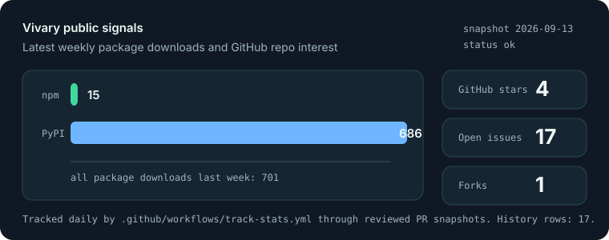

# Original Vivary CLI reference

This reference preserves the original command tools, package release history,
and workspace contracts. It does not describe a released desktop application.
Package versions and dated verification records below retain their original scope.
Run source commands from the repository root.

**Lightweight, local-first governed context for agent work.** Vivary gives agents
bounded evidence and task capsules, provenance and receipts, verification, one visible
state surface, and deliberate human gates. New workspaces start with five small files;
brownfield projects keep their own structure and receive at most three Vivary payload
files plus two bounded startup/privacy integrations.

A *vivary* is an archaic word for a vivarium: a self-contained world where living
things are kept, in stacked layers. That's the metaphor — your project lives
inside a small, well-formed world with a substrate, an atmosphere, and gates.

## Release status

The coordinated release train named **Vivary Governed Context** is **published and
verified**. A train is a release label, not a suite version: packages retain
independent semvers. The only numeric lockstep is the same scaffolder distributed as
`create-vivary` on PyPI and `@vivary/create` on npm. This policy resolves
[#149](https://github.com/vivary-dev/vivary-cli/issues/149); its lifecycle lives in the
[release workflow](RELEASE-WORKFLOW.md#train-and-version-lifecycle).

The table below preserves the package installation checks from **2026-08-15**.
The later registry availability check follows it.

| Surface | Published version | Link |
|---|---:|---|
| `vivary` (PyPI meta) | 0.1.10 | [PyPI](https://pypi.org/project/vivary/) |
| `create-vivary` (PyPI) | 0.4.2 | [PyPI](https://pypi.org/project/create-vivary/) |
| `@vivary/create` (npm) | 0.4.2 | [npm](https://www.npmjs.com/package/@vivary/create) |
| `vivary-core` | 0.2.7 | [PyPI](https://pypi.org/project/vivary-core/) |
| `vivary-tropo` | 0.5.3 | [PyPI](https://pypi.org/project/vivary-tropo/) |
| `vivary-strato` | 0.1.2 | [PyPI](https://pypi.org/project/vivary-strato/) |
| `vivary-ozone` | 0.3.1 | [PyPI](https://pypi.org/project/vivary-ozone/) |
| `vivary-exo` | 0.3.0 | [PyPI](https://pypi.org/project/vivary-exo/) |
| `vivary-memory-cognee` | 0.1.2 | [PyPI](https://pypi.org/project/vivary-memory-cognee/) |
| `vivary-mcp` (optional) | 0.1.3 | [PyPI](https://pypi.org/project/vivary-mcp/) |

Every version in the table is live on its registry and passed a cache-resistant
install smoke on 2026-08-15. The package manifests own role-to-Core floors. The
[meta-package manifest](../packages/vivary/pyproject.toml) owns its component floors,
including `create-vivary>=0.4.4`, `vivary-tropo>=0.5.5`, and `vivary-strato>=0.1.3`.
It receives Core transitively. `vivary-memory-cognee` and `vivary-mcp` ride the same
train as optional packages and are not meta-package dependencies.

Registry metadata checked on **2026-09-13** reports these later versions:

| Registry package | Available version |
| --- | ---: |
| PyPI `vivary` | 0.2.0 |
| PyPI `create-vivary` | 0.4.3 |
| PyPI `vivary-tropo` | 0.5.4 |
| PyPI `vivary-strato` | 0.1.3 |
| PyPI `vivary-ozone` | 0.3.2 |
| PyPI `vivary-exo` | 0.3.1 |
| npm `@vivary/create` | 0.4.2 |

On 2026-09-15, a metadata recheck confirmed create-vivary 0.4.3, vivary 0.2.0,
Tropo 0.5.4, and npm @vivary/create 0.4.2. The dated table above remains the
2026-09-13 snapshot. This is registry availability, not fresh installation verification. The inspected
Tropo 0.5.4 wheel lacks workspace-role metadata. npm 0.4.3 is absent, so the
previous Front Door train was not completely published across both registries.

Development source stages **Tropo 0.5.5**, **create-vivary and @vivary/create 0.4.4**,
and **vivary 0.2.1** for the workspace-role repairs. Those versions are unpublished.
The creator requires Tropo 0.5.5, and the meta-package requires the matching
creator and Tropo versions. Build the local wheel set to exercise this composition.
Registry installation does not provide these source-only repairs.

Development source also stages optional **vivary-mcp 0.1.4**, unpublished, with
the exact SDK pin `mcp==2.2.0`. The staged **create-vivary 0.4.4** includes Doctor's
matching check against the installed adapter's declared exact SDK pin. It recognizes
both published vivary-mcp 0.1.3 with `mcp==2.0.0` and staged 0.1.4 with
`mcp==2.2.0`, and reports mismatched or invalid declarations as incompatible.
This changes no registry artifact or desktop release status.

Registry metadata rechecked on **2026-10-18** still reports vivary-mcp 0.1.3,
create-vivary 0.4.3 on PyPI, and @vivary/create 0.4.2 on npm. vivary-mcp 0.1.4 and
both creator 0.4.4 artifacts are absent. These are availability checks, not new
installation verification; the dated registry tables remain unchanged.

[CHANGELOG.md](../CHANGELOG.md) records the train and the exact smokes that verified it,
without rewriting earlier independent-version history.
[Migration status](MIGRATION-STATUS.md) owns maturity classifications.
[Decisions](DECISIONS.md) routes the durable policy.

Users who need the previously published full-layout behavior can pin it explicitly:
`uvx --from create-vivary==0.3.1 create-vivary ...` or
`npx @vivary/create@0.3.1 ...`. That pin is the only supported route to the legacy
layout. Version 0.4.2 does not silently migrate or rewrite those legacy workspaces,
and Doctor keeps them read-compatible.

## Public Signals



Vivary tracks public npm, PyPI, and GitHub signals through reviewed daily PR
snapshots. The chart is generated from [`stats/latest.json`](../stats/latest.json) and
[`stats/history.csv`](../stats/history.csv); see [docs/SIGNALS.md](SIGNALS.md) for
sources and caveats.

`tropo` (typed knowledge graph + search + storage), `strato` (agent OS), `ozone`
(graph-aware review), and `exo` (coordination plus a bounded governed-control adapter)
are composed by `create-vivary`. See [docs/ARCHITECTURE.md](ARCHITECTURE.md) for
ownership and boundaries. [docs/COMMANDS.md](COMMANDS.md) owns the exact CLI
envelopes. [docs/WHITE-PAPER.md](WHITE-PAPER.md) holds the technical argument.
[docs/PORTFOLIO.md](PORTFOLIO.md) holds proof and case-study material.
[docs/MCP.md](MCP.md) owns the optional read-only MCP adapter contract. The
high-leverage backlog lives in [docs/PRODUCT-ROADMAP.md](PRODUCT-ROADMAP.md).

Current command surface:

- `vivary create` / `adopt` / `doctor` / `capabilities` / `check` / `find` / `decide` /
  `review` / `impact` / `control` from the `vivary` meta package, the front door that
  routes ten task verbs to the commands below. The standalone commands stay the
  advanced surface with every operation.
- `create-vivary init` / `doctor` / `wizard` / `capabilities` / `adopt` / `record` /
  `doctor --trend`
- `tropo check` / `graph` / `find` / `query` / `migrate` / `map` / `init --packs`
- `strato decide --governed`
- `ozone review` / `impact` / `verify --governed`
- `exo board` / `conflicts` / `claim` / `roles`, plus the opt-in
  `exo control REQUEST --governed`
- `vivary-cognee doctor` / `index` / `recall` / `forget` from the optional
  `vivary-memory-cognee` package
- `vivary-mcp --workspace ALIAS PATH` from the optional `vivary-mcp` package,
  which stays off by default

`vivary doctor --root PATH --public` prints `vivary.doctor-result/v0` with `ok`,
`errors`, and `warnings`, and names no path the user authored. Plain Doctor reads every
note its config does not exclude and names notes and module folders that Git may ignore.
The public path skips the note walk, leaving notes to `vivary check --public`, and counts
module folder problems without naming them. It exits 1 when Doctor reports errors and
never refuses a folder.

`vivary find QUERY --root PATH --public` and `vivary check --root PATH --public` read
through Tropo's privacy-filtered facade instead of the plain Tropo commands. They leave
out files that Git ignores, sensitive file names, and the private paths of a thin
Vivary workspace, and they need no `tropo.toml`. Neither command writes under the root,
and both always print JSON. The flag is part of the unpublished vivary 0.2.1 source.

`find` prints `vivary.find-result/v0` and `check` prints `vivary.check-result/v0`, and
each counts what it left out under `omissions`. `find` accepts `--k` from 1 to 20
(default 5) and `--budget` from 64 to 4000 (default 1200), refuses a query that starts
with `-`, and exits 0. `check` exits 1 when it reports errors. When the facade refuses the
request, both print `{"schema": "vivary.read-refusal/v0", "reason": "<reason>"}` and
exit 2. A usage error also exits 2, so read stdout to tell them apart.

A root that is neither a Git worktree nor a thin Vivary workspace gets
`privacy_policy_unavailable`. So does a Git worktree on a host where `git` is not on
`PATH`. `find` also returns `path_refused` for a question that contains a file or URL
path, credential-like text, a control character, or the root path, and a snippet the
facade cannot show safely is `null`. `vivary find --help` still prints Tropo's help,
and `vivary find --public --help` prints this path's options. No public path writes a
run receipt or accepts `--receipt`.

`vivary review --root PATH --public` and `vivary impact ID --root PATH --public`
build their graph only from the notes in Tropo's privacy-filtered snapshot, so
a private note never reaches a rule. Review runs the Structure or Editorial pack
(`--pack`, default `structure`). Context budget reads routing files from disk
and has no public form. Review prints `vivary.review-result/v0`, whose findings
carry a rule code, the note's id, type, and path, and no message. A
broken-edge finding adds its link field and leaves out the target, so a link
to a private note reads like a link to a missing id. Impact prints
`vivary.impact-result/v0` with each dependent's distance and linking field. A
private, missing, or unknown target gets `target_unavailable`. Both exit 0 on
success and print the read refusal with exit 2 otherwise. Ozone's declared
Tropo floor does not require the Tropo that adds `public_graph`.

For local debugging and bug reports, the core CLIs accept `--receipt PATH` or
`VIVARY_RECEIPT_LOG=PATH` to append a dependency-free JSONL run receipt. Receipts stay
local and do not capture stdout, stderr, file contents, raw query text, target ids, or
paths. Install the `vivary` meta package to inspect those logs with `vivary logs` or
build a local email draft with `vivary logs email`; Vivary never sends mail or telemetry
by itself.

## Quickstart

The five-file workflow below pins the command versions verified on 2026-08-15.
Newer registry availability is listed above. Unpinned commands can resolve those
newer packages and are not a replay of that dated verification. You need Python
3.11 or newer:

```bash
uvx --from create-vivary==0.4.2 create-vivary init my-workspace --preset coding --no-wizard
uvx --from create-vivary==0.4.2 create-vivary doctor my-workspace
uvx --from vivary-tropo==0.5.3 tropo check --root my-workspace
```

The npm launcher installs and runs the same PyPI scaffolder:

```bash
npx @vivary/create@0.4.2 my-workspace --preset coding
```

Pin 0.3.1 only when you deliberately want the previous full-layout behavior:

```bash
uvx --from create-vivary==0.3.1 create-vivary init my-workspace
npx @vivary/create@0.3.1 my-workspace
```

Default `init` writes exactly `AGENTS.md`, `STATE.md`, `.gitignore`,
`.vivary/context.md`, and `.vivary/workspace.toml`. The context file is the first typed
project node; real records under `.vivary/records/` appear only when work earns them.
Private material belongs under `.vivary/private/`, runtime state under
`.vivary/runtime/`, and both are ignored. Optional runtime projections are explicit and
bounded. `doctor` validates the thin contract, privacy, graph health, declared
capabilities, and interrupted adoption transactions.
`create-vivary record` is the matching bounded maintenance seam: it validates one
typed source plus the complete capsule envelope, verifies capsule integrity and the
current workspace binding, proposes one create or update without writing, and applies
only the exact human-approved plan hash. It reruns Doctor and rolls back on failure;
there is no batch, starter-pack, or automatic second-brain materialization mode.
`tropo find` returns small typed context packets for agents and humans to read first;
The opt-in `tropo find --governed` path is the first `vivary-core` adapter:
it turns one explicitly scoped, read-only workspace scan into a bounded, fingerprinted
Task Capsule whose claims carry evidence and selection reasons. It performs no fetch,
write, indexing, provider, or memory operation; plain `tropo find` is unchanged.
The opt-in `strato decide --governed` facade is the second adapter. It validates
one authority- and workspace-bound request, then exposes core's budget, capsule/receipt
gate, and next-loop decision as stable machine-readable output. It is advisory unless
`--strict` is set, persists nothing, and rejects free-form status text rather than
treating it as human approval.
`tropo query` provides filtered graph search, `tropo query --mode vector` adds
dependency-free local typed-vector search when `.vivary/storage.toml` explicitly
enables it, and `tropo migrate` handles backend switching. When local vector policy is
enabled, embedded migration stores graph-shaped vectors with source/embedding
fingerprints; `--mode vector` uses those stored rows when they are current and
falls back to deterministic typed text results when the embedded index is missing,
stale, or partial. `tropo query --mode semantic` can call an explicitly configured
optional semantic-memory provider while still returning typed Vivary node ids.

For workspaces that explicitly choose Cognee semantic memory, the optional
`vivary-memory-cognee` package adds `vivary-cognee doctor`, `index`, `recall`, and
`forget`. It indexes privacy-filtered typed Tropo node packets and only accepts recall
hits that map back to known Vivary node ids. It is not part of the default install and
provider writes require explicit approval. `tropo query --mode semantic --json` uses
that same optional provider bridge after the workspace has been configured and indexed.
Authored project facts are separate from that provider state. In a thin workspace,
Tropo types each Markdown file in `.vivary/knowledge/`, or in a folder the `memory`
role names, as a built-in `vivary_fact` note that requires `source` and `confirmed`.
`vivary-cognee forget` deletes only the provider state under `.vivary/memory/`. The
[Tropo specification](../packages/tropo/SPEC.md) owns the type rule.
The `vivary_core.recall` API is a separate provider-neutral firewall. It
classifies normalized candidates and projects caller-persisted recall transitions.
Create and supersede require a proposal-bound human approval. Core adds no provider,
store, network call, or default memory capability.

For users who only want local typed vector ranking, `--mode vector` stays inside the
typed graph, reports whether results came from stored or computed vectors, and falls
back to text search when no trustworthy local vector index is present.

For coding workspaces that need richer source retrieval, `--active-context
cocoindex-code` declares that optional capability in the same five-file seed. It adds
the private index path to policy, but does not copy guidance, install, index, enable
MCP, create starter graph records, or send source text anywhere. See
[docs/ACTIVE-CONTEXT.md](ACTIVE-CONTEXT.md) and the copyable
[LLM active-context guide](LLM-ACTIVE-CONTEXT.md).

<details><summary>Run from source (no install)</summary>

```bash
python packages/create-vivary/create_vivary.py init sandboxes/coding-demo --preset coding
python packages/create-vivary/create_vivary.py doctor sandboxes/coding-demo
python packages/tropo/tropo.py check --root sandboxes/coding-demo
python packages/tropo/tropo.py find "local ci baseline" --root sandboxes/coding-demo --json
python packages/tropo/tropo.py graph --root sandboxes/coding-demo --json
```

</details>

### Agent setup

Already working with Claude Code, Codex, Cursor, or another coding agent? Paste this
prompt and it handles setup — greenfield or brownfield — with your approval at every gate:

```text
Set up Vivary (https://vivary.vercel.app) in this project.

1. Read https://vivary.vercel.app/getting-started/ and https://vivary.vercel.app/commands/ before running anything.
2. You need Python 3.11+ and uv for these pinned commands. Tell me if something is missing before installing it.
3. If this folder already has content, this is an adoption: run `uvx --from create-vivary==0.4.2 create-vivary adopt . --json`, show me the exact creates, managed patches, privacy result, conflicts, and `plan_hash`, and apply only after I approve with `--yes --plan <plan_hash>`.
   If this folder is new or empty, it is a fresh workspace: ask me which preset fits (coding / second brain / knowledge work / writing), then run `uvx --from create-vivary==0.4.2 create-vivary init . --preset <choice>`.
4. Stop on any conflict. A successful apply must pass `uvx --from create-vivary==0.4.2 create-vivary doctor .` and `uvx --from vivary-tropo==0.5.3 tropo check --root .`; show me both results.
5. Read the generated AGENTS.md, then follow it for all future work here.
```

## The irreducible baseline

Every agent workspace, regardless of stack or task, needs the same small core:

> **Bounded evidence and task context, provenance and receipts, verification,
> one visible state surface, and human gates.**

Everything Vivary ships is a facet of that one sentence. The design law (inherited
from [throughline](https://github.com/Jeff-Kazzee/throughline)): *the framework
must cost almost nothing to load, or it steals the context the work needs.*

That means Vivary is deliberately DRY: `AGENTS.md` routes to one compact context
capsule, `STATE.md` is read only when current state matters, and typed records are
created lazily. Context management is valuable only when it keeps active context small.

**No lock-in.** A workspace is plain Markdown + YAML and a few CLIs — it works in any
editor, or none, and on any agent runtime. `AGENTS.md` is the default startup route;
`.agents` and `.claude` projections are explicit options. Obsidian, an IDE, and any
particular agent remain optional. The visual knowledge graph renders editor-free with
`tropo view`; configure Obsidian separately after thin initialization — see
[docs/OBSIDIAN.md](OBSIDIAN.md).

## Modules

Standalone Python packages (`vivary-*` on PyPI), plus the npm scaffolder
`@vivary/create`, composed by `create-vivary`:

| Package | Layer | Job | Source |
|---|---|---|---|
| **tropo** | troposphere — the living foundation | typed knowledge graph: what the workspace *knows* | loam ✓ |
| **strato** | stratosphere — the stable layer | agent OS: state surface, memory, the loop, gates, self-improvement | throughline + flywheel |
| **ozone** | the protective filter | review — graph-aware, code *and* editorial | new ✓ |
| **exo** | the outermost layer | coordination, plus a bounded caller-persisted control adapter | new ✓ |

`create vivary` → pick a preset (**coding · second brain · knowledge work · writing**) → it creates
the same five-file governed-context contract with preset-specific configuration. See
[Quickstart](#quickstart) above to install.

## Documentation

**Website: [vivary.vercel.app](https://vivary.vercel.app/)** — or browse the source in
[docs/](./):

- [Getting started](GETTING-STARTED.md) — install → workspace → loop
- [Guide library](LEARN-BY-DOING.md) — concise STE100 style procedures for people and agents
- [Command reference](COMMANDS.md) — every CLI, flag, and exit code
- [Advanced recipes](HOWTO.md) · [Agent skills](SKILLS.md) · [Homepage FAQ](https://vivary.vercel.app/#faq) · [White paper](WHITE-PAPER.md)
- [Active context](ACTIVE-CONTEXT.md) · [LLM active-context guide](LLM-ACTIVE-CONTEXT.md)
- [Architecture](ARCHITECTURE.md) · [Product roadmap](PRODUCT-ROADMAP.md) · [Semantic memory](SEMANTIC-MEMORY.md) · [Obsidian (optional)](OBSIDIAN.md)
- [Migration status](MIGRATION-STATUS.md) · [Decisions](DECISIONS.md)
- [Release workflow](RELEASE-WORKFLOW.md) — end-of-update release truth, docs/site sync, and publish checks
- [Portfolio proof](PORTFOLIO.md) — shipped surfaces, screenshots, and case-study notes

## The value-add (why this isn't another harness)

1. The substrate is a **typed, validated knowledge graph**, not flat memory.
2. Every change shows its **blast radius** — before and after — beyond a text diff.
3. It's **medium-agnostic**: the same graph + review serves code and prose.
4. It **standardizes the agent workspace** — which nobody has done.
5. **Agents can self-configure from scratch** — `--no-wizard --json` gives a
   zero-prompt, machine-readable five-file setup; optional installs remain separate gates.

## License

MIT — see [LICENSE](../LICENSE).
